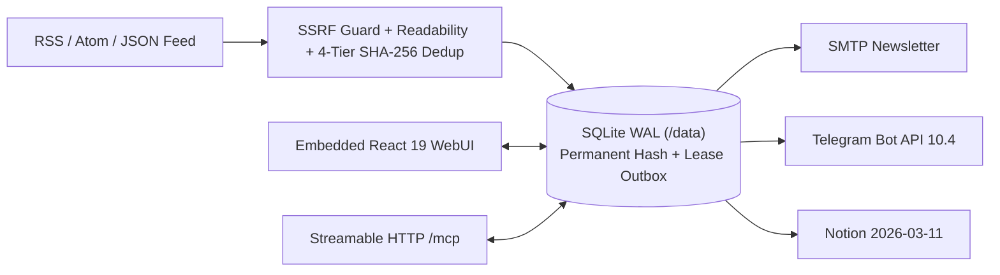

<div align="center">
  <picture>
    <source media="(prefers-color-scheme: dark)" srcset="./docs/public/logo-dark.svg">
    <source media="(prefers-color-scheme: light)" srcset="./docs/public/logo-light.svg">
    
  </picture>

  # FeedCourier

  Lightweight, single-binary pure-Rust **RSS / Atom / JSON Feed streaming delivery gateway** (`<20 MB` idle RSS, single SQLite WAL volume at `/data`) for SMTP, Telegram Bot API 10.4, and Notion `2026-03-11`, with an embedded React 19 WebUI and native Streamable HTTP `/mcp` server.

  [](https://github.com/ElleryHe/FeedCourier/actions/workflows/ci.yml)
  [](https://github.com/ElleryHe/FeedCourier/actions/workflows/release.yml)
  [](https://hub.docker.com/r/elleryhe/feedcourier)
  [](https://feedcourier.ellery.me)
  [](./LICENSE)
  [](https://www.rust-lang.org/)

  **English** | [简体中文](./README.zh-CN.md) | [Documentation](https://feedcourier.ellery.me)
</div>

---

## Key Features

- **Delivery Gateway, Not a Reader (Ephemeral Payloads)** — 4-tier anti-drift SHA-256 deduplication fingerprints persist permanently in SQLite, while sanitized HTML bodies and media metadata purge automatically via zero-refcount `NOT EXISTS` GC after `RETENTION_HOURS=24`. Anti-hotlink media relays stream in-memory without touching disk.
- **3 Curated Delivery Channels** — Real-time routing to **SMTP Newsletters** (`Force-From` SPF/DKIM/DMARC safety, inline-CSS reader template), **Telegram Bot API 10.4** (`sendRichMessage` via [`telegram-rich`](https://crates.io/crates/telegram-rich), Compact Card, and Media Mode with Local Bot API capability fallback), and **Notion (`2026-03-11`)** (auto-initialized 7-column Data Sources, Markdown v2 dynamic code-fence expansion, and `allow_async: true` long-form writes).
- **Lease-Based Outbox with Anti-Spam Pacing & `checkpoint_json` Crash Recovery** — Every matched article enqueues an isolated transactional task (`1 Task = 1 Entry × 1 Route`) drained with credential-shared **minimum interval + random jitter** and **hourly/daily quota guardrails**. Expired `lease_until` claims recover mid-flight crashes via `checkpoint_json` (`FC-ID` effective-once Notion reconciliation and checkpointed 10-item `sendMediaGroup` batches).
- **Connect-Time DNS SSRF Guard & Per-Resource Proxy** — Every outbound request validates resolved IPs before TCP connect, re-validates every `30x` redirect hop, supports fine-grained `SSRF_ALLOWLIST` CIDRs/hosts, enforces strict stream size caps with optional `dom_smoothie` Readability extraction, and allows selective HTTP / SOCKS5 `use_proxy` per feed and per channel.
- **Built-in Streamable HTTP `/mcp` Server & React 19 WebUI** — Manage feeds, routes, and dead letters through the embedded console or any MCP client (`readonly` / `admin` SHA-256 Bearer tokens) with ChaCha20-Poly1305 encrypted credentials, WebUI-locked recipients, and `<untrusted_feed_content>` prompt-injection framing.



---

## Quick Start

### Docker Run

```bash
docker run -d \
  --name feedcourier \
  --restart unless-stopped \
  -p 8080:8080 \
  -v "$(pwd)/data:/data" \
  elleryhe/feedcourier:latest
  # Or pin an exact release: elleryhe/feedcourier:0.1.0
```

### Docker Compose

```yaml
services:
  feedcourier:
    image: elleryhe/feedcourier:latest # or elleryhe/feedcourier:0.1.0
    container_name: feedcourier
    restart: unless-stopped
    ports:
      - "8080:8080"
    volumes:
      - ./data:/data
    environment:
      DATA_DIR: /data
      LISTEN_ADDR: 0.0.0.0:8080
      RETENTION_HOURS: "24"
```

Open `http://127.0.0.1:8080` to initialize your administrator password. For **Prebuilt Binaries (`Linux` / `macOS`) & Building from Source**, see the [Quick Start Guide](https://feedcourier.ellery.me/guide/quick-start).

---

## Documentation

Full bilingual documentation is hosted at **[feedcourier.ellery.me](https://feedcourier.ellery.me)**:

| Section | Core Topics |
| :--- | :--- |
| **1. Guide & Operations** | [Introduction & Design Principles](https://feedcourier.ellery.me/guide/introduction) · [Quick Start (Docker / Binary / Source)](https://feedcourier.ellery.me/guide/quick-start) · [Configuration & Proxy / SSRF](https://feedcourier.ellery.me/guide/configuration) · [Operations & Hot Backup](https://feedcourier.ellery.me/guide/operations) |
| **2. Delivery Channels** | [Pacing & Quota Guardrails](https://feedcourier.ellery.me/channels/pacing-and-quotas) · [Telegram Bot API 10.4](https://feedcourier.ellery.me/channels/telegram) · [Notion (`2026-03-11`)](https://feedcourier.ellery.me/channels/notion) · [SMTP Newsletters](https://feedcourier.ellery.me/channels/smtp) |
| **3. Native MCP (`/mcp`)** | [Client Setup & Bearer Tokens](https://feedcourier.ellery.me/mcp/setup) · [7 MCP Tools Reference](https://feedcourier.ellery.me/mcp/tools) · [Security & Trust Boundaries](https://feedcourier.ellery.me/mcp/security) |
| **4. Reference** | [System Architecture](https://feedcourier.ellery.me/reference/architecture) · [SQLite Database Schema](https://feedcourier.ellery.me/reference/database-schema) · [REST API (`/api/v1/*`)](https://feedcourier.ellery.me/reference/rest-api) · [Releasing & CI/CD](https://feedcourier.ellery.me/reference/releasing) |

---

## License & Compliance

[AGPL-3.0](./LICENSE)

Deploying and using FeedCourier must comply with the Telegram Terms of Service ([Telegram Bot Developer Terms](https://telegram.org/tos/bot-developers)), Notion Terms of Service ([Notion Developer Terms](https://developers.notion.com/)), SMTP anti-spam policies, and upstream crawling and content terms. Do not use this software for spam, API abuse, or unauthorized content redistribution.
