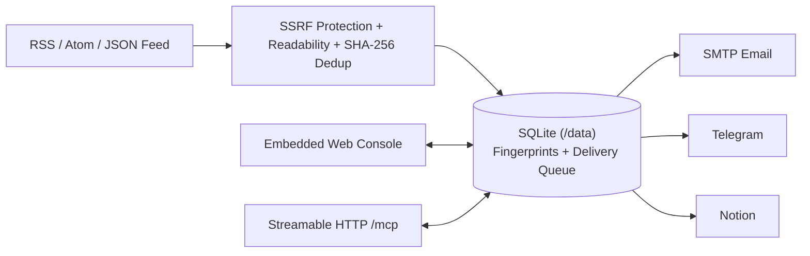

<div align="center">
  <picture>
    <source media="(prefers-color-scheme: dark)" srcset="./docs/public/logo-dark.svg">
    <source media="(prefers-color-scheme: light)" srcset="./docs/public/logo-light.svg">
    
  </picture>

  # FeedCourier

  An **RSS / Atom / JSON Feed subscription delivery service** built with Rust, SQLite, and React. It polls feeds, extracts full text when needed, filters articles by route rules, and delivers them to Email via SMTP, Telegram, and Notion, with an embedded web console and an `/mcp` endpoint for AI clients.

  [](https://github.com/ElleryHe/FeedCourier/actions/workflows/ci.yml)
  [](https://github.com/ElleryHe/FeedCourier/actions/workflows/release.yml)
  [](https://hub.docker.com/r/elleryhe/feedcourier)
  [](https://feedcourier.ellery.me)
  [](./LICENSE)
  [](https://www.rust-lang.org/)

  **English** | [简体中文](./README.zh-CN.md) | [Documentation](https://feedcourier.ellery.me)
</div>

---

## Key Features

- **Article Deduplication & Automatic Cleanup** — Stores SHA-256 article fingerprints in SQLite to prevent duplicate deliveries while automatically cleaning up sanitized HTML bodies and media metadata after the retention window (24 hours by default). Anti-hotlink media is relayed in memory.
- **Multi-Channel Delivery (SMTP Email / Telegram / Notion)** — Delivers matched articles to **SMTP Email** (inline-CSS email template with `Force-From` sender alignment), **Telegram** (Rich Message, Compact Card, and Media delivery modes, with Local Bot API support), and **Notion** (automatic data source property initialization, Markdown conversion, and asynchronous long-page creation).
- **Rate Pacing & Crash Recovery** — Enqueues an independent delivery task for each matched article and route (`1 Task = 1 Entry × 1 Route`), supporting credential-shared minimum intervals, random jitter, and hourly/daily quotas, with task lease recovery across restarts.
- **Connect-Time DNS SSRF Protection & Per-Resource Proxy** — Validates resolved IPs before TCP connection and re-validates every `30x` redirect hop; supports CIDR/host allowlists, response size caps, optional Readability full-text extraction, and per-feed or per-channel HTTP / SOCKS5 proxy routing.
- **Embedded Web Console & `/mcp` Endpoint** — Ships the React management console and a Streamable HTTP `/mcp` server in a single binary, supporting `readonly` and `admin` Bearer tokens, encrypted channel credentials, and WebUI-managed delivery destinations.



---

## Quick Start

### Docker Run

```bash
docker run -d \
  --name feedcourier \
  --restart unless-stopped \
  -p 8080:8080 \
  -v "$(pwd)/data:/data" \
  elleryhe/feedcourier:latest
  # Or pin an exact release: elleryhe/feedcourier:0.1.1
```

### Docker Compose

```yaml
services:
  feedcourier:
    image: elleryhe/feedcourier:latest # or elleryhe/feedcourier:0.1.1
    container_name: feedcourier
    restart: unless-stopped
    ports:
      - "8080:8080"
    volumes:
      - ./data:/data
    environment:
      DATA_DIR: /data
      LISTEN_ADDR: 0.0.0.0:8080
      RETENTION_HOURS: "24"
```

Open `http://127.0.0.1:8080` to initialize your administrator password. For **Prebuilt Binaries (`Linux` / `macOS`) & Building from Source**, see the [Quick Start Guide](https://feedcourier.ellery.me/guide/quick-start).

---

## Documentation

Full bilingual documentation is hosted at **[feedcourier.ellery.me](https://feedcourier.ellery.me)**:

| Manual | Section | Core Topics |
| :--- | :--- | :--- |
| **User Guide** | **Getting Started** | [Project Overview](https://feedcourier.ellery.me/guide/introduction) · [Quick Start](https://feedcourier.ellery.me/guide/quick-start) · [Configuration & Proxy](https://feedcourier.ellery.me/guide/configuration) · [Backup & Maintenance](https://feedcourier.ellery.me/guide/operations) |
| **User Guide** | **Delivery Channels** | [Send Rate, Quotas & Filters](https://feedcourier.ellery.me/channels/pacing-and-quotas) · [SMTP Email](https://feedcourier.ellery.me/channels/smtp) · [Telegram](https://feedcourier.ellery.me/channels/telegram) · [Notion](https://feedcourier.ellery.me/channels/notion) |
| **User Guide** | **MCP Integration** | [Client Setup & Security](https://feedcourier.ellery.me/mcp/setup) · [Tools Overview](https://feedcourier.ellery.me/mcp/tools) |
| **Architecture Manual** | **Architecture & Development** | [System Architecture](https://feedcourier.ellery.me/reference/architecture) · [Channel Protocols & Delivery](https://feedcourier.ellery.me/reference/channel-protocols) · [Security & Isolation](https://feedcourier.ellery.me/reference/security) · [Database Schema](https://feedcourier.ellery.me/reference/database-schema) · [REST API](https://feedcourier.ellery.me/reference/rest-api) · [Build & Release Pipeline](https://feedcourier.ellery.me/reference/releasing) |

---

## License & Compliance

[AGPL-3.0](./LICENSE)

Deploying and using FeedCourier must comply with the Telegram Terms of Service ([Telegram Bot Developer Terms](https://telegram.org/tos/bot-developers)), Notion Terms of Service ([Notion Developer Terms](https://developers.notion.com/)), SMTP anti-spam policies, and upstream crawling and content terms. Do not use this software for spam, API abuse, or unauthorized content redistribution.
