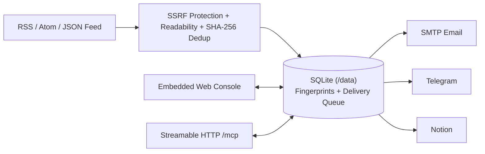

<div align="center">
  <picture>
    <source media="(prefers-color-scheme: dark)" srcset="./docs/public/logo-dark.svg">
    <source media="(prefers-color-scheme: light)" srcset="./docs/public/logo-light.svg">
    
  </picture>

  # FeedCourier

  An **RSS / Atom / JSON Feed subscription delivery service** built with Rust, SQLite, and React. It polls feeds, extracts full text when needed, filters articles by route rules, and delivers them to Email via SMTP, Telegram, and Notion, with an embedded web console and an `/mcp` endpoint for AI clients.

  [](https://github.com/ElleryHe/FeedCourier/actions/workflows/ci.yml)
  [](https://github.com/ElleryHe/FeedCourier/releases/latest)
  [](https://hub.docker.com/r/elleryhe/feedcourier)
  [](./LICENSE)

  **English** | [简体中文](./README.zh-CN.md) | [Documentation](https://feedcourier.ellery.me) | [Release RSS](https://feedcourier.ellery.me/feed.xml)
</div>

---

## Key Features

- **Article Deduplication & Automatic Cleanup** — Stores SHA-256 article fingerprints in SQLite to prevent duplicate deliveries while automatically cleaning up sanitized HTML bodies and media metadata after the retention window (24 hours by default). Anti-hotlink media is relayed in memory.
- **Built-In Plugin Framework & YOURLS Link Rewrite** — Extensible Protocol v1 (`api_version: "1"`) delivery-time `on_render` hook chain with a built-in **Link Rewrite (YOURLS)** plugin (encrypted multi-provider instances, `signature`/`timed_signature`/`password` auth, 90-day SQLite short-link cache, domain exclusions, strict retry mode, media preservation) and live marketplace catalog powered by [`ElleryHe/FeedCourier-Plugins`](https://github.com/ElleryHe/FeedCourier-Plugins).
- **Multi-Channel Accounts, Destinations & SMTP Compliance (SMTP / Telegram / Notion)** — Organizes delivery into **Channel Accounts** (credentials, proxy, pacing, quotas) with multiple **Destinations** per account: **SMTP Email** (per-recipient sending, manual-trigger double opt-in verification, RFC 8058 one-click unsubscribe `/u/{token}`, CAN-SPAM `sender_identity` footer, synchronous 5xx hard-bounce handling, responsive Outlook-safe templates, `Force-From`), **Telegram** (Rich Message via `telegram-rich 0.0.2` with native footers and image collages, Compact Card, and Media Mode, with Local Bot API support), and **Notion** (8-column database auto-init with optional `Short URL`, automatic `404` `data_source_id` writeback, Markdown v2 conversion, and asynchronous long-page creation).
- **Rate Pacing, Per-Route Timezones & Crash Recovery** — Enqueues an independent task per matched article and route (`1 Task = 1 Entry × 1 Route`), sharing minimum intervals, per-delivery random jitter, hourly/daily quotas, and `429` cooldowns across all destinations of an account, with lease recovery across restarts. Routes support their own delivery language, IANA timezone override (governing delivery windows and localized article timestamps), weekdays, and plugin bindings; the global queue can be paused or scheduled to resume, delivering backlogs chronologically.
- **Connect-Time DNS SSRF Protection & Per-Resource Proxy** — Validates resolved IPs before TCP connection and re-validates every `30x` redirect hop across feeds, Telegram Bot API, plugins, and marketplace fetches; supports `SSRF_ALLOWLIST`, response size caps, optional Readability full-text extraction, and per-feed/account/provider HTTP / SOCKS5 proxy routing.
- **Embedded Web Console & `/mcp` Endpoint** — Ships the React management console (with Plugins & Marketplace, SMTP recipient verification management, Feeds tag filtering/sorting/pagination, cascading Routes filters, and semantic Outbox status colors) and a Streamable HTTP `/mcp` server in a single binary, supporting `readonly` and `admin` Bearer tokens, encrypted credentials & destinations, username/password + optional TOTP 2FA, and **10 MCP tools** (including secret-free `list_plugins` and redacted destination discovery).



---

## Quick Start

### Docker Run

```bash
docker run -d \
  --name feedcourier \
  --restart unless-stopped \
  -p 8080:8080 \
  -v "$(pwd)/data:/data" \
  -e TZ=America/Los_Angeles \
  elleryhe/feedcourier:latest
  # Or pin an exact release: elleryhe/feedcourier:0.3.1
```

### Docker Compose

```yaml
services:
  feedcourier:
    image: elleryhe/feedcourier:latest # or elleryhe/feedcourier:0.3.1
    container_name: feedcourier
    restart: unless-stopped
    ports:
      - "8080:8080"
    volumes:
      - ./data:/data
    environment:
      DATA_DIR: /data
      LISTEN_ADDR: 0.0.0.0:8080
      RETENTION_HOURS: "24"
      TZ: America/Los_Angeles # system timezone for route delivery time windows
```

Open `http://127.0.0.1:8080` to create your administrator account (username defaults to `Courier`; optional TOTP 2FA is available under **Settings**). Set `ADMIN_USERNAME`, `ADMIN_PASSWORD`, or `RESET_2FA=true` to manage or recover access; see [Configuration](https://feedcourier.ellery.me/guide/configuration). For **Prebuilt Binaries (`Linux` / `macOS`) & Building from Source**, see the [Quick Start Guide](https://feedcourier.ellery.me/guide/quick-start).

---

## Documentation

Full bilingual documentation is hosted at **[feedcourier.ellery.me](https://feedcourier.ellery.me)**:

| Manual | Section | Core Topics |
| :--- | :--- | :--- |
| **User Guide** | **Getting Started** | [Project Overview](https://feedcourier.ellery.me/guide/introduction) · [Quick Start](https://feedcourier.ellery.me/guide/quick-start) · [Configuration & Proxy](https://feedcourier.ellery.me/guide/configuration) · [Backup & Maintenance](https://feedcourier.ellery.me/guide/operations) |
| **User Guide** | **Delivery Channels** | [Send Rate, Quotas, Windows & Filters](https://feedcourier.ellery.me/channels/pacing-and-quotas) · [SMTP Email](https://feedcourier.ellery.me/channels/smtp) · [Telegram](https://feedcourier.ellery.me/channels/telegram) · [Notion](https://feedcourier.ellery.me/channels/notion) |
| **User Guide** | **Plugins** | [Overview & Marketplace](https://feedcourier.ellery.me/plugins/) · [Link Rewrite (YOURLS)](https://feedcourier.ellery.me/plugins/link-rewrite) · [Plugin Development](https://feedcourier.ellery.me/plugins/development) |
| **User Guide** | **MCP Integration** | [Client Setup & Security](https://feedcourier.ellery.me/mcp/setup) · [Tools Overview](https://feedcourier.ellery.me/mcp/tools) |
| **Architecture Manual** | **Architecture & Development** | [System Architecture](https://feedcourier.ellery.me/reference/architecture) · [Channel Protocols & Delivery](https://feedcourier.ellery.me/reference/channel-protocols) · [Security & Isolation](https://feedcourier.ellery.me/reference/security) · [Database Schema](https://feedcourier.ellery.me/reference/database-schema) · [REST API](https://feedcourier.ellery.me/reference/rest-api) · [Build & Release Pipeline](https://feedcourier.ellery.me/reference/releasing) |

---

## License & Compliance

[AGPL-3.0](./LICENSE)

Deploying and using FeedCourier must comply with the Telegram Terms of Service ([Telegram Bot Developer Terms](https://telegram.org/tos/bot-developers)), Notion Terms of Service ([Notion Developer Terms](https://developers.notion.com/)), SMTP anti-spam policies, and upstream crawling and content terms. Do not use this software for spam, API abuse, or unauthorized content redistribution.
