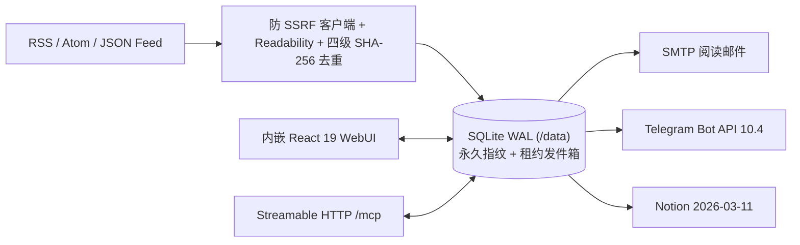

<div align="center">
  <picture>
    <source media="(prefers-color-scheme: dark)" srcset="./docs/public/logo-dark.svg">
    <source media="(prefers-color-scheme: light)" srcset="./docs/public/logo-light.svg">
    
  </picture>

  # FeedCourier

  面向个人与极客小团队的纯血 Rust 单二进制 **RSS / Atom / JSON Feed 流式订阅投递网关**（空闲内存 `<20 MB`，仅需单一 `/data` SQLite WAL 数据卷），实时桥接 SMTP 邮件、Telegram Bot API 10.4 与 Notion `2026-03-11`，原生内嵌 React 19 管理面板与 Streamable HTTP `/mcp` 服务端。

  [](https://github.com/ElleryHe/FeedCourier/actions/workflows/ci.yml)
  [](https://github.com/ElleryHe/FeedCourier/actions/workflows/release.yml)
  [](https://hub.docker.com/r/elleryhe/feedcourier)
  [](https://feedcourier.ellery.me/zh/)
  [](./LICENSE)
  [](https://www.rust-lang.org/)

  [English](./README.md) | **简体中文** | [官方文档](https://feedcourier.ellery.me/zh/)
</div>

---

## 核心特性

- **做投递网关，不做阅读器（正文阅后即焚）** —— 四级防漂移 SHA-256 指纹在 SQLite 中永久留存防重，清洗后的 HTML 正文与媒体元数据在 `RETENTION_HOURS=24` 闭环后由零引用计数 `NOT EXISTS` GC 自动回收；防盗链媒体全程内存流式中转、绝不落盘。
- **三大精选推送通道** —— 实时投递至 **SMTP 精品阅读邮件**（`Force-From` 保障 SPF/DKIM/DMARC、响应式内联 CSS 信纸）、**Telegram Bot API 10.4**（基于 [`telegram-rich`](https://crates.io/crates/telegram-rich) 的 `sendRichMessage` 富文档、快讯模式、媒体模式及自建 Local Bot API 自动降级）与 **Notion（`2026-03-11`）**（自动初始化 7 列标准数据源、Markdown v2 动态反引号扩充、`allow_async: true` 异步长文写入）。
- **租约制发件箱、防风控匀速控速与 `checkpoint_json` 崩溃恢复** —— 按 `1 Task = 1 Entry × 1 Route` 独立入队，支持同凭据共享的**最小间隔 + 随机抖动**与**小时/日配额护栏**；基于 `lease_until` 租约与 `checkpoint_json` 断点对账实现 Notion `FC-ID` 有效一次（Effective-once）投递与 Telegram 10 项媒体组分批续发。
- **连接层 DNS 防 SSRF 与按源/按通道分流代理** —— 出站请求在 TCP 建连前校验解析 IP 并逐跳重验 `30x` 重定向，支持 `SSRF_ALLOWLIST` 精细放行内网服务、流式体积硬上限与按需 `dom_smoothie` Readability 全文提取，以及按源/按通道独立启用 HTTP / SOCKS5 代理。
- **原生内嵌 Streamable HTTP `/mcp` 与 React 19 WebUI** —— 共享同一业务内核，支持签发 `readonly` / `admin` SHA-256 Bearer 令牌；通道密钥以 ChaCha20-Poly1305 加密黑盒存储、收件终点独占锁死在 WebUI，并对外部订阅内容实施 `<untrusted_feed_content>` 防提示词注入隔离。



---

## 快速开始

### Docker Run

```bash
docker run -d \
  --name feedcourier \
  --restart unless-stopped \
  -p 8080:8080 \
  -v "$(pwd)/data:/data" \
  elleryhe/feedcourier:latest
  # 或锁定精确版本：elleryhe/feedcourier:0.1.1
```

### Docker Compose

```yaml
services:
  feedcourier:
    image: elleryhe/feedcourier:latest # 或 elleryhe/feedcourier:0.1.1
    container_name: feedcourier
    restart: unless-stopped
    ports:
      - "8080:8080"
    volumes:
      - ./data:/data
    environment:
      DATA_DIR: /data
      LISTEN_ADDR: 0.0.0.0:8080
      RETENTION_HOURS: "24"
```

启动后访问 `http://127.0.0.1:8080` 初始化管理员密码。如需使用**四平台预编译二进制包或从源码构建**，请参阅 [快速开始指南](https://feedcourier.ellery.me/zh/guide/quick-start)。

---

## 文档导航

完整中英双语文档托管于 **[feedcourier.ellery.me/zh/](https://feedcourier.ellery.me/zh/)**：

| 章节板块 | 核心文档直链 |
| :--- | :--- |
| **1. 快速开始与运维** | [项目介绍与设计边界](https://feedcourier.ellery.me/zh/guide/introduction) · [快速开始（Docker / 二进制 / 源码）](https://feedcourier.ellery.me/zh/guide/quick-start) · [环境变量与代理 / SSRF 配置](https://feedcourier.ellery.me/zh/guide/configuration) · [数据卷运维与在线热备](https://feedcourier.ellery.me/zh/guide/operations) |
| **2. 三大推送通道** | [匀速步进与配额护栏](https://feedcourier.ellery.me/zh/channels/pacing-and-quotas) · [Telegram Bot API 10.4](https://feedcourier.ellery.me/zh/channels/telegram) · [Notion（`2026-03-11`）](https://feedcourier.ellery.me/zh/channels/notion) · [SMTP 阅读邮件](https://feedcourier.ellery.me/zh/channels/smtp) |
| **3. MCP 智能接入** | [客户端接入与令牌管理](https://feedcourier.ellery.me/zh/mcp/setup) · [7 个 MCP 工具手册](https://feedcourier.ellery.me/zh/mcp/tools) · [纵深安全与信任边界](https://feedcourier.ellery.me/zh/mcp/security) |
| **4. 架构与参考手册** | [核心系统架构](https://feedcourier.ellery.me/zh/reference/architecture) · [SQLite 数据库表结构](https://feedcourier.ellery.me/zh/reference/database-schema) · [REST API（`/api/v1/*`）](https://feedcourier.ellery.me/zh/reference/rest-api) · [自动化发布流水线](https://feedcourier.ellery.me/zh/reference/releasing) |

---

## 开源协议与合规声明

[AGPL-3.0](./LICENSE)

部署与使用 FeedCourier 须遵守 Telegram 服务条款（[Telegram Bot Developer Terms](https://telegram.org/tos/bot-developers)）、Notion 服务条款（[Notion Developer Terms](https://developers.notion.com/)）、SMTP 反垃圾邮件策略以及上游站点的抓取与内容版权规范；请勿将本软件用于垃圾信息发送、API 滥用或未经授权的内容分发。
