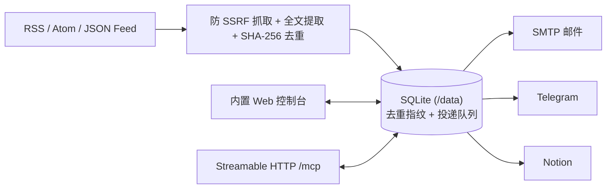

<div align="center">
  <picture>
    <source media="(prefers-color-scheme: dark)" srcset="./docs/public/logo-dark.svg">
    <source media="(prefers-color-scheme: light)" srcset="./docs/public/logo-light.svg">
    
  </picture>

  # FeedCourier

  基于 Rust、SQLite 与 React 构建的 **RSS / Atom / JSON Feed 订阅投递服务**。定时抓取订阅源，按需提取全文并去重过滤，将文章投递至 SMTP 邮件、Telegram 与 Notion，内置 Web 管理控制台与 `/mcp` 服务端。

  [](https://github.com/ElleryHe/FeedCourier/actions/workflows/ci.yml)
  [](https://github.com/ElleryHe/FeedCourier/releases/latest)
  [](https://hub.docker.com/r/elleryhe/feedcourier)
  [](./LICENSE)

  [English](./README.md) | **简体中文** | [官方文档](https://feedcourier.ellery.me/zh/) | [更新订阅 RSS](https://feedcourier.ellery.me/feed.xml)
</div>

---

## 功能特点

- **文章去重与定期清理** —— 在 SQLite 中长期保留文章 SHA-256 指纹以避免重复投递；已投递的 HTML 正文与媒体元数据在保留期（默认 24 小时）过后自动清理，防盗链媒体通过内存流式转发。
- **内置插件框架与 YOURLS 链接替换** —— 基于 Protocol v1（`api_version: "1"`）的投递期 `on_render` 钩子体系，内置首个第一方插件 **链接替换 (YOURLS)**（支持多服务商加密存储、`signature`/`timed_signature`/`password` 鉴权、90 天 SQLite 短链缓存、域名排除、严格重试模式与媒体保留），并接入官方市场仓库 [`ElleryHe/FeedCourier-Plugins`](https://github.com/ElleryHe/FeedCourier-Plugins)。
- **双层投递通道与 SMTP 合规（SMTP / Telegram / Notion）** —— 采用**通道账号**挂载多个**目的地**的结构：**SMTP 邮件**（逐收件人发送、手动触发双重确认验证、RFC 8058 一键退订 `/u/{token}`、CAN-SPAM `sender_identity` 页脚、同步 5xx 硬退信保护、响应式防撑宽模板与 `Force-From`）、**Telegram**（基于 `telegram-rich 0.0.2` 的富文本排版与连图拼贴/幻灯片、摘要卡片与媒体模式，兼容 Local Bot API）以及 **Notion**（一键初始化含可选 `Short URL` 的 8 列标准表结构、`404` 自动写回 `data_source_id`、Markdown v2 转换与长文异步写入）。
- **发送速率控制、路由级时区与断点恢复** —— 每篇文章与路由独立入队（`1 Task = 1 Entry × 1 Route`），同一账号下的所有目的地自动共享最小间隔、逐条独立随机抖动、小时/日配额与 `429` 冷却，进程重启后支持任务租约回收与进度恢复。每条路由支持独立投递语言、IANA 时区覆盖、星期限制与插件绑定；全局队列支持暂停与定时恢复，历史积压与多源统一按时间顺序投递。
- **连接层防 SSRF 与按源/按通道/按插件代理** —— 订阅源抓取、Telegram Bot API、插件出站调用与市场索引拉取均在建立连接前校验解析 IP 并逐跳检查 `30x` 重定向；支持 `SSRF_ALLOWLIST`、响应体积上限、按需 Readability 全文提取以及独立 HTTP / SOCKS5 代理开关。
- **内置 Web 控制台与 `/mcp` 接口** —— 单一可执行文件内置 React 管理界面（含插件与市场、SMTP 收件人验证管理、订阅源标签筛选/排序记忆/分页、路由级联筛选与发件箱语义配色）与 Streamable HTTP `/mcp` 端点，支持 `readonly` / `admin` 令牌、凭据与目的地分级加密、用户名 + 密码及可选 TOTP 两步验证；MCP 提供 **10 个工具**（含零凭据 `list_plugins` 与脱敏目的地发现）。



---

## 快速开始

### Docker Run

```bash
docker run -d \
  --name feedcourier \
  --restart unless-stopped \
  -p 8080:8080 \
  -v "$(pwd)/data:/data" \
  -e TZ=Asia/Shanghai \
  elleryhe/feedcourier:latest
  # 或锁定精确版本：elleryhe/feedcourier:0.3.0
```

### Docker Compose

```yaml
services:
  feedcourier:
    image: elleryhe/feedcourier:latest # 或锁定版本 elleryhe/feedcourier:0.3.0
    container_name: feedcourier
    restart: unless-stopped
    ports:
      - "8080:8080"
    volumes:
      - ./data:/data
    environment:
      DATA_DIR: /data
      LISTEN_ADDR: 0.0.0.0:8080
      RETENTION_HOURS: "24"
      TZ: Asia/Shanghai # 系统时区，用于路由投递时间窗口
```

启动后访问 `http://127.0.0.1:8080` 创建管理员账号（用户名默认 `Courier`；可在**设置**中启用 TOTP 两步验证）。可通过 `ADMIN_USERNAME`、`ADMIN_PASSWORD` 或 `RESET_2FA=true` 管理或找回访问权限，详见[配置说明](https://feedcourier.ellery.me/zh/guide/configuration)。如需使用**预编译二进制包或从源码构建**，请参阅 [快速开始指南](https://feedcourier.ellery.me/zh/guide/quick-start)。

---

## 文档导航

完整中英双语文档托管于 **[feedcourier.ellery.me/zh/](https://feedcourier.ellery.me/zh/)**：

| 手册分类 | 章节板块 | 文档直链 |
| :--- | :--- | :--- |
| **使用手册** | **入门与部署** | [项目简介](https://feedcourier.ellery.me/zh/guide/introduction) · [快速开始](https://feedcourier.ellery.me/zh/guide/quick-start) · [环境配置与代理](https://feedcourier.ellery.me/zh/guide/configuration) · [数据备份与维护](https://feedcourier.ellery.me/zh/guide/operations) |
| **使用手册** | **推送通道设置** | [发送频率、配额、时间窗口与过滤](https://feedcourier.ellery.me/zh/channels/pacing-and-quotas) · [SMTP 邮件](https://feedcourier.ellery.me/zh/channels/smtp) · [Telegram](https://feedcourier.ellery.me/zh/channels/telegram) · [Notion](https://feedcourier.ellery.me/zh/channels/notion) |
| **使用手册** | **插件** | [插件概览与市场](https://feedcourier.ellery.me/zh/plugins/) · [链接替换 (YOURLS)](https://feedcourier.ellery.me/zh/plugins/link-rewrite) · [插件开发手册](https://feedcourier.ellery.me/zh/plugins/development) |
| **使用手册** | **MCP 接入** | [客户端接入与安全说明](https://feedcourier.ellery.me/zh/mcp/setup) · [工具说明](https://feedcourier.ellery.me/zh/mcp/tools) |
| **架构手册** | **架构与开发手册** | [系统架构总览](https://feedcourier.ellery.me/zh/reference/architecture) · [通道协议与投递实现](https://feedcourier.ellery.me/zh/reference/channel-protocols) · [安全与防注入机制](https://feedcourier.ellery.me/zh/reference/security) · [数据库表结构](https://feedcourier.ellery.me/zh/reference/database-schema) · [REST API 接口](https://feedcourier.ellery.me/zh/reference/rest-api) · [构建与发布流程](https://feedcourier.ellery.me/zh/reference/releasing) |

---

## 开源协议与合规声明

[AGPL-3.0](./LICENSE)

部署与使用 FeedCourier 须遵守 Telegram 服务条款（[Telegram Bot Developer Terms](https://telegram.org/tos/bot-developers)）、Notion 服务条款（[Notion Developer Terms](https://developers.notion.com/)）、SMTP 反垃圾邮件策略以及上游站点的抓取与内容版权规范；请勿将本软件用于垃圾信息发送、API 滥用或未经授权的内容分发。
