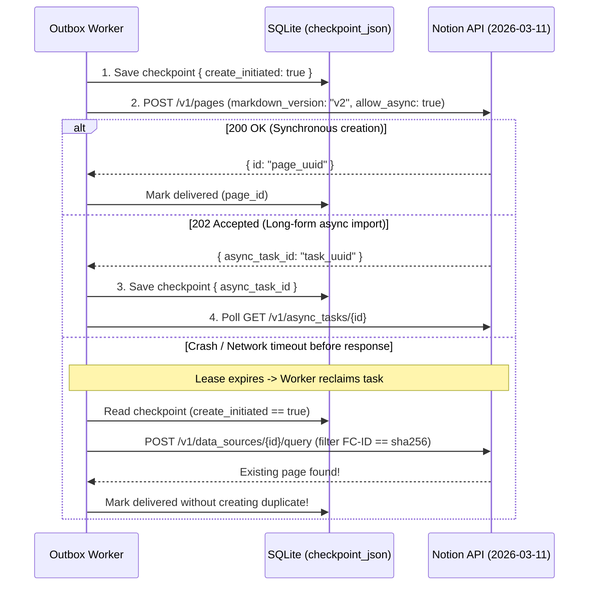

# Notion Channel (`2026-03-11` & Markdown v2)

FeedCourier's Notion adapter (`src/channels/notion.rs`) is built natively against **`Notion-Version: 2026-03-11`**, adopting Notion's `data_source_id` architecture, `initial_data_source.properties` provisioning, `in_trash` lifecycle field, Markdown v2 native page ingestion, `allow_async` long-form imports, and **`FC-ID` effective-once deduplication**.

---

## Two Onboarding Flows

When configuring a Notion channel in the WebUI (**Channels → New Channel → Notion**), you can either let FeedCourier provision a ready-to-use 7-column database or bind an existing Notion data source.

### Option A: Zero-Friction Auto-Provisioning (`POST /api/v1/channels/notion/init-db`)

Provide your **Notion Internal Integration Secret** (`ntn_...` or `secret_...`) and the **Parent Page ID or URL** you shared with the integration.

FeedCourier calls `POST /v1/databases` with `Notion-Version: 2026-03-11`, declaring all 7 standard columns inside `initial_data_source.properties` and binding the returned `data_source_id`:

| Standard Column | Notion Property Type | Purpose |
| :--- | :--- | :--- |
| **`Title`** | `title` *(Required)* | Article title. |
| **`FC-ID`** | `rich_text` *(Required)* | Stores the entry's 64-char SHA-256 fingerprint for **effective-once** reconciliation. |
| **`Link`** | `url` *(Optional)* | Canonical article permalink. |
| **`Source`** | `select` *(Optional)* | Feed title. |
| **`Published`** | `date` *(Optional)* | Original ISO-8601 publication timestamp. |
| **`State`** | `select` *(Optional)* | Pre-configured with `UnRead` (red) and `Read` (green); new entries initialize to `UnRead`. |
| **`Tag`** | `multi_select` *(Optional)* | Automatically synced from the feed's `tags` array. |

### Option B: Bind & Inspect an Existing Data Source (`POST /api/v1/channels/notion/inspect-schema`)

Already have a reading database in Notion? Paste its **`data_source_id`** or **Database URL**:

1. **Automatic Resolution**: If you supply a `database_id` or Notion URL, FeedCourier fetches the database metadata and resolves its default `data_source_id`.
2. **Schema Inspection & Column Mapping**: FeedCourier inspects `GET /v1/data_sources/{data_source_id}` and matches properties by name and type:
   - Only **`Title`** (`title`) and **`FC-ID`** (`rich_text`) are mandatory. Optional columns (`Link`, `Source`, `Published`, `State`, `Tag`) can be mapped to custom column names or skipped (`null`).
   - **One-Click Auto-Patch (`patch_missing: true`)**: If your existing database is missing `FC-ID` or any desired standard columns, FeedCourier patches them in place via `PATCH /v1/data_sources/{data_source_id}`.

---

## Clean Reader Layout & Markdown v2 Normalizer

To keep your Notion database fast and distraction-free, FeedCourier attaches only the feed's **Favicon** as the page `icon` (no synthetic cover banners or noisy callout headers) and converts the sanitized HTML body directly into **Notion Markdown v2** (`htmd` + `normalize_markdown_v2`):

### 1. Dynamic Code Fence Expansion (`4+` Backticks)
Notion's Markdown v2 parser rejects fenced code blocks whose body contains literal triple backticks (`` ``` ``) unless the outer fence uses a strictly longer backtick sequence.
FeedCourier scans every code block for its longest contiguous run of backticks $k$ and dynamically expands the outer fence to $\max(3, k + 1)$ backticks (e.g., ```` ````rust ````).

### 2. Block-Boundary Truncation (`MAX_NOTION_BLOCKS = 4,800`)
Notion enforces a hard validation cap of `5,000` blocks per page write (even when `allow_async: true` is enabled).
FeedCourier estimates the block count and byte size (`MAX_MARKDOWN_BYTES = 450 KB`) before sending. If an article exceeds either threshold, it truncates cleanly at a block boundary and appends a canonical link footer:

> *Article content was truncated to fit Notion's block limit. [Read full original article →](https://example.com/post)*

---

## Crash-Safe Effective-Once Delivery (`FC-ID` + `allow_async`)

Notion is the only channel where duplicate retries would clutter a permanent knowledge base. FeedCourier achieves **effective-once** delivery semantics by combining `delivery_tasks.checkpoint_json` with `FC-ID` queries:



1. **Pre-Flight Checkpoint**: Immediately before issuing `POST /v1/pages`, the worker flushes `{"kind": "notion", "create_initiated": true}` to SQLite.
2. **Async Long-Form Handling (`allow_async: true`)**: For articles exceeding `250` blocks or `24 KiB`, FeedCourier sets `"allow_async": true`. When Notion returns `202 Accepted` with an `async_task_id`, the worker saves `async_task_id` to `checkpoint_json` and polls `GET /v1/async_tasks/{async_task_id}` (deferring up to 20 minutes without consuming transient error retry attempts).
3. **`FC-ID` Reconciliation on Recovery**: If a container restarts or a network connection drops after `create_initiated: true` was set, the recovering worker first queries `POST /v1/data_sources/{data_source_id}/query` for a page whose `FC-ID` equals `entry.fingerprint_sha256` (and `in_trash == false`). If found, the task completes immediately as `delivered`—preventing duplicate pages.
