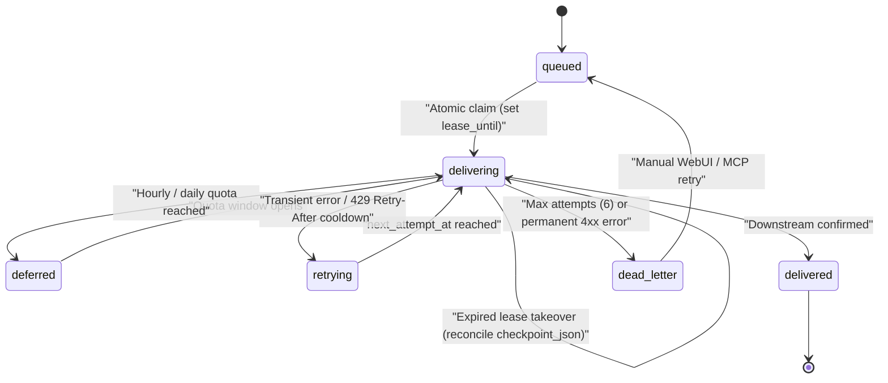

# Pacing, Quotas & Content Filters

When an upstream RSS feed publishes 15 new items at once—or when several feeds update in the same minute—naive notification bots blast downstream endpoints in a tight loop. That burst behavior triggers SMTP `421` greylisting, Telegram `429 Too Many Requests`, or Notion `429 Retry-After` throttling.

FeedCourier solves this with a **persistent lease-based outbox (`delivery_tasks`)** that decouples feed ingestion from paced, anti-spam delivery.

---

## Single-Entry Streaming Model

Every time a feed poll discovers a new entry (whose 4-tier SHA-256 fingerprint is not yet in `entries`), FeedCourier evaluates all active **Routes** (`routes.enabled = 1`). For each matching route, it inserts an isolated outbox task:

$$\text{1 Delivery Task} = \text{1 Entry} \times \text{1 Route}$$

A `UNIQUE (route_id, entry_id)` constraint in SQLite guarantees that even if a poll or route evaluation runs twice, duplicate tasks can never be created for the same entry and route.

---

## Pacing + Jitter (`min_interval_secs` & `jitter_max_secs`)

Each trusted channel defines its own smooth pacing cadence:

| Field | Default | Description |
| :--- | :--- | :--- |
| `min_interval_secs` | `15` | Minimum seconds to wait after a successful delivery before dispatching the next task on this channel or credential group. |
| `jitter_max_secs` | `10` | Uniform random jitter (`0 ..= jitter_max_secs` seconds) added on top of `min_interval_secs`. |

With the default `15s` base interval and `10s` jitter, consecutive messages are spaced **`15` to `25` seconds apart**, turning a sudden burst of 12 articles into a calm, human-paced 4-minute stream.

---

## Shared Credential Group Locks (`credential_group_key`)

Suppose you create three separate Telegram channels in the WebUI—one sending to a private chat, one to a team supergroup topic (`message_thread_id`), and one to a public broadcast channel—all using the **same Telegram Bot Token**.

If each channel paced independently, they could still fire simultaneously and trip Bot API rate limits.

To prevent this, FeedCourier automatically computes a cryptographic `credential_group_key` (`SHA-256`) whenever a channel is created or updated (`src/channels/mod.rs`):

| Channel Type | Shared Credential Group Identity |
| :--- | :--- |
| **SMTP** | `SHA-256("smtp:" + lowercase(username_or_from) + "@" + lowercase(host) + ":" + port)` |
| **Telegram** | `SHA-256("telegram:" + lowercase(api_base_url) + ":" + bot_token)` |
| **Notion** | `SHA-256("notion:" + integration_secret)` |

All channels sharing the same `credential_group_key` automatically share:
1. **Pacing intervals** (`min_interval_secs + jitter`).
2. **Downstream rate-limit cooldowns** (`cooldown_until`), so if one channel receives a `429 Retry-After`, all channels using that credential pause until the cooldown expires.

---

## Hourly & Daily Quota Guardrails

Every channel optionally accepts two hard delivery ceilings:

- **`hourly_quota`**: Maximum `delivered` tasks permitted within the rolling 1-hour window (`3,600` seconds).
- **`daily_quota`**: Maximum `delivered` tasks permitted within the rolling 24-hour window (`86,400` seconds).

When a channel reaches its hourly or daily quota:
- Pending tasks transition to **`deferred`** (not `retrying` or `dead_letter`).
- Their `attempt_count` is **not** incremented—quota deferral never consumes your 6-attempt transient failure budget.
- As soon as the rolling quota window frees capacity, `deferred` tasks automatically resume delivery in FIFO order.

---

## Route Matching & Content Filters

A **Route** binds a set of feeds to a target `channel_id` and applies content filtering before a task is ever enqueued.

### 1. Feed & Tag Selectors
- **`feed_ids`**: Explicit list of feed IDs matched by the route.
- **`match_tags`**: Case-insensitive list of feed tags (e.g., `["rust", "security"]`).
- If **both** `feed_ids` and `match_tags` are empty (`[]`), the route acts as a **catch-all** matching every active feed. Otherwise, a feed matches if its ID is in `feed_ids` **or** it carries at least one tag in `match_tags`.

### 2. Keyword & Regular Expression Filters
Routes evaluate filters against the entry's **title + sanitized plain-text summary/body** (`src/ingest/filter.rs`):

| Filter Rule | Matching Logic |
| :--- | :--- |
| `include_keywords` | Case-insensitive substring list. When non-empty, **at least one** keyword must appear. |
| `exclude_keywords` | Case-insensitive substring list. If **any** keyword appears, the entry is rejected immediately. |
| `include_regex` | Bounded regular expression (`regex` crate, `1 MiB` DFA size cap to prevent ReDoS) that must match. |
| `exclude_regex` | Bounded regular expression that rejects the entry if matched. |

::: tip Dry-Run Filter Testing Before Saving
You can test any combination of `include_keywords`, `exclude_keywords`, `include_regex`, and `exclude_regex` against live feed items without creating tasks using the WebUI **Feed Preview** drawer (`POST /api/v1/feeds/preview`) or the [`preview_feed_latest` MCP tool](/mcp/tools#3-preview-feed-latest).Each preview item reports `matched_filter: true | false` and the exact `filter_reason`.
:::
