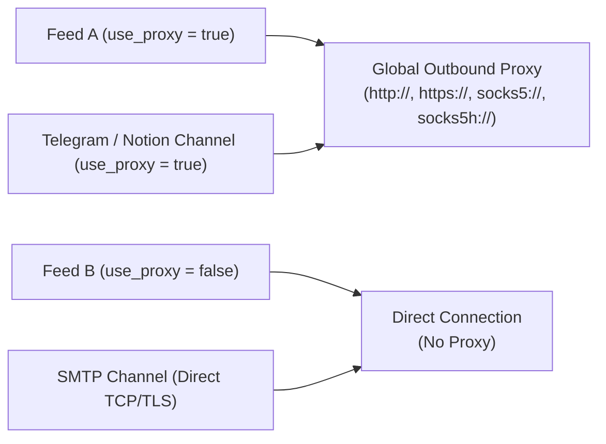

# Configuration & Proxy

FeedCourier requires only `DATA_DIR` and `LISTEN_ADDR` for a standard deployment, both of which have default values. The system timezone, outbound proxy settings, and private network allowlists can be initialized via environment variables on first launch and updated at any time from the WebUI under **Settings**.

---

## Environment Variables Reference

| Variable | Default | Description |
| :--- | :--- | :--- |
| `DATA_DIR` | `./data` (`/data` in Docker) | Persistent directory storing `feedcourier.db` (SQLite WAL), `master.key`, and online database backups. |
| `LISTEN_ADDR` | `0.0.0.0:8080` | Socket address (`IP:PORT`) for the WebUI, `/api/v1/*` REST API, and `/mcp` Streamable HTTP endpoint. |
| `MASTER_KEY` | *(auto-generated)* | Explicit 32-byte encryption key encoded as 64-character hex or Base64. When omitted, `<DATA_DIR>/master.key` is generated automatically with `0600` file permissions. |
| `ADMIN_USERNAME` | `Courier` | WebUI administrator username. When set, it overrides the stored username on **every startup**. |
| `ADMIN_PASSWORD` | *(interactive setup)* | Sets or resets the WebUI administrator password on startup. |
| `RESET_2FA` | *(unset)* | Set to `true` for a one-shot emergency removal of the TOTP secret and all recovery codes at startup (logs a `WARN`). Remove the variable afterwards. See [Lost Authenticator](/guide/operations#lost-authenticator-reset-2fa). |
| `TIMEZONE` (or `TZ`) | `America/Los_Angeles` | Default IANA **system timezone** (for example `Asia/Shanghai`) inherited by routes to evaluate delivery time windows, weekdays, and localized article timestamps in SMTP emails and Telegram rich messages. Seeds the database once; later changes in **Settings** take precedence, and individual routes can override it with `options.timezone`. |
| `OUTBOUND_PROXY` | *(unset)* | Initial global outbound proxy URL (`http://`, `https://`, `socks5://`, `socks5h://`). Falls back to `ALL_PROXY`, `HTTPS_PROXY`, or `HTTP_PROXY` if unset. |
| `SSRF_ALLOWLIST` | *(empty)* | Comma-separated internal CIDRs or hostnames permitted for outbound requests (e.g., `10.0.0.5/32,rsshub.internal,yourls,*.lan`). Applies to feeds, Local Telegram Bot API servers, plugins (such as LAN/Docker YOURLS), and remote plugin index fetches. |
| `PUBLIC_URL` | *(unset)* | Optional absolute public base URL (`https://feeds.example.com`, no query or fragment; trailing `/` stripped) enabling RFC 8058 one-click SMTP unsubscribe links (`/u/{token}`) and double-opt-in verification links (`/v/{token}`). When set via environment variable, it takes precedence over WebUI **Settings**; plain `http://` displays a warning. |
| `TRUST_PROXY` | `false` | Set to `true` only when running behind a trusted reverse proxy (such as Nginx or Caddy) that overwrites `X-Real-IP` or appends the client IP to `X-Forwarded-For`. When `false` (default), public `/u/` and `/v/` rate limiting uses only the direct TCP peer IP (`ConnectInfo<SocketAddr>`), resisting spoofed `X-Forwarded-For` headers; when `true`, FeedCourier reads `X-Real-IP` or the **rightmost** proxy-appended `X-Forwarded-For` entry. |
| `PLUGIN_INDEX_URL` | `https://raw.githubusercontent.com/ElleryHe/FeedCourier-Plugins/main/index.json` | Optional custom `http://` or `https://` URL for the plugin marketplace `index.json`. Fetched through the SSRF-protected client (cached for 6 hours; 60-second negative cache on snapshot fallback) with automatic fallback to the compiled snapshot when unreachable. |
| `LOCALE` | *(unset)* | Legacy fallback delivery language (`en` or `zh-CN`) for routes that have no delivery language of their own. New routes store their own language; the WebUI language is a browser preference and no longer syncs to the server. |
| `RETENTION_HOURS` | `24` | Hours after discovery to retain article HTML and media metadata once all delivery tasks for that entry have finished. |
| `DB_READ_MAX_CONNECTIONS` | `8` | Maximum concurrent connections in the read-only SQLite connection pool (minimum `1`). |
| `RUST_LOG` | `feedcourier=info,tower_http=info` | Log level filter (supports `debug`, `warn`, `error`, or module targets such as `feedcourier::scheduler=debug`). |

::: warning Environment Overrides vs. Persisted Settings
- If **`ADMIN_PASSWORD`** is set in the environment, FeedCourier updates the administrator password on **every startup**, which can also be used to recover access if you forget your password. **`ADMIN_USERNAME`** behaves the same way for the username; while it is set, the WebUI shows a hint that the username is managed by the environment.
- **`PUBLIC_URL`** also takes precedence over the database setting whenever set in the environment (WebUI **Settings** marks it as environment-managed and rejects edits via `PUT /api/v1/settings` until unset). When omitted from the environment, `public_url` can be configured freely from **Settings**.
- **`TIMEZONE`**/**`TZ`**, **`OUTBOUND_PROXY`**, and **`SSRF_ALLOWLIST`** act as **initial defaults**: they populate the database only when no value has been saved yet. Once initialized, changes saved in the WebUI (**Settings**) take precedence across restarts.
- **`TRUST_PROXY`** and **`PLUGIN_INDEX_URL`** are read at startup (`TRUST_PROXY` defaults to `false`; `PLUGIN_INDEX_URL` defaults to the official `ElleryHe/FeedCourier-Plugins` raw `index.json`).
- **`RESET_2FA=true`** is a one-time recovery switch. Remove it after the restart, otherwise it clears 2FA again on every start.
:::

::: tip Docker Timezone & Per-Route Overrides
Pass the default system timezone to the container with `-e TZ=America/Los_Angeles` (or any IANA name). Route time windows and localized article timestamps use this system timezone unless a route sets its own `timezone` override under **Routes**.
:::

---

## Per-Resource Outbound Proxy (`use_proxy`)

In environments where certain upstream feeds, Telegram (`api.telegram.org`), or Notion (`api.notion.com`) require an outbound proxy while local feeds or internal mail servers connect directly, you can toggle proxy usage per feed and per channel.



### Supported Proxy Schemes

- `http://[user:pass@]host:port` — HTTP/CONNECT proxy.
- `https://[user:pass@]host:port` — HTTPS proxy.
- `socks5://[user:pass@]host:port` — SOCKS5 proxy.
- `socks5h://[user:pass@]host:port` — SOCKS5 proxy with remote DNS resolution.

### Environment Fallback Order

When reading the initial proxy URL at startup, FeedCourier checks:

1. `OUTBOUND_PROXY`
2. `ALL_PROXY`
3. `HTTPS_PROXY`
4. `HTTP_PROXY`

### Enabling Proxy Per Feed, Channel, or Plugin

Setting a global proxy URL does not route all traffic through the proxy automatically. Instead, you enable `use_proxy` individually on:

- **Feeds**: Applies to feed polling, full-text extraction, site icon fetching, and media relay for that feed.
- **HTTP-Based Channel Accounts (Telegram & Notion)**: Applies to account verification, outbound deliveries, and destination tests for **all destinations** attached to that Telegram or Notion account. *(SMTP channels use native TCP/TLS direct connections; HTTP/SOCKS outbound proxies do not apply to SMTP.)*
- **Plugin Providers (e.g., Link Rewrite / YOURLS)**: Routes outbound plugin API calls through the global outbound proxy.
- **Feed Previews**: Both the WebUI preview drawer and the MCP `preview_feed_latest` tool accept a `use_proxy` toggle per preview request.

::: warning Fail-Closed `use_proxy: true` Guarantee
If a feed, channel account, feed preview, or plugin instance has `use_proxy: true` enabled while **no global `OUTBOUND_PROXY`** (or fallback proxy URL in **Settings** / environment) is configured, FeedCourier **fails closed** with an explicit error instead of silently falling back to a direct connection and leaking the host's egress IP.
:::

---

## Private Network Blocking & `SSRF_ALLOWLIST`

By default, outbound HTTP requests to user-supplied URLs block private and local network addresses to prevent Server-Side Request Forgery (SSRF):

- Loopback addresses (`127.0.0.0/8`, `::1/128`, `localhost`, `*.localhost`)
- Private IPv4 ranges (`10.0.0.0/8`, `172.16.0.0/12`, `192.168.0.0/16`)
- IPv6 Unique Local (`fc00::/7`) and Link-Local (`fe80::/10`) addresses
- Link-Local and cloud metadata addresses (`169.254.0.0/16`, including `169.254.169.254`)
- Shared address space (`100.64.0.0/10`), broadcast, multicast, and unspecified (`0.0.0.0`, `::`) ranges

### Allowing Internal Services (`SSRF_ALLOWLIST`) {#allowing-trusted-internal-services-ssrf-allowlist}

If you run companion services on your LAN or Docker network—such as **[RSSHub](https://docs.rsshub.app/)**, **RSS-Bridge**, a **[Self-Hosted Local Telegram Bot API Server](/channels/telegram#self-hosted-local-bot-api-server)**, or a **self-hosted [YOURLS](/plugins/link-rewrite)** instance—add their CIDR ranges or hostnames to `SSRF_ALLOWLIST`.

Supported entry formats:

| Format | Example | Behavior |
| :--- | :--- | :--- |
| **IPv4 / IPv6 CIDR** | `10.0.0.5/32`, `172.18.0.0/16`, `fd00::1/128` | Permits connections whose resolved IP falls within the CIDR prefix. |
| **Single IP Address** | `192.168.1.50` | Treated as a `/32` (IPv4) or `/128` (IPv6) host entry. |
| **Exact Hostname** | `rsshub.internal`, `telegram-bot-api.local` | Permits the hostname (case-insensitive) and its resolved private IPs. |
| **Wildcard Subdomain** | `*.lan`, `*.internal.example.com` | Permits any subdomain under the suffix (does not match the apex domain unless listed separately). |

#### Example: Allowing a Docker Compose RSSHub Service

```yaml
services:
  feedcourier:
    image: elleryhe/feedcourier:latest
    environment:
      SSRF_ALLOWLIST: "rsshub,172.20.0.0/16"
```

You can also edit the allowlist directly in the WebUI under **Settings**. Updates take effect immediately without restarting the service. For technical details on connection-layer IP verification, see [Security & Isolation](/reference/security).

---

## Managing Large Feed Lists in the WebUI

The **Feeds** page provides built-in filtering, sorting, and pagination controls designed for larger OPML libraries:

- **Search**: Matches feed **title** and **URL** directly (tags are filtered via the dedicated dropdown).
- **Tag Filter Dropdown**: Single-select dropdown to the left of the search input showing **All tags**, every existing tag with its subscribed feed count, and **Untagged**.
- **Persistent Sort**: Sort selector to the left of the Tag dropdown supporting **Added time** or **Name** (ascending or descending). Name sorting uses `Intl.Collator` for natural CJK and Latin ordering.
- **Pagination & Persistence**: Displays **15** feeds per page by default (switchable between **15 / 30 / 50**). Changing the search query, tag filter, or sort order resets to page 1; your selected sort mode and page size are saved in browser `localStorage`.
