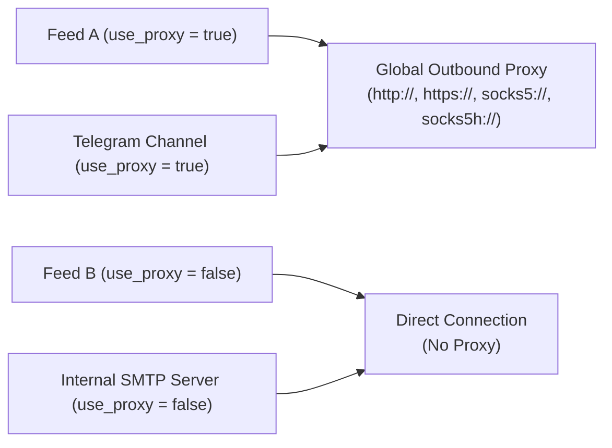

# Configuration & Proxy

FeedCourier requires only `DATA_DIR` and `LISTEN_ADDR` for a standard deployment, both of which have default values. Outbound proxy settings and private network allowlists can be initialized via environment variables on first launch and updated at any time from the WebUI under **Settings**.

---

## Environment Variables Reference

| Variable | Default | Description |
| :--- | :--- | :--- |
| `DATA_DIR` | `./data` (`/data` in Docker) | Persistent directory storing `feedcourier.db` (SQLite WAL), `master.key`, and online database backups. |
| `LISTEN_ADDR` | `0.0.0.0:8080` | Socket address (`IP:PORT`) for the WebUI, `/api/v1/*` REST API, and `/mcp` Streamable HTTP endpoint. |
| `MASTER_KEY` | *(auto-generated)* | Explicit 32-byte encryption key encoded as 64-character hex or Base64. When omitted, `<DATA_DIR>/master.key` is generated automatically with `0600` file permissions. |
| `ADMIN_PASSWORD` | *(interactive setup)* | Sets or resets the WebUI administrator password on startup. |
| `OUTBOUND_PROXY` | *(unset)* | Initial global outbound proxy URL (`http://`, `https://`, `socks5://`, `socks5h://`). Falls back to `ALL_PROXY`, `HTTPS_PROXY`, or `HTTP_PROXY` if unset. |
| `SSRF_ALLOWLIST` | *(empty)* | Comma-separated internal CIDRs or hostnames permitted for outbound requests (e.g., `10.0.0.5/32,rsshub.internal,*.lan`). |
| `LOCALE` | *(auto-synced)* | Initial language (`en` or `zh-CN`) for downstream Telegram and SMTP push notification templates. Automatically syncs with the WebUI language switcher once signed in. |
| `RETENTION_HOURS` | `24` | Hours after discovery to retain article HTML and media metadata once all delivery tasks for that entry have finished. |
| `DB_READ_MAX_CONNECTIONS` | `8` | Maximum concurrent connections in the read-only SQLite connection pool (minimum `1`). |
| `RUST_LOG` | `feedcourier=info,tower_http=info` | Log level filter (supports `debug`, `warn`, `error`, or module targets such as `feedcourier::scheduler=debug`). |

::: warning Resetting `ADMIN_PASSWORD` vs. Persisted Network Settings
- If **`ADMIN_PASSWORD`** is set in the environment, FeedCourier updates the administrator password on **every startup**, which can also be used to recover access if you forget your password.
- **`OUTBOUND_PROXY`** and **`SSRF_ALLOWLIST`** act as **initial defaults**: they populate the database only when no value has been saved yet. Once initialized, changes saved in the WebUI (**Settings**) take precedence across restarts.
:::

---

## Per-Resource Outbound Proxy (`use_proxy`)

In environments where certain upstream feeds, Telegram (`api.telegram.org`), or Notion (`api.notion.com`) require an outbound proxy while local feeds or internal mail servers connect directly, you can toggle proxy usage per feed and per channel.



### Supported Proxy Schemes

- `http://[user:pass@]host:port` — HTTP/CONNECT proxy.
- `https://[user:pass@]host:port` — HTTPS proxy.
- `socks5://[user:pass@]host:port` — SOCKS5 proxy.
- `socks5h://[user:pass@]host:port` — SOCKS5 proxy with remote DNS resolution.

### Environment Fallback Order

When reading the initial proxy URL at startup, FeedCourier checks:

1. `OUTBOUND_PROXY`
2. `ALL_PROXY`
3. `HTTPS_PROXY`
4. `HTTP_PROXY`

### Enabling Proxy Per Feed or Per Channel

Setting a global proxy URL does not route all traffic through the proxy automatically. Instead, you enable `use_proxy` individually on:

- **Feeds**: Applies to feed polling, full-text extraction, site icon fetching, and media relay for that feed.
- **Channels**: Applies to outbound deliveries and channel tests for that specific Telegram, Notion, or SMTP channel.
- **Feed Previews**: Both the WebUI preview drawer and the MCP `preview_feed_latest` tool accept a `use_proxy` toggle per preview request.

---

## Private Network Blocking & `SSRF_ALLOWLIST`

By default, outbound HTTP requests to user-supplied URLs block private and local network addresses to prevent Server-Side Request Forgery (SSRF):

- Loopback addresses (`127.0.0.0/8`, `::1/128`, `localhost`, `*.localhost`)
- Private IPv4 ranges (`10.0.0.0/8`, `172.16.0.0/12`, `192.168.0.0/16`)
- IPv6 Unique Local (`fc00::/7`) and Link-Local (`fe80::/10`) addresses
- Link-Local and cloud metadata addresses (`169.254.0.0/16`, including `169.254.169.254`)
- Shared address space (`100.64.0.0/10`), broadcast, multicast, and unspecified (`0.0.0.0`, `::`) ranges

### Allowing Internal Services (`SSRF_ALLOWLIST`) {#allowing-trusted-internal-services-ssrf-allowlist}

If you run companion services on your LAN or Docker network—such as **[RSSHub](https://docs.rsshub.app/)**, **RSS-Bridge**, or a **[Self-Hosted Local Telegram Bot API Server](/channels/telegram#self-hosted-local-bot-api-server)**—add their CIDR ranges or hostnames to `SSRF_ALLOWLIST`.

Supported entry formats:

| Format | Example | Behavior |
| :--- | :--- | :--- |
| **IPv4 / IPv6 CIDR** | `10.0.0.5/32`, `172.18.0.0/16`, `fd00::1/128` | Permits connections whose resolved IP falls within the CIDR prefix. |
| **Single IP Address** | `192.168.1.50` | Treated as a `/32` (IPv4) or `/128` (IPv6) host entry. |
| **Exact Hostname** | `rsshub.internal`, `telegram-bot-api.local` | Permits the hostname (case-insensitive) and its resolved private IPs. |
| **Wildcard Subdomain** | `*.lan`, `*.internal.example.com` | Permits any subdomain under the suffix (does not match the apex domain unless listed separately). |

#### Example: Allowing a Docker Compose RSSHub Service

```yaml
services:
  feedcourier:
    image: elleryhe/feedcourier:latest
    environment:
      SSRF_ALLOWLIST: "rsshub,172.20.0.0/16"
```

You can also edit the allowlist directly in the WebUI under **Settings**. Updates take effect immediately without restarting the service. For technical details on connection-layer IP verification, see [Security & Isolation](/reference/security).
