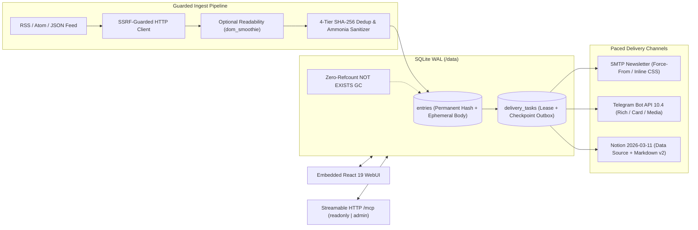

# Introduction & Design Philosophy

**FeedCourier** is a lightweight, single-binary pure-Rust **RSS / Atom / JSON Feed streaming delivery gateway** (`<20 MB` idle RSS, single SQLite WAL volume at `/data`) built for individuals and small engineering teams.

Inspired by `rss2email`'s single-entry reliability—without multi-tenant bloat or local content hoarding—FeedCourier routes feed entries in real time to **SMTP Newsletters**, **Telegram Bot API 10.4**, and **Notion (`2026-03-11` Data Sources & Markdown v2)**, managed identically through an **embedded React 19 WebUI** and a **native Streamable HTTP MCP server (`/mcp`)**.

---

## Why FeedCourier?

Most self-hosted RSS tools fall into one of two extremes:

1. **Heavyweight Online Readers** (e.g., FreshRSS, Miniflux, TT-RSS) that store gigabytes of full-text archives and media caches locally, requiring another inbox to check every day.
2. **Rigid Cron Digests or Fragile Scripts** that either dump 30 articles at once—triggering downstream SMTP `421` / Telegram `429` rate limits—or lack persistent deduplication, SSRF protection, and crash-safe recovery.

FeedCourier is architected from first principles as a **stateless-feeling, stateful-under-the-hood delivery gateway** that pushes curated information directly into the tools you already live in.

---

## Four Core Design Boundaries

### 1. A Delivery Gateway, Not an Online Reader

FeedCourier intentionally omits local reading panes, bookmarking folders, or permanent media caches. Deep reading, full-text search, and long-term knowledge archiving belong in your email client, Telegram stream, or Notion workspace.

### 2. Permanent Fingerprints, Ephemeral Payloads

To prevent duplicate floods across years of operation while keeping `/data/feedcourier.db` compact:

- **Permanent Fingerprints**: Every discovered item is reduced to a 64-character SHA-256 fingerprint via a [4-tier anti-drift fallback chain](/reference/architecture#four-tier-anti-drift-sha-256-deduplication) and stored permanently in `entries`.
- **Burn-After-Reading Payloads**: Sanitized HTML bodies, extracted summaries, and media attachment lists exist only during active queueing or retry windows (`RETENTION_HOURS=24` by default). Once all routed tasks reach a terminal state and the retention window passes, a zero-refcount `NOT EXISTS` garbage collector sets those columns to `NULL`.
- **Zero-Disk Media Relay**: When Telegram Media Mode falls back to streaming hotlink-protected images or videos, bytes stream through bounded in-memory buffers (`10 MiB` photos, `50 MiB` video/audio/documents) and never touch disk.

### 3. Single-Entry Streaming with Anti-Spam Pacing

FeedCourier never batches multiple articles into a synthetic daily digest. Every matched entry enqueues an isolated transactional task:

$$\text{1 Delivery Task} = \text{1 Entry} \times \text{1 Matched Route}$$

The outbox worker drains tasks smoothly using:
- **Minimum Interval + Random Jitter** (default `15s + 0..10s` per channel) to flatten traffic spikes.
- **Shared Credential Group Locks** (`credential_group_key`) so multiple channels sharing the same SMTP account, Telegram Bot Token, or Notion Integration Secret automatically coordinate rate limits and cooldowns.
- **Hourly & Daily Quotas** that defer excess tasks (`status = 'deferred'`) into the next quota window without burning retry attempts.

See [Pacing, Quotas & Filters](/channels/pacing-and-quotas) for details.

### 4. Unified Human & AI Plane with Strict Trust Boundaries

Both the embedded React 19 WebUI (`/api/v1/*`) and the native Streamable HTTP MCP server (`/mcp`) drive the exact same Rust service layer, but with strict privilege separation:

- **WebUI Exclusivity for Secrets & Recipients**: Channel credentials (ChaCha20-Poly1305 encrypted at rest) and delivery targets (recipient emails, Telegram `chat_id`, Notion `data_source_id`) can **only** be created or modified by an authenticated administrator in the WebUI.
- **Scoped AI Orchestration**: MCP clients authenticate with `readonly` or `admin` Bearer tokens and reference channels strictly by numeric `channel_id`. External feed text returned to AI agents is truncated and wrapped in `<untrusted_feed_content>` tags to neutralize indirect prompt injection.

See [MCP Security Boundaries](/mcp/security) for the full threat model.

---

## Technology Stack Overview

| Layer | Crates / Technologies | Purpose |
| :--- | :--- | :--- |
| **Async Runtime & HTTP** | `tokio`, `axum`, `tower-http`, `reqwest` (`rustls-tls` + `socks`) | Unified HTTP server for WebUI, REST API, `/mcp`, and SSRF-guarded outbound client. |
| **Storage Engine** | `sqlx` + SQLite (`WAL` mode) | Single-writer (`max_connections = 1`) + concurrent read pool (`query_only = ON`). |
| **Feed & Readability** | `feed-rs`, `dom_smoothie`, `ammonia`, `unicode-segmentation` | RSS/Atom/JSON Feed parsing, pure-Rust Readability extraction, HTML sanitization, and CJK/Latin first-sentence segmentation. |
| **Delivery Adapters** | `lettre`, `minijinja`, `html2text`, [`telegram-rich`](https://crates.io/crates/telegram-rich), `htmd` | Responsive inline-CSS emails, Telegram Bot API 10.4 Rich HTML normalization & block fitting, and Notion Markdown v2 conversion. |
| **Cryptography** | `argon2` (`Argon2id`), `chacha20poly1305`, `sha2` | Admin password hashing, AEAD channel secret encryption, and SHA-256 token/fingerprint hashing. |
| **MCP Server** | `rmcp` (Official Rust MCP SDK) | Streamable HTTP `/mcp` transport with 7 structured tools and AGPLv3 `ServerInfo` metadata. |
| **Embedded WebUI** | `React 19`, `TypeScript`, `Vite`, `Tailwind CSS`, `TanStack Query`, `rust-embed` | Single-page console compiled directly into the Rust binary. |

::: tip Open Source & AGPL-3.0-only Compliance
FeedCourier is licensed under **AGPL-3.0-only**. In compliance with Section 13, both the embedded WebUI footer (`/api/v1/auth/status`) and the `/mcp` `ServerInfo` initialization payload natively expose the exact build version (`CARGO_PKG_VERSION`), SPDX license identifier, and upstream source repository (`https://github.com/ElleryHe/FeedCourier`). The companion crate [`telegram-rich`](https://github.com/ElleryHe/telegram-rich) is dual-licensed under `MIT OR Apache-2.0`.
:::

## Next Steps

- **[Quick Start](/guide/quick-start)** — Deploy FeedCourier in under 60 seconds with Docker, Docker Compose, or a prebuilt binary.
- **[Configuration & Proxy](/guide/configuration)** — Configure environment variables, HTTP/SOCKS5 proxies, and internal SSRF allowlists.
- **[Delivery Channels](/channels/pacing-and-quotas)** — Set up SMTP, Telegram Bot API 10.4, and Notion `2026-03-11` channels.
