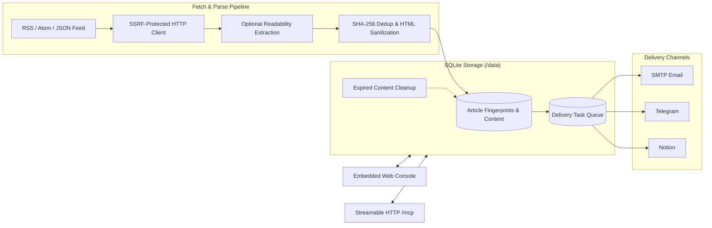

## Delivery Pipeline Overview



## Quick Deployment with Docker

```bash
docker run -d \
  --name feedcourier \
  --restart unless-stopped \
  -p 8080:8080 \
  -v "$(pwd)/data:/data" \
  -e TZ=America/Los_Angeles \
  elleryhe/feedcourier:latest
```

After starting the container, open `http://127.0.0.1:8080` in your browser to set the administrator username and password, configure delivery channels, import OPML subscriptions, or issue `/mcp` tokens. For binary and source builds, see [Quick Start](/guide/quick-start).
