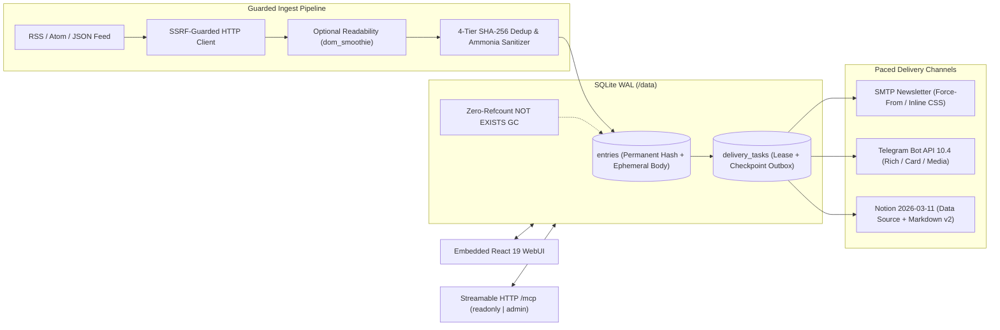

## End-to-End Delivery Pipeline

## Explore the Documentation

| Section | What You'll Learn |
| :--- | :--- |
| **[Getting Started & Operations](/guide/introduction)** | Core design boundaries, [Docker & binary deployment](/guide/quick-start), [environment variables & proxy routing](/guide/configuration), and [`/data` backups](/guide/operations). |
| **[Delivery Channels](/channels/pacing-and-quotas)** | [Pacing, quotas & content filters](/channels/pacing-and-quotas), [SMTP `Force-From` newsletters](/channels/smtp), [Telegram Bot API 10.4 modes](/channels/telegram), and [Notion `2026-03-11` integration](/channels/notion). |
| **[Native MCP Server](/mcp/setup)** | [Streamable HTTP client setup](/mcp/setup), [all 7 MCP tools](/mcp/tools), and [defense-in-depth prompt-injection guardrails](/mcp/security). |
| **[Architecture & Reference](/reference/architecture)** | [4-tier dedup & lease outbox internals](/reference/architecture), [SQLite WAL schema](/reference/database-schema), [`/api/v1/*` REST API](/reference/rest-api), and [automated release pipelines](/reference/releasing). |
