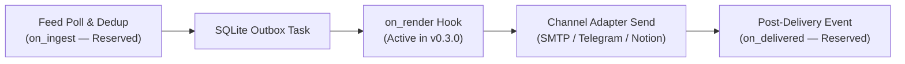

# Plugin Development & Protocol v1

FeedCourier defines a stable **Plugin Protocol v1 (`api_version: "1"`)** shared by first-party compiled plugins, the public marketplace registry ([`ElleryHe/FeedCourier-Plugins`](https://github.com/ElleryHe/FeedCourier-Plugins)), and the upcoming Phase 2 sandboxed WASM runtime.

---

## 1. Plugin Manifest Schema (`schema/manifest.schema.json`)

Every plugin listed in the marketplace registry is defined by a JSON file at `registry/<id>.json` conforming to JSON Schema **Draft 2020-12** (`additionalProperties: false`):

```json
{
  "id": "link-rewrite",
  "name": "Link Rewrite (YOURLS)",
  "version": "0.3.0",
  "api_version": "1",
  "kind": "builtin",
  "min_core": "0.3.0",
  "category": "links",
  "icon": "link",
  "description": "Rewrite outgoing article links using one or more self-hosted YOURLS short-link providers at delivery time, with SQLite caching, domain exclusions, and optional strict retry mode.",
  "homepage": "https://feedcourier.ellery.me/plugins/link-rewrite",
  "repository": "https://github.com/ElleryHe/FeedCourier",
  "hooks": ["on_render"],
  "permissions": ["network"]
}
```

### Field Reference

| Field | Type | Constraints | Description |
| :--- | :--- | :--- | :--- |
| `id` | `string` | `^[a-z0-9][a-z0-9-]{1,47}$` | Globally unique lowercase kebab-case plugin ID. Must match `registry/<id>.json`. |
| `name` | `string` | `2..=80` chars | Human-readable display name shown in WebUI and docs. |
| `version` | `string` | SemVer 2.0.0 | Plugin release version (e.g., `"0.3.0"`). |
| `api_version` | `string` | Const `"1"` | Plugin Protocol version. |
| `kind` | `string` | `"builtin"` \| `"external"` \| `"coming_soon"` | `"builtin"` is reserved for first-party plugins compiled into FeedCourier; use `"external"` or `"coming_soon"` for community listings. |
| `min_core` | `string` | SemVer 2.0.0 | Minimum compatible FeedCourier core version. |
| `category` | `string` | `"links"` \| `"content"` \| `"media"` \| `"delivery"` \| `"analytics"` \| `"security"` \| `"other"` | Marketplace category for filtering. |
| `icon` | `string` | `^[a-z0-9][a-z0-9-]{0,31}$` | Icon slug rendered on marketplace cards (e.g., `"link"`). |
| `description` | `string` | `10..=280` chars | Concise summary of plugin functionality. |
| `homepage` | `string` | `https://` URI | Documentation or project homepage URL (no embedded credentials). |
| `repository` | `string` | `https://` URI | Public source repository URL (no embedded credentials). |
| `hooks` | `string[]` | Unique, min `1`; `"on_render"` \| `"on_ingest"` \| `"on_delivered"` | Lifecycle hooks implemented by the plugin. |
| `permissions` | `string[]` | Unique; `"network"` | Declared capabilities. Omit or pass `[]` for pure local transforms; declare `"network"` whenever outbound HTTP requests are made. |

### Runtime Declarative UI Schemas

In addition to registry metadata, runtime `PluginManifest` responses (`GET /api/v1/plugins`) carry two JSON Schema subsets that let the WebUI render configuration controls automatically:

- **`instance_schema`**: Describes per-provider configuration fields stored encrypted in `plugin_instances.encrypted_config` (supports `"format": "password"` for secret inputs, enums, booleans, and string arrays).
- **`route_option_schema`**: Describes per-route controls persisted under `routes.options_json -> $.plugins.<plugin_id>` (in `v0.3.0`, the route editor renders `select` backed by `plugin_instances`, `boolean`, and `string` controls).

---

## 2. Hook Lifecycle (Protocol v1)



| Hook | Status in `v0.3.0` | Execution Point & Semantics |
| :--- | :---: | :--- |
| **`on_render`** | **Active** | Runs per outbox delivery (and Debug Push) after decrypting channel/destination configs and immediately before `sender.send()`. Receives immutable `RenderContext` (`entry`, `feed`, `route`, `route_options`, `channel`, `destination`, `plugin_route_config`, `write_cache`) and mutates `RenderOverrides` (`content_html`, `primary_link`, `warnings`). Never mutates persisted `entries`. Returns `PluginResult::Continue` or `PluginResult::Retry { diagnostic, retry_after_secs }`. |
| **`on_ingest`** | *Reserved* | Reserved in Protocol v1 manifest & enum for future ingest-stage enrichment/normalization prior to task fanout. |
| **`on_delivered`** | *Reserved* | Reserved in Protocol v1 manifest & enum for future post-delivery audit/webhook/analytics callbacks. |

### Core Security Invariants for Plugins

1. **Mandatory SSRF Protection**: Every outbound HTTP call must pass through `ProtectedHttpClient` (`src/net/ssrf.rs`), honoring connect-time DNS IP validation, hop-by-hop redirect checks, response byte caps, and `SSRF_ALLOWLIST`.
2. **Secret Encryption & Redaction**: Provider credentials are encrypted at rest via `MasterKey` (ChaCha20-Poly1305) in `plugin_instances.encrypted_config`. Plugins must implement `redact_instance_config` and `merge_instance_config` so secrets are never returned by `/api/v1/plugins*` or MCP `list_plugins`.
3. **Referential Delete Guard**: Route references in `routes.options_json` prevent deleting an in-use `plugin_instances` row (`409 Conflict` with `referencing_routes`).

---

## 3. Submitting a Listing to `ElleryHe/FeedCourier-Plugins`

Community authors can list open-source Protocol v1 plugins (`kind: "external"` or `"coming_soon"`) via pull request to **[`ElleryHe/FeedCourier-Plugins`](https://github.com/ElleryHe/FeedCourier-Plugins)**:

1. Fork `ElleryHe/FeedCourier-Plugins` and create a branch from `main`.
2. Add your manifest at `registry/<your-plugin-id>.json` matching `schema/manifest.schema.json`.
3. Validate locally with Node.js 24+ (zero external dependencies):
   ```bash
   node scripts/build-index.mjs --check
   ```
4. **Do not manually edit `index.json` in your PR.** GitHub Actions runs `validate.yml` on PRs and automatically executes `build-index.yml` to rebuild and commit `index.json` after merge to `main`.
5. Complete the PR template checklist:
   - Unique plugin ID matching `registry/<id>.json`
   - Valid `api_version: "1"`, SemVer `version` & `min_core`, and `https://` URLs
   - Open-source license (`AGPL-3.0` or OSI-approved)
   - Security & SSRF disclosure (outbound hosts, permissions, credential handling)
   - Tested FeedCourier core version

---

## 4. Phase 2 Roadmap: Sandboxed WASM Runtime

`v0.3.0` locks down Protocol v1's manifest schema, database tables, REST/MCP contracts, and `on_render` override semantics so the planned **Phase 2 WASM/Extism runtime** can load third-party `.wasm` plugins without breaking existing configurations:

- **Host-Enforced Capability Sandbox**: WASM plugins will have zero direct socket or filesystem access; network requests declared under `permissions: ["network"]` will be proxied exclusively through FeedCourier's SSRF-protected host functions.
- **Deterministic Resource Limits**: Per-invocation CPU fuel/timeout caps and memory limits so a misbehaving plugin cannot stall the outbox scheduler.
- **Zero-Migration Upgrade**: Existing `plugins`, `plugin_instances`, `plugin_link_cache`, and `routes.options_json` rows remain forward-compatible as third-party WASM modules join first-party built-in plugins.
