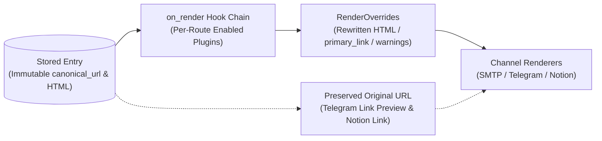

# Plugins & Marketplace

Starting in **`v0.3.0`**, FeedCourier introduces a **Protocol v1 (`api_version: "1"`) Plugin Framework** that lets you extend the delivery pipeline per route without mutating stored feed entries.

---

## Plugin Architecture Overview

- **Delivery-Time, Non-Destructive Execution (`on_render`)**: Plugins execute inside the outbox worker right before the channel adapter renders a delivery (and during stateless Debug Push previews, without writing to cache). Stored `entries` remain unmodified so multi-route fanout, Telegram link previews, and Notion `Link` archival stay intact.
- **Per-Route Configuration (`RouteOptions.plugins`)**: Enable a plugin globally under **Plugins** in the WebUI, add one or more encrypted provider instances (for example, separate YOURLS servers), and bind a provider per route in the route editor's collapsible **Plugins** section (or via REST API / MCP `configure_route`).
- **Safe Lifecycle & Referential Integrity**:
  - Disabling a plugin globally skips its hooks at delivery time while preserving all route configurations.
  - Deleting a provider instance still referenced by one or more routes returns **`409 Conflict`** listing the referencing routes.
  - If a provider instance is disabled (not deleted), the plugin degrades gracefully and attaches a warning to the task's diagnostic log (rendered in amber in the Outbox view).
- **Two-Phase Runtime Roadmap**:
  - **Phase 1 (`v0.3.0`)**: First-party plugins (beginning with [Link Rewrite (YOURLS)](/plugins/link-rewrite)) implement the Rust `Plugin` trait and compile directly into the single binary while using the stable Protocol v1 manifest, SQLite schema (`plugins`, `plugin_instances`, `plugin_link_cache`), and hook lifecycle.
  - **Phase 2 (Planned)**: Sandboxed WASM/Extism runtime for third-party plugins reusing the exact Protocol v1 contracts.

---

## Plugin Marketplace

The catalog below is loaded at build time from the official **[`ElleryHe/FeedCourier-Plugins`](https://github.com/ElleryHe/FeedCourier-Plugins)** registry (`index.json`), with an automatic fallback to the compiled snapshot in `src/plugins/market_snapshot.json` for offline builds.

<PluginMarketplace locale="en" />

### Runtime Marketplace Loading in FeedCourier

When you open **Plugins → Marketplace** in the WebUI (`GET /api/v1/plugins/market`):

- FeedCourier fetches `https://raw.githubusercontent.com/ElleryHe/FeedCourier-Plugins/main/index.json` through the SSRF-protected HTTP client (up to `1 MiB`, `8s` timeout) and caches the result in memory for **6 hours**.
- Set [`PLUGIN_INDEX_URL`](/guide/configuration#environment-variables-reference) to point to a private mirror or self-hosted registry.
- In air-gapped networks where the remote URL is unreachable, FeedCourier automatically falls back to its built-in snapshot (`source: "snapshot"`).
- Built-in (`kind: "builtin"`) plugins can be activated in one click; external (`kind: "external"`) and planned (`kind: "coming_soon"`) listings link to their documentation and source repositories.

---

## Next Steps

- **[Link Rewrite (YOURLS)](/plugins/link-rewrite)**: Set up self-hosted YOURLS short-link rewriting, authentication modes, `SSRF_ALLOWLIST`, caching, and channel-specific behavior.
- **[Plugin Development](/plugins/development)**: Protocol v1 (`api_version: "1"`) manifest schema, hook lifecycle, submitting listings to [`ElleryHe/FeedCourier-Plugins`](https://github.com/ElleryHe/FeedCourier-Plugins), and the Phase 2 WASM sandbox roadmap.
