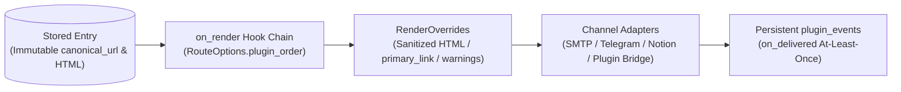

# Plugins & Marketplace

FeedCourier provides a **Protocol v1 (`api_version: "1"`) Plugin Framework** supporting both **built-in Rust plugins** (`v0.3.0+`) and **out-of-process HTTP Bridge plugins** (`v0.3.1+`) for custom delivery channels (`kind: "channel"`), delivery-time processors (`kind: "processor"`, `on_render`), and persistent post-delivery callbacks (`on_delivered`).

---

## Plugin Architecture Overview

- **Two Runtime Models Sharing Protocol v1**:
  - **Built-in (`runtime: "builtin"`)**: First-party Rust plugins compiled directly into the single FeedCourier binary (such as [Link Rewrite (YOURLS)](/plugins/link-rewrite)).
  - **HTTP Bridge (`runtime: "bridge"`, `v0.3.1+`)**: Operator-registered sidecar HTTP services authenticated via HMAC-SHA256 (`±300s` replay window). Bridges can implement custom **delivery channels** (`POST /deliver`), **render processors** (`POST /hooks/on_render`, with `ammonia` HTML re-sanitization), or **post-delivery subscribers** (`POST /hooks/on_delivered`).
- **Per-Route Configuration & Execution Ordering (`RouteOptions.plugins` & `plugin_order`)**: Enable processor plugins globally, configure per-route options, and control execution sequence with up/down ordering arrows in the route editor. Each plugin runs under an isolated 15s wall-clock timeout; non-strict failures record warnings without blocking delivery.
- **Persistent `on_delivered` Events (`plugin_events`)**: Subscriptions to `on_delivered` are enqueued inside the same SQLite transaction that commits task delivery and dispatched asynchronously with an idempotency key and exponential backoff (up to 5 attempts).
- **Safe Lifecycle & Compatibility Checks**:
  - Marketplace and bridge manifests are checked against `api_version` and `min_core` before installation.
  - Deleting an in-use bridge plugin or provider instance returns **`409 Conflict`** listing referencing channels and routes (`?cascade=true` supported for bridge plugins).

---

## Plugin Marketplace

The catalog below is loaded at build time from the official **[`ElleryHe/FeedCourier-Plugins`](https://github.com/ElleryHe/FeedCourier-Plugins)** registry (`index.json`), with an automatic fallback to the compiled snapshot in `src/plugins/market_snapshot.json` for offline builds.

<PluginMarketplace locale="en" />

### Runtime Marketplace Loading in FeedCourier

When you open **Plugins → Marketplace** in the WebUI (`GET /api/v1/plugins/market`):

- FeedCourier fetches `https://raw.githubusercontent.com/ElleryHe/FeedCourier-Plugins/main/index.json` through the SSRF-protected HTTP client (up to `1 MiB`, `8s` timeout) and caches the result in memory for **6 hours**.
- Set [`PLUGIN_INDEX_URL`](/guide/configuration#environment-variables-reference) to point to a private mirror or self-hosted registry.
- In air-gapped networks where the remote URL is unreachable, FeedCourier automatically falls back to its built-in snapshot (`source: "snapshot"`).
- Built-in (`kind: "builtin"`) plugins can be activated in one click; HTTP Bridge (`runtime: "bridge"`) listings display their container image and Docker Compose snippet and open the **Register Bridge** flow; incompatible entries display their required core version (`min_core`).

---

## Next Steps

- **[Bridge Channel Plugins](/plugins/bridge-channels)**: Deploy and register out-of-process HTTP Bridge delivery channels (including the reference `ntfy` plugin).
- **[Link Rewrite (YOURLS)](/plugins/link-rewrite)**: Set up self-hosted YOURLS short-link rewriting, authentication modes, `SSRF_ALLOWLIST`, caching, and channel-specific behavior.
- **[Plugin Development](/plugins/development)**: Protocol v1 (`api_version: "1"`) manifest & HTTP Bridge wire specification, HMAC-SHA256 signing, `channel-template`, and submitting to [`ElleryHe/FeedCourier-Plugins`](https://github.com/ElleryHe/FeedCourier-Plugins).
