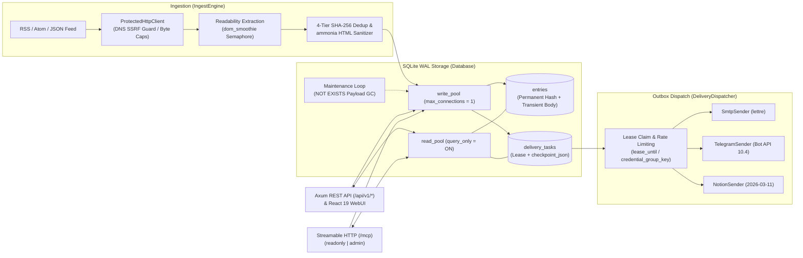
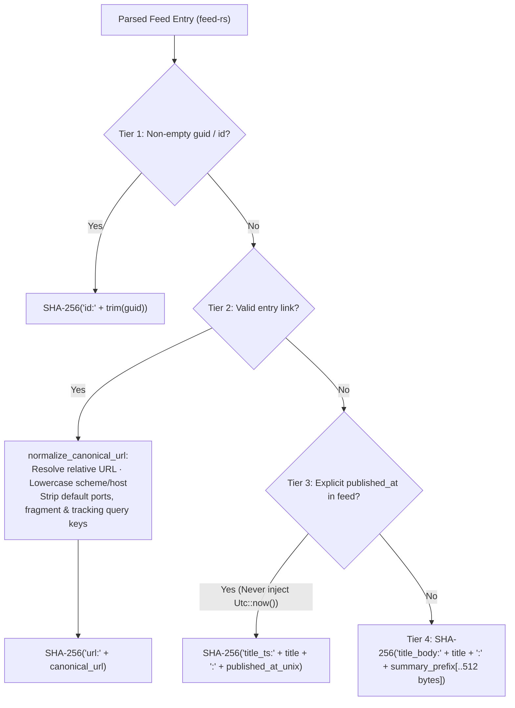
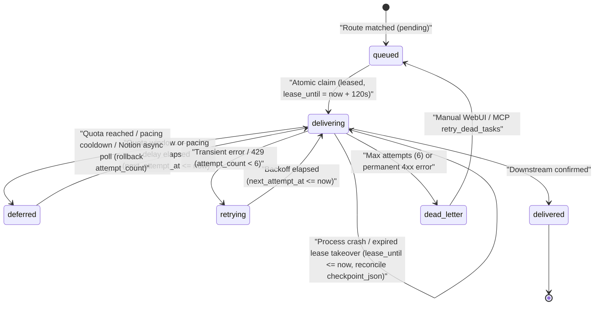

# System Architecture

This document describes FeedCourier's internal module layout, data flow, four-tier SHA-256 fingerprint deduplication, SQLite WAL read/write connection pools, `NOT EXISTS` payload garbage collection, and the lease-based outbox state machine (`lease_until` + `credential_group_key`).

For downstream channel protocol specifications and security isolation details, see:
- [Channel Protocols & Delivery](/reference/channel-protocols)
- [Security & Isolation](/reference/security)

---

## 1. Module Layout & Data Flow

FeedCourier runs inside a single Rust process composed of five primary subsystems:
- **`ProtectedHttpClient` (`src/net/`)**: Performs pre-connect DNS IP validation against SSRF, hop-by-hop redirect validation (up to 5 hops), streaming response byte caps, and optional outbound proxy routing.
- **`IngestEngine` (`src/ingest/`)**: Executes feed polling (`ETag` / `Last-Modified` conditional requests), optional `dom_smoothie` Readability full-article extraction, `ammonia` HTML sanitization, four-tier SHA-256 fingerprint calculation, and route content filtering.
- **`Database` (`src/db/`)**: Manages a serialized SQLite WAL writer pool (`write_pool`) and a concurrent read-only pool (`read_pool`) over `feeds`, `entries`, `channels`, `channel_destinations`, `routes`, and `delivery_tasks`, including the automatic atomic v0.2.0 migration hook (`Database::migrate_channels_to_v2`).
- **`DeliveryDispatcher` (`src/scheduler/`)**: Drives the background feed polling loop, the lease-based outbox worker (with shared-credential pacing, rolling quotas, and `checkpoint_json` crash recovery), and the periodic maintenance loop (`NOT EXISTS` payload GC and `PRAGMA optimize`).
- **Axum HTTP Server (`src/api/`, `src/mcp/`)**: Serves the embedded React 19 WebUI, the JSON REST API (`/api/v1/*`), and the Streamable HTTP MCP endpoint (`/mcp`) on a single listen address.



---

## 2. Four-Tier SHA-256 Fingerprint Deduplication

Implemented in `src/ingest/fingerprint.rs` (`compute_entry_fingerprint`).

Because upstream RSS, Atom, and JSON Feeds frequently omit stable item IDs, append rotating marketing parameters (`?utm_source=...`), or omit `<pubDate>`, FeedCourier computes a deterministic 64-character hex SHA-256 fingerprint per feed using a four-tier fallback hierarchy enforced by `UNIQUE (feed_id, fingerprint_sha256)`:



| Priority | Tier | Hash Input Format | Rationale |
| :---: | :--- | :--- | :--- |
| **Tier 1** | `guid` (`NativeId`) | `id:<trimmed_guid_or_id>` | Uses the upstream Atom `<id>`, RSS `<guid>`, or JSON Feed `id` when present. |
| **Tier 2** | `canonical_url` | `url:<normalized_canonical_url>` | Normalizes the entry link via `normalize_canonical_url` so campaign query mutations do not alter the digest. |
| **Tier 3** | `title + published_at` | `title_ts:<normalized_title>:<published_at_unix>` | Used only when the feed explicitly provides a publication timestamp; never substitutes `Utc::now()`, preventing hash drift on every poll. |
| **Tier 4** | `title + summary` | `title_body:<normalized_title>:<plain_summary_512b>` | Fallback for minimal feeds without IDs, links, or dates, hashing the normalized title and the first 512 bytes of plain-text summary. |

### URL Normalization (`normalize_canonical_url`)

Before computing a Tier 2 fingerprint or storing `entries.canonical_url`, links are normalized as follows:
1. Relative URLs are resolved against the fallback chain `canonical_url -> entry xml:base -> feed site_url -> feed_url`;
2. Scheme and host are lowercased, and default ports (`:80`, `:443`) and URL fragments (`#...`) are stripped;
3. Marketing and tracking query parameters are removed: all `utm_*` keys plus `fbclid`, `gclid`, `dclid`, `msclkid`, `twclid`, `igshid`, `mc_cid`, `mc_eid`, `spm`, `from`, `_hsenc`, `_hsmi`, `mkt_tok`, `vero_id`, `oly_enc_id`, `oly_anon_id`, `rb_clickid`, `s_kwcid`, and `yclid`;
4. Remaining query parameters are sorted lexicographically.

### Silent Initialization (`silent_init`)
When a feed is created (`silent_init = true` by default) or imported via OPML 2.0, the initial poll records the SHA-256 fingerprints of all existing entries in `entries` and flips `silent_init` to `0` without enqueuing historical `delivery_tasks` (unless `push_latest_one = true` is set, which enqueues only the single newest item to verify channel connectivity).

### Chronological Backlog Insertion & Clear Cache
When a poll finds several new entries (a first poll with `silent_init = false`, or a feed that published many items at once), they are inserted and enqueued **oldest → newest** by `published_at`, falling back to the reverse of the feed's own order when timestamps are absent. `POST /api/v1/feeds/{id}/clear-cache` (and MCP `manage_feed` `clear_cache`) deletes the feed's `entries` (cascading to `delivery_tasks`), clears `etag` / `last_modified` and failure state, and sets `silent_init = 0`, so the next poll (immediate by default) enqueues the full backlog in that order.

---

## 3. SQLite WAL Dual-Pool Concurrency & `NOT EXISTS` Payload GC

### 1. Read/Write Connection Pool Separation (`src/db/mod.rs`)

To prevent `SQLITE_BUSY` lock contention between background ingestion/outbox writes and concurrent WebUI or MCP reads, `Database::connect` opens two separate `sqlx::SqlitePool` instances against `<DATA_DIR>/feedcourier.db`:

| Pool | Max Connections | Connection PRAGMAs | Responsibilities |
| :--- | :--- | :--- | :--- |
| **`write_pool`** | `max_connections = 1` | `journal_mode = WAL`<br>`synchronous = NORMAL`<br>`busy_timeout = 5000`<br>`foreign_keys = ON` | Serializes all `INSERT` / `UPDATE` / `DELETE` transactions: entry ingestion, atomic task claiming, `checkpoint_json` updates, configuration writes, and `VACUUM INTO` backups. |
| **`read_pool`** | Default `8`<br>(`DB_READ_MAX_CONNECTIONS`) | Same as above, plus:<br>`PRAGMA query_only = ON` | Serves concurrent WebUI queries, task list pagination, route lookups, and read-only MCP diagnostics without blocking the writer. |

### 2. `NOT EXISTS` Payload Garbage Collection (`purge_expired_entry_payloads`)

`entries.fingerprint_sha256` rows are retained permanently to prevent duplicate deliveries, whereas large HTML bodies and media arrays are reclaimed once delivery completes. Rather than maintaining manual reference counters that can drift when routes are deleted or channels are disabled, the hourly maintenance task (also triggerable via `POST /api/v1/maintenance/gc`) executes a declarative `NOT EXISTS` update:

```sql
UPDATE entries
SET content_html = NULL,
    summary_text = NULL,
    first_sentence = NULL,
    media_json = NULL,
    payload_purged_at = ?1
WHERE payload_purged_at IS NULL
  AND discovered_at <= ?2
  AND NOT EXISTS (
      SELECT 1
      FROM delivery_tasks t
      WHERE t.entry_id = entries.id
        AND t.status IN ('queued', 'delivering', 'retrying', 'deferred')
  );
```

- **Retention Window (`RETENTION_HOURS`)**: Parameter `?2` equals `now - RETENTION_HOURS * 3600` (default `24` hours). During this window, entry payloads remain intact even for `delivered` or `dead_letter` tasks so operators can retry failed deliveries via the WebUI or MCP `retry_dead_tasks`;
- **Automatic Reclamation**: Once `discovered_at <= now - RETENTION_HOURS` and no task for that entry remains in an active state (`queued`, `delivering`, `retrying`, `deferred`), `content_html`, `summary_text`, `first_sentence`, and `media_json` are set to `NULL` and `payload_purged_at` is recorded;
- **Partial Index**: `idx_entries_gc_candidates ON entries (discovered_at) WHERE payload_purged_at IS NULL` restricts GC scans to unpurged rows.

---

## 4. Outbox Task State Machine, `lease_until` Recovery & Shared-Credential Rate Limiting

Implemented in `src/scheduler/mod.rs` (`DeliveryDispatcher`) and `src/db/mod.rs` (`claim_next_delivery_task`).

### 1. Outbox State Machine

Each row in `delivery_tasks` (`1 Task = 1 Entry × 1 Route`) transitions through the following states (with the corresponding SQL `delivery_tasks.status` column values shown in parentheses):

- **Pending (`pending` / SQL `'queued'`)**: Enqueued after matching a route filter and waiting to be claimed.
- **Leased (`leased` / SQL `'delivering'`)**: Atomically claimed by the worker with a lease expiration timestamp `lease_until = now + 120s` (`DEFAULT_TASK_LEASE_SECS`).
- **Deferred (`deferred`)**: Rescheduled to a future `next_attempt_at` **without incrementing** the failure attempt counter because the channel is inside a pacing interval, has reached its rolling `hourly_quota` / `daily_quota`, or is polling an asynchronous Notion page import (`202 Accepted`).
- **Failed / Retrying (`failed` / SQL `'retrying'`)**: Encountered a transient network error, upstream `5xx`, or `429 Too Many Requests` (`Retry-After`) with `attempt_count < 6` (`DEFAULT_MAX_DELIVERY_ATTEMPTS`).
- **Delivered (`delivered`)**: Confirmed by the downstream channel; `completed_at` is recorded.
- **Dead Letter (`dead_letter`)**: Exhausted all `6` delivery attempts or failed with a permanent `4xx` authentication/validation error; remains idle until manually requeued via the WebUI or MCP `retry_dead_tasks`.



### 2. `lease_until` Expired-Lease Recovery

On every dispatch cycle, `claim_next_delivery_task` executes a single `UPDATE ... RETURNING *` statement on `write_pool` that selects either:
1. `status IN ('queued', 'retrying', 'deferred') AND next_attempt_at <= now`, or
2. `status = 'delivering' AND lease_until <= now`.

Candidates are ordered with expired leases first (`delivering` by `lease_until`), then by `COALESCE(entries.published_at, entries.discovered_at) ASC`, `entries.id ASC`, `delivery_tasks.id ASC`. Because the outbox is global, tasks of several feeds form **one merged chronological stream** rather than per-feed batches.

If the process terminates mid-delivery (`SIGKILL`, container restart, or power loss), the task's `120`-second lease expires and the next worker tick claims it automatically. Before issuing a new network request, the channel adapter inspects `checkpoint_json` (`DeliveryCheckpoint`) to reconcile or resume partial progress (see [Channel Protocols & Delivery](/reference/channel-protocols)).

### 3. Shared-Credential Rate Limiting (`credential_group_key`) & Quotas

Under the two-layer channel model (`channels` Account + multiple `channel_destinations`), every destination attached to the same Channel Account inherits that account's credentials, proxy, pacing, quotas, and cooldowns. In addition, if separate Channel Accounts share the same underlying sender credential (same SMTP login/host/port, same Telegram `bot_token` + `api_base_url`, or same Notion `integration_secret`), FeedCourier computes an identical SHA-256 `credential_group_key` so they share rate limits too:

- **Independent Per-Delivery Pacing & In-Memory Jitter**: `DeliveryDispatcher` tracks the next allowed send timestamp per `credential_group_key` in memory (`pacing_next_allowed_at`). After **each** completed delivery, it independently samples a fresh `uniform_random(0..=jitter_max_secs)` delay and sets `next_allowed = completed_at + min_interval_secs + jitter` (jitter is never shared across a batch). Because the randomized jitter state is kept in memory only, after a restart the first delivery enforces `min_interval_secs` from the persisted `last_completed_at` timestamp in SQLite (`max(last_completed_at + min_interval_secs, mem_earliest)`), and subsequent deliveries resume full jittered pacing;
- **Group-Wide `429` Cooldown (`cooldown_until`)**: When an upstream API returns `429 Too Many Requests` (with a Telegram `retry_after` parameter or HTTP `Retry-After` header), `cooldown_until` is applied across the account and all sibling accounts sharing the same `credential_group_key`;
- **Account & Group Rolling Quotas (`hourly_quota` / `daily_quota`)**: Before sending, `get_channel_quota_usage` counts `status = 'delivered'` tasks across all destinations of the account (and its `credential_group_key`) over the trailing `3,600` and `86,400` seconds. When a quota is reached, the task is moved to `deferred` without burning retry attempts.

### 4. Route Timezones, Delivery Windows & Global Queue Pause

Two gates sit in front of the claim loop:

- **Route timezone & delivery windows**: `routes.options_json` may carry an optional IANA `timezone` override (defaulting to `system_settings.timezone` via `resolve_route_timezone`), `active_windows` (`HH:MM` pairs), and `active_weekdays` (`1`=Mon … `7`=Sun) (`src/schedule.rs`). The effective route timezone governs delivery window evaluation as well as localized article timestamps rendered in SMTP emails and Telegram rich-message `<footer>` blocks (`format_local_timestamp`, formatted as `YYYY-MM-DD HH:MM (UTC±HH:MM)`). A window whose `end` is earlier than `start` wraps midnight, `start == end` covers the whole day, and an empty list means always; for wrapped windows the weekday is that of the day the window starts. A task outside its window is **not dropped**: it keeps status `queued` / `deferred` and `next_attempt_at` is set to the next window start, so the regular claim query picks it up then.
- **Global pause**: `system_settings.outbox_queue` stores the pause state and optional `resume_at`. While paused the dispatcher claims nothing, but feed polling and task enqueueing continue. An expired `resume_at` counts as resumed (`GET /api/v1/tasks/queue` returns `paused: false`). After resume, all due tasks drain in the chronological order above.

Delivery language is resolved per task from `routes.options_json.locale`, falling back to the legacy `system_settings.locale`. The WebUI language is only a browser preference (`localStorage`) and is not stored on the server.

### 5. Debug Push (`POST /api/v1/feeds/preview/push`, MCP `test_push_feed_entry`)

A debug push fetches one entry live and calls the channel sender directly against a trusted `destination_id` (or legacy single-destination `channel_id`) with an in-memory entry and optional `options.timezone`. It writes no `entries` fingerprint and no `delivery_tasks` row, and bypasses route filters, time windows, the global pause, pacing, and quotas. Notion pages use a `test-` prefixed `FC-ID`, and downstream errors are returned to the caller as `ok: false` diagnostics.

---

## 5. Polling Concurrency Isolation & Circuit Breaker

- **Semaphore Isolation**: Feed XML/JSON polling runs under a dedicated semaphore (`DEFAULT_FEED_POLL_CONCURRENCY = 4`, capped at `DEFAULT_MAX_FEED_BYTES = 10 MiB` per response). Feeds with `fetch_full_content = true` run `dom_smoothie` Readability extraction on a separate semaphore (`DEFAULT_READABILITY_CONCURRENCY = 2`, `DEFAULT_MAX_ARTICLE_BYTES = 5 MiB`, offloaded via `spawn_blocking`) so slow article origins do not block routine feed polling.
- **Exponential Backoff & Circuit Breaker**: Poll failures increment `consecutive_failures`, set `health_status = 'backoff'`, and schedule the next poll using $t_{\text{delay}} = \min(21600,\; t_0 \cdot 2^{\min(n, 8)} + \text{jitter})$. Reaching `DEFAULT_CIRCUIT_BREAKER_THRESHOLD = 15` consecutive failures transitions the feed to `'circuit_open'` and halts automatic polling until reset via the WebUI or MCP `reset_and_poll_feed`.
