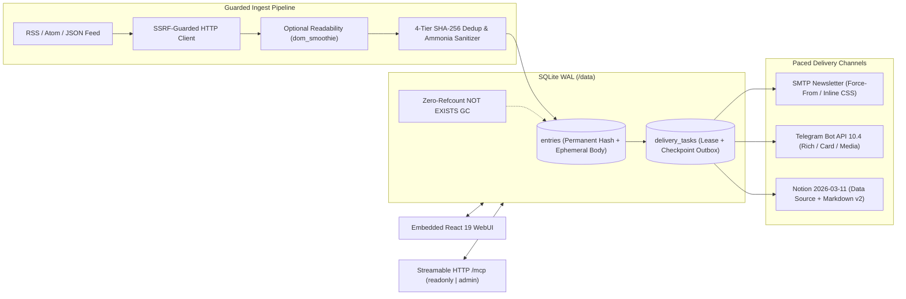
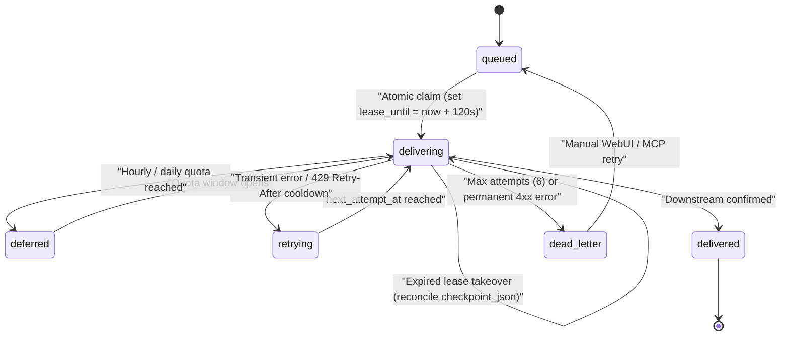

# Core Architecture Deep Dive

This reference documents FeedCourier's internal subsystems: the **4-tier anti-drift SHA-256 deduplication pipeline**, **zero-refcount `NOT EXISTS` payload garbage collection**, **SQLite WAL read/write pool separation**, **lease-based outbox recovery**, and **connect-time DNS SSRF protection**.

---

## High-Level Data Flow



---

## 1. Four-Tier Anti-Drift SHA-256 Deduplication

Many real-world RSS and Atom feeds exhibit subtle defects: rotating marketing query parameters (`?utm_source=...`), changing `http://` to `https://`, or omitting `<guid>` and `<pubDate>` entirely (causing naive parsers to inject `now()` on every poll and re-deliver every article on every tick).

FeedCourier computes a deterministic 64-character hex SHA-256 fingerprint (`src/ingest/fingerprint.rs`) per feed using a strict **4-tier fallback chain**:

| Priority | Tier Name | Input Normalized Before Hashing | Why It Prevents Drift |
| :--- | :--- | :--- | :--- |
| **Tier 1** | `NativeId` | Atom `<id>`, RSS `<guid>`, or JSON Feed `id` (trimmed). | Highest fidelity when the publisher provides stable item IDs. |
| **Tier 2** | `CanonicalUrl` | Entry permalink normalized via `normalize_canonical_url`: scheme unified (`http` → `https`), host lowercased, default ports `:80`/`:443` stripped, fragment `#...` removed, query parameters sorted, and tracking keys (`utm_*`, `fbclid`, `gclid`, `mc_cid`, `mc_eid`, `spm`, `from`, `ref`, `_hsenc`, `_hsmi`, `mkt_tok`, `igshid`) stripped. | Immune to marketing campaign query mutations and HTTP→HTTPS migrations. |
| **Tier 3** | `TitleAndPublished` | `normalized_title + original_published_unix_timestamp` — **only used when the feed XML/JSON explicitly contains a publication timestamp**. | Avoids synthetic "current time" injection on feeds that omit `<pubDate>`. |
| **Tier 4** | `TitleAndContentPrefix` | `normalized_title + first 512 bytes` of sanitized plain-text body. | Stable content-addressed fallback for bare feeds lacking IDs, links, and dates. |

### Silent Initialization (`silent_init`)
When a new feed is added (`silent_init = true` by default) or imported via OPML 2.0, all existing historical entries in the feed are inserted into `entries` with their SHA-256 fingerprints, while **zero** `delivery_tasks` are enqueued (unless `push_latest_one = true` is explicitly requested to verify channel connectivity with the single newest item).

---

## 2. Zero-Refcount `NOT EXISTS` Payload Garbage Collection

Maintaining manual reference counts across routes and tasks is error-prone when users delete routes, disable channels, or filter out entries.

Instead, FeedCourier uses a declarative **`NOT EXISTS` relational predicate** (`src/db/mod.rs`) executed hourly (and on manual trigger):

```sql
UPDATE entries
SET content_html = NULL,
    summary_text = NULL,
    first_sentence = NULL,
    media_json = NULL,
    payload_purged_at = ?1
WHERE payload_purged_at IS NULL
  AND discovered_at <= ?2
  AND NOT EXISTS (
      SELECT 1
      FROM delivery_tasks t
      WHERE t.entry_id = entries.id
        AND t.status IN ('queued', 'delivering', 'retrying', 'deferred')
  );
```

This single query guarantees:
1. Entries with **active or retrying tasks** retain their HTML and media metadata even if `RETENTION_HOURS` has elapsed.
2. Entries that were **filtered out**, **silently initialized**, or whose **routes/channels were deleted** are automatically reclaimed once `discovered_at <= now - RETENTION_HOURS`.
3. The compact `(feed_id, fingerprint_sha256)` row stays forever (`< 100 bytes` per row), preventing historical entries from ever re-triggering.

---

## 3. SQLite WAL Read/Write Connection Pool Separation

To eliminate `SQLITE_BUSY` contention between background feed polling, outbox checkpoint writes, and concurrent WebUI / MCP queries, `Database` (`src/db/mod.rs`) maintains **two separate `sqlx::SqlitePool` instances** against `<DATA_DIR>/feedcourier.db`:

| Pool | Max Connections | SQLite Pragmas | Workload |
| :--- | :--- | :--- | :--- |
| **`write_pool`** | `1` (Serialized) | `journal_mode = WAL`, `synchronous = NORMAL`, `busy_timeout = 5000`, `foreign_keys = ON` | Atomic task claiming (`UPDATE ... RETURNING`), entry ingestion, checkpoint flushes, and config mutations. |
| **`read_pool`** | `8` (`DB_READ_MAX_CONNECTIONS`) | `query_only = ON`, `busy_timeout = 5000`, `foreign_keys = ON` | Concurrent WebUI dashboard reads, MCP `list_feeds_status` / `inspect_failed_deliveries`, and route lookups. |

---

## 4. Lease-Based Outbox & `checkpoint_json` State Machine



### Atomic Claiming & Expired-Lease Takeover
Outbox workers never rely on fragile startup-only crash recovery scans. On every dispatch tick, a worker claims due tasks **or** tasks whose `lease_until` (`DEFAULT_TASK_LEASE_SECS = 120s`) has expired:

- **`queued` / `retrying` / `deferred`** where `next_attempt_at <= now`
- **`delivering`** where `lease_until <= now` (process killed, container restarted, or network hung)

### Per-Channel Delivery Semantics

| Channel | Semantics | `checkpoint_json` Structure |
| :--- | :--- | :--- |
| **Notion (`2026-03-11`)** | **Effective-once** | `{"kind":"notion","create_initiated":true,"async_task_id":"...","page_id":"..."}` — Queries `FC-ID` before recreating if `create_initiated` is set. |
| **SMTP** | **At-least-once** *(client-deduplicable)* | `{"kind":"smtp","message_id":"<fc-entry-...>"}` — Reuses identical RFC 5322 `Message-ID` across retries. |
| **Telegram (`10.4`)** | **At-least-once** *(bounded to 1 batch)* | `{"kind":"telegram","next_batch_offset":10,"sent_message_ids":[...],"degraded_to_compact":false}` — Resumes `sendMediaGroup` from the first unsent 10-item batch. |

---

## 5. Guarded Outbound Networking, Exponential Backoff & Readability

1. **Connect-Time DNS SSRF Guard (`src/net/ssrf.rs`)**: `SsrfDnsResolver` hooks directly into `reqwest`'s DNS resolution phase, validating every resolved IPv4/IPv6 socket address against private, loopback, link-local, and cloud metadata (`169.254.169.254`) ranges **before** TCP `connect()` is called—defeating DNS rebinding attacks.
2. **Hop-by-Hop Redirect Re-Validation**: `reqwest`'s automatic redirect policy is disabled (`Policy::none()`). `ProtectedHttpClient` manually inspects up to `5` redirect hops (`DEFAULT_MAX_REDIRECT_HOPS = 5`), resolving relative `Location` headers and re-validating every hop's scheme (`http`/`https`) and IP address.
3. **Streaming Byte Caps**: Responses are read chunk-by-chunk and aborted immediately if they exceed `10 MiB` (feeds), `5 MiB` (Readability web pages), `10 MiB` (Telegram fallback photos), or `50 MiB` (Telegram fallback video/audio/documents).
4. **Conditional HTTP Polling & Circuit Breaker**:
   - Persists `etag` (`If-None-Match`) and `last_modified` (`If-Modified-Since`) per feed; `304 Not Modified` responses finish in `< 1 ms` without parsing XML/JSON.
   - On transient HTTP or network errors, schedules the next poll using exponential backoff with jitter:
     $$t_{\text{delay}} = \min\left(21600,\; t_0 \cdot 2^{\min(n, 8)} + \text{jitter}\right)$$
   - After **`15` consecutive failures** (`DEFAULT_CIRCUIT_BREAKER_THRESHOLD = 15`), the feed transitions to `health_status = 'circuit_open'` and pauses automatic polling until reset via WebUI or MCP `reset_and_poll_feed`.
5. **Isolated Readability Semaphore**: Feeds with `fetch_full_content = true` extract full article HTML via pure-Rust `dom_smoothie` behind a dedicated semaphore (`DEFAULT_READABILITY_CONCURRENCY = 2`, `15s` timeout), ensuring slow origin websites never starve regular feed polling.
