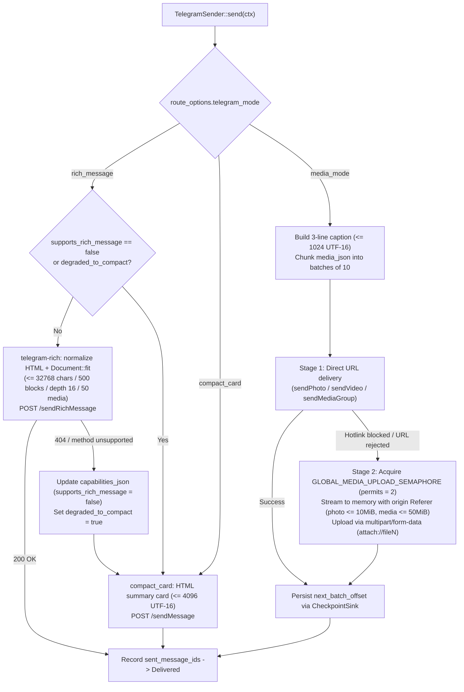
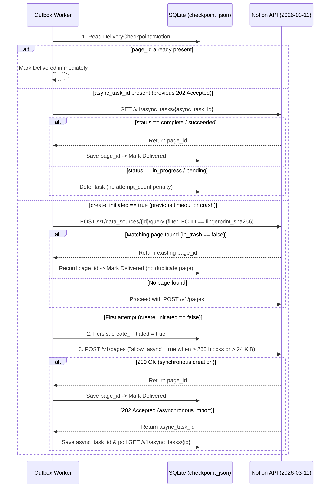

# Channel Protocols & Delivery

This document specifies the wire protocols, payload transformations, streaming media handling, and `DeliveryCheckpoint` crash-recovery logic for FeedCourier's three delivery adapters: **SMTP**, **Telegram Bot API 10.4**, and **Notion API `2026-03-11`**.

For step-by-step WebUI setup instructions, see the user guides for [SMTP Newsletter](/channels/smtp), [Telegram Bot](/channels/telegram), and [Notion Database](/channels/notion).

---

## 1. Delivery Checkpoint Overview (`DeliveryCheckpoint`)

`delivery_tasks.checkpoint_json` stores a serialized `DeliveryCheckpoint` enum (`src/channels/mod.rs`) used to reconcile or resume tasks across retries and `lease_until` lease takeovers:

| Variant | Serialized JSON Fields | Delivery Semantics & Reconciliation |
| :--- | :--- | :--- |
| `DeliveryCheckpoint::Smtp` | `{"kind": "smtp", "message_id": "<...>"}` | **At-least-once (client-deduplicable)**: Generates and persists a deterministic RFC 5322 `Message-ID` before sending; retries reuse the exact `Message-ID` so mail clients deduplicate copies. |
| `DeliveryCheckpoint::Telegram` | `{"kind": "telegram", "next_batch_offset": 10, "sent_message_ids": [...], "degraded_to_compact": false}` | **At-least-once (batch-resumable)**: In `media_mode`, persists `next_batch_offset` via `CheckpointSink` after each 10-item `sendMediaGroup` batch; retries resume from the first unsent batch. |
| `DeliveryCheckpoint::Notion` | `{"kind": "notion", "create_initiated": true, "async_task_id": "...", "page_id": "..."}` | **Effective-once**: Persists `create_initiated = true` before `POST /v1/pages`; on retry, queries `FC-ID == fingerprint_sha256` (or polls `async_task_id`) and records the existing `page_id` without creating a duplicate page. |

---

## 2. SMTP Adapter (`src/channels/smtp.rs`)

### 1. `lettre` Async Transport & Connection Pooling
- `SmtpSender` uses `lettre::AsyncSmtpTransport<Tokio1Executor>` and supports three transport security modes (`SmtpSecurity`):
  - `StartTls` (default port `587`): explicit STARTTLS upgrade;
  - `Tls` (default port `465`): implicit TLS wrapper;
  - `Plain` (default port `25`): unencrypted relay for trusted internal networks.
- Transports are cached in-memory by a SHA-256 key over `(host, port, security, username, password)` with `PoolConfig::new().max_size(2).idle_timeout(60s)` and a per-command timeout of `DEFAULT_SMTP_TIMEOUT = 30s`.
- Account-level tests (`POST /api/v1/channels/{id}/test` without `destination_id`) call `SmtpSender::test_account` (`EHLO`/`AUTH`) without sending an email, whereas destination tests (`POST /api/v1/destinations/{id}/test`) invoke `send_test` against `SmtpDestinationConfig.to_addresses`.

### 2. `minijinja` Single-Column HTML Rendering, Responsive Rewriting & `< 95 KiB` Size Budget
- Every email is built as a `multipart/alternative` message (`MultiPart::alternative_plain_html`) containing:
  1. **`text/html` part**: rendered by `minijinja` using `EMAIL_HTML_TEMPLATE` (a `640px` max-width single-column card layout with `592px` inner width `EMAIL_CARD_INNER_WIDTH_PX`, inline CSS attributes, and `<head>` CSS fallbacks for Gmail, Apple Mail, and Outlook.com). Publication timestamps in the metadata line are formatted in the **route timezone** via `format_local_timestamp` (`YYYY-MM-DD HH:MM (UTC±HH:MM)`);
  2. **`text/plain` part**: generated by `html2text` wrapped at `PLAIN_TEXT_WRAP_WIDTH = 78` columns.
- **Responsive Body HTML Rewriting**: Prior to template interpolation, body tags are normalized so oversized upstream markup cannot break the `640px` card:
  - ``: strips fixed `height`, sets Outlook-compatible `width="592"` (preserving explicit `width` values narrower than `592px`), and enforces inline `style="display:block;max-width:100%;width:100%;height:auto;..."` (or non-stretched `max-width:100%;height:auto` for small images);
  - `<figure>` / `<figcaption>`: resets horizontal margins and applies subtle muted caption styling;
  - `<table>` / `<pre>`: applies `max-width:100%` with horizontal scrolling / word-wrapping so wide tables and code blocks stay contained.
- **Gmail Clipping Prevention (`MAX_EMAIL_HTML_BYTES = 95 KiB`)**: Because Gmail clips messages whose raw body exceeds approximately `102 KB`, `render_entry_html` caps the rendered UTF-8 HTML part at **`95 KiB` (`97,280` bytes)**. Oversized articles are truncated at a tag boundary and appended with a `Continue reading original article →` link to `canonical_url`.

### 3. `Force-From` Alignment & Deterministic Headers
- **`Force-From` (SPF / DKIM / DMARC Alignment)**: Regardless of the author address declared in the upstream feed, the RFC 5322 `From` header always uses the authenticated channel's `from_address`, formatted as `"<Feed Title> via FeedCourier" <from_address>`. When configured, `reply_to` is emitted as a separate `Reply-To` header.
- **Deterministic `Message-ID`**: Computed from the first 32 hex characters of the entry fingerprint, the `route_id`, and the sender domain:
  ```text
  <fc-entry-{fingerprint_sha256[..32]}-r{route_id}@{from_domain}>
  ```
- **Per-Feed `List-Id` & `Auto-Submitted`**: Includes `Auto-Submitted: auto-generated` and `List-Id: <feed-{feed_id}.feedcourier.{from_domain}>` for deterministic client-side folder filtering.

---

## 3. Telegram Adapter (`src/channels/telegram.rs`, Bot API 10.4)

`TelegramSender` targets **Telegram Bot API 10.4** across private chats, groups, forum topic supergroups (`message_thread_id`), channels, and self-hosted Local Bot API servers (`api_base_url`), supporting three per-route presentation modes (`TelegramDeliveryMode`).



### 1. `RichMessage` Mode & `telegram-rich 0.0.2` Integration
- When a route selects `rich_message`, `build_rich_message_payload_with_options` builds the structured Bot API 10.4 message using [`telegram-rich 0.0.2`](https://crates.io/crates/telegram-rich):
  1. **Header Structure**: Emits the article title as plain foreground **`<h3>`** (`Block::Heading { level: 3 }`, without link blue so the bottom capsule button serves as the sole CTA), renders `Source · Author · Compact Localized Publish Time` (formatted in the **route timezone** as `YYYY-MM-DD HH:MM`) as a native Telegram **`<footer>`** (`Block::Footer`), and inserts a horizontal divider (`Block::Divider` / `<hr>`) before the body.
  2. **Rich HTML Parsing (`parse_rich_html` + `ParseOptions`)**: Parses sanitized body HTML with `heading_offset: 3` (demoting `h1→h4`, `h2→h5`, `h3+→h6`) and `group_consecutive_media: true` (automatically merging 2+ consecutive inline images into `<tg-collage>`, falling back to `<tg-slideshow>` when exceeding collage limits), while preserving compact tables (`<table compact>`), expandable blockquotes (`<blockquote expandable>`), syntax-tagged code blocks (`<pre><code class="language-...">`), and bottom link buttons (`<tg-button-row>` / `Block::link_button`).
  3. **Structural Truncation (`Document::fit` / `FitOptions`)**: Fits the document within Bot API 10.4 limits prior to serialization as `InputRichMessage`:
     - Maximum text length: `32,768` characters;
     - Maximum structural blocks: `500` blocks;
     - Maximum nesting depth: `16` levels;
     - Maximum embedded media items: `50` items.

### 2. Endpoint Capability Probing (`probe_capabilities`) & Automatic Fallback
- When creating or testing a Telegram **Account** (`POST /api/v1/channels` or `POST /api/v1/channels/{id}/test` without `destination_id`), `probe_capabilities` calls `getMe` to verify the token and retrieve `bot_username` (used as the default account name when blank), then sends a dry-run `POST /bot<token>/sendRichMessage` with an empty JSON body `{}`:
  - A `400 Bad Request` response (missing `chat_id`) confirms that the endpoint supports Bot API `10.2+` / `10.4` `sendRichMessage`, recording `supports_rich_message: true` and `bot_api_version: "10.4"` in `channels.capabilities_json`;
  - A `404 Not Found` or unknown-method error on a self-hosted Local Bot API Server `< 10.2` records `supports_rich_message: false` and `bot_api_version: "<10.2"`.
- Destination creation also calls `getChat` to auto-populate the destination display name when omitted, and `POST /api/v1/destinations/{id}/test` sends an interactive test message to that destination's `chat_id` (and optional `message_thread_id`).
- Whenever `supports_rich_message` is `false` (or if `sendRichMessage` returns an unsupported-method error at runtime), `TelegramSender` automatically falls back to `CompactCard` (`sendMessage` with `parse_mode: "HTML"`, bounded to `MAX_MESSAGE_UTF16_UNITS = 4,096` UTF-16 code units and respecting `link_preview_options`).

### 3. `MediaMode`: 3-Line Hyperlink Caption, Smart Media Routing & 10-Item Batch Checkpointing
- **3-Line HTML Caption (`MAX_CAPTION_UTF16_UNITS = 1,024`, `parse_mode: "HTML"`)**:
  - Line 1: HTML-escaped entry author (or feed title when author is absent);
  - Line 2: HTML-escaped first sentence extracted via `unicode-segmentation` (`unicode_sentences`) stored in `entries.first_sentence`;
  - Line 3: Localized hyperlink (`<a href="...">Link</a>` in English / `<a href="...">链接</a>` in Simplified Chinese, following the route's `options.locale`, falling back to the legacy `system_settings.locale`).
  - Visible text is truncated on a character boundary to at most `1,024` UTF-16 code units (entries without valid media items send the same 3-line HTML message via `sendMessage`).
- **Smart Per-Type Routing, Magic-Byte Sniffing & ISO-BMFF Metadata Extraction**:
  - **Stage 1 (Direct URL Pass for Images, Audio & Explicit Documents)**: Submits upstream image/audio URLs directly to Telegram (`sendPhoto`, `sendAudio`, `sendDocument`, or `sendMediaGroup`), falling back to Stage 2 on hotlink (`Referer`) or URL fetch failures.
  - **Stage 2 (In-Memory Streaming `multipart/form-data` Upload & Video Pipeline)**: Videos (`MediaAttachmentKind::Video`) and unlabeled `<enclosure>` attachments bypass Telegram's URL fetcher (which silently downgrades extensionless or `application/octet-stream` videos into unpreviewable `Document` files with HTTP `200 OK`) and acquire a permit from `GLOBAL_MEDIA_UPLOAD_SEMAPHORE` (`MAX_CONCURRENT_MEDIA_UPLOADS = 2`). `ProtectedMediaFetcher` streams the asset into an in-memory `Bytes` buffer with an origin `Referer` header, `sniff_media_bytes` inspects container magic bytes (`ftyp`/`moov`, WebM EBML, JPEG/PNG/GIF/WebP, MP3/Ogg, PDF) to promote misclassified attachments and normalize video MIME/extensions to `video/mp4` + `.mp4`, and `parse_mp4_metadata` walks ISO-BMFF `moov -> mvhd / tkhd / stsd` boxes (accounting for 90°/270° portrait rotation matrices) so `sendVideo` and `sendMediaGroup` (`InputMediaVideo`) include `supports_streaming: true`, `width`, `height`, and `duration`.
  - **Byte Caps**: Photos are capped at `MAX_PHOTO_BYTES = 10 MiB` (`10,485,760` bytes); videos, audio, and documents are capped at `MAX_MEDIA_BYTES = 50 MiB` (`52,428,800` bytes). Assets exceeding the cap abort the stream immediately and append compact `<a href="...">Media N</a>` (`媒体 N`) hyperlinks to the 3rd line.
- **`sendMediaGroup` 10-Item Batching & `checkpoint_json` Resume**:
  - Entries with more than `MEDIA_GROUP_BATCH_SIZE = 10` media attachments are split into sequential 10-item batches (attaching the 3-line caption to the first batch);
  - After each batch succeeds, `CheckpointSink::save_checkpoint` persists `next_batch_offset` and `sent_message_ids` in `delivery_tasks.checkpoint_json`. If a subsequent batch hits a `429 Too Many Requests` cooldown or a process crash, the retry resumes from `media_items[next_batch_offset..]` without duplicating earlier batches.

---

## 4. Notion Adapter (`src/channels/notion.rs`, `Notion-Version: 2026-03-11`)

### 1. Pinned `Notion-Version: 2026-03-11` Contract
`NotionSender` pins the `Notion-Version: 2026-03-11` header (`NOTION_API_VERSION = "2026-03-11"`) on all HTTP requests and implements the `2026-03-11` Data Source model. Under the two-layer channel model, `channels.encrypted_config` holds `NotionChannelConfig` (`integration_secret`, verified via `GET /v1/users/me`), while each destination in `channel_destinations.encrypted_config` holds `NotionDestinationConfig` (`data_source_id`, optional `database_id` / `parent_page_id`, and `column_mapping`):
- **Parent Model (`data_source_id`)**: Page creation (`POST /v1/pages`) specifies `parent: { "type": "data_source_id", "data_source_id": "<uuid>" }` rather than `database_id`;
- **Database Provisioning (`initial_data_source.properties`)**: `POST /api/v1/channels/notion/init-db` calls `POST /v1/databases` with the 7 standard columns (`Title`, `FC-ID`, `Link`, `Source`, `Published`, `State`, `Tag`) defined under `initial_data_source.properties` and extracts the resulting `data_source_id` from `data_sources[0].id`;
- **Schema Inspection & Auto-Patching (`inspect-schema`)**: `POST /api/v1/channels/notion/inspect-schema` inspects `GET /v1/data_sources/{id}` and, when `patch_missing: true`, adds missing standard columns via `PATCH /v1/data_sources/{id}` (automatically resolving a `database_id` to its primary `data_source_id` via `GET /v1/databases/{id}` when given a database URL);
- **Trash Flag (`in_trash`)**: Uses `in_trash: bool` on pages and data sources instead of the deprecated `archived` field.

### 2. HTML-to-Markdown v2 Conversion (`htmd` + `normalize_markdown_v2`)
Notion `2026-03-11` accepts a top-level `markdown` string on `POST /v1/pages`. `convert_entry_html_to_notion_markdown` processes each entry through two stages:
1. **`htmd` Conversion**: Converts sanitized HTML into ATX headings (`#`), `-` bullet lists, inline links, and fenced code blocks;
2. **Dynamic Backtick Fence Expansion (`normalize_markdown_v2`)**: Scans every fenced code block; if the code body contains a run of $k \ge 3$ consecutive backticks, the outer opening and closing fences are expanded to $k + 1$ backticks (e.g., ```` ```` ````) so nested Markdown examples cannot prematurely close the fence;
3. **Block-Boundary Truncation**: Enforces safety caps below Notion's 5,000-block single-write limit at `MAX_NOTION_BLOCKS = 4,800` blocks and `MAX_MARKDOWN_BYTES = 450,000` UTF-8 bytes (while capping individual `rich_text` fragments at `MAX_NOTION_TEXT_FRAGMENT_CHARS = 2,000` chars and `select` / `multi_select` option names at `MAX_NOTION_SELECT_CHARS = 100` chars). Truncation occurs cleanly at block/fence boundaries and appends a link to the original article.

### 3. Large Page Async Creation (`allow_async`) & Effective-Once Reconciliation


- **Async Page Creation**: When an article exceeds `ASYNC_BLOCK_THRESHOLD = 250` blocks or `ASYNC_BYTE_THRESHOLD = 24 KiB` (`24,576` bytes), `POST /v1/pages` sets `"allow_async": true`. If Notion responds with `202 Accepted` and an `async_task_id`, the worker performs bounded inline polls (`DEFAULT_INITIAL_ASYNC_POLLS = 2` at `600ms` intervals) of `GET /v1/async_tasks/{id}` and, if still in progress, persists `async_task_id` and defers the task (up to `DEFAULT_MAX_ASYNC_POLL_AGE_SECS = 1200s` without consuming transient retry attempts).
- **`FC-ID` Reconciliation**: Before sending `POST /v1/pages`, the worker persists `create_initiated: true` via `CheckpointSink` and populates the `FC-ID` property with `entry.fingerprint_sha256`. If a network timeout or crash occurs before the response arrives, the next retry queries `POST /v1/data_sources/{id}/query` for `FC-ID == entry.fingerprint_sha256` (`in_trash == false`). If the page was already created, its `page_id` is saved and the task completes without creating a duplicate page.
