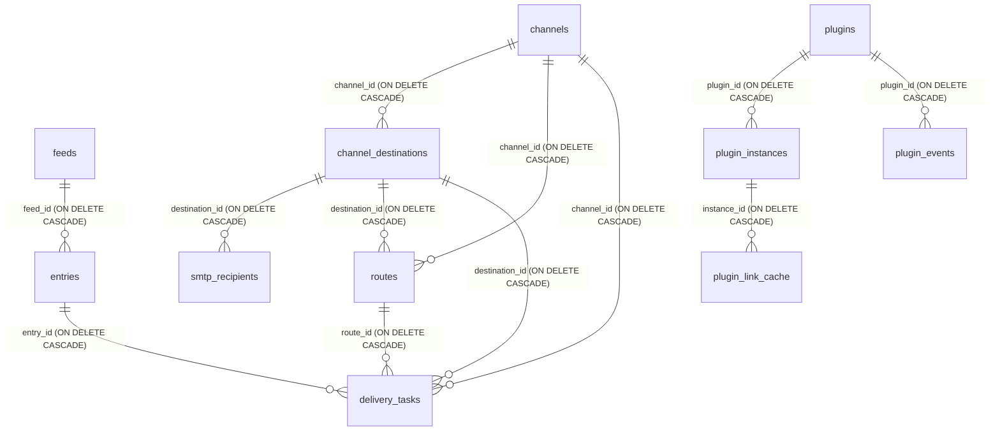

# SQLite Database Schema

FeedCourier stores all persistent business state in a single SQLite `WAL` database at `<DATA_DIR>/feedcourier.db`, while structured operational logs live in a separate database (`<DATA_DIR>/logs.db` or optional ClickHouse; see [Section 9](#_9-operational-log-storage-logs-db-optional-clickhouse)). Schema migrations live in [`migrations/0001_init.sql`](https://github.com/ElleryHe/FeedCourier/blob/main/migrations/0001_init.sql), [`migrations/0002_channel_destinations.sql`](https://github.com/ElleryHe/FeedCourier/blob/main/migrations/0002_channel_destinations.sql), [`migrations/0003_plugins_and_smtp_compliance.sql`](https://github.com/ElleryHe/FeedCourier/blob/main/migrations/0003_plugins_and_smtp_compliance.sql), and [`migrations/0004_js_plugins.sql`](https://github.com/ElleryHe/FeedCourier/blob/main/migrations/0004_js_plugins.sql) and run automatically on startup.

Before applying major DDL migrations against an existing database, `Database::connect` captures a pure pre-DDL online `VACUUM INTO` snapshot without overwriting prior backups (appending a UTC timestamp and collision suffix if the file or companion `-wal`/`-shm` sidecars exist, and cleaning up residual sidecar files afterward):
- Upgrading `v0.1.x` → `v0.2.0+`: writes `<DATA_DIR>/pre-v0.2.0-backup.db` before `0002_channel_destinations.sql`, followed by `Database::migrate_channels_to_v2`.
- Upgrading `v0.2.x` → `v0.3.0`: whenever an existing database has migration `0002` applied, `0003` pending, and **any business table (`feeds`, `channels`, or `channel_destinations`) is non-empty**, writes `<DATA_DIR>/pre-v0.3.0-backup.db` before `0003_plugins_and_smtp_compliance.sql` (and cleans up any partial backup file and `-wal`/`-shm` sidecars if `VACUUM INTO` fails), followed by the idempotent startup backfill `Database::backfill_legacy_smtp_recipients`.
- Upgrading `v0.3.0` → `v0.3.1`: whenever an existing database has migration `0003` applied, `0004` pending, and **`feeds` or `channels` is non-empty**, writes `<DATA_DIR>/pre-v0.3.1-backup.db` via online `VACUUM INTO` before applying `0004_js_plugins.sql` (which extends `plugins` for in-process JS scripts, rebuilds `channels` to allow `kind = 'plugin'` while preserving `sqlite_sequence`, and creates the `plugin_events` durable queue).

All timestamps are stored as **UTC Unix epoch seconds (`INTEGER`)**, and relational business foreign keys enforce **`ON DELETE CASCADE`** (while `delivery_quota_ledger` intentionally omits foreign keys so deletions never clear quota usage).

---

## Entity-Relationship Overview



---

## Table Definitions

### 1. `feeds` — Subscribed Feeds & Polling State

Stores RSS/Atom/JSON Feed URLs, conditional HTTP caching headers, Readability/proxy flags, and circuit-breaker health state.

| Column | Type | Constraints / Default | Description |
| :--- | :--- | :--- | :--- |
| `id` | `INTEGER` | `PRIMARY KEY AUTOINCREMENT` | Unique feed identifier. |
| `url` | `TEXT` | `NOT NULL UNIQUE` | Feed XML/JSON URL (`http://` or `https://`). |
| `title` | `TEXT` | `NOT NULL DEFAULT ''` | Human-readable feed title (auto-populated on first poll if empty). |
| `site_url` | `TEXT` | `NULL` | Upstream website home URL. |
| `favicon_url` | `TEXT` | `NULL` | Discovered favicon URL (used as Notion page icon and in WebUI). |
| `tags_json` | `TEXT` | `NOT NULL DEFAULT '[]'` | JSON array of string tags (matched by `routes.match_tags_json` and synced to Notion `Tag`). |
| `poll_interval_secs` | `INTEGER` | `NOT NULL DEFAULT 1800` | Base polling interval in seconds (`CHECK (poll_interval_secs > 0)`). |
| `fetch_full_content` | `INTEGER` | `NOT NULL DEFAULT 0` | `1` to extract full webpage articles via `dom_smoothie` Readability (`0` or `1`). |
| `use_proxy` | `INTEGER` | `NOT NULL DEFAULT 0` | `1` to route feed and article requests through the global outbound proxy. |
| `etag` | `TEXT` | `NULL` | Upstream HTTP `ETag` sent in `If-None-Match`. |
| `last_modified` | `TEXT` | `NULL` | Upstream HTTP `Last-Modified` sent in `If-Modified-Since`. |
| `health_status` | `TEXT` | `NOT NULL DEFAULT 'active'` | `'active'`, `'backoff'`, `'circuit_open'`, or `'paused'`. |
| `consecutive_failures` | `INTEGER` | `NOT NULL DEFAULT 0` | Consecutive poll failure counter (transitions to `'circuit_open'` at `15`). |
| `next_poll_at` | `INTEGER` | `NULL` | Next scheduled poll timestamp (UTC Unix seconds). |
| `last_error` | `TEXT` | `NULL` | Diagnostic message from the most recent poll failure. |
| `silent_init` | `INTEGER` | `NOT NULL DEFAULT 1` | `1` to record historical entry fingerprints on initial poll without enqueuing tasks. |
| `created_at` | `INTEGER` | `NOT NULL DEFAULT (unixepoch())` | Creation timestamp. |
| `updated_at` | `INTEGER` | `NOT NULL DEFAULT (unixepoch())` | Last modification timestamp. |

**Indexes:**
- `idx_feeds_poll_schedule ON feeds (health_status, next_poll_at)`

---

### 2. `entries` — Deduplication Fingerprints & Entry Payloads

Stores the permanent 64-character SHA-256 deduplication fingerprint alongside transient HTML and media payloads that are set to `NULL` by the `NOT EXISTS` garbage collector after `RETENTION_HOURS` (see [System Architecture](/reference/architecture)).

| Column | Type | Lifecycle | Description |
| :--- | :--- | :--- | :--- |
| `id` | `INTEGER` | **Permanent** | Primary key (`AUTOINCREMENT`). |
| `feed_id` | `INTEGER` | **Permanent** | Foreign key to `feeds(id) ON DELETE CASCADE`. |
| `fingerprint_sha256` | `TEXT` | **Permanent** | 64-char hex SHA-256 fingerprint (`UNIQUE (feed_id, fingerprint_sha256)`). |
| `published_at` | `INTEGER` | **Permanent** | Original publication timestamp from feed metadata (`NULL` if omitted). |
| `discovered_at` | `INTEGER` | **Permanent** | Timestamp when FeedCourier first discovered the entry. |
| `payload_purged_at` | `INTEGER` | **Permanent** | Timestamp when transient payload columns were purged by GC (`NULL` while retained). |
| `title` | `TEXT` | **Permanent** | Sanitized entry title (retained for task audit logs). |
| `canonical_url` | `TEXT` | **Permanent** | Normalized article permalink (retained for task audit logs). |
| `author` | `TEXT` | **Permanent** | Entry author name. |
| `content_html` | `TEXT` | *Transient (Purged by GC)* | `ammonia`-sanitized HTML body with resolved absolute URLs. |
| `first_sentence` | `TEXT` | *Transient (Purged by GC)* | Unicode-segmented first sentence used by Telegram `media_mode`. |
| `summary_text` | `TEXT` | *Transient (Purged by GC)* | Plain-text summary used by Telegram `compact_card`, content filters, and MCP previews. |
| `media_json` | `TEXT` | *Transient (Purged by GC)* | JSON array of extracted `MediaAttachment` items (`url`, `mime_type`, `kind`). |

**Indexes:**
- `UNIQUE (feed_id, fingerprint_sha256)`
- `idx_entries_feed_discovered ON entries (feed_id, discovered_at DESC)`
- `idx_entries_gc_candidates ON entries (discovered_at) WHERE payload_purged_at IS NULL` *(Partial index limiting hourly GC scans to unpurged rows)*

---

### 3. `channels` — Encrypted Trusted Delivery Accounts

Stores account-level ChaCha20-Poly1305 encrypted credentials (`ChannelConfig`), shared credential group keys, outbound proxy toggles, and account-wide pacing/quota/cooldown settings shared by all child `channel_destinations` (see [Security & Isolation](/reference/security)).

| Column | Type | Constraints / Default | Description |
| :--- | :--- | :--- | :--- |
| `id` | `INTEGER` | `PRIMARY KEY AUTOINCREMENT` | Unique channel account ID (`sqlite_sequence` is preserved across the `0004_js_plugins.sql` table rebuild so historical IDs are never reused). |
| `name` | `TEXT` | `NOT NULL` | Display name shown in WebUI and MCP summaries (auto-derived from Telegram `getMe`, SMTP `from_address`, Notion `/v1/users/me`, or JS channel plugin manifest name when omitted). |
| `kind` | `TEXT` | `NOT NULL CHECK (kind IN ('smtp', 'telegram', 'notion', 'plugin'))` | Channel kind (`'plugin'` added via table rebuild in `0004_js_plugins.sql`). |
| `encrypted_config` | `BLOB` | `NOT NULL` | ChaCha20-Poly1305 ciphertext (`12-byte nonce \|\| ciphertext \|\| 16-byte Poly1305 tag`) of account-level `ChannelConfig` (SMTP server/auth/`from_address`, Telegram `bot_token`/`api_base_url`, Notion `integration_secret`, or `PluginChannelConfig { plugin_id, config }`). |
| `credential_group_key` | `TEXT` | `NOT NULL` | SHA-256 key grouping accounts sharing the same underlying sender credential (for SMTP, incorporates the SHA-256 digest of the password—never plaintext—so distinct API keys under a shared username such as SendGrid's `apikey` stay isolated; for `plugin`, hashes `plugin_id` plus canonical account config JSON). |
| `capabilities_json` | `TEXT` | `NOT NULL DEFAULT '{}'` | Cached capability probe JSON (e.g., Telegram `supports_rich_message`, `bot_api_version`, `bot_username`; or JS channel `capabilities` synced from `manifest_json`). |
| `min_interval_secs` | `INTEGER` | `NOT NULL DEFAULT 15` | Minimum pacing delay in seconds between deliveries across all destinations of this account. |
| `jitter_max_secs` | `INTEGER` | `NOT NULL DEFAULT 10` | Per-delivery random jitter ceiling in seconds (`0 ..= jitter_max_secs`, kept in memory). |
| `hourly_quota` | `INTEGER` | `NULL` | Optional maximum deliveries per rolling 1-hour window shared across all destinations of this account. |
| `daily_quota` | `INTEGER` | `NULL` | Optional maximum deliveries per rolling 24-hour window shared across all destinations of this account. |
| `use_proxy` | `INTEGER` | `NOT NULL DEFAULT 0` | `1` to route all HTTP requests for this account and its destinations through the global outbound proxy (Telegram, Notion, and public `allowed_hosts` of Plugin Channels; SMTP uses native TCP/TLS direct connections). |
| `cooldown_until` | `INTEGER` | `NULL` | Downstream rate-limit cooldown expiration timestamp shared across all destinations. |
| `enabled` | `INTEGER` | `NOT NULL DEFAULT 1` | `1` when active, `0` when paused. |
| `created_at` | `INTEGER` | `NOT NULL DEFAULT (unixepoch())` | Creation timestamp. |
| `updated_at` | `INTEGER` | `NOT NULL DEFAULT (unixepoch())` | Last modification timestamp. |

**Indexes:**
- `idx_channels_credential_group ON channels (credential_group_key)`

---

### 3b. `channel_destinations` — Encrypted Delivery Destinations

Stores one or more concrete delivery targets per parent Channel Account (`migrations/0002_channel_destinations.sql`), each independently encrypted, toggleable, and testable.

| Column | Type | Constraints / Default | Description |
| :--- | :--- | :--- | :--- |
| `id` | `INTEGER` | `PRIMARY KEY AUTOINCREMENT` | Unique destination ID (primary target for `routes` and MCP `configure_route` / `test_push_feed_entry`). |
| `channel_id` | `INTEGER` | `NOT NULL` | Foreign key to `channels(id) ON DELETE CASCADE`. |
| `name` | `TEXT` | `NOT NULL` | Destination label shown in WebUI and redacted MCP summaries (auto-derived from Telegram `getChat`, masked SMTP first recipient such as `a***e@example.com`, or Notion database title when omitted). |
| `encrypted_config` | `BLOB` | `NOT NULL` | ChaCha20-Poly1305 ciphertext of `DestinationConfig` (Telegram `chat_id`/`message_thread_id`, SMTP `to_addresses`/`reply_to`, Notion `data_source_id`/`column_mapping`, or `PluginDestinationConfig { config }`). |
| `enabled` | `INTEGER` | `NOT NULL DEFAULT 1` | `1` when active, `0` when paused independently of sibling destinations. |
| `auto_paused` | `INTEGER` | `NOT NULL DEFAULT 0 CHECK (IN (0, 1))` | Added in `0003_plugins_and_smtp_compliance.sql`. Set to `1` alongside `enabled = 0` when all SMTP recipients become `unsubscribed` or `bounced`. When any recipient subsequently completes re-verification while `auto_paused = 1`, FeedCourier atomically restores `enabled = 1, auto_paused = 0` and wakes deferred tasks; manually toggling `enabled` clears `auto_paused = 0` so manually disabled destinations remain paused. |
| `created_at` | `INTEGER` | `NOT NULL DEFAULT (unixepoch())` | Creation timestamp. |
| `updated_at` | `INTEGER` | `NOT NULL DEFAULT (unixepoch())` | Last modification timestamp. |

**Indexes:**
- `idx_channel_destinations_channel_id ON channel_destinations (channel_id)`

---

### 4. `routes` — Routing Rules, Content Filters & Presentation Options

Binds feed IDs or tags to a target `destination_id` (alongside its parent `channel_id`).

| Column | Type | Constraints / Default | Description |
| :--- | :--- | :--- | :--- |
| `id` | `INTEGER` | `PRIMARY KEY AUTOINCREMENT` | Unique route identifier. |
| `name` | `TEXT` | `NOT NULL` | Human-readable route rule name. |
| `feed_ids_json` | `TEXT` | `NOT NULL DEFAULT '[]'` | JSON array of matched feed IDs (`i64`). |
| `match_tags_json` | `TEXT` | `NOT NULL DEFAULT '[]'` | JSON array of matched feed tags (`string`). |
| `channel_id` | `INTEGER` | `NOT NULL` | Foreign key to parent `channels(id) ON DELETE CASCADE`. |
| `destination_id` | `INTEGER` | `REFERENCES channel_destinations(id) ON DELETE CASCADE` | Target delivery destination ID (populated automatically on v0.2.0 migration and on all route creations). |
| `include_keywords_json` | `TEXT` | `NOT NULL DEFAULT '[]'` | JSON array of case-insensitive required keywords. |
| `exclude_keywords_json` | `TEXT` | `NOT NULL DEFAULT '[]'` | JSON array of case-insensitive excluded keywords. |
| `include_regex` | `TEXT` | `NULL` | Optional regular expression that must match. |
| `exclude_regex` | `TEXT` | `NULL` | Optional regular expression that rejects matching entries. |
| `options_json` | `TEXT` | `NOT NULL DEFAULT '{}'` | JSON `RouteOptions`: `telegram_mode`, `link_preview`, `locale` (route delivery language), `timezone` (optional per-route IANA timezone override inheriting `system_settings.timezone`), `active_windows` (`[{start, end}]`, `HH:MM` in the route timezone), `active_weekdays` (`1` = Mon … `7` = Sun), `plugin_order` (optional ordered array of up to 64 processor plugin IDs), and `plugins` (`{ "<plugin_id>": { ... } }`). |
| `enabled` | `INTEGER` | `NOT NULL DEFAULT 1` | `1` when active, `0` when disabled. |
| `created_at` | `INTEGER` | `NOT NULL DEFAULT (unixepoch())` | Creation timestamp. |
| `updated_at` | `INTEGER` | `NOT NULL DEFAULT (unixepoch())` | Last modification timestamp. |

**Indexes:**
- `idx_routes_destination_id ON routes (destination_id)`

---

### 5. `delivery_tasks` — Transactional Outbox & Checkpoints

Tracks every `Entry × Route` delivery lifecycle.

| Column | Type | Constraints / Default | Description |
| :--- | :--- | :--- | :--- |
| `id` | `INTEGER` | `PRIMARY KEY AUTOINCREMENT` | Unique task ID. |
| `route_id` | `INTEGER` | `NOT NULL` | Foreign key to `routes(id) ON DELETE CASCADE`. |
| `channel_id` | `INTEGER` | `NOT NULL` | Foreign key to parent `channels(id) ON DELETE CASCADE` (retained for account/group rolling quota aggregation). |
| `destination_id` | `INTEGER` | `REFERENCES channel_destinations(id) ON DELETE CASCADE` | Target delivery destination ID. |
| `entry_id` | `INTEGER` | `NOT NULL` | Foreign key to `entries(id) ON DELETE CASCADE`. |
| `status` | `TEXT` | `NOT NULL DEFAULT 'queued'` | `'queued'` (pending), `'delivering'` (leased), `'delivered'`, `'retrying'` (failed/backoff), `'deferred'`, or `'dead_letter'`. |
| `lease_until` | `INTEGER` | `NULL` | Worker lease expiration timestamp while `status = 'delivering'`. |
| `checkpoint_json` | `TEXT` | `NULL` | Serialized `DeliveryCheckpoint` (`smtp { message_id, sent_recipients }` / `telegram` / `notion`). |
| `attempt_count` | `INTEGER` | `NOT NULL DEFAULT 0` | Number of delivery attempts consumed (`dead_letter` at `6`). |
| `next_attempt_at` | `INTEGER` | `NOT NULL DEFAULT (unixepoch())` | Earliest timestamp when the task may be claimed. |
| `last_status_code` | `INTEGER` | `NULL` | Downstream HTTP or SMTP status code from the last attempt. |
| `diagnostic_log` | `TEXT` | `NULL` | Diagnostic message or error reason from the last attempt (recipient email addresses are masked to prevent plaintext PII leakage). |
| `completed_at` | `INTEGER` | `NULL` | Completion timestamp when `status` reaches `'delivered'` or `'dead_letter'`. |
| `created_at` | `INTEGER` | `NOT NULL DEFAULT (unixepoch())` | Task creation timestamp. |

**Indexes:**
- `UNIQUE (route_id, entry_id)`
- `idx_delivery_tasks_status_next_attempt ON delivery_tasks (status, next_attempt_at)` *(The outbox claim then orders due tasks by `COALESCE(entries.published_at, entries.discovered_at)` via a join on `entries`, producing a merged chronological stream across feeds)*
- `idx_delivery_tasks_status_lease ON delivery_tasks (status, lease_until)`
- `idx_delivery_tasks_entry_status ON delivery_tasks (entry_id, status)` *(Supports `NOT EXISTS` GC subquery)*
- `idx_delivery_tasks_channel_status_completed ON delivery_tasks (channel_id, status, completed_at)` *(Supports channel delivery history queries and `v0.2.0` migration backfill into `delivery_quota_ledger`)*
- `idx_delivery_tasks_destination_id ON delivery_tasks (destination_id)`

---

### 5b. `delivery_quota_ledger` — Persistent Rolling Quota & Pacing Ledger

Added in `migrations/0002_channel_destinations.sql` to decouple rolling 1-hour / 24-hour quota accounting and `last_completed_at` pacing timestamps from cascade-deleted `delivery_tasks` rows. Intentionally has **no business foreign keys** (`feeds`, `routes`, `channel_destinations`, or `channels`) so deleting feeds, routes, or destinations—or running Clear cache—never resets quota usage or pacing timestamps.

| Column | Type | Constraints / Default | Description |
| :--- | :--- | :--- | :--- |
| `id` | `INTEGER` | `PRIMARY KEY AUTOINCREMENT NOT NULL` | Unique ledger entry ID. |
| `credential_group_key` | `TEXT` | `NOT NULL` | Account credential group key at the time of delivery. |
| `channel_id` | `INTEGER` | `NOT NULL` | Parent channel account ID at the time of delivery (no foreign key). |
| `completed_at` | `INTEGER` | `NOT NULL` | UTC Unix timestamp when the delivery succeeded. |

- **Lifecycle**: Appended whenever a delivery succeeds (and backfilled from trailing 24-hour `delivered` tasks during `v0.2.0` migration); automatically pruned by the hourly maintenance task once `completed_at` is older than 24 hours (`86,400` seconds).
- **Indexes:**
  - `idx_delivery_quota_ledger_group_completed ON delivery_quota_ledger (credential_group_key, completed_at)` *(Primary index for rolling 1h/24h quota counts and `last_completed_at` pacing lookups)*
  - `idx_delivery_quota_ledger_channel_completed ON delivery_quota_ledger (channel_id, completed_at)`

---

### 6. `system_settings`, `mcp_tokens` & `sessions`

- **`system_settings`** (`key TEXT PRIMARY KEY`, `value_json TEXT`, `updated_at INTEGER`): Key-value store for instance-wide settings:

  | Key | Value |
  | :--- | :--- |
  | `admin_username` | Administrator username (default `Courier`; overridden by `ADMIN_USERNAME` at every start). |
  | `admin_password_hash` | Argon2id PHC string. |
  | `admin_totp_secret` | Active TOTP secret, ChaCha20-Poly1305 encrypted (base64). Removed when 2FA is disabled or `RESET_2FA=true`. |
  | `admin_totp_pending` | Encrypted TOTP secret awaiting its first confirmed code during 2FA setup. |
  | `admin_totp_last_step` | Last accepted TOTP time step (replay protection). |
  | `admin_recovery_hashes` | SHA-256 hashes of the unused single-use recovery codes. |
  | `timezone` | Default IANA system timezone inherited by routes (seeded from `TIMEZONE` / `TZ`, default `America/Los_Angeles`). |
  | `outbox_queue` | Global queue pause state (`paused`, optional `resume_at`). |
  | `channel_model_version` | Integer schema marker (`2` once the v0.2.0 two-layer Account + Destinations migration completes; prevents re-running migration on subsequent restarts). |
  | `smtp_recipient_model_version` | Integer marker (`1` once the v0.3.0 legacy SMTP recipient backfill completes idempotently). |
  | `public_url` | Optional public base URL (`https://...`) for RFC 8058 `/u/{token}` and `/v/{token}` links (overridden whenever `PUBLIC_URL` is set in the environment). |
  | `locale` | **Legacy** fallback delivery language for routes without `options.locale`. |
  | `outbound_proxy_url` | Global outbound proxy URL. |
  | `ssrf_allowlist` | SSRF CIDR / hostname allowlist entries. |
- **`mcp_tokens`** (`id`, `name`, `token_hash UNIQUE`, `token_prefix`, `scope CHECK (scope IN ('readonly', 'admin'))`, `last_used_at`, `created_at`): Stores SHA-256 digests of issued MCP Bearer tokens.
- **`sessions`** (`token_hash TEXT PRIMARY KEY`, `expires_at INTEGER`, `created_at INTEGER`): Stores SHA-256 digests of active WebUI `fc_session` cookies (`30`-day TTL, `2,592,000` seconds).

---

### 7. `plugins`, `plugin_instances`, `plugin_link_cache` & `plugin_events` (`0003` + `0004_js_plugins.sql`)

Added in `v0.3.0` (`0003_plugins_and_smtp_compliance.sql`) and extended in `v0.3.1` (`0004_js_plugins.sql`) to store in-process sandboxed JS plugin scripts (`boa_engine`), SHA-256 digests, compiled manifests, and durable at-least-once `on_delivered` event queues:

#### `plugins`

| Column | Type | Constraints / Default | Description |
| :--- | :--- | :--- | :--- |
| `id` | `TEXT` | `PRIMARY KEY NOT NULL` | Canonical plugin identifier (e.g., `'link-rewrite'`, `'ntfy'`, `'bark'`). |
| `enabled` | `INTEGER` | `NOT NULL DEFAULT 0 CHECK (IN (0, 1))` | Global enable toggle (disabling skips hooks while keeping route configs). |
| `installed_version` | `TEXT` | `NOT NULL` | Installed plugin SemVer version. |
| `settings_json` | `TEXT` | `NOT NULL DEFAULT '{}'` | Optional plugin-wide JSON settings. |
| `source` | `TEXT` | `NOT NULL DEFAULT 'builtin' CHECK (source IN ('builtin', 'market', 'custom'))` | Added in `0004_js_plugins.sql`. Distinguishes compiled built-in Rust plugins from Marketplace-installed or custom-uploaded JS plugins. |
| `kind` | `TEXT` | `NOT NULL DEFAULT 'processor' CHECK (kind IN ('processor', 'channel'))` | Added in `0004_js_plugins.sql`. Plugin role (`'processor'` for `on_render`/`on_delivered` hooks or `'channel'` for custom delivery channels). |
| `script_js` | `TEXT` | `NULL` | Added in `0004_js_plugins.sql`. Persisted single-file `plugin.js` ES module source (`NULL` for built-in Rust plugins). |
| `script_sha256` | `TEXT` | `NULL` | Added in `0004_js_plugins.sql`. 64-char lowercase hex SHA-256 checksum of `script_js` (`NULL` for built-in plugins). |
| `manifest_json` | `TEXT` | `NULL` | Added in `0004_js_plugins.sql`. Compiled Protocol v1 manifest JSON extracted from `export const meta`. |
| `installed_at` | `INTEGER` | `NULL` | Added in `0004_js_plugins.sql`. UTC Unix seconds timestamp when the JS plugin was installed or last upgraded. |
| `disabled_reason` | `TEXT` | `NULL` | Added in `0004_js_plugins.sql`. Reason recorded when the automatic 3-consecutive-timeout circuit breaker disables a JS plugin globally (cleared when manually re-enabled). |
| `created_at` / `updated_at` | `INTEGER` | `NOT NULL DEFAULT (unixepoch())` | Timestamps. |

#### `plugin_instances`

| Column | Type | Constraints / Default | Description |
| :--- | :--- | :--- | :--- |
| `id` | `INTEGER` | `PRIMARY KEY AUTOINCREMENT NOT NULL` | Unique provider instance ID referenced by `routes.options_json -> $.plugins.<id>.provider_id`. |
| `plugin_id` | `TEXT` | `NOT NULL REFERENCES plugins(id) ON DELETE CASCADE` | Owning plugin ID. |
| `name` | `TEXT` | `NOT NULL` | Human-readable provider label (shown in WebUI and secret-free MCP `list_plugins`). |
| `encrypted_config` | `BLOB` | `NOT NULL` | ChaCha20-Poly1305 AEAD ciphertext of provider settings (e.g., YOURLS `api_url`, `auth_mode`, `signature`/`password`, `exclude_domains`, `strict_mode`, `pass_title`, `use_proxy`). |
| `enabled` | `INTEGER` | `NOT NULL DEFAULT 1 CHECK (IN (0, 1))` | Provider instance toggle. |
| `created_at` / `updated_at` | `INTEGER` | `NOT NULL DEFAULT (unixepoch())` | Timestamps. |

- **Index:** `idx_plugin_instances_plugin_id ON plugin_instances (plugin_id)`

#### `plugin_link_cache`

| Column | Type | Constraints / Default | Description |
| :--- | :--- | :--- | :--- |
| `instance_id` | `INTEGER` | `NOT NULL REFERENCES plugin_instances(id) ON DELETE CASCADE` | Provider instance ID (part of composite PK). |
| `long_url_sha256` | `TEXT` | `NOT NULL` | 64-char SHA-256 hex digest of the original URL (part of composite PK). |
| `short_url` | `TEXT` | `NOT NULL` | Resolved short URL returned by the provider. |
| `created_at` | `INTEGER` | `NOT NULL DEFAULT (unixepoch())` | Cache insertion timestamp. |
| `last_used_at` | `INTEGER` | `NOT NULL DEFAULT (unixepoch())` | Refreshed on cache hit; rows unused for > **90 days** are pruned by background maintenance. |

- **Primary Key:** `(instance_id, long_url_sha256)`
- **Index:** `idx_plugin_link_cache_last_used ON plugin_link_cache (last_used_at)`

#### `plugin_events` (`0004_js_plugins.sql`)

Durable at-least-once event outbox for asynchronous `on_delivered` callbacks on enabled JS plugins (persisted alongside successful delivery and retried with exponential backoff):

| Column | Type | Constraints / Default | Description |
| :--- | :--- | :--- | :--- |
| `id` | `INTEGER` | `PRIMARY KEY AUTOINCREMENT NOT NULL` | Unique event queue row ID. |
| `plugin_id` | `TEXT` | `NOT NULL REFERENCES plugins(id) ON DELETE CASCADE` | Target JS plugin ID. |
| `event` | `TEXT` | `NOT NULL` | Lifecycle event identifier (e.g., `'on_delivered'`). |
| `idempotency_key` | `TEXT` | `NOT NULL` | Deterministic deduplication key passed into the `onDelivered` handler. |
| `payload_json` | `TEXT` | `NOT NULL` | Serialized JSON event payload (`task_id`, entry/feed/route/channel/destination metadata, `status_code`, `delivered_at`). |
| `attempts` | `INTEGER` | `NOT NULL DEFAULT 0` | Number of dispatch attempts completed so far. |
| `next_attempt_at` | `INTEGER` | `NOT NULL` | Earliest UTC Unix seconds timestamp when the worker may dispatch this event. |
| `created_at` | `INTEGER` | `NOT NULL DEFAULT (unixepoch())` | Enqueue timestamp. |

- **Unique Constraint:** `UNIQUE (plugin_id, idempotency_key)`
- **Index:** `idx_plugin_events_due ON plugin_events (next_attempt_at ASC, id ASC)`

---

### 8. `smtp_recipients` (`0003_plugins_and_smtp_compliance.sql`)

Tracks per-recipient double opt-in verification, consent audit, unsubscribe, and synchronous hard-bounce state without storing plaintext email addresses in the table (plaintext addresses live exclusively inside `channel_destinations.encrypted_config`):

| Column | Type | Constraints / Default | Description |
| :--- | :--- | :--- | :--- |
| `id` | `INTEGER` | `PRIMARY KEY AUTOINCREMENT NOT NULL` | Unique recipient record ID. |
| `destination_id` | `INTEGER` | `NOT NULL REFERENCES channel_destinations(id) ON DELETE CASCADE` | Parent SMTP destination ID. |
| `address_hmac` | `TEXT` | `NOT NULL` | Keyed HMAC-SHA256 hex digest (`HKDF(master_key, "fc-smtp-addr-v1")`) of the normalized lowercase email address. |
| `status` | `TEXT` | `NOT NULL CHECK (IN ('unverified','pending','verified','unsubscribed','bounced'))` | Current delivery eligibility status. |
| `code_sha256` | `TEXT` | `NULL` | SHA-256 hex digest of the active 6-digit verification code. |
| `code_expires_at` | `INTEGER` | `NULL` | Expiration timestamp (`now + 1800s` / 30 minutes). |
| `code_attempts` | `INTEGER` | `NOT NULL DEFAULT 0` | Failed code verification attempts (max `5`). |
| `last_code_sent_at` | `INTEGER` | `NULL` | Timestamp of last verification email (enforces 60s cooldown). |
| `codes_sent_window_start` | `INTEGER` | `NULL` | Rolling 1-hour window start for verification send throttling. |
| `codes_sent_in_window` | `INTEGER` | `NOT NULL DEFAULT 0` | Verification emails sent in current 1-hour window (max `5`). |
| `consent_method` | `TEXT` | `NULL` | Audit trail: `'code'`, `'link'`, or `'legacy'` (upgrade backfill). |
| `consented_at` | `INTEGER` | `NULL` | Timestamp when consent was recorded. |
| `revoked_method` | `TEXT` | `NULL` | Revocation reason: `'one_click'`, `'link'`, `'admin'`, or `'hard_bounce'`. |
| `revoked_at` | `INTEGER` | `NULL` | Timestamp when revoked or hard-bounced. |
| `bounce_diagnostic` | `TEXT` | `NULL` | Redacted SMTP 5xx recipient-level hard-bounce diagnostic text (any email addresses are masked). |
| `created_at` / `updated_at` | `INTEGER` | `NOT NULL DEFAULT (unixepoch())` | Timestamps. |

- **Unique Constraint:** `UNIQUE (destination_id, address_hmac)`
- **Index:** `idx_smtp_recipients_destination_status ON smtp_recipients (destination_id, status)`

---

### 9. Operational Log Storage (`logs.db` & Optional ClickHouse)

Structured runtime logs are stored **separately** from `feedcourier.db` (`LOG_STORE=sqlite|clickhouse|off`, default `sqlite`) so log ingestion and retention pruning never contend with the main business database's write lock.

#### SQLite Operational Log Database (`<DATA_DIR>/logs.db`)

Opened in SQLite `WAL` mode (`synchronous = NORMAL`, `5s` busy timeout) with a single dedicated writer connection and a 4-connection read-only pool:

##### `logs`

| Column | Type | Constraints | Description |
| :--- | :--- | :--- | :--- |
| `id` | `INTEGER` | `PRIMARY KEY AUTOINCREMENT` | Monotonic log row ID. |
| `ts_ms` | `INTEGER` | `NOT NULL` | UTC Unix epoch timestamp in **milliseconds**. |
| `level` | `TEXT` | `NOT NULL` | Severity label (`TRACE`, `DEBUG`, `INFO`, `WARN`, `ERROR`). |
| `level_num` | `INTEGER` | `NOT NULL` | Numeric severity rank for threshold filtering. |
| `target` | `TEXT` | `NOT NULL` | Rust `tracing` module target path. |
| `message` | `TEXT` | `NOT NULL` | Redacted human-readable log message. |
| `fields_json` | `TEXT` | `NOT NULL` | Redacted JSON object of structured event fields. |
| `feed_id` | `INTEGER` | `NULL` | Optional correlated feed ID. |
| `task_id` | `INTEGER` | `NULL` | Optional correlated outbox delivery task ID. |
| `route_id` | `INTEGER` | `NULL` | Optional correlated route ID. |
| `channel_id` | `INTEGER` | `NULL` | Optional correlated channel account ID. |
| `destination_id` | `INTEGER` | `NULL` | Optional correlated channel destination ID. |
| `plugin_id` | `TEXT` | `NULL` | Optional correlated plugin ID. |

- **Indexes:**
  - `idx_logs_ts ON logs(ts_ms DESC)`
  - `idx_logs_level_ts ON logs(level_num, ts_ms DESC)`
  - `idx_logs_task_id ON logs(task_id, ts_ms ASC) WHERE task_id IS NOT NULL`
  - `idx_logs_feed_id ON logs(feed_id, ts_ms DESC) WHERE feed_id IS NOT NULL`
- **Retention Pruning:** Background maintenance deletes rows older than `LOG_RETENTION_DAYS` (default `7` days) and trims oldest rows beyond `LOG_MAX_ROWS` (default `100,000`).

#### Optional ClickHouse Log Backend (`LOG_STORE=clickhouse`)

When `LOG_STORE=clickhouse` is enabled (`LOG_CLICKHOUSE_URL`, default database `feedcourier`, default table `logs`), FeedCourier idempotently provisions a `MergeTree` table via HTTP (`INSERT ... FORMAT JSONEachRow`, redirects disabled):

```sql
CREATE TABLE IF NOT EXISTS feedcourier.logs (
    ts DateTime64(3, 'UTC'),
    ts_ms Int64,
    level LowCardinality(String),
    level_num Int32,
    target String,
    message String,
    fields_json String,
    feed_id Nullable(Int64),
    task_id Nullable(Int64),
    route_id Nullable(Int64),
    channel_id Nullable(Int64),
    destination_id Nullable(Int64),
    plugin_id Nullable(String)
) ENGINE = MergeTree
ORDER BY (ts_ms, level_num)
TTL ts + INTERVAL <LOG_RETENTION_DAYS> DAY
```

Retention in ClickHouse is enforced natively via the table `TTL` (`LOG_MAX_ROWS` applies only to SQLite `logs.db`). In `JSONEachRow` inserts, `ts` is serialized as UTC `YYYY-MM-DD HH:MM:SS.fff` strings compatible with `DateTime64(3, 'UTC')` alongside the integer `ts_ms` epoch-millisecond column. Structured keyword searches against either log store validate `2–128` Unicode characters, default to a 24-hour lookback window when no lower bound is given, and enforce a 5-second query timeout. Outages never block startup or delivery—failed batches increment a dropped-log counter and emit rate-limited warnings on `stderr`.
