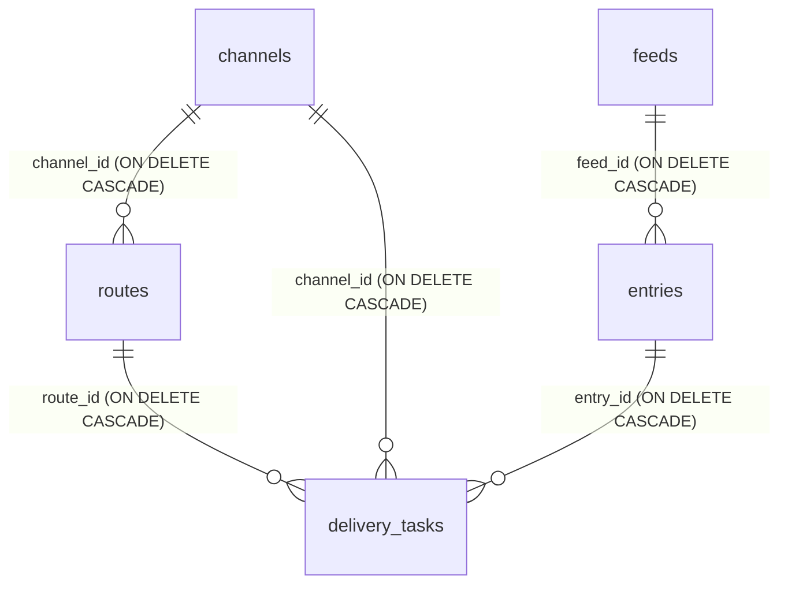

# SQLite Database Schema

FeedCourier stores all persistent state in a single SQLite `WAL` database at `<DATA_DIR>/feedcourier.db`. Schema migrations live in [`migrations/0001_init.sql`](https://github.com/ElleryHe/FeedCourier/blob/main/migrations/0001_init.sql) and run automatically on startup. All timestamps are stored as **UTC Unix epoch seconds (`INTEGER`)**, and foreign keys enforce **`ON DELETE CASCADE`**.

---

## Entity-Relationship Overview

---

## Table Definitions

### 1. `feeds` — Subscribed Feeds & Polling State

Stores RSS/Atom/JSON Feed URLs, conditional HTTP caching headers, Readability/proxy flags, and circuit-breaker health state.

| Column | Type | Constraints / Default | Description |
| :--- | :--- | :--- | :--- |
| `id` | `INTEGER` | `PRIMARY KEY AUTOINCREMENT` | Unique feed identifier. |
| `url` | `TEXT` | `NOT NULL UNIQUE` | Feed XML/JSON URL (`http://` or `https://`). |
| `title` | `TEXT` | `NOT NULL DEFAULT ''` | Human-readable feed title (auto-populated on first poll if empty). |
| `site_url` | `TEXT` | `NULL` | Upstream website home URL. |
| `favicon_url` | `TEXT` | `NULL` | Discovered favicon URL (used as Notion page icon and in WebUI). |
| `tags_json` | `TEXT` | `NOT NULL DEFAULT '[]'` | JSON array of string tags (matched by `routes.match_tags_json` and synced to Notion `Tag`). |
| `poll_interval_secs` | `INTEGER` | `NOT NULL DEFAULT 1800` | Base polling interval in seconds (`CHECK (poll_interval_secs > 0)`). |
| `fetch_full_content` | `INTEGER` | `NOT NULL DEFAULT 0` | `1` to extract full webpage articles via `dom_smoothie` Readability (`0` or `1`). |
| `use_proxy` | `INTEGER` | `NOT NULL DEFAULT 0` | `1` to route feed and article requests through the global outbound proxy. |
| `etag` | `TEXT` | `NULL` | Upstream HTTP `ETag` sent in `If-None-Match`. |
| `last_modified` | `TEXT` | `NULL` | Upstream HTTP `Last-Modified` sent in `If-Modified-Since`. |
| `health_status` | `TEXT` | `NOT NULL DEFAULT 'active'` | `'active'`, `'backoff'`, `'circuit_open'`, or `'paused'`. |
| `consecutive_failures` | `INTEGER` | `NOT NULL DEFAULT 0` | Consecutive poll failure counter (transitions to `'circuit_open'` at `15`). |
| `next_poll_at` | `INTEGER` | `NULL` | Next scheduled poll timestamp (UTC Unix seconds). |
| `last_error` | `TEXT` | `NULL` | Diagnostic message from the most recent poll failure. |
| `silent_init` | `INTEGER` | `NOT NULL DEFAULT 1` | `1` to record historical entry fingerprints on initial poll without enqueuing tasks. |
| `created_at` | `INTEGER` | `NOT NULL DEFAULT (unixepoch())` | Creation timestamp. |
| `updated_at` | `INTEGER` | `NOT NULL DEFAULT (unixepoch())` | Last modification timestamp. |

**Indexes:**
- `idx_feeds_poll_schedule ON feeds (health_status, next_poll_at)`

---

### 2. `entries` — Deduplication Fingerprints & Entry Payloads

Stores the permanent 64-character SHA-256 deduplication fingerprint alongside transient HTML and media payloads that are set to `NULL` by the `NOT EXISTS` garbage collector after `RETENTION_HOURS` (see [System Architecture](/reference/architecture)).

| Column | Type | Lifecycle | Description |
| :--- | :--- | :--- | :--- |
| `id` | `INTEGER` | **Permanent** | Primary key (`AUTOINCREMENT`). |
| `feed_id` | `INTEGER` | **Permanent** | Foreign key to `feeds(id) ON DELETE CASCADE`. |
| `fingerprint_sha256` | `TEXT` | **Permanent** | 64-char hex SHA-256 fingerprint (`UNIQUE (feed_id, fingerprint_sha256)`). |
| `published_at` | `INTEGER` | **Permanent** | Original publication timestamp from feed metadata (`NULL` if omitted). |
| `discovered_at` | `INTEGER` | **Permanent** | Timestamp when FeedCourier first discovered the entry. |
| `payload_purged_at` | `INTEGER` | **Permanent** | Timestamp when transient payload columns were purged by GC (`NULL` while retained). |
| `title` | `TEXT` | **Permanent** | Sanitized entry title (retained for task audit logs). |
| `canonical_url` | `TEXT` | **Permanent** | Normalized article permalink (retained for task audit logs). |
| `author` | `TEXT` | **Permanent** | Entry author name. |
| `content_html` | `TEXT` | *Transient (Purged by GC)* | `ammonia`-sanitized HTML body with resolved absolute URLs. |
| `first_sentence` | `TEXT` | *Transient (Purged by GC)* | Unicode-segmented first sentence used by Telegram `media_mode`. |
| `summary_text` | `TEXT` | *Transient (Purged by GC)* | Plain-text summary used by Telegram `compact_card`, content filters, and MCP previews. |
| `media_json` | `TEXT` | *Transient (Purged by GC)* | JSON array of extracted `MediaAttachment` items (`url`, `mime_type`, `kind`). |

**Indexes:**
- `UNIQUE (feed_id, fingerprint_sha256)`
- `idx_entries_feed_discovered ON entries (feed_id, discovered_at DESC)`
- `idx_entries_gc_candidates ON entries (discovered_at) WHERE payload_purged_at IS NULL` *(Partial index limiting hourly GC scans to unpurged rows)*

---

### 3. `channels` — Encrypted Trusted Delivery Channels

Stores ChaCha20-Poly1305 encrypted credentials, recipient endpoints, shared credential group keys, and pacing/quota settings (see [Security & Isolation](/reference/security)).

| Column | Type | Constraints / Default | Description |
| :--- | :--- | :--- | :--- |
| `id` | `INTEGER` | `PRIMARY KEY AUTOINCREMENT` | Unique channel ID (referenced by `routes` and MCP `configure_route`). |
| `name` | `TEXT` | `NOT NULL` | Display name shown in WebUI and MCP summaries. |
| `kind` | `TEXT` | `NOT NULL` | `'smtp'`, `'telegram'`, or `'notion'`. |
| `encrypted_config` | `BLOB` | `NOT NULL` | ChaCha20-Poly1305 ciphertext (`12-byte nonce \|\| ciphertext \|\| 16-byte Poly1305 tag`) of `ChannelConfig`. |
| `credential_group_key` | `TEXT` | `NOT NULL` | SHA-256 key grouping channels that share the same underlying sender credential. |
| `capabilities_json` | `TEXT` | `NOT NULL DEFAULT '{}'` | Cached capability probe JSON (e.g., Telegram `supports_rich_message`, `bot_api_version`). |
| `min_interval_secs` | `INTEGER` | `NOT NULL DEFAULT 15` | Minimum pacing delay in seconds between deliveries. |
| `jitter_max_secs` | `INTEGER` | `NOT NULL DEFAULT 10` | Random jitter ceiling in seconds (`0 ..= jitter_max_secs`). |
| `hourly_quota` | `INTEGER` | `NULL` | Optional maximum deliveries per rolling 1-hour window. |
| `daily_quota` | `INTEGER` | `NULL` | Optional maximum deliveries per rolling 24-hour window. |
| `use_proxy` | `INTEGER` | `NOT NULL DEFAULT 0` | `1` to route channel requests through the global outbound proxy. |
| `cooldown_until` | `INTEGER` | `NULL` | Downstream rate-limit cooldown expiration timestamp. |
| `enabled` | `INTEGER` | `NOT NULL DEFAULT 1` | `1` when active, `0` when paused. |
| `created_at` | `INTEGER` | `NOT NULL DEFAULT (unixepoch())` | Creation timestamp. |
| `updated_at` | `INTEGER` | `NOT NULL DEFAULT (unixepoch())` | Last modification timestamp. |

**Indexes:**
- `idx_channels_credential_group ON channels (credential_group_key)`

---

### 4. `routes` — Routing Rules, Content Filters & Presentation Options

Binds feed IDs or tags to a target `channel_id`.

| Column | Type | Constraints / Default | Description |
| :--- | :--- | :--- | :--- |
| `id` | `INTEGER` | `PRIMARY KEY AUTOINCREMENT` | Unique route identifier. |
| `name` | `TEXT` | `NOT NULL` | Human-readable route rule name. |
| `feed_ids_json` | `TEXT` | `NOT NULL DEFAULT '[]'` | JSON array of matched feed IDs (`i64`). |
| `match_tags_json` | `TEXT` | `NOT NULL DEFAULT '[]'` | JSON array of matched feed tags (`string`). |
| `channel_id` | `INTEGER` | `NOT NULL` | Foreign key to `channels(id) ON DELETE CASCADE`. |
| `include_keywords_json` | `TEXT` | `NOT NULL DEFAULT '[]'` | JSON array of case-insensitive required keywords. |
| `exclude_keywords_json` | `TEXT` | `NOT NULL DEFAULT '[]'` | JSON array of case-insensitive excluded keywords. |
| `include_regex` | `TEXT` | `NULL` | Optional regular expression that must match. |
| `exclude_regex` | `TEXT` | `NULL` | Optional regular expression that rejects matching entries. |
| `options_json` | `TEXT` | `NOT NULL DEFAULT '{}'` | JSON `RouteOptions` (`telegram_mode`, `link_preview`). |
| `enabled` | `INTEGER` | `NOT NULL DEFAULT 1` | `1` when active, `0` when disabled. |
| `created_at` | `INTEGER` | `NOT NULL DEFAULT (unixepoch())` | Creation timestamp. |
| `updated_at` | `INTEGER` | `NOT NULL DEFAULT (unixepoch())` | Last modification timestamp. |

---

### 5. `delivery_tasks` — Transactional Outbox & Checkpoints

Tracks every `Entry × Route` delivery lifecycle.

| Column | Type | Constraints / Default | Description |
| :--- | :--- | :--- | :--- |
| `id` | `INTEGER` | `PRIMARY KEY AUTOINCREMENT` | Unique task ID. |
| `route_id` | `INTEGER` | `NOT NULL` | Foreign key to `routes(id) ON DELETE CASCADE`. |
| `channel_id` | `INTEGER` | `NOT NULL` | Foreign key to `channels(id) ON DELETE CASCADE`. |
| `entry_id` | `INTEGER` | `NOT NULL` | Foreign key to `entries(id) ON DELETE CASCADE`. |
| `status` | `TEXT` | `NOT NULL DEFAULT 'queued'` | `'queued'` (pending), `'delivering'` (leased), `'delivered'`, `'retrying'` (failed/backoff), `'deferred'`, or `'dead_letter'`. |
| `lease_until` | `INTEGER` | `NULL` | Worker lease expiration timestamp while `status = 'delivering'`. |
| `checkpoint_json` | `TEXT` | `NULL` | Serialized `DeliveryCheckpoint` (`smtp` / `telegram` / `notion`). |
| `attempt_count` | `INTEGER` | `NOT NULL DEFAULT 0` | Number of delivery attempts consumed (`dead_letter` at `6`). |
| `next_attempt_at` | `INTEGER` | `NOT NULL DEFAULT (unixepoch())` | Earliest timestamp when the task may be claimed. |
| `last_status_code` | `INTEGER` | `NULL` | Downstream HTTP or SMTP status code from the last attempt. |
| `diagnostic_log` | `TEXT` | `NULL` | Diagnostic message or error reason from the last attempt. |
| `completed_at` | `INTEGER` | `NULL` | Completion timestamp when `status` reaches `'delivered'` or `'dead_letter'`. |
| `created_at` | `INTEGER` | `NOT NULL DEFAULT (unixepoch())` | Task creation timestamp. |

**Indexes:**
- `UNIQUE (route_id, entry_id)`
- `idx_delivery_tasks_status_next_attempt ON delivery_tasks (status, next_attempt_at)`
- `idx_delivery_tasks_status_lease ON delivery_tasks (status, lease_until)`
- `idx_delivery_tasks_entry_status ON delivery_tasks (entry_id, status)` *(Supports `NOT EXISTS` GC subquery)*
- `idx_delivery_tasks_channel_status_completed ON delivery_tasks (channel_id, status, completed_at)` *(Supports rolling hourly/daily quota window counts)*

---

### 6. `system_settings`, `mcp_tokens` & `sessions`

- **`system_settings`** (`key TEXT PRIMARY KEY`, `value_json TEXT`, `updated_at INTEGER`): Persists `admin_password_hash` (Argon2id PHC string), `outbound_proxy_url`, and `ssrf_allowlist`.
- **`mcp_tokens`** (`id`, `name`, `token_hash UNIQUE`, `token_prefix`, `scope CHECK (scope IN ('readonly', 'admin'))`, `last_used_at`, `created_at`): Stores SHA-256 digests of issued MCP Bearer tokens.
- **`sessions`** (`token_hash TEXT PRIMARY KEY`, `expires_at INTEGER`, `created_at INTEGER`): Stores SHA-256 digests of active WebUI `fc_session` cookies (`30`-day TTL, `2,592,000` seconds).
