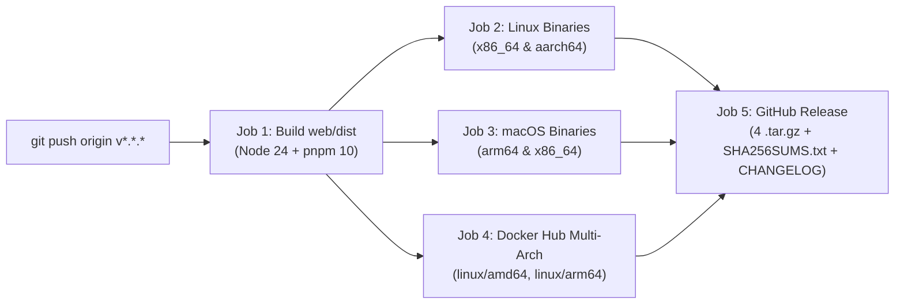

# Release & CI/CD Pipeline

FeedCourier uses two GitHub Actions workflows—**CI** (`.github/workflows/ci.yml`) and **Release** (`.github/workflows/release.yml`)—to run automated checks, verify internal documentation links, compile multi-platform binaries, and publish multi-architecture Docker Hub images.

---

## Continuous Integration (`.github/workflows/ci.yml`)

Every push to `main` or `develop` and every pull request runs:

1. **Frontend Verification (`web/`)**:
   - `pnpm --dir web install --frozen-lockfile`
   - `pnpm --dir web exec tsc --noEmit` (TypeScript typecheck)
   - `pnpm --dir web build` (produces `web/dist` for `rust-embed`)
2. **Documentation Build & Link Verification (`docs/`)**:
   - `pnpm --dir docs install --frozen-lockfile`
   - `pnpm --dir docs build` (VitePress static build checking internal links across `/` and `/zh/`)
3. **Rust Formatting, Linting & Test Suite**:
   - `cargo fmt --all -- --check`
   - `cargo clippy --all-targets --locked -- -D warnings`
   - `cargo test --all-targets --locked` (unit and integration tests covering 4-tier deduplication, `NOT EXISTS` GC, SSRF connect-time guards, SMTP `Force-From`, Telegram 10.4 modes, Notion `2026-03-11` Markdown v2, REST API, and MCP tools)
4. **License & Dependency Supply-Chain Audit**:
   - `cargo deny check` (`deny.toml` verifying `AGPL-3.0` compatibility and advisory checks)

---

## Automated Release Workflow (`.github/workflows/release.yml`)

Pushing a semantic version tag matching `v*.*.*` (for example, `git tag v0.1.2 && git push origin v0.1.2`) triggers the automated release pipeline:

### 1. Version Verification & Multi-Platform Binaries

Before compiling, the workflow verifies that `version` in `Cargo.toml` matches `${GITHUB_REF_NAME#v}` exactly. It then builds locked, stripped release archives containing `feedcourier`, `LICENSE`, `README.md`, and `README.zh-CN.md` for:

- `x86_64-unknown-linux-gnu` (built on `ubuntu-24.04`)
- `aarch64-unknown-linux-gnu` (built on `ubuntu-24.04-arm`)
- `aarch64-apple-darwin` (`MACOSX_DEPLOYMENT_TARGET=11.0`)
- `x86_64-apple-darwin` (`MACOSX_DEPLOYMENT_TARGET=11.0`)

All four `.tar.gz` archives are hashed into `SHA256SUMS.txt`, paired with the matching version section extracted from `CHANGELOG.md`, and published to **GitHub Releases** (automatically marking `-rc`, `-beta`, or `-alpha` tags as pre-releases).

### 2. Multi-Arch Docker Hub Publishing (`elleryhe/feedcourier`)

In parallel, the `docker` job builds and pushes a multi-architecture (`linux/amd64`, `linux/arm64`) image to **[Docker Hub (`elleryhe/feedcourier`)](https://hub.docker.com/r/elleryhe/feedcourier)**:

- **Published Image Tags**:
  - `<version>` (e.g., `0.1.2`)
  - `<major>.<minor>` (e.g., `0.1`)
  - `<major>` (enabled from `1.0.0`+)
  - `latest` (for stable non-prerelease tags)
- **Required GitHub Actions Secrets / Variables**:
  - `DOCKERHUB_USERNAME` *(Secret)* — Docker Hub account username.
  - `DOCKERHUB_TOKEN` *(Secret)* — Docker Hub Personal Access Token (`Read & Write` scope).
  - `DOCKERHUB_REPO` *(Optional Variable)* — Overrides the target repository name (defaults to `<DOCKERHUB_USERNAME>/feedcourier`).

---

## Documentation Site Deployment (`feedcourier.ellery.me`)

The bilingual VitePress documentation site in `docs/` deploys to **Cloudflare Workers Static Assets** via `docs/wrangler.jsonc`:

| Setting | Value |
| :--- | :--- |
| **Worker Name** | `feedcourier` |
| **Root Directory** | `docs` (plain directory path, without wildcards) |
| **Build Watch Paths** | `docs/**` (only triggers builds when files under `docs/` change) |
| **Build Command** | `pnpm run build` |
| **Deploy Command** | `npx wrangler deploy` (Non-production / PR preview: `npx wrangler preview` via `"previews": {}`) |
| **Output Directory** | `./.vitepress/dist` |
| **Custom Domain** | `https://feedcourier.ellery.me` (`Production branch: main`, preview URLs generated automatically on `develop` via `"previews": {}`) |
