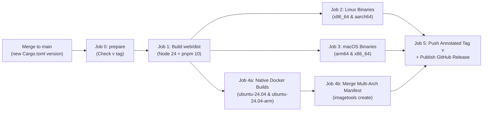

# Release & CI/CD Pipeline

FeedCourier uses two GitHub Actions workflows—**CI** (`.github/workflows/ci.yml`) and **Release** (`.github/workflows/release.yml`)—to run automated checks, verify internal documentation links, compile multi-platform binaries, and publish multi-architecture Docker Hub images.

---

## Continuous Integration (`.github/workflows/ci.yml`)

Every push to `main` or `develop` and every pull request runs:

1. **Frontend Verification (`web/`)**:
   - `pnpm --dir web install --frozen-lockfile`
   - `pnpm --dir web exec tsc --noEmit` (TypeScript typecheck)
   - `pnpm --dir web build` (produces `web/dist` for `rust-embed`)
2. **Documentation Build & Link Verification (`docs/`)**:
   - `pnpm --dir docs install --frozen-lockfile`
   - `pnpm --dir docs build` (VitePress static build checking internal links across `/` and `/zh/`)
3. **Rust Formatting, Linting & Test Suite**:
   - `cargo fmt --all -- --check`
   - `cargo clippy --all-targets --locked -- -D warnings`
   - `cargo test --all-targets --locked` (unit and integration tests covering 4-tier deduplication, `NOT EXISTS` GC, SSRF connect-time guards, SMTP `Force-From`, Telegram 10.4 modes, Notion `2026-03-11` Markdown v2, REST API, and MCP tools)
4. **License & Dependency Supply-Chain Audit**:
   - `cargo deny check` (`deny.toml` verifying `AGPL-3.0` compatibility and advisory checks)

---

## Automated Release Workflow (`.github/workflows/release.yml`)

Merging a release PR into `main` with an bumped `version` in `Cargo.toml` (where tag `v<version>` does not yet exist on `origin`) automatically triggers the release pipeline—no manual Git tag push is required. Manual `v*.*.*` tag pushes and `workflow_dispatch` dry-runs remain supported as fallbacks, while non-version-bump commits on `main` are automatically detected and skipped in `prepare`:



### 1. Planned Version Detection & Multi-Platform Binaries

`prepare` inspects `version` in `Cargo.toml` and checks whether `refs/tags/v<version>` already exists on `origin`. When a new version is detected, downstream jobs build locked, stripped release archives containing `feedcourier`, `LICENSE`, `README.md`, and `README.zh-CN.md` for:

- `x86_64-unknown-linux-gnu` (built on `ubuntu-24.04`)
- `aarch64-unknown-linux-gnu` (built on `ubuntu-24.04-arm`)
- `aarch64-apple-darwin` (built on `macos-15-intel`, `MACOSX_DEPLOYMENT_TARGET=11.0`)
- `x86_64-apple-darwin` (built on `macos-15-intel`, `MACOSX_DEPLOYMENT_TARGET=11.0`)

Once all four `.tar.gz` archives and the multi-arch Docker Hub manifest succeed, the `release` job creates and pushes the annotated Git tag `v<version>` onto the `main` commit, generates `SHA256SUMS.txt`, extracts the matching `CHANGELOG.md` section, and publishes the **GitHub Release** (automatically marking `-rc`, `-beta`, or `-alpha` versions as pre-releases).

### 2. Multi-Arch Docker Hub Publishing (`elleryhe/feedcourier`)

In parallel, `docker-build` compiles `linux/amd64` natively on `ubuntu-24.04` and `linux/arm64` natively on `ubuntu-24.04-arm` (without QEMU emulation, caching external Cargo dependencies independently per architecture and pushing by digest), and `docker` combines both digests via `docker buildx imagetools create` to **[Docker Hub (`elleryhe/feedcourier`)](https://hub.docker.com/r/elleryhe/feedcourier)**:

- **Published Image Tags**:
  - `<version>` (e.g., `0.2.0`)
  - `<major>.<minor>` (e.g., `0.2`)
  - `<major>` (enabled from `1.0.0`+)
  - `latest` (for stable non-prerelease tags)
- **Required GitHub Actions Secrets / Variables**:
  - `DOCKERHUB_USERNAME` *(Secret)* — Docker Hub account username.
  - `DOCKERHUB_TOKEN` *(Secret)* — Docker Hub Personal Access Token (`Read & Write` scope).
  - `DOCKERHUB_REPO` *(Optional Variable)* — Overrides the target repository name (defaults to `<DOCKERHUB_USERNAME>/feedcourier`).

---

## Release Checklist

When preparing a new release (e.g., merging `develop` into `main`), keep all version references synchronized before opening the release PR:

1. **Synchronize the release version across all files**:
   - `Cargo.toml` (`[package].version`)
   - `Cargo.lock` (`feedcourier` package entry)
   - `web/package.json` (`version`)
   - `docs/package.json` (`version`)
   - `web/src/api/types.ts` (`DEFAULT_VERSION`)
   - `CHANGELOG.md` (add the matching `## [<version>] - YYYY-MM-DD` section and comparison links)
2. **Run local verification checks on `develop`**:
   ```bash
   pnpm --dir web exec tsc --noEmit && pnpm --dir web build
   pnpm --dir docs build
   cargo fmt --all -- --check
   cargo clippy --all-targets --locked -- -D warnings
   cargo test --all-targets --locked
   ```
3. **Open and merge the PR into `main`**: Once merged, GitHub Actions automatically tags `v<version>`, builds all four platform archives, publishes the multi-arch Docker Hub manifest, and creates the GitHub Release.

---

## Documentation Site Deployment (`feedcourier.ellery.me`)

The bilingual VitePress documentation site in `docs/` deploys to **Cloudflare Workers Static Assets** via `docs/wrangler.jsonc`:

| Setting | Value |
| :--- | :--- |
| **Worker Name** | `feedcourier` |
| **Root Directory** | `docs` (plain directory path, without wildcards) |
| **Build Watch Paths** | `docs/**` (only triggers builds when files under `docs/` change) |
| **Build Command** | `pnpm run build` |
| **Deploy Command** | `npx wrangler deploy` (Non-production / PR preview: `npx wrangler preview` via `"previews": {}`) |
| **Output Directory** | `./.vitepress/dist` |
| **Custom Domain** | `https://feedcourier.ellery.me` (`Production branch: main`, preview URLs generated automatically on `develop` via `"previews": {}`) |
