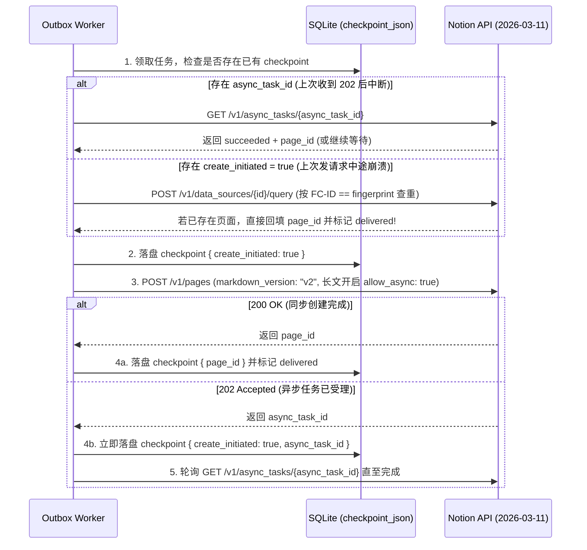

# Notion 数据源通道（对齐 `2026-03-11`）

FeedCourier 的 Notion 通道全面对齐 **`Notion-Version: 2026-03-11`** 最新 API 规范（围绕 `data_source_id` 数据源模型运作，采用 `initial_data_source.properties` 初始化表结构，使用 `in_trash` 替代旧版已移除的 `archived` 字段，并通过 `"markdown_version": "v2"` 原子写入页面正文）。

---

## 1. 准备工作：创建 Notion Internal Integration 并授权页面

1. 访问 [Notion Integrations 控制台](https://www.notion.so/profile/integrations)，点击 **New integration** 创建一个内部集成（Internal Integration）。
2. 在 **Capabilities** 中确保勾选 **Read content**、**Update content** 与 **Insert content**，复制生成的 **`Internal Integration Secret`**（以 `ntn_` 或 `secret_` 开头）。
3. 打开你希望用来存放订阅文章的 Notion 父页面（或已有数据库），点击右上角 `•••` 菜单 → **Connections（连接）** → 搜索并添加你刚才创建的集成。

---

## 2. 两种零摩擦接入方式

在 WebUI **Channels → New Channel → Notion** 向导中，FeedCourier 提供两种数据源接入模式：

### 方式一：在父页面下一键初始化 7 列标准表（推荐新用户）

只需填入 `Integration Secret` 与授权好的**父页面 URL 或 32 位 Page ID**，点击 **Initialize Standard Database**（底层调用 `POST /api/v1/channels/notion/init-db`）：

- FeedCourier 会向 Notion 发送 `POST /v1/databases` 请求，将初始属性列声明在 `2026-03-11` 规范要求的 **`initial_data_source.properties`** 对象下，自动创建名为 `FeedCourier Inbox`（可自定义）的数据库，并从响应中提取绑定 `data_source_id` 与 `database_id`。
- 自动创建的 **7 个标准属性列**如下：

| 标准列名 | Notion 属性类型 | 是否必需 | 写入内容说明 |
| :--- | :---: | :---: | :--- |
| **`Title`** | `title` | **必需** | 文章标题（超长时自动按 2,000 字符分片）。 |
| **`FC-ID`** | `rich_text` | **必需** | 条目 64 位 SHA-256 指纹哈希（`fingerprint_sha256`），用于重试与崩溃恢复前的**有效一次（Effective-once）查重对账**。 |
| **`Link`** | `url` | 可选 | 剥离追踪参数后的规范化原文链接（`canonical_url`）。 |
| **`Source`** | `select` | 可选 | 所属订阅源名称（自动截断在 100 字符以内并剔除逗号）。 |
| **`Published`** | `date` | 可选 | 文章原始发布时间戳（RFC 3339 / ISO 8601 格式）。 |
| **`State`** | `select` | 可选 | 阅读状态，自动预设 `UnRead`（蓝色）与 `Read`（绿色）选项，新入库文章默认设为 **`UnRead`**。 |
| **`Tag`** | `multi_select` | 可选 | 自动同步该订阅源在 FeedCourier 中配置的自定义多标签（`feeds.tags`）。 |

### 方式二：绑定已有数据源（自动结构体检与按需补列）

如果你已经有一个正在使用的 Notion 阅读数据库，希望将文章直接汇入其中：

1. 在向导中选择 **Bind Existing Data Source**，填入已有数据源的 `data_source_id`（或直接粘贴 Notion 数据库页面 URL，系统会自动通过 `GET /v1/data_sources/{id}` 或 `GET /v1/databases/{id}` 解析其底层默认 `data_source_id`）。
2. 点击 **Inspect & Repair Schema**（调用 `POST /api/v1/channels/notion/inspect-schema`）：
   - **自动匹配**：系统按“列名 + 属性类型”扫描现有数据源结构，展示 7 个标准列的对齐状态（`matched` / `missing` / `type_mismatch`）；
   - **一键自动补列（`auto_add_missing: true`）**：对于缺失的标准列（特别是幂等对账必需的 **`FC-ID`** 列），系统可通过 `PATCH /v1/data_sources/{data_source_id}` 自动为你补齐；
   - **自定义列名映射（`NotionColumnMapping`）**：仅 `Title`（`title` 类型）与 `FC-ID`（`rich_text` 类型）为强制要求；其余 5 个可选列允许映射到你现有的自定义列名，或设为 `null` 跳过写入。

---

## 3. Markdown v2 规范化器与纯净排版

FeedCourier 秉持清爽无干扰的笔记沉淀美学：新建的 Notion 页面仅将订阅源站点的 Favicon 挂载为页面图标（`icon.external.url`），不强塞花哨的封面图或顶部广告 Callout，直接输出纯净文章正文。

在将清洗后的 HTML 正文写入 Notion 前，系统通过 `htmd` 转换为 Markdown，并经由专门设计的 **Notion Markdown v2 规范化管线（`normalize_markdown_v2`）** 处理：

1. **代码块内嵌反引号动态围栏扩充**：
   - 技术博客文章的代码块内经常包含 Markdown 示例（即代码内容本身含有 ```` ``` ```` 三反引号）。若外层仍使用三反引号围栏，会导致 Notion Markdown v2 解析器提前闭合代码块、破坏后续全部排版。
   - 规范化器会逐一扫描每个代码块内部最长的连续反引号串长度 $L_{\max}$，并将外层代码围栏动态扩充为 $\max(3, L_{\max} + 1)$ 个反引号（例如内部含 ```` ``` ```` 时，外层自动升级为 ````` ```` ````` 四反引号围栏），同时归一化语言标识符。
2. **`5,000` 块边界安全截断兜底**：
   - Notion API 对单次创建的块数量上限为 `5,000` 个块。`normalize_markdown_v2` 在本地实时估算转换后的 Notion 块数与 UTF-8 字节数；
   - 当块数超过安全阈值 **`4,800` 块（`MAX_NOTION_BLOCKS`）** 或体积超过 **`450 KB`（`MAX_MARKDOWN_BYTES`）** 时，自动在完整段落/代码块边界处干净截断，并在文末追加包含原文直达链接的截断说明引用块，确保请求 100% 通过 Notion 服务端校验。

---

## 4. `allow_async` 异步写入与 `FC-ID` 有效一次（Effective-once）状态机

针对长篇文章写入耗时较长以及网络超时/进程重启可能导致重复建页的难题，FeedCourier 结合 Notion `2026-03-11` 的异步导入接口与 `delivery_tasks.checkpoint_json` 实现了严格的**有效一次（Effective-once）**投递语义：



### 关键保障机制

- **长文自动启用 `allow_async: true`**：当估算块数 $\ge 250$ 块（`ASYNC_BLOCK_THRESHOLD`）或 Markdown 体积 $\ge 24\text{ KiB}$（`ASYNC_BYTE_THRESHOLD`）时，`POST /v1/pages` 自动携带 `"allow_async": true`。
- **异步轮询不消耗重试预算**：若收到 `202 Accepted` 后在短轮询内Notion 后台仍在处理（`in_progress`），任务将携带 `async_task_id` 转入短暂延迟等待，在最长 20 分钟（`DEFAULT_MAX_ASYNC_POLL_AGE_SECS`）窗口内**不消耗 6 次故障重试预算**。
- **`FC-ID` 先查后建防重对账**：发起 `POST /v1/pages` 前必先将 `create_initiated: true` 刷入 SQLite。即使在 HTTP 响应返回前遭遇断电、OOM 强杀或网关超时，下次接管任务时也会先调用 `POST /v1/data_sources/{data_source_id}/query` 检索 `FC-ID == fingerprint_sha256`（且 `in_trash == false`）的页面——若下游其实已创建成功，直接回填 `page_id` 闭环，彻底杜绝重复页面。
