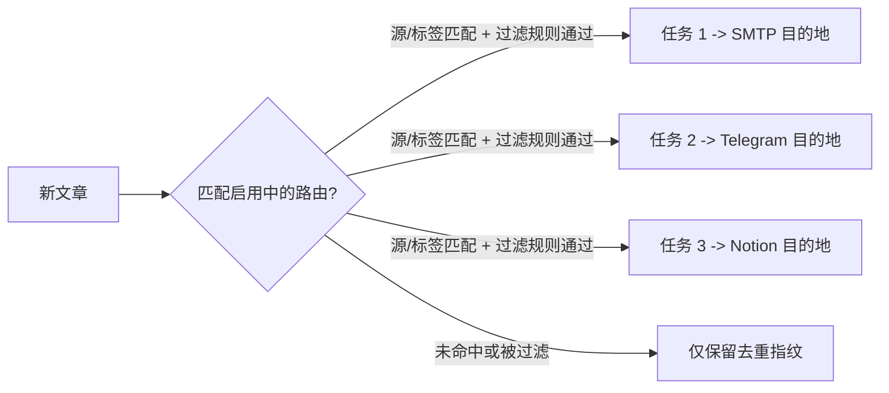

# 发送频率、配额与过滤

当订阅源集中更新时，如果在短时间内向 SMTP 服务器、Telegram 或 Notion 连续发送大量请求，容易触发下游平台的频率限制（如 SMTP `421`/`451` 临时限制、Telegram `429 Too Many Requests` 或 Notion `429 Rate Limited`）。

FeedCourier 采用**双层投递通道模型（通道账号 + 多个目的地）**，并在**通道账号**与**路由规则（Route）**两个层面提供发送间隔控制、逐条随机抖动、配额顺延、路由时区、时间窗口与内容过滤功能。

---

## 1. 双层通道模型与单篇独立入队

投递目标分为两层管理：

- **通道账号（Channel Account）**：在 **Channels** 页面配置一次，统一保存加密凭据、出站代理开关（`use_proxy`，仅适用于 Telegram 与 Notion 等 HTTP 通道；SMTP 使用原生 TCP/TLS 直连）、发送流速与抖动（`min_interval_secs`、`jitter_max_secs`）、滚动配额（`hourly_quota`、`daily_quota`）与冷却状态（`cooldown_until`）。
- **目的地（Destination）**：挂在通道账号下，可添加多个（例如同一 Telegram Bot 推送至不同群组/话题、同一 SMTP 账号发送至不同收件人组、同一 Notion 集成同步至不同数据库）。每个目的地都可以单独启用/停用，也可以单独发送测试。

每当订阅源拉取到一篇新文章，系统会检查所有启用中的路由规则；每命中一条指向某个目的地的路由，就生成一条独立的投递任务（`1 Task = 1 Entry × 1 Route`）：



即使同一篇文章同时发往 SMTP、Telegram 和 Notion 三个账号，不同账号之间的排队进度、发送间隔与失败重试彼此独立、互不阻塞。

---

## 2. 最小发送间隔与随机抖动

在 WebUI **Channels** 页面创建或编辑**通道账号**时，可以配置两个发送频率参数：

| 参数名称 | 字段名 | 默认值 | 说明 |
| :--- | :--- | :---: | :--- |
| **最小发送间隔（秒）** | `min_interval_secs` | `15` | 同一通道账号（及共享同一凭据的账号组）连续两次投递之间的最小等待秒数。 |
| **随机延迟上限（秒）** | `jitter_max_secs` | `10` | 在最小发送间隔基础上，额外叠加 `0` 到 `jitter_max_secs` 秒之间的随机等待时间。 |

例如保持默认的 `15` 秒最小间隔与 `10` 秒随机延迟时，若一次拉取到 10 篇新文章，系统会以每篇间隔 **15 至 25 秒**的速度依次发送。仍在等待冷却间隔的任务会处于 `deferred`（顺延等待）状态，不会计入失败重试次数。

> [!NOTE]
> **抖动机制说明**
> - **每个任务独立抽取**：每成功送达一条消息，系统都会重新独立抽取一个 `0..=jitter_max_secs` 之间的随机秒数，加上 `min_interval_secs` 作为同一凭据组下一条任务的最早发送时间，**不存在整批任务共用同一个抖动值**。
> - **仅保存在内存中**：带有随机抖动的下一次允许发送时间戳只保存在内存中，不落盘；服务重启后，第一条投递仅根据 SQLite 配额账本（`delivery_quota_ledger`）中持久化的 `last_completed_at` 遵循 `min_interval_secs` 控速，随后每次投递恢复完整的 `min_interval_secs + 抖动` 间隔。

---

## 3. 账号及同凭据组共享限流、配额与冷却

由于上游平台是按发件邮箱账号、Bot Token 或 Notion 集成密钥（而非按单个群组或收件人列表）实施限流的，FeedCourier 在**通道账号**与**共享凭据组（`credential_group_key`）**粒度上统一执行所有保护规则：

- **同一账号下的多个目的地共享限流**：同一 Telegram Bot 下的所有群组/频道/话题目的地、同一 SMTP 账号下的所有收件人组目的地、同一 Notion 集成下的所有数据库目的地，共享同一套发送间隔与随机抖动、同一份小时/日配额以及同一份 `429` 冷却状态。
- **使用相同凭据的多个账号自动关联**：即使你创建了多个通道账号，只要它们使用了相同的底层凭据（同一 SMTP 主机/端口/登录账号与密码 SHA-256 摘要、同一 `api_base_url` 下的同一 Telegram `bot_token`、或同一 Notion `integration_secret`），系统会自动计算相同的 `credential_group_key` 并合并计算流速、滚动配额（按组内最严有效配额执行）与限流冷却。由于 SMTP 分组键纳入了密码摘要，共用同一通用用户名但 API Key 不同的账号（例如 SendGrid 的 `apikey`）保持相互隔离。
- **组级冷却联动**：当任一目的地收到下游平台的 `429 Retry-After` 或临时 SMTP 限流响应时，同一账号（及同凭据组）下的其余目的地会同步暂停，等待 `cooldown_until` 结束后再恢复发送。

---

## 4. 小时配额与每日配额

每个**通道账号**支持设置两项可选的发送总量上限（由该账号下的全部目的地共享）：

- **每小时配额（`hourly_quota`）**：限制该账号在过去滚动 1 小时（3,600 秒）内最多发送成功的文章篇数（留空表示不限制）。
- **每日配额（`daily_quota`）**：限制该账号在过去滚动 24 小时（86,400 秒）内最多发送成功的文章篇数（留空表示不限制）。

### 超出配额后的顺延机制

> [!IMPORTANT]
> 当账号达到 `hourly_quota` 或 `daily_quota` 上限时，后续新文章的投递任务**不会被丢弃，也不会标记为失败**，而是自动进入 **`deferred`（顺延）**状态：
> - 小时配额触顶时，任务每次顺延 5 分钟后重新检查窗口余量；
> - 每日配额触顶时，任务每次顺延 15 分钟后重新检查窗口余量；
> - 顺延等待期间不会消耗故障重试次数，且文章正文会一直保留至投递完成。

> [!NOTE]
> **持久化配额账本（`delivery_quota_ledger`）**
> 每次投递成功后，系统都会向独立的 `delivery_quota_ledger` 表写入一条轻量流水（`credential_group_key`、`channel_id`、`completed_at`；无业务外键，超过 24 小时由维护任务自动清理）。滚动 1 小时 / 24 小时配额计数与 `last_completed_at` 步进时间戳均直接读取该账本，因此**删除订阅源、路由、目的地或执行清除缓存（Clear cache）绝不会清零已消耗配额或重置发送间隔**。

---

## 5. 路由级筛选、内容过滤与页面筛选

在 WebUI **Routes** 页面（或通过 MCP 的 [`configure_route`](/zh/mcp/tools#6-configure-route) 工具）创建路由时，选择目标**目的地**并配置匹配规则。

### 通道页与路由页筛选

- **Channels 页面**：顶部提供**渠道类型**筛选（全部 / Telegram / SMTP / Notion），方便快速定位指定类型的账号与目的地。
- **Routes 页面**：顶部提供两个**级联下拉框**——先选择**渠道类型**（全部 / Telegram / SMTP / Notion），再选择**账号**（仅列出当前所选类型下的 Bot / 发件箱 / Notion 集成），便于管理大量路由规则。

### 第一步：选择订阅源或标签

每条路由可通过 **指定订阅源（`feed_ids`）** 与 **匹配标签（`match_tags`，不区分大小写）** 筛选文章来源：
- 若 `feed_ids` 与 `match_tags` **均留空**：该路由默认匹配**全部订阅源**；
- 若填写了 `feed_ids` 或 `match_tags`：只要文章所属订阅源在 `feed_ids` 列表中，**或者**订阅源带有 `match_tags` 中的任一标签，即视为匹配该路由。

### 第二步：关键词与正则表达式过滤

系统会将文章的**标题**与**正文纯文本（或摘要）**合并检查，并按以下顺序依次判断：

1. **排除关键词（`exclude_keywords`）**：不区分大小写。只要标题或正文中包含列表里的**任意一个**词，该文章就会被跳过。
2. **排除正则表达式（`exclude_regex`）**：只要标题或正文匹配该正则表达式，该文章就会被跳过。
3. **包含关键词（`include_keywords`）**：当列表非空时，标题或正文必须至少包含其中的**一个**词，否则跳过。
4. **包含正则表达式（`include_regex`）**：当填写了正则表达式时，标题或正文必须匹配该表达式，否则跳过。

> [!TIP]
> 在正式保存路由规则前，你可以在 WebUI 中使用订阅源预览功能，或通过 MCP 调用 [`preview_feed_latest`](/zh/mcp/tools#4-preview-feed-latest) 传入过滤条件，直接查看最近 10 篇文章中哪些会命中、哪些会被哪条规则排除。

---

## 6. 路由级时区、投递时间窗口与语言 {#route-delivery-time-windows}

每条路由都可以独立设置时区、投递时段与投递语言。在 WebUI 的 **Routes** 页面（或通过 MCP `configure_route`）中配置：

| 选项 | 说明 |
| :--- | :--- |
| **`timezone`** | 可选的路由级 **IANA 时区**（如 `Asia/Shanghai`、`America/New_York`）。留空时自动继承**系统时区**（默认 `America/Los_Angeles`，可通过 `TIMEZONE`/`TZ` 或 **Settings** 修改）。 |
| **`active_windows`** | 每日投递窗口，格式为 `{ "start": "HH:MM", "end": "HH:MM" }`，按**路由时区**执行夏令时（DST）安全判定。`end` 早于 `start` 表示跨午夜（如 `22:00`–`06:00`）；**仅 `00:00`–`00:00`（或空列表 `[]`）表示全天**，其余非零的 `start == end` 窗口（如 `08:00`–`08:00`）会被拒绝并返回 `400 Bad Request`。 |
| **`active_weekdays`** | 允许投递的星期，`1`（周一）到 `7`（周日）。列表为空表示每天。对跨午夜的窗口，按窗口**开始**那一天的星期判定。 |
| **`locale`** | 该路由的投递语言（`en` 或 `zh-CN`），用于推送消息中的本地化文案。创建路由时默认填入当前 WebUI 界面语言；未设置的旧路由回退到旧版系统级语言设置。 |

### 路由时区的作用范围

路由生效时区（`options.timezone`，留空继承 `system_settings.timezone`）会同时作用于以下三处：

1. **推送时间窗口与星期**：`active_windows` 与 `active_weekdays` 按该路由时区判定；
2. **SMTP 邮件正文时间**：邮件头部渲染的文章发布时间按该路由时区转换；
3. **Telegram 富文本页脚（`<footer>`）时间**：标题下方的「来源 · 作者 · 本地发布时间」按该路由时区显示。

文章本地发布时间统一采用带明确 UTC 偏移的格式展示，例如：

```text
2026-11-08 11:00 (UTC+08:00)
```

> [!NOTE]
> **夏令时（DST）安全边界、窗口外排队与在途任务同步**
> - **窗口外保留入队**：窗口外的任务不会被丢弃，而是保持在队列中（`queued` / `deferred`），下次尝试时间设为**下一个窗口的开始时刻**，之后按时间顺序投递，同时仍受账号发送间隔与配额约束。
> - **夏令时（DST）安全计算**：春季向前跳变产生不存在的本地时刻（如 `02:30`）时，窗口边界自动向前推进至跳变后首个合法时刻；秋季向后回拨产生重复本地时刻时，窗口起点取最早时刻、窗口终点取最晚时刻，避免投递窗口缩水或遗漏。
> - **修改路由时的在途任务同步**：更换路由的目标**目的地**时，系统在同一事务内将尚未开始的 `queued`、`deferred`、`retrying` 任务重指向新目的地，并清空 `checkpoint_json`、将 `attempt_count` 重置为 `0`（正在投递中的 `delivering` 任务保持不变直至完成）；修改 `active_windows`、`active_weekdays` 或 `timezone` 时，立即将 `queued` 与 `deferred` 任务的 `next_attempt_at` 重置为当前时间并唤醒发件箱。

---

## 7. 投递顺序与全局队列暂停 {#delivery-order-and-queue-pause}

- **积压按时间顺序**：订阅源首次轮询（或执行 **Clear cache** 之后）时，积压文章按发布时间从旧到新入队；缺少时间时按订阅源原始顺序的倒序处理。
- **多订阅源合并排序**：全局发件箱按文章发布时间（缺失时按发现时间）从旧到新领取到期任务。多个订阅源同时有待投递任务时，会合并成一条按时间排列的投递流，同时仍受账号间隔与配额约束。
- **全局暂停**：在 **Tasks** 页面可以暂停整个队列（立即、15 分钟至 6 小时，或到指定时间）并手动恢复。暂停期间订阅源仍会轮询、任务持续累积；恢复后所有到期任务从旧到新依次投递。详见[数据备份与维护](/zh/guide/operations#pausing-resuming-the-delivery-queue)。

---

## 8. 在订阅源预览中调试推送 {#debug-push-from-the-feed-preview}

想在不订阅、不影响队列的情况下查看文章在某个目的地中的实际效果，可打开某个 URL（或已有订阅源）的**订阅源预览**，使用 **Debug push** 栏：选择目标**目的地**、（Telegram 还可选择）投递模式与链接预览、投递语言、可选的时区覆盖以及可选插件（如链接替换），然后在具体预览条目上点击 **Push latest** 或 **Push this item**。

调试推送是**无状态**的：不写入指纹、不进入队列，也不应用路由过滤、时间窗口与配额，不占用账号额度。针对 SMTP 目的地，调试推送严格仅向 **`verified`**（已验证）收件人按单 `To:` 隔离信封附带合规头发送（0 位已验证收件人时返回错误提示）。通过它在 Notion 创建的页面，`FC-ID` 会带 `test-` 前缀，不会与真实投递冲突。失败时会在结果消息中返回诊断信息。对应的 MCP 工具为 [`test_push_feed_entry`](/zh/mcp/tools#10-test-push-feed-entry)。

---

## 延伸阅读

- 关于发件箱状态机、租约恢复与共享限流键的内部实现，请参阅架构手册中的 [系统架构总览](/zh/reference/architecture)。
- 关于各通道重试策略与协议交互细节，请参阅架构手册中的 [通道协议与投递实现](/zh/reference/channel-protocols)。
