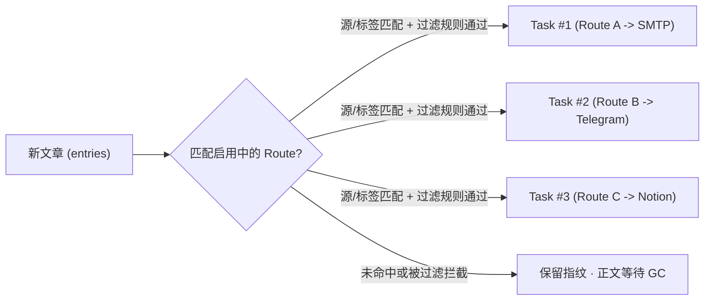

# 流控、配额与过滤规则

在订阅源高频更新或首次批量拉取时，如果网关将数十篇新文章在 1 秒内并发轰炸至下游 SMTP 服务器、Telegram Bot API 或 Notion API，极易触发下游平台的反垃圾风控（如 SMTP `421`/`451` 临时封禁、Telegram `429 Too Many Requests (retry_after)` 或 Notion `429 Rate Limited`）。

FeedCourier 通过**单篇实时入队模型**、**同底层凭据共享限流锁**、**步进抖动（Pacing + Jitter）**、**小时/每日配额护栏**以及**路由级内容过滤引擎**，在保障实时性的同时彻底消除突发流量尖峰。

---

## 1. `1 Task = 1 Entry × 1 Route` 实时入队模型

FeedCourier 不采用“定时汇总多篇文章拼成一封长周报”的批处理模式，而是全通道统一遵循 **`1 Task = 1 Entry × 1 Route`** 的流式原子模型：

- 每当订阅源拉取到一篇全新指纹（`fingerprint_sha256`）的文章，引擎会立即遍历所有启用中的路由（`routes.enabled = 1`）；
- 对每条命中的路由，向 `delivery_tasks` 表插入一条独立的投递任务（受 `UNIQUE (route_id, entry_id)` 唯一约束保护，绝不重复入队）；
- 即使同一篇文章同时分发往 SMTP、Telegram 和 Notion 三个通道，各通道的排队进度、重试次数、配额顺延与断点状态（`checkpoint_json`）完全解耦、互不阻塞。

---

## 2. 同底层发信凭据跨通道共享限流锁

在实际使用中，用户常常会基于**同一个底层发信凭据**创建多个逻辑通道，例如：
- 使用同一个 Telegram Bot Token，分别创建推送至“技术资讯群话题 A”和“运维告警频道 B”的两个 Telegram 通道；
- 使用同一个 Notion Internal Integration Secret，分别写入“每日阅读库”和“团队精选库”两个 Notion 数据源；
- 使用同一个 SMTP 发件邮箱账号，分别投递给不同的收件人列表。

为了防止这些共享同一底层账号的通道各自独立计时而叠加突破平台限流，FeedCourier 在创建或更新通道时会自动计算脱敏的 **`credential_group_key`**（HMAC/SHA-256 派生标识，源码见 `ChannelConfig::credential_group_key`）：

| 通道类型 | 共享限流分组键（`credential_group_key`）计算依据 | 共享效果 |
| :--- | :--- | :--- |
| **`smtp`** | ` lowercase(username \|\| from_address) @ lowercase(host) : port ` | 同一 SMTP 服务器上的同一认证账号自动共享发信步进间隔与 `421`/`45x` 全局冷却锁。 |
| **`telegram`** | ` lowercase(api_base_url) : bot_token ` | 同一 Bot Token（在相同 Bot API 端点下）无论拆分出多少个 `chat_id` 或话题通道，自动共享步进间隔与 `retry_after` 冷却。 |
| **`notion`** | ` integration_secret ` | 同一 Notion Integration Secret 关联的所有数据源通道自动共享步进间隔与 `429 Retry-After` 冷却。 |

当组内任意一个通道收到下游返回的 `429` / `retry_after` 或 SMTP 临时流控响应时，调度器会将**同一 `credential_group_key` 下的所有通道**同步置入 `cooldown_until` 冷却窗口，避免其它同凭据通道继续撞墙。

---

## 3. 最小发信间隔与随机抖动（Pacing + Jitter）

每个通道均可配置两个步进控制参数（在数据库与 REST API 中对应 `min_interval_secs` / `jitter_max_secs`，即通道级最小间隔 `min_interval_sec` 与随机抖动 `jitter_sec`）：

- **`min_interval_secs`（最小发信间隔秒数，默认 `15` 秒）**：同一 `credential_group_key` 连续两次投递之间的硬性最小冷却间隔；
- **`jitter_max_secs`（随机抖动上限秒数，默认 `10` 秒）**：在最小间隔之上额外叠加 $0 \sim \text{jitter\_max\_secs}$ 秒的均匀分布随机延迟。

每次投递完成后，该凭据组的下一次允许发信时间计算公式为：

$$t_{\text{next\_allowed}} = t_{\text{completed}} + \text{min\_interval\_secs} + \text{Uniform}(0, \text{jitter\_max\_secs})$$

例如默认配置（`15s + 0~10s`）下，突发涌入的 20 篇文章会以每篇间隔 **15 至 25 秒**的拟人化离散节奏平滑发出。若任务被领取时仍处于步进冷却期内，该任务会被无损置为 `deferred`（延迟至 $t_{\text{next\_allowed}}$），**不增加 `attempt_count` 重试计数**。

---

## 4. 小时与每日配额护栏（`hourly_quota` & `daily_quota`）

除了单次间隔控速外，你还可以为任意通道配置可选的总量水位护栏：

- **`hourly_quota`（每小时最大投递篇数，可选）**：统计该通道在过去滚动 `3,600` 秒内成功送达（`status = 'delivered'`）的任务数；
- **`daily_quota`（每日最大投递篇数，可选）**：统计该通道在过去滚动 `86,400` 秒内成功送达的任务数。

### 超限顺延语义（`deferred` 而非丢弃）

> [!IMPORTANT]
> 当某个通道触达 `hourly_quota` 或 `daily_quota` 上限时，新到达的投递任务**绝不会被丢弃或打入死信队列**，而是自动转入 **`deferred`（配额顺延）**状态：
> - 小时配额触顶：顺延 `300` 秒（5 分钟）后重新检查滚动窗口水位；
> - 每日配额触顶：顺延 `900` 秒（15 分钟）后重新检查滚动窗口水位；
> - **零重试损耗**：转入 `deferred` 状态时会回退本次领取增加的 `attempt_count`，不会消耗任务宝贵的 6 次故障重试预算；同时只要存在未完成的 `deferred` 任务，后台 `NOT EXISTS` GC 便会自动保留该文章的正文载荷直至投递完成。

---

## 5. 路由级订阅源选择与内容过滤规则

在 `routes`（路由规则）中，你可以精细控制哪些订阅源的哪些文章允许进入目标通道。

### 第一步：订阅源匹配（Feed Selector）

每条路由可通过 `feed_ids`（指定订阅源 ID 数组）与 `match_tags`（指定标签数组，大小写不敏感）组合筛选输入源：
- 若 `feed_ids` 与 `match_tags` **均为空数组 `[]`**：该路由默认匹配**全部订阅源**（适合全局汇总归档通道）；
- 若配置了 `feed_ids` 或 `match_tags`：只要订阅源的 `id` 在 `feed_ids` 中，**或者**订阅源携带的任意标签命中 `match_tags`（逻辑或 `OR`），即视为源匹配成功。

### 第二步：标题与正文内容过滤（Content Filter Rules）

源码定于 `src/ingest/filter.rs`（`CompiledContentFilter::evaluate`）。系统将文章的**标题（`title`）**与**纯文本正文（`plain_text` / `summary_text`）**合并为检索语料，按以下四步顺序严格判定：

1. **排除关键词（`exclude_keywords`）**：大小写不敏感子串匹配。只要语料命中列表中**任意一个**排除词，立即拒绝（返回 `excluded by keyword '...'`）。
2. **排除正则表达式（`exclude_regex`）**：只要语料匹配该正则表达式，立即拒绝（返回 `excluded by regex '...'`）。
3. **包含关键词（`include_keywords`）**：当列表非空时，语料必须至少命中其中**一个**关键词（逻辑或 `OR`），否则拒绝（返回 `did not match any include_keywords`）。
4. **包含正则表达式（`include_regex`）**：当配置非空时，语料必须匹配该正则表达式，否则拒绝（返回 `did not match include_regex '...'`）。

> [!TIP]
> **防 ReDoS 正则安全边界**：所有用户或 MCP 配置的正则表达式均由 Rust `regex` 引擎编译，并强制施加字符长度上限（`MAX_REGEX_PATTERN_LEN = 512`）与编译后 DFA/NFA 体积限制（`size_limit(256 KiB)`、`dfa_size_limit(256 KiB)`），从算法层面免疫灾难性回溯（ReDoS）。
> 你可以在 WebUI 创建路由前，或通过 MCP 调用 [`preview_feed_latest`](/zh/mcp/tools) 工具传入过滤参数，实时预览最近 10 篇文章的命中结果（`matched_filter`）与未命中原因（`filter_reason`）。
