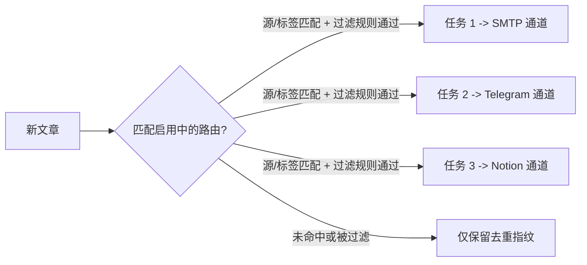

# 发送频率、配额与过滤

当订阅源集中更新时，如果在短时间内向 SMTP 服务器、Telegram 或 Notion 连续发送大量请求，容易触发下游平台的频率限制（如 SMTP `421`/`451` 临时限制、Telegram `429 Too Many Requests` 或 Notion `429 Rate Limited`）。

FeedCourier 在推送通道（Channel）和路由规则（Route）两个层面提供了发送间隔控制、配额顺延与内容过滤功能，帮助你在 WebUI 中按需控制投递节奏与推送范围。

---

## 1. 单篇实时入队与独立分发

FeedCourier 按单篇文章逐条分发：每当订阅源拉取到一篇新文章，系统会检查所有启用中的路由规则（Routes）。如果文章所属的订阅源和内容满足某条路由的条件，就会为该路由生成一条独立的投递任务。

即使同一篇文章同时发往 SMTP、Telegram 和 Notion 三个通道，各通道的排队进度、发送间隔与失败重试也彼此独立、互不阻塞。

---

## 2. 最小发送间隔与随机延迟

在 WebUI **Channels** 页面创建或编辑推送通道时，可以配置两个发送频率参数：

| 参数名称 | 字段名 | 默认值 | 说明 |
| :--- | :--- | :---: | :--- |
| **最小发送间隔（秒）** | `min_interval_secs` | `15` | 同一通道（或共享同一账号的通道组）连续两次发送之间的最小等待秒数。 |
| **随机延迟上限（秒）** | `jitter_max_secs` | `10` | 在最小发送间隔基础上，额外叠加 `0` 到 `jitter_max_secs` 秒之间的随机等待时间。 |

例如保持默认的 `15` 秒最小间隔与 `10` 秒随机延迟时，若一次拉取到 10 篇新文章，系统会以每篇间隔 **15 至 25 秒**的速度依次发送。仍在等待冷却间隔的任务会处于 `deferred`（顺延等待）状态，不会计入失败重试次数。

---

## 3. 小时配额与每日配额

除了控制两次发送之间的间隔外，你还可以为通道设置可选的发送总量上限：

- **每小时配额（`hourly_quota`）**：限制该通道在过去滚动 1 小时（3,600 秒）内最多发送成功的文章篇数（留空表示不限制）。
- **每日配额（`daily_quota`）**：限制该通道在过去滚动 24 小时（86,400 秒）内最多发送成功的文章篇数（留空表示不限制）。

### 超出配额后的顺延机制

> [!IMPORTANT]
> 当通道达到 `hourly_quota` 或 `daily_quota` 上限时，后续新文章的投递任务**不会被丢弃，也不会标记为失败**，而是自动进入 **`deferred`（顺延）**状态：
> - 小时配额触顶时，任务每次顺延 5 分钟后重新检查窗口余量；
> - 每日配额触顶时，任务每次顺延 15 分钟后重新检查窗口余量；
> - 顺延等待期间不会消耗故障重试次数，且文章正文会一直保留至投递完成。

---

## 4. 同账号 / 同令牌通道自动共享限流

在实际使用中，你可能会使用同一个发信账号创建多个推送通道，例如：
- 用同一个 Telegram `bot_token` 分别创建发往“技术群话题 A”和“个人频道 B”的两个通道；
- 用同一个 Notion `integration_secret` 分别写入两个不同的 Notion 数据库；
- 用同一个 SMTP 邮箱账号分别发往不同的收件人。

FeedCourier 会自动识别使用相同底层账号或令牌的通道，并将它们的发送间隔与限流冷却状态合并计算：
- 同一 SMTP 服务器上的同一发件账号共享发送间隔与临时限流冷却；
- 同一 Telegram `bot_token`（在相同 API 地址下）关联的所有通道共享发送间隔与 `retry_after` 冷却；
- 同一 Notion `integration_secret` 关联的所有通道共享发送间隔与 `429` 冷却。

当其中一个通道收到下游平台的限流提示时，共享同一凭据的其余通道也会同步等待冷却结束，避免多个通道同时发送触发更严格的封禁。

---

## 5. 路由级订阅源选择与内容过滤

在 WebUI **Routes** 页面（或通过 MCP 的 [`configure_route`](/zh/mcp/tools#5-configure-route) 工具）创建路由时，可以分两步筛选要推送的文章：

### 第一步：选择订阅源或标签

每条路由可通过 **指定订阅源（`feed_ids`）** 与 **匹配标签（`match_tags`，不区分大小写）** 筛选文章来源：
- 若 `feed_ids` 与 `match_tags` **均留空**：该路由默认匹配**全部订阅源**；
- 若填写了 `feed_ids` 或 `match_tags`：只要文章所属订阅源在 `feed_ids` 列表中，**或者**订阅源带有 `match_tags` 中的任一标签，即视为匹配该路由。

### 第二步：关键词与正则表达式过滤

系统会将文章的**标题**与**正文纯文本（或摘要）**合并检查，并按以下顺序依次判断：

1. **排除关键词（`exclude_keywords`）**：不区分大小写。只要标题或正文中包含列表里的**任意一个**词，该文章就会被跳过。
2. **排除正则表达式（`exclude_regex`）**：只要标题或正文匹配该正则表达式，该文章就会被跳过。
3. **包含关键词（`include_keywords`）**：当列表非空时，标题或正文必须至少包含其中的**一个**词，否则跳过。
4. **包含正则表达式（`include_regex`）**：当填写了正则表达式时，标题或正文必须匹配该表达式，否则跳过。

> [!TIP]
> 在正式保存路由规则前，你可以在 WebUI 中使用订阅源预览功能，或通过 MCP 调用 [`preview_feed_latest`](/zh/mcp/tools#3-preview-feed-latest) 传入过滤条件，直接查看最近 10 篇文章中哪些会命中、哪些会被哪条规则排除。

---

## 6. 路由投递时间窗口 {#route-delivery-time-windows}

每条路由都可以限定**何时**投递，避免在夜间或不希望打扰的日子收到推送。在 WebUI 的 **Routes** 页面（或通过 MCP `configure_route`）设置：

| 选项 | 说明 |
| :--- | :--- |
| **`active_windows`** | 每日投递窗口，格式为 `{ "start": "HH:MM", "end": "HH:MM" }`，按**系统时区**判定。`end` 早于 `start` 表示跨午夜（如 `22:00`–`06:00`）；`start` 等于 `end` 表示全天；列表为空表示不限制。 |
| **`active_weekdays`** | 允许投递的星期，`1`（周一）到 `7`（周日）。列表为空表示每天。对跨午夜的窗口，按窗口**开始**那一天的星期判定。 |

系统时区默认为 `America/Los_Angeles`（首次启动时取自环境变量 `TIMEZONE` / `TZ`），可在 **Settings** 中修改，详见[环境配置与代理](/zh/guide/configuration)。

> [!NOTE]
> 窗口外的任务不会被丢弃：它们仍保持在队列中（`queued` / `deferred`），下次尝试时间被设为**下一个窗口的开始时刻**，之后按时间顺序投递，同时仍受通道发送间隔与配额约束。

### 路由投递语言

每条路由拥有独立的投递语言（`en` 或 `zh-CN`），用于推送消息中需要本地化的部分（如 Telegram 媒体模式的链接文字、SMTP / Notion 模板文案）。创建路由时，WebUI 会默认填入当前界面语言。界面语言本身只是浏览器本地偏好，不会改变实际投递的语言。早于该选项创建的旧路由会回退到旧版系统级语言设置。

---

## 7. 投递顺序与全局队列暂停

- **积压按时间顺序**：订阅源首次轮询（或执行 **Clear cache** 之后）时，积压文章按发布时间从旧到新入队；缺少时间时按订阅源原始顺序的倒序处理。
- **多订阅源合并排序**：全局发件箱按文章发布时间（缺失时按发现时间）从旧到新领取到期任务。多个订阅源同时有待投递任务时，会合并成一条按时间排列的投递流，同时仍受通道间隔与配额约束。
- **全局暂停**：在 **Tasks** 页面可以暂停整个队列（立即、15 分钟至 6 小时，或到指定时间）并手动恢复。暂停期间订阅源仍会轮询、任务持续累积；恢复后所有到期任务从旧到新依次投递。详见[数据备份与维护](/zh/guide/operations#pausing-resuming-the-delivery-queue)。

---

## 8. 在订阅源预览中调试推送 {#debug-push-from-the-feed-preview}

想在不订阅、不影响队列的情况下查看文章在某个通道中的实际效果，可打开某个 URL（或已有订阅源）的**订阅源预览**，使用 **Debug push** 栏：选择通道，（Telegram 通道还可选择）投递模式与链接预览，以及投递语言，然后在具体预览条目上点击 **Push latest** 或 **Push this item**。

调试推送是**无状态**的：不写入指纹、不进入队列，也不应用路由过滤、时间窗口与配额，不占用通道额度。通过它在 Notion 创建的页面，`FC-ID` 会带 `test-` 前缀，不会与真实投递冲突。失败时会在结果消息中返回诊断信息。对应的 MCP 工具为 [`test_push_feed_entry`](/zh/mcp/tools#9-test-push-feed-entry)。

---

## 延伸阅读

- 关于发件箱状态机、租约恢复与共享限流键的内部实现，请参阅架构手册中的 [系统架构总览](/zh/reference/architecture)。
- 关于各通道重试策略与协议交互细节，请参阅架构手册中的 [通道协议与投递实现](/zh/reference/channel-protocols)。
