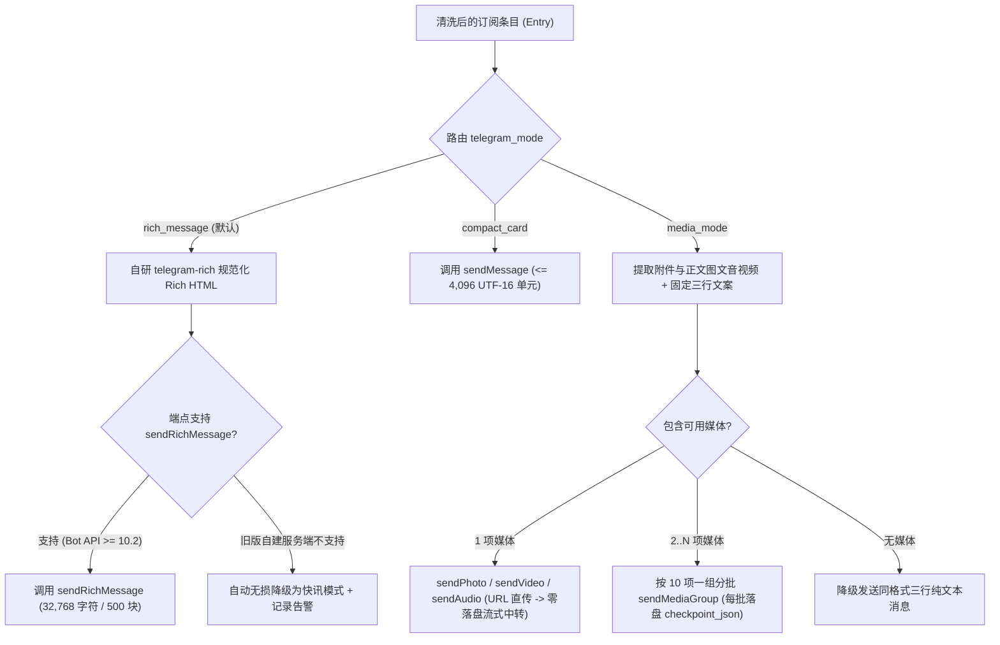

# Telegram 通道（对齐 Bot API 10.4）

FeedCourier 的 Telegram 通道全面对齐 **Telegram Bot API 10.4**，支持投递至**个人私聊**、**普通群组**、**开启话题的超级群组指定话题（`message_thread_id`）**以及**广播频道（Channel）**，并允许自定义 `api_base_url` 以对接反向代理或自建 Local Bot API Server。

更重要的是，FeedCourier 允许你在**每一条路由（Route）**上独立选择三种截然不同的展现模式：**富文档模式（`rich_message`）**、**快讯模式（`compact_card`）**与**媒体模式（`media_mode`）**。

---

## 1. 创建 Bot 与配置授信通道

1. 在 Telegram 中向 [@BotFather](https://t.me/BotFather) 发送 `/newbot`，获取形如 `123456789:AAH...` 的 **`bot_token`**。
2. 将 Bot 添加至目标群组或频道（若为频道，需授予“发布消息 / Post Messages”管理员权限）。
3. 获取目标会话的 **`chat_id`**：
   - 公开频道或群组：可直接填写 `@channelusername`；
   - 私密频道或超级群组：填写以 `-100` 开头的数字 ID（如 `-1001234567890`）；
   - 个人私聊：先向 Bot 发送任意消息，填写你的个人数字 User ID。
4. 在 WebUI **Channels → New Channel → Telegram** 中填写以下字段（对应 `TelegramChannelConfig`）：

| 字段名 | 必填 | 默认值 | 说明 |
| :--- | :---: | :--- | :--- |
| `bot_token` | 是 | — | `@BotFather` 签发的 Bot Token（ChaCha20-Poly1305 加密落盘，列表接口仅返回 `1234••••wxyz` 脱敏提示）。 |
| `chat_id` | 是 | — | 目标私聊 ID、群组 ID（`-100...`）或频道用户名（`@...`）。 |
| `message_thread_id` | 否 | `null` | 超级群组（Forum Supergroup）下的指定话题（Topic）整数 ID。留空则发送至主聊天流。 |
| `api_base_url` | 否 | `null` | 自定义 Bot API 基础地址（默认使用官方 `https://api.telegram.org`）。支持对接 Cloudflare Workers 反代或自建 `telegram-bot-api`。 |

---

## 2. 路由级三种展现模式详解

在配置路由（**Routes**）指向 Telegram 通道时，可通过 `options.telegram_mode` 选择以下三种模式之一：



---

### 模式一：富文档模式（`rich_message`，默认推荐）

对齐 Telegram Bot API 10.3 / 10.4 的 **`sendRichMessage`** 接口，底层由 FeedCourier 团队自研并开源发布的独立 Rust 库 **[`telegram-rich`](https://crates.io/crates/telegram-rich)**（[GitHub 仓库](https://github.com/ElleryHe/telegram-rich)）驱动：

- **原生 Rich HTML 转换与结构提升**：
  - 将文章 HTML 规范化为 Telegram 官方支持的 Rich HTML 子集；
  - 原生支持紧凑表格 `<table compact>`、可折叠长引用 `<blockquote expandable>`、底部交互按钮行 `<tg-button-row>`、代码块语法高亮语言标签（`<pre><code class="language-rust">`）以及从 MathML 提取 TeX 公式；
  - 自动将包裹在段落 `<p>` 或超链接 `<a>` 内的图片与视频提升为顶层独立媒体块，识别常见的 `data-src` / `srcset` 懒加载图片并剔除 1×1 追踪像素。
- **官方多维限额感知截断（`Document::fit`）**：
  - 严格按照 Telegram 官方上限（**`32,768` 字符**、**`500` 个块**、**`16` 层嵌套**、**`50` 个内嵌媒体**、表格最多 **`20` 列**）在块级边界优雅截断，绝不产生未闭合标签；
  - 文末固定追加 `<tg-button-row>`“阅读原文”直达按钮；若正文因超长发生截断，自动在按钮上方追加斜体截断提示尾注。
- **通道级能力探测与旧版自建服务端自动降级**：
  - 在创建通道或点击 **Test** 时，FeedCourier 会主动探测目标 `api_base_url` 的 Bot API 版本与 `sendRichMessage` 支持情况，并缓存至 `channels.capabilities_json`；
  - 如果你使用的是版本滞后（`< Bot API 10.2`）的自建 Local Bot API Server，或者运行期收到 `sendRichMessage` 方法未知的 `400/404` 响应，系统会**自动将该次投递无缝降级为快讯模式（`compact_card`）完成送达**，同时在 `checkpoint_json`（`degraded_to_compact: true`）与通道能力快照中写入降级原因供 WebUI 和 MCP 巡检。

---

### 模式二：快讯模式（`compact_card`）

适合高频新闻源、GitHub Releases 动态或追求极简通知的群组聊天：

- 调用标准 **`sendMessage`**（`parse_mode: "HTML"`）；
- 排版结构为：**加粗文章标题** + **订阅源名称与作者行** + **清洗后的精炼纯文本摘要** + **原文直达超链接**；
- 严格按 Telegram UTF-16 代码单元上限（**`4,096` UTF-16 code units**，`MAX_MESSAGE_UTF16_UNITS`）在字符边界安全截断；
- 支持在路由选项中通过 `link_preview: true | false` 独立控制是否展开 Telegram 网页链接预览卡片（`LinkPreviewOptions.is_disabled`）。

---

### 模式三：媒体模式（`media_mode`）

专为摄影、插画、社交媒体动态、播客与视频订阅源打造。系统全量汇总 `<enclosure>`、Media RSS（`media:content`）以及正文中提取出的图片、视频与音频资源，并执行以下工程策略：

#### 1. 固定三行极简文案（Strict 3-Line Caption）

摒弃冗长杂乱的 HTML 正文，媒体说明文字（Caption，控制在 `1,024` UTF-16 单元以内）严格固定为三行：
1. **第一行**：文章作者名称（若源未提供作者，自动回退为订阅源标题）；
2. **第二行**：基于 `unicode-segmentation` 按 Unicode 句子边界提取的**正文第一句完整句子**（完美兼容中文 `。！？` 与英文缩写，自动剥离末尾句号）；
3. **第三行**：规范化后的原文直达链接（`canonical_url`）。

> 当某篇文章不包含任何可用媒体（或所有媒体均拉取失败）时，系统自动降级为调用 `sendMessage` 发送相同格式的三行纯文本消息。

#### 2. 智能外链直传与防盗链内存零落盘流式中转

许多图床与内容平台对图片开启了严格的 `Referer` 防盗链校验，导致 Telegram 官方服务器直接拉取媒体 URL 时报错（如 `failed to get HTTP URL content` 或 `wrong file identifier/HTTP URL specified`）。

FeedCourier 实现了全自动两阶段传输回退：
1. **阶段一（外链直传优先）**：首先将媒体 `https://` URL 直接传给 Telegram Bot API，零本机带宽消耗；
2. **阶段二（防盗链内存流式中转）**：一旦检测到 Telegram 抓取远端 URL 失败，FeedCourier 立即通过内置的受保护客户端（`ProtectedMediaFetcher`）自动构造目标源站同源 `Referer` 与 `Accept` 请求头，将媒体文件流式拉取至内存缓冲区，并以 `multipart/form-data` 直接上传至 Telegram：
   - **全程零落盘**：媒体字节流在内存中即传即毁，绝不在 `/data` 磁盘上产生任何临时文件垃圾；
   - **严格流式体积卡死**：先检查响应头 `Content-Length`，并在流式读取过程中实时累加字节数——**图片硬上限 `10 MiB`（`MAX_PHOTO_BYTES`），视频/音频硬上限 `50 MiB`（`MAX_MEDIA_BYTES`）**，超限立即中断连接；
   - **全局并发信号量保护**：进程级信号量（`GLOBAL_MEDIA_UPLOAD_SEMAPHORE`）将并发媒体流式中转严格限制在 **`2` 个（`MAX_CONCURRENT_MEDIA_UPLOADS`）** 以内，确保即使多篇多图文章同时触发回退，内存峰值依然稳如磐石。

#### 3. 超过 10 项媒体的分批发送与 `checkpoint_json` 断点续投

Telegram `sendMediaGroup` 接口限制单次调用最多包含 **10 项媒体（`MEDIA_GROUP_BATCH_SIZE = 10`）**。当一篇文章包含例如 25 张高清长图时：

1. 系统自动将其切分为 `10 + 10 + 5` 共 3 个批次依次调用 `sendMediaGroup`（三行精炼文案仅挂载于第 1 批的第 1 张媒体上）；
2. **每成功发送完一个批次**，调度器立即通过 `CheckpointSink` 将当前进度实时刷入 SQLite `delivery_tasks.checkpoint_json`：

```json
{
  "kind": "telegram",
  "next_batch_offset": 20,
  "sent_message_ids": [1041, 1042, 1043, 1044, 1045, 1046, 1047, 1048, 1049, 1050]
}
```

3. 如果在发送第 3 批（偏移量 `20`）时遭遇 Telegram `429 Too Many Requests (retry_after)` 限流冷却或进程意外重启，当任务在冷却结束后被重新领取时，发送器会直接从 `next_batch_offset = 20` 恢复发送剩余的 5 张图，**绝不重复发送前 20 张已送达的图片**。
