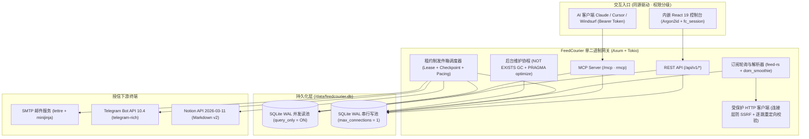

# 项目简介与核心设计边界

**FeedCourier** 是一款面向个人与极客小团队（10 人以内规模）打造的纯血 Rust 轻量级 **RSS / Atom / JSON Feed 流式订阅投递网关**。它以单一静态二进制文件或极简多架构容器镜像运行，空闲内存占用低于 **20 MB**，仅需挂载单个 `/data` 目录（基于单文件 SQLite WAL）即可稳定运转。

---

## 项目背景：致敬并超越 `rss2email`

在信息过载时代，传统自托管在线阅读器（如各类重型 Web Reader）往往需要额外部署 PostgreSQL、Redis 或全文检索引擎，并在服务器磁盘上无限期囤积成千上万篇未读文章正文与图片缓存。而对于许多极客与知识工作者而言，最自然、最高效的阅读与沉淀发生地早已存在于日常终端之中：

- **邮件客户端**：零打扰的深度长文阅读与基于邮件规则的自动化归档；
- **Telegram 即时信息流**：跨设备秒级触达的资讯卡片、原生富文档（`sendRichMessage`）与多图媒体流；
- **Notion 结构化数据库**：支持多标签筛选、阅读状态流转与双链笔记批注的知识库。

`FeedCourier` 旨在传承经典命令行工具 `rss2email` **稳定、克制、单篇精准投递**的工程哲学，同时用现代 Rust 异步生态补齐当代自托管场景的核心痛点：**多协议通道适配（SMTP / Telegram Bot API 10.4 / Notion 2026-03-11）**、**防下游风控的持久化步进发件箱**、**连接层防 SSRF 与按需 Readability 全文提取**，以及**人机协同的原生 WebUI + Streamable HTTP `/mcp` 服务端**。

---

## 四大核心设计边界

FeedCourier 的每一项架构取舍都严格收敛在以下四条边界之内：

### 1. 做投递网关，不做在线阅读器

FeedCourier 不提供本地文章阅读界面、全文搜索或收藏夹，也不在服务器磁盘上永久囤积历史文章全文与媒体文件。它的唯一职责是**高可靠地拉取、清洗、按需提取全文、按规则过滤，并将每一篇新文章精准格式化后送达下游阅读终端**。

### 2. 指纹永久保留，正文阅后即焚

为了彻底杜绝重复推送并保持数据库体积恒定精简，SQLite `entries` 表将字段生命周期一分为二：

- **永久指纹行**：每篇文章的定长 64 位 SHA-256 指纹哈希（`fingerprint_sha256`）与所属 `feed_id`、发布时间戳永久保留，单条记录仅占百余字节；
- **阅后即焚载荷**：清洗后的 HTML 正文（`content_html`）、摘要与媒体附件 JSON 仅在“排队流控或待重试”窗口期内暂存。当文章超过保留窗口（默认 `RETENTION_HOURS=24`）且 **`NOT EXISTS`** 任何未终态投递任务时，后台 GC 自动将大字段置为 `NULL`；Telegram 防盗链媒体中转更是全程在内存中流式转发，即传即毁绝不落盘。

### 3. 全通道单篇流式，防风控匀速控速

FeedCourier 摒弃跨天 Cron 汇总拼版模式，全通道统一采用 **`1 Task = 1 Entry × 1 Route`** 的单篇实时入队模型。面对订阅源突发更新或批量拉取产生的高并发任务，发件箱调度器通过：

- **最小发信间隔（`min_interval_secs`）+ 随机抖动（`jitter_max_secs`）** 平滑吐出；
- **小时配额（`hourly_quota`）与每日配额（`daily_quota`）** 触顶自动转入 `deferred` 窗口顺延而非丢弃；
- **同底层凭据自动共享限流锁（`credential_group_key`）**，避免多通道共用同一发信邮箱、Bot Token 或 Notion Integration 时并发抢跑触发下游 `429` 封禁。

### 4. 人类面板与 AI 协议同源驱动、权限分级隔离

内嵌的 **React 19 可视化控制台**与 **Streamable HTTP `/mcp` 服务端**共享同一套底层 Rust 业务引擎（`IngestEngine` 与 `DeliveryDispatcher`），但实施严格的纵深安全隔离：

- **人类管理员（WebUI）**：独占掌控 SMTP 密码、Telegram Bot Token、Notion Secret 以及收件邮箱、`chat_id`、`data_source_id` 等授信投递终点；
- **AI 助手（MCP `readonly` / `admin`）**：仅能通过数字 `channel_id` 引用 WebUI 已配置的授信通道，以自然语言完成日常健康巡检、死信诊断、Readability 效果试抓与路由过滤规则编排，从根源上杜绝提示词注入诱导数据外泄。

---

## 整体系统架构图

---

## 典型适用场景

- **个人极客资讯中枢**：在 1C1G 轻量云服务器、家庭 NAS 或树莓派上以 `<20 MB` 内存常驻运行，将数十个技术博客、GitHub Releases 与新闻源分流投递至个人邮箱与 Telegram 私密频道。
- **小团队情报看板**：将行业动态、安全公告或竞品更新通过标签路由與关键词过滤，自动沉淀至团队共享的 Notion 数据源（`2026-03-11`）或 Telegram 群组指定话题（`message_thread_id`）。
- **AI 辅助无感运维**：在 Cursor、Claude Desktop 或 Antigravity 中挂载 `/mcp` 端点，随时用一句话让 AI 检查断联源、试抓全文提取效果、编写正则过滤规则或重投死信任务。

---

## 下一步阅读

- [快速开始](/zh/guide/quick-start)：通过 Docker、Docker Compose 或预编译二进制在 1 分钟内启动服务。
- [配置说明与环境变量](/zh/guide/configuration)：了解环境变量、HTTP/SOCKS5 分流代理与内网 `SSRF_ALLOWLIST` 放行配置。
- [流控、配额与过滤规则](/zh/channels/pacing-and-quotas)：掌握发件箱步进节奏、配额护栏与路由级关键词/正则过滤。
- [架构原理深入解析](/zh/reference/architecture)：深入了解四级防漂移指纹、租约状态机与连接层防 SSRF 实现细节。
