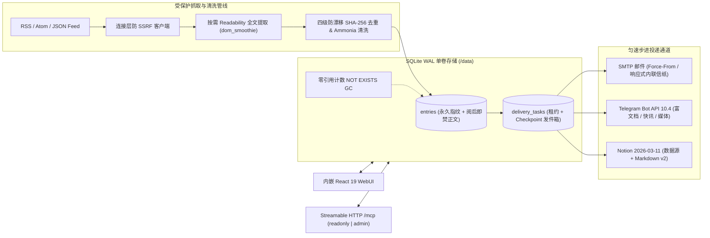

## 整体数据流向速览



## 30 秒 Docker 一键部署

```bash
docker run -d \
  --name feedcourier \
  --restart unless-stopped \
  -p 8080:8080 \
  -v "$(pwd)/data:/data" \
  elleryhe/feedcourier:latest
```

启动后浏览器访问 `http://127.0.0.1:8080` 即可引导设置管理员口令，进入内嵌 React 19 控制台配置授信通道、导入 OPML 订阅源或签发 `/mcp` 令牌。更多部署方式请查阅[快速开始](/zh/guide/quick-start)。
