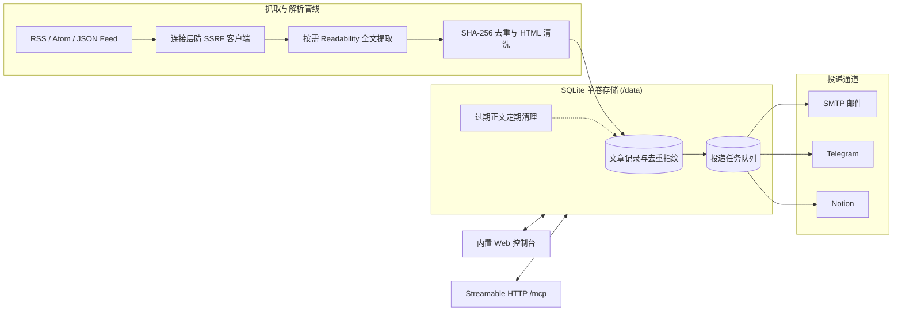

## 整体数据流向



## Docker 快速部署

```bash
docker run -d \
  --name feedcourier \
  --restart unless-stopped \
  -p 8080:8080 \
  -v "$(pwd)/data:/data" \
  -e TZ=Asia/Shanghai \
  elleryhe/feedcourier:latest
```

启动后在浏览器访问 `http://127.0.0.1:8080` 设置管理员用户名与密码，即可在 Web 控制台中配置推送通道、导入 OPML 订阅源或签发 `/mcp` 令牌。更多部署方式请参阅[快速开始](/zh/guide/quick-start)。
