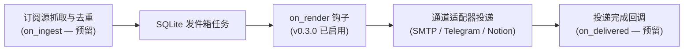

# 插件开发手册（Protocol v1）

FeedCourier 定义了一套稳定的 **插件协议 v1（`api_version: "1"`）**，由第一方内置 Rust 插件、官方市场索引仓库（[`ElleryHe/FeedCourier-Plugins`](https://github.com/ElleryHe/FeedCourier-Plugins)）以及规划中的第二阶段 WASM 沙箱运行时共同遵循。

---

## 1. 清单规范（`schema/manifest.schema.json`）

市场注册表中的每个插件以独立的 `registry/<id>.json` 文件声明，严格遵循 JSON Schema **Draft 2020-12**（`additionalProperties: false`）：

```json
{
  "id": "link-rewrite",
  "name": "Link Rewrite (YOURLS)",
  "version": "0.3.0",
  "api_version": "1",
  "kind": "builtin",
  "min_core": "0.3.0",
  "category": "links",
  "icon": "link",
  "description": "Rewrite outgoing article links using one or more self-hosted YOURLS short-link providers at delivery time, with SQLite caching, domain exclusions, and optional strict retry mode.",
  "homepage": "https://feedcourier.ellery.me/plugins/link-rewrite",
  "repository": "https://github.com/ElleryHe/FeedCourier",
  "hooks": ["on_render"],
  "permissions": ["network"]
}
```

### 字段说明

| 字段名 | 类型 | 约束 | 说明 |
| :--- | :--- | :--- | :--- |
| `id` | `string` | `^[a-z0-9][a-z0-9-]{1,47}$` | 全局唯一的小写短横线标识（2–48 字符），必须与 `registry/<id>.json` 文件名完全一致。 |
| `name` | `string` | `2..=80` 字符 | 在 WebUI 与文档站展示的插件名称。 |
| `version` | `string` | SemVer 2.0.0 | 插件语义化版本号（如 `"0.3.0"`）。 |
| `api_version` | `string` | 固定值 `"1"` | FeedCourier 插件协议版本。 |
| `kind` | `string` | `"builtin"` \| `"external"` \| `"coming_soon"` | `"builtin"` 仅限编译进 FeedCourier 主二进制的第一方插件；社区条目使用 `"external"` 或 `"coming_soon"`。 |
| `min_core` | `string` | SemVer 2.0.0 | 要求兼容的最低 FeedCourier 核心版本。 |
| `category` | `string` | `"links"` \| `"content"` \| `"media"` \| `"delivery"` \| `"analytics"` \| `"security"` \| `"other"` | 市场分类标签，用于筛选。 |
| `icon` | `string` | `^[a-z0-9][a-z0-9-]{0,31}$` | 市场卡片渲染使用的图标名称（如 `"link"`）。 |
| `description` | `string` | `10..=280` 字符 | 简明扼要的插件功能介绍。 |
| `homepage` | `string` | `https://` URL | 插件文档或项目主页链接（不得包含内嵌账号密码）。 |
| `repository` | `string` | `https://` URL | 公开源码仓库链接（不得包含内嵌账号密码）。 |
| `hooks` | `string[]` | 去重、至少 1 项；`"on_render"` \| `"on_ingest"` \| `"on_delivered"` | 插件声明实现的协议钩子。 |
| `permissions` | `string[]` | 去重；`"network"` | 插件声明的能力权限；纯本地变换传 `[]`，需发起外部 HTTP 请求时声明 `"network"`。 |

### 运行时声明式 UI Schema

运行时接口 `GET /api/v1/plugins` 返回的 `PluginManifest` 还包含两段 JSON Schema 子集，供 WebUI 动态生成表单控件：

- **`instance_schema`**：定义服务商实例的配置字段（加密保存于 `plugin_instances.encrypted_config`，支持 `"format": "password"` 密码框、枚举、布尔开关与字符串数组）。
- **`route_option_schema`**：定义路由级插件控件（保存于 `routes.options_json -> $.plugins.<plugin_id>`；`v0.3.0` 支持基于 `plugin_instances` 的 `select` 下拉框、`boolean` 开关与 `string` 输入框）。

---

## 2. 钩子生命周期（Protocol v1）



| 钩子 | `v0.3.0` 状态 | 执行时机与语义 |
| :--- | :---: | :--- |
| **`on_render`** | **已启用** | 在每次发件箱投递（及调试推送）解密凭据后、调用 `sender.send()` 之前执行。接收只读 `RenderContext`（含 `entry`、`feed`、`route`、`route_options`、`channel`、`destination`、`plugin_route_config`、`write_cache`），并写入非破坏式的 `RenderOverrides`（`content_html`、`primary_link`、`warnings`），绝不修改入库的 `entries`。返回 `PluginResult::Continue` 或 `PluginResult::Retry { diagnostic, retry_after_secs }`。 |
| **`on_ingest`** | *预留* | 已在 Protocol v1 协议与枚举中预留，用于未来在抓取入库、任务扇出前执行内容增强或规范化处理。 |
| **`on_delivered`** | *预留* | 已在 Protocol v1 协议与枚举中预留，用于未来在投递完成后触发审计、Webhook 或统计回调。 |

### 核心安全不变量

1. **强制防 SSRF 出站约束**：插件的所有出站 HTTP 请求都必须通过 `ProtectedHttpClient`（`src/net/ssrf.rs`）发出，执行连接期 DNS IP 校验、逐跳重定向检查、响应体积上限并遵循 `SSRF_ALLOWLIST`。
2. **凭据加密与分级脱敏**：服务商配置以 `MasterKey`（ChaCha20-Poly1305）加密存储于 `plugin_instances.encrypted_config`；插件必须实现 `redact_instance_config` 与 `merge_instance_config`，确保 `/api/v1/plugins*` 与 MCP `list_plugins` 绝不泄露密钥明文。
3. **引用删除保护**：删除仍被 `routes.options_json` 引用的服务商实例时，后端拒绝删除并返回 `409 Conflict` 及引用路由清单。

---

## 3. 向 `ElleryHe/FeedCourier-Plugins` 提交插件上架

社区开发者可通过 Pull Request 将开源 Protocol v1 插件（`kind: "external"` 或 `"coming_soon"`）收录到官方市场 **[`ElleryHe/FeedCourier-Plugins`](https://github.com/ElleryHe/FeedCourier-Plugins)**：

1. Fork `ElleryHe/FeedCourier-Plugins` 并基于 `main` 创建新分支。
2. 按照 `schema/manifest.schema.json` 新增 `registry/<your-plugin-id>.json`。
3. 使用 Node.js 24+ 在本地运行零依赖校验脚本：
   ```bash
   node scripts/build-index.mjs --check
   ```
4. **请勿在 PR 中手动修改 `index.json`。** PR 阶段由 `validate.yml` 执行 Schema 校验，合入 `main` 后由 `build-index.yml` 自动重新生成并提交 `index.json`。
5. 按 PR 模板完成核对清单：
   - 唯一插件 ID 且与 `registry/<id>.json` 文件名一致
   - 合法的 `api_version: "1"`、SemVer 格式的 `version` / `min_core` 与 `https://` 链接
   - 采用 `AGPL-3.0` 或经 OSI 认可的开源协议
   - 完整披露安全与 SSRF 信息（出站域名/自托管端点、权限声明、凭据处理方式）
   - 标明已验证兼容的 FeedCourier 核心版本

---

## 4. 第二阶段路线图：WASM 沙箱运行时

`v0.3.0` 率先将 Protocol v1 清单规范、SQLite 表结构、REST / MCP 契约与 `on_render` 覆盖语义定稳，为后续 **第二阶段 WASM / Extism 第三方插件运行时** 铺平道路：

- **宿主强制能力沙箱**：第三方 `.wasm` 插件不拥有直接访问网络套接字或本地文件系统的权限；声明了 `permissions: ["network"]` 的插件只能通过 FeedCourier 宿主提供的防 SSRF HTTP 函数发起请求。
- **确定性资源隔离**：对单次钩子调用施加 CPU Fuel / 超时与内存上限，防止异常插件拖慢或阻塞发件箱调度器。
- **零迁移平滑演进**：现有的 `plugins`、`plugin_instances`、`plugin_link_cache` 与 `routes.options_json` 结构完全向前兼容，后续可直接承载第三方 WASM 插件实例。
