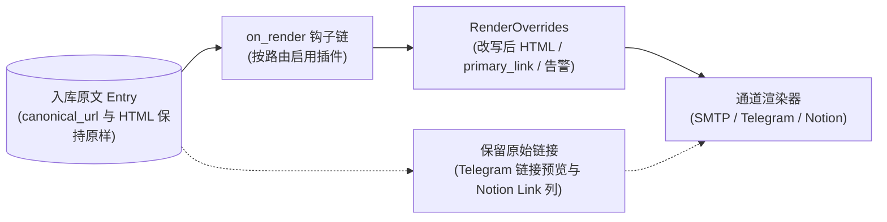

# 插件概览与市场

自 **`v0.3.0`** 起，FeedCourier 引入基于 **Protocol v1（`api_version: "1"`）** 的插件框架，支持在投递渲染阶段按路由扩展处理能力，同时保持数据库中的原始文章数据不变。

---

## 插件架构概览

- **投递期非破坏式执行（`on_render`）**：插件在发件箱 Worker 解密配置后、调用通道渲染器前运行（调试推送同样执行该钩子链，但不写入短链缓存）。数据库中的 `entries` 原文始终不被修改，确保同一篇文章发往多条路由、Telegram 链接预览以及 Notion 的原文 `Link` 属性均互不干扰。
- **路由级配置（`RouteOptions.plugins`）**：在 WebUI 的 **插件** 页面全局启用插件并添加一个或多个加密存储的服务商实例（例如多套 YOURLS 服务），随后在路由编辑弹窗的可折叠**插件**分区（或通过 REST API / MCP `configure_route`）按需绑定服务商。
- **安全的生命周期与引用保护**：
  - 全局禁用插件时，投递自动跳过其钩子，同时保留各路由上的插件配置。
  - 删除仍被路由引用的插件服务商实例时，服务端返回 **`409 Conflict`** 并列出所有引用它的路由名称。
  - 若服务商实例被停用（未删除），插件将自动降级保留原始链接，并在任务的诊断日志中记录黄色警告。
- **两期演进路线**：
  - **第一阶段（`v0.3.0`）**：第一方内置插件（首个插件为 [链接替换 (YOURLS)](/zh/plugins/link-rewrite)）以 Rust 实现并直接编译进单文件二进制，同时定型 Protocol v1 清单规范、SQLite 存储表（`plugins`、`plugin_instances`、`plugin_link_cache`）与钩子生命周期。
  - **第二阶段（规划中）**：基于 WASM / Extism 沙箱的第三方插件运行时，复用同一套 Protocol v1 协议与配置存储。

---

## 插件市场

下方目录在文档站构建时直接拉取官方 **[`ElleryHe/FeedCourier-Plugins`](https://github.com/ElleryHe/FeedCourier-Plugins)** 仓库的 `index.json` 生成；若处于离线环境或远端不可达，则自动回退到主仓库内置快照 `src/plugins/market_snapshot.json`。

<PluginMarketplace locale="zh" />

### 运行时市场索引加载机制

在 WebUI 打开 **插件 → 市场** 标签页（`GET /api/v1/plugins/market`）时：

- 后端通过连接层防 SSRF HTTP 客户端拉取 `https://raw.githubusercontent.com/ElleryHe/FeedCourier-Plugins/main/index.json`（上限 `1 MiB`，超时 `8s`），并在内存中缓存 **6 小时**。
- 可通过环境变量 [`PLUGIN_INDEX_URL`](/zh/guide/configuration#环境变量说明) 指定自托管镜像或内网索引地址。
- 在离线或无法访问 GitHub 的环境中，系统会自动回退到编译内置快照（`source: "snapshot"`）。
- 内置插件（`kind: "builtin"`）点击「安装」即可直接启用；第三方（`kind: "external"`）与规划中（`kind: "coming_soon"`）条目展示简介与源码仓库链接。

---

## 下一步阅读

- **[链接替换 (YOURLS)](/zh/plugins/link-rewrite)**：配置自托管 YOURLS 短链服务商、鉴权模式、`SSRF_ALLOWLIST` 内网放行、缓存与各渠道行为说明。
- **[插件开发手册](/zh/plugins/development)**：Protocol v1（`api_version: "1"`）清单规范、钩子生命周期、向 [`ElleryHe/FeedCourier-Plugins`](https://github.com/ElleryHe/FeedCourier-Plugins) 提交上架 PR 的流程以及 WASM 沙箱路线图。
