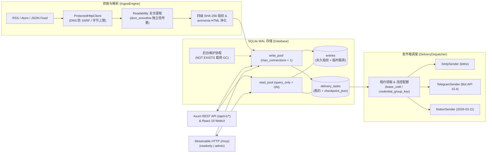
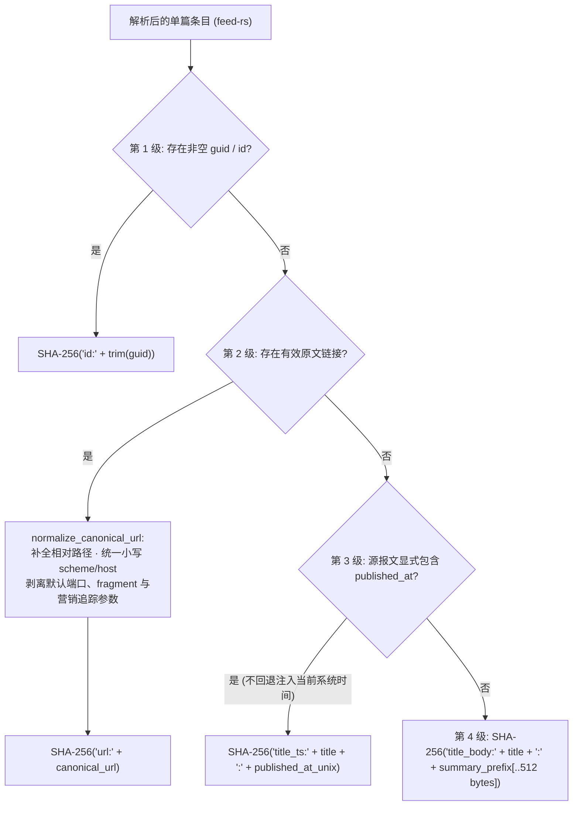
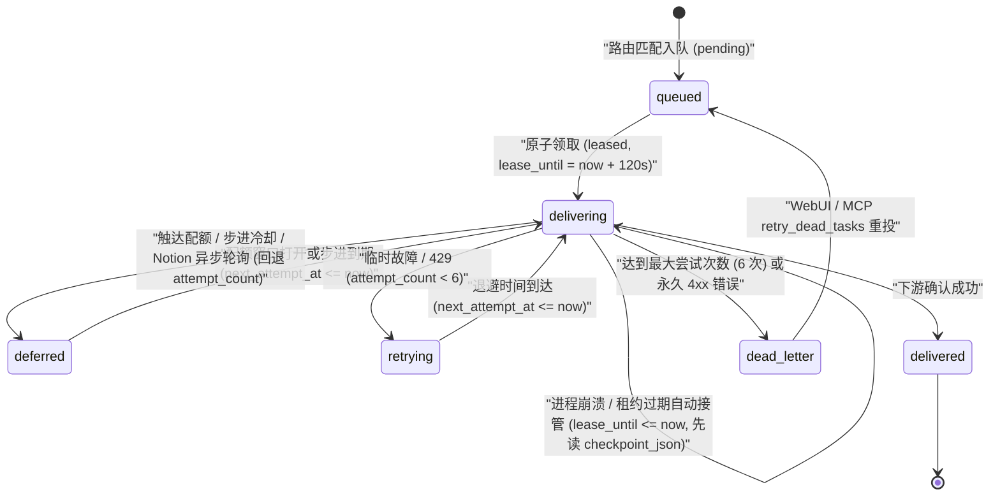

# 系统架构总览

本文说明 FeedCourier 后端的核心模块划分、数据流向、四级 SHA-256 指纹去重、SQLite WAL 读写双连接池与 `NOT EXISTS` 载荷垃圾回收，以及基于租约（`lease_until`）与共享凭据组（`credential_group_key`）的发件箱调度状态机。

关于下游通道协议细节与安全隔离机制，请分别参阅：
- [通道协议与投递实现](/zh/reference/channel-protocols)
- [安全与防注入机制](/zh/reference/security)

---

## 1. 模块划分与数据流图

FeedCourier 运行于单个 Rust 进程内，主要由五个核心组件协同工作：
- **`ProtectedHttpClient`（`src/net/`）**：在 DNS 解析与 TCP 连接阶段执行防 SSRF 校验，支持逐跳重定向校验（最多 5 跳）、响应流字节上限控制及可选全局出站代理。
- **`IngestEngine`（`src/ingest/`）**：执行订阅源拉取（支持 `ETag` / `Last-Modified` 条件请求）、按需 `dom_smoothie` Readability 全文提取、`ammonia` HTML 净化、四级 SHA-256 指纹计算以及路由过滤匹配。
- **`Database`（`src/db/`）**：维护基于 SQLite WAL 的串行写池（`write_pool`）与并发读池（`read_pool`），承载 `feeds`、`entries`、`channels`、`routes`、`delivery_tasks` 等持久化表。
- **`DeliveryDispatcher`（`src/scheduler/`）**：驱动后台订阅源轮询协程、租约制发件箱投递 Worker（含步进流控、配额窗口与 `checkpoint_json` 断点恢复）以及定期维护协程（`NOT EXISTS` 正文回收与 `PRAGMA optimize`）。
- **Axum HTTP 服务（`src/api/`、`src/mcp/`）**：在同一监听端口上挂载内嵌 React 19 WebUI、REST API（`/api/v1/*`）以及 Streamable HTTP MCP 服务端点（`/mcp`）。



---

## 2. 四级 SHA-256 指纹去重算法

实现位于 `src/ingest/fingerprint.rs`（`compute_entry_fingerprint`）。

针对不同订阅源在标识符、链接追踪参数与发布时间字段上的差异，FeedCourier 采用带命名空间前缀的四级降级策略计算定长 64 字符的十六进制 SHA-256 指纹（按 `(feed_id, fingerprint_sha256)` 唯一约束去重）：



| 优先级 | 降级层级 | 哈希输入组成 | 设计考量 |
| :---: | :--- | :--- | :--- |
| **Tier 1** | `guid`（原生 ID） | `id:<trimmed_guid_or_id>` | 当源站提供稳定的 Atom `<id>`、RSS `<guid>` 或 JSON Feed `id` 时优先采用。 |
| **Tier 2** | `canonical_url` | `url:<normalized_canonical_url>` | 经 `normalize_canonical_url` 规范化后计算，消除动态营销追踪参数导致的链接漂移。 |
| **Tier 3** | `title + published_at` | `title_ts:<normalized_title>:<published_at_unix>` | 仅当源报文显式声明发布时间戳时启用；缺失时间戳时不注入 `Utc::now()`，避免每次轮询生成不同指纹。 |
| **Tier 4** | `title + summary` | `title_body:<normalized_title>:<plain_summary_512b>` | 对缺失 ID、链接与发布时间的简讯源，截取清洗后纯文本摘要前 512 字节与标题组合哈希。 |

### URL 规范化规则（`normalize_canonical_url`）

在计算第 2 级指纹及写入 `entries.canonical_url` 前，链接依次执行以下处理：
1. 按 `canonical_url -> entry xml:base -> feed site_url -> feed_url` 基准链将相对路径解析为绝对 `http(s)` URL；
2. 统一小写化 `scheme` 与 `host`，移除默认端口（`:80`、`:443`）与 URL Fragment（`#...`）；
3. 剔除常见追踪参数：所有 `utm_*` 参数，以及 `fbclid`、`gclid`、`dclid`、`msclkid`、`twclid`、`igshid`、`mc_cid`、`mc_eid`、`spm`、`from`、`_hsenc`、`_hsmi`、`mkt_tok`、`vero_id`、`oly_enc_id`、`oly_anon_id`、`rb_clickid`、`s_kwcid`、`yclid`；
4. 对剩余 Query 参数按字典序排序。

### 首次静默初始化（`silent_init`）
新增订阅源或通过 OPML 批量导入时，`silent_init` 默认设为 `true`：首次拉取将存量条目的 `fingerprint_sha256` 写入 `entries` 表并把 `silent_init` 置为 `0`，不向 `delivery_tasks` 派发历史文章任务（若同时指定 `push_latest_one = true`，则仅将最新 1 篇条目入队以验证通道连通性）。


### 积压按时间顺序入队与清除缓存
当一次拉取发现多篇新文章（首次拉取且 `silent_init = false`，或订阅源一次性发布大量文章）时，系统按 `published_at` 从旧到新依次写入并入队；缺少发布时间时，按订阅源自身顺序的倒序处理。`POST /api/v1/feeds/{id}/clear-cache`（以及 MCP `manage_feed` 的 `clear_cache`）会删除该订阅源的 `entries`（级联删除 `delivery_tasks`）、清除 `etag` / `last_modified` 与失败状态，并将 `silent_init` 置为 `0`，使下一次拉取（默认立即）按上述顺序将全部积压入队。

---

## 3. SQLite WAL 读写双池与 `NOT EXISTS` 载荷回收

### 1. 读写连接池分离（`src/db/mod.rs`）

为避免后台高频写入与前端/MCP 查询竞争 SQLite 文件锁而触发 `SQLITE_BUSY`，`Database::connect` 对同一数据库文件（`<DATA_DIR>/feedcourier.db`）建立两个独立的 `sqlx::SqlitePool`：

| 连接池 | 最大连接数 | 连接级 PRAGMA 参数 | 承载负载 |
| :--- | :--- | :--- | :--- |
| **`write_pool`（写池）** | `max_connections = 1` | `journal_mode = WAL`<br>`synchronous = NORMAL`<br>`busy_timeout = 5000`<br>`foreign_keys = ON` | 串行执行所有写事务：条目入库、任务原子领取、`checkpoint_json` 更新、配置修改及 `VACUUM INTO` 在线热备。 |
| **`read_pool`（读池）** | 默认 `8`<br>（`DB_READ_MAX_CONNECTIONS`） | 同上，并额外启用：<br>`PRAGMA query_only = ON` | 并发处理 WebUI 仪表盘查询、任务列表分页、路由读取以及 MCP 只读诊断工具调用，不阻塞写连接。 |

### 2. `NOT EXISTS` 载荷垃圾回收（`purge_expired_entry_payloads`）

FeedCourier 长期保留 `entries.fingerprint_sha256` 用于去重，而将体积较大的 HTML 正文与媒体列表作为临时载荷管理。系统不维护易因路由删除或通道禁用而失步的引用计数，而是由后台维护协程每小时（或通过 `POST /api/v1/maintenance/gc`）执行一条 `NOT EXISTS` 更新语句：

```sql
UPDATE entries
SET content_html = NULL,
    summary_text = NULL,
    first_sentence = NULL,
    media_json = NULL,
    payload_purged_at = ?1
WHERE payload_purged_at IS NULL
  AND discovered_at <= ?2
  AND NOT EXISTS (
      SELECT 1
      FROM delivery_tasks dt
      WHERE dt.entry_id = entries.id
        AND dt.status IN ('queued', 'delivering', 'retrying', 'deferred')
  );
```

- **保留窗口（`RETENTION_HOURS`）**：参数 `?2` 对应 `now - RETENTION_HOURS * 3600`（默认 `24` 小时）。在保留窗口内，即使任务已完成或进入 `dead_letter`，其正文与媒体载荷仍保留在库中，支持管理员重投；
- **条件回收**：当条目超过 `RETENTION_HOURS` 且不存在任何处于活跃状态（`queued`、`delivering`、`retrying`、`deferred`）的关联任务时，`content_html`、`summary_text`、`first_sentence` 与 `media_json` 被置为 `NULL`，并记录 `payload_purged_at`；
- **部分索引加速**：`idx_entries_gc_candidates ON entries (discovered_at) WHERE payload_purged_at IS NULL` 确保 GC 仅扫描尚未回收载荷的行。

---

## 4. 发件箱状态机、租约恢复与共享凭据流控

实现位于 `src/scheduler/mod.rs`（`DeliveryDispatcher`）与 `src/db/mod.rs`（`claim_next_delivery_task`）。

### 1. 任务状态机

在 `delivery_tasks` 表中，每个投递任务（`1 Task = 1 Entry × 1 Route`）经历以下生命周期状态（括号内为对应的数据库 `status` 枚举值）：

- **待处理（`pending` / SQL `'queued'`）**：路由匹配通过后入队，等待 Worker 领取。
- **租约投递中（`leased` / SQL `'delivering'`）**：Worker 原子领取任务并写入租约截止时间 `lease_until = now + 120s`（`DEFAULT_TASK_LEASE_SECS`）。
- **流控/配额延后（`deferred`）**：通道处于共享凭据步进间隔、触发小时/每日配额上限，或等待 Notion 异步任务（`202 Accepted`）完成时，推迟 `next_attempt_at` 且**不扣减**失败重试次数。
- **退避重试（`failed` / SQL `'retrying'`）**：遇到临时网络错误、上游 `5xx` 或 `429 Too Many Requests` 时，按指数退避（或 `Retry-After`）计算 `next_attempt_at`，在未达最大尝试次数（`DEFAULT_MAX_DELIVERY_ATTEMPTS = 6`）前等待重试。
- **投递成功（`delivered`）**：下游通道确认接收，记录 `completed_at`。
- **死信队列（`dead_letter`）**：连续尝试满 `6` 次仍失败，或遇到不可恢复的 `4xx` 配置/鉴权错误时转入死信，等待人工排查后通过 WebUI 或 MCP `retry_dead_tasks` 重新入队。



### 2. `lease_until` 过期租约自动接管

`claim_next_delivery_task` 在每次调度周期中通过单条 `UPDATE ... RETURNING *` 同时匹配两类候选行：
1. `status IN ('queued', 'retrying', 'deferred') AND next_attempt_at <= now`
2. `status = 'delivering' AND lease_until <= now`

候选任务的排序为：先处理已过期租约（`delivering`，按 `lease_until`），其余按 `COALESCE(entries.published_at, entries.discovered_at) ASC`、`entries.id ASC`、`delivery_tasks.id ASC`。由于发件箱是全局的，多个订阅源的任务会合并成**一条按时间排列的投递流**，而不是按订阅源分批。

若进程在投递中途因容器重启或断电退出，正在执行的任务在 `120` 秒租约到期后会被后续调度周期自动重新领取。Worker 在发起网络请求前会先读取任务上的 `checkpoint_json`（`DeliveryCheckpoint`），按通道协议执行幂等对账或断点续传（详见[通道协议与投递实现](/zh/reference/channel-protocols)）。

### 3. 共享凭据组流控（`credential_group_key`）与配额护栏

多个逻辑通道可能共用同一个底层发信账号（例如同一个 Telegram `bot_token` 推送至不同群组/频道，或同一个 Notion `integration_secret` 写入不同数据源）。为防止并发通道叠加触发上游速率限制，FeedCourier 在保存通道时计算 `credential_group_key`（基于协议类型与核心凭据的 SHA-256 摘要）：

- **步进间隔与随机抖动（Pacing & Jitter）**：`DeliveryDispatcher` 按 `credential_group_key` 维护下次允许发送时间戳。每次投递完成后，同组通道共同延迟 `min_interval_secs + uniform_random(0..=jitter_max_secs)` 秒；
- **上游 `429` 组级冷却（`cooldown_until`）**：当任一通道收到下游 `429 Too Many Requests`（含 Telegram `parameters.retry_after` 或 HTTP `Retry-After` 响应头）时，系统按 `credential_group_key` 批量更新同组所有通道的 `cooldown_until`；
- **滚动配额窗口（`hourly_quota` / `daily_quota`）**：发送前统计当前通道过去 `3,600` 秒与 `86,400` 秒内 `status = 'delivered'` 的任务数；若达到上限，任务转入 `deferred` 状态并推迟至最早一笔已完成任务滑出窗口的时间点。

### 4. 路由时间窗口与全局队列暂停

领取循环之前有两道闸门：

- **路由时间窗口**：`routes.options_json` 可包含 `active_windows`（`HH:MM` 区间）与 `active_weekdays`（`1` = 周一 … `7` = 周日），按 `system_settings.timezone` 中保存的 IANA 时区判定（`src/schedule.rs`）。`end` 早于 `start` 的窗口跨午夜，`start == end` 表示全天，空列表表示不限制；跨午夜窗口按窗口开始那一天的星期判定。窗口外的任务**不会被丢弃**：保持 `queued` / `deferred` 状态，`next_attempt_at` 被设为下一个窗口开始时间，之后由常规领取查询接管。
- **全局暂停**：`system_settings.outbox_queue` 保存暂停状态与可选的 `resume_at`。暂停期间调度器不领取任何任务，但订阅源轮询与任务入队照常进行。已过期的 `resume_at` 视为已恢复（`GET /api/v1/tasks/queue` 返回 `paused: false`）。恢复后，所有到期任务按上述时间顺序依次发出。

每个任务的投递语言按 `routes.options_json.locale` 解析，缺省时回退到旧版 `system_settings.locale`。WebUI 界面语言只是浏览器本地偏好（`localStorage`），不保存到服务端。

### 5. 调试推送（`POST /api/v1/feeds/preview/push`、MCP `test_push_feed_entry`）

调试推送会实时抓取一条文章，并以内存中的条目直接调用通道发送器。它不写入 `entries` 指纹，也不创建 `delivery_tasks` 行，并绕过路由过滤、时间窗口、全局暂停、步进间隔与配额。Notion 页面的 `FC-ID` 带 `test-` 前缀，下游错误会以 `ok: false` 诊断信息返回给调用方。

---

## 5. 抓取并发隔离与退避熔断

- **轮询与全文提取并发隔离**：订阅源 XML/JSON 轮询受 `DEFAULT_FEED_POLL_CONCURRENCY = 4` 信号量限制（单次响应上限 `DEFAULT_MAX_FEED_BYTES = 10 MiB`）；开启 `fetch_full_content` 的源通过独立的 `DEFAULT_READABILITY_CONCURRENCY = 2` 信号量与 `spawn_blocking` 调用 `dom_smoothie` 提取正文（单页上限 `DEFAULT_MAX_ARTICLE_BYTES = 5 MiB`），避免慢速源站阻塞常规订阅轮询。
- **指数退避与熔断（Circuit Breaker）**：拉取失败时递增 `consecutive_failures` 并进入 `'backoff'` 状态，按 $t_{\text{delay}} = \min(21600,\; t_0 \cdot 2^{\min(n, 8)} + \text{jitter})$ 推迟 `next_poll_at`；当连续失败达到 `DEFAULT_CIRCUIT_BREAKER_THRESHOLD = 15` 次时，`health_status` 转为 `'circuit_open'` 并停止自动轮询，需由管理员在 WebUI 或通过 MCP `reset_and_poll_feed` 复位。
