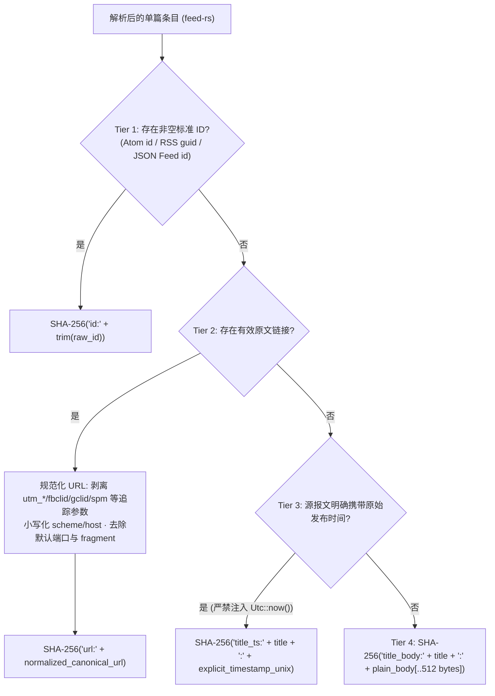
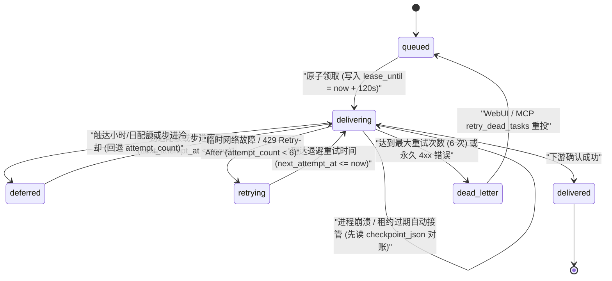
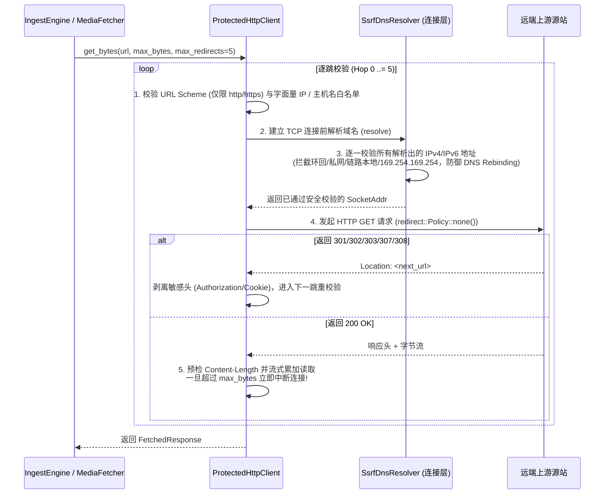

# 架构原理深入解析

本文深入剖析 FeedCourier 核心引擎的五大工程子系统：**四级防漂移 SHA-256 指纹去重算法**、**零引用计数 `NOT EXISTS` 正文 GC**、**SQLite WAL 读写分离连接池**、**租约制事务发件箱（`lease_until` + `checkpoint_json`）**以及**连接层防 SSRF 与独立信号量隔离的 Readability 提取管线**。

---

## 1. 四级防漂移 SHA-256 去重算法

源码定于 `src/ingest/fingerprint.rs`（`compute_entry_fingerprint`）。

在真实的互联网环境中，许多非标 RSS/Atom 源存在三类典型缺陷：
1. 根本不输出 `<guid>` 或 `<id>` 标签；
2. 每次生成 XML 时在文章链接末尾动态拼接不同的营销追踪参数（如 `?utm_source=...`、`&fbclid=...`、`&spm=...`）；
3. 既没有 `<guid>` 也没有 `<pubDate>`，若解析器在缺失时间戳时盲目回退注入当前系统时间（`Utc::now()`），会导致每次轮询計算出的哈希值都不同，从而造成灾难性的重复刷屏。

为彻底根治上述问题，FeedCourier 设计了带命名空间前缀的四级確定性降级 SHA-256 指纹管线：



### URL 规范化细节（`normalize_canonical_url`）

在进入二级指纹计算及写入 `entries.canonical_url` 前，链接统一经过以下净化步骤：
- 按 **`canonical_url -> entry xml:base -> feed site_url -> feed_url`** 四级基准链将相对路径补全为绝对 `http(s)` 地址；
- 剥离 URL Fragment（`#...`）及默认端口（`http:80`、`https:443`）；
- 过滤移除所有营销追踪 Query 参数：包括一切以 `utm_` 开头的参数，以及 `fbclid`、`gclid`、`dclid`、`msclkid`、`twclid`、`igshid`、`mc_cid`、`mc_eid`、`spm`、`from`、`_hsenc`、`_hsmi`、`mkt_tok`、`vero_id`、`oly_enc_id`、`oly_anon_id`、`rb_clickid`、`s_kwcid`、`yclid`；
- 对保留的业务 Query 参数按字典序稳定排序，确保参数顺序变化不影响指纹一致性。

---

## 2. 零引用计数 `NOT EXISTS` 正文回收（GC）

源码定于 `src/db/mod.rs`（`purge_expired_entry_payloads`）。

为了实现“**指纹永久保留，正文阅后即焚**”，传统的做法是在文章表上维护一个 `pending_tasks_count` 引用计数器。然而一旦用户在任务排队中途删除了某条路由、禁用了某个通道、或者某篇文章未命中任何路由，静态引用计数极易出现漏减或死锁，导致正文永远无法回收。

FeedCourier 完全摒弃引用计数，由后台维护协程（默认每小时运行一次，亦可通过 `POST /api/v1/maintenance/gc` 手动触发）执行一条声明式的 **`NOT EXISTS` 原子更新**：

```sql
UPDATE entries
SET title = NULL,
    canonical_url = NULL,
    author = NULL,
    content_html = NULL,
    first_sentence = NULL,
    summary_text = NULL,
    media_json = NULL,
    payload_purged_at = ?1
WHERE payload_purged_at IS NULL
  AND discovered_at <= ?2
  AND NOT EXISTS (
      SELECT 1
      FROM delivery_tasks dt
      WHERE dt.entry_id = entries.id
        AND dt.status IN ('queued', 'delivering', 'retrying', 'deferred')
  );
```

- **保留窗口保障**：`?2` 为 `now - RETENTION_HOURS * 3600`（默认保留 24 小时），确保在窗口期内即使任务已进入 `dead_letter`（死信）状态，正文依然完好保留，供管理员在 WebUI 或通过 MCP `retry_dead_tasks` 重投；
- **零误差覆盖所有边界**：只要文章不再被任何活跃任务（`queued`、`delivering`、`retrying`、`deferred`）引用且已渡过保留窗口，其 HTML 正文与媒体 JSON 立即被置空，仅留下定长 64 字节的 `fingerprint_sha256` 行用于永久防重。

---

## 3. SQLite WAL 读写连接池隔离

源码定于 `src/db/mod.rs`（`Database::connect`）。

在单机自托管场景下，SQLite 的性能瓶颈从来不是 I/O 吞吐，而是多个并发写连接争抢文件锁触发的 `SQLITE_BUSY` 异常。FeedCourier 在架构层将数据库连接池严格拆分为两个独立池：

| 连接池 | 容量配置 | 连接级 PRAGMA 初始化参数 | 职责范围 |
| :--- | :--- | :--- | :--- |
| **串行写池（`write_pool`）** | **`max_connections = 1`** | `journal_mode = WAL`<br>`synchronous = NORMAL`<br>`busy_timeout = 5000`<br>`foreign_keys = ON` | 串行承载全部 `INSERT` / `UPDATE` / `DELETE` 事务、任务原子领取、`checkpoint_json` 刷新与 `VACUUM INTO` 热备份。应用层天然排队，**从根源上消灭写写锁竞争**。 |
| **并发读池（`read_pool`）** | 默认 **`8`**<br>（`DB_READ_MAX_CONNECTIONS`） | 除上述参数外，额外强制开启：<br>**`PRAGMA query_only = ON`** | 并发服务 WebUI 仪表盘轮询、任务列表检索、MCP `list_feeds_status` 与 `inspect_failed_deliveries` 查询，与后台写操作完全并行不互锁。 |

---

## 4. 租约制发件箱（`lease_until`）与崩溃恢复状态机

源码定于 `src/scheduler/mod.rs`（`DeliveryDispatcher::process_next_outbox_task`）。



### 1. 单条 SQL 原子领取与过期租约回收

Worker 无需在启动时执行繁琐的“扫描上次崩溃遗留任务”逻辑，因为在运行期的每一次领取操作中，`claim_next_delivery_task` 都会同时将 **`status IN ('queued', 'retrying', 'deferred') AND next_attempt_at <= now`** 以及 **`status = 'delivering' AND lease_until <= now`** 的任务纳入候选集，并通过单连接写池执行 `UPDATE ... RETURNING *`：

- 正常领取后，任务获得默认 **`120` 秒（`DEFAULT_TASK_LEASE_SECS`）** 的租约（`lease_until`），同时 `attempt_count` 加 1；
- 若容器在发送途中被 `SIGKILL` 强杀或宿主机断电，待租约到期后，该任务会自动被重新领取并进入 **`checkpoint_json` 断点对账流程**。

### 2. 三大通道断点续投（`DeliveryCheckpoint`）

| 变体类型 | `checkpoint_json` 字段 | 恢复与对账动作 |
| :--- | :--- | :--- |
| `DeliveryCheckpoint::Notion` | `create_initiated: bool`<br>`async_task_id: Option<String>`<br>`page_id: Option<String>` | 1. 若已有 `page_id`：直接标记 `delivered`。<br>2. 若有 `async_task_id`：轮询 `GET /v1/async_tasks/{id}`。<br>3. 若 `create_initiated == true`：先按 `FC-ID == fingerprint_sha256` 查询数据源，若页面已创建则直接回填 `page_id` 闭环，实现**有效一次（Effective-once）**。 |
| `DeliveryCheckpoint::Telegram` | `next_batch_offset: usize`<br>`sent_message_ids: Vec<i64>`<br>`degraded_to_compact: bool` | 多图 `media_mode` 每发完一组（10 张）立即持久化 `next_batch_offset`。重试或恢复时直接跳过已送达批次，从断点批次继续发送。 |
| `DeliveryCheckpoint::Smtp` | `message_id: String` | 记录确定性生成的 RFC 5322 `Message-ID`，确保重试邮件携带完全一致的 `Message-ID` 供收件箱客户端去重。 |

---

## 5. 连接层防 SSRF 客户端与独立信号量 Readability

源码定于 `src/net/mod.rs`、`src/net/ssrf.rs` 与 `src/ingest/readability.rs`。



### 流式响应体积硬上限一览

| 抓取场景 | 常量名称 | 字节硬上限 | 并发与超时隔离策略 |
| :--- | :--- | :---: | :--- |
| **RSS / Atom / JSON Feed 轮询与预览** | `DEFAULT_MAX_FEED_BYTES` | **`10 MiB`** | 轮询并发上限 `4`（`DEFAULT_FEED_POLL_CONCURRENCY`），连接超时 `10s`，总超时 `30s`。 |
| **Readability 网页全文提取（`dom_smoothie`）** | `DEFAULT_MAX_ARTICLE_BYTES` | **`5 MiB`** | **独立信号量并发上限 `2`**（`DEFAULT_READABILITY_CONCURRENCY`），单页超时 `20s`，使用 `spawn_blocking` 隔离 CPU 密集型 DOM 解析。 |
| **Telegram 媒体防盗链流式中转（图片）** | `MAX_PHOTO_BYTES` | **`10 MiB`** | **全局进程信号量并发上限 `2`**（`MAX_CONCURRENT_MEDIA_UPLOADS`），超时 `45s`，纯内存零落盘转发。 |
| **Telegram 媒体防盗链流式中转（视频/音频）** | `MAX_MEDIA_BYTES` | **`50 MiB`** | 同上，共享全局并发上限 `2`，超限自动降级为文末直达链接。 |
