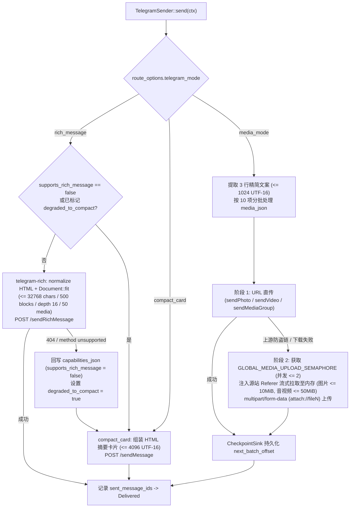
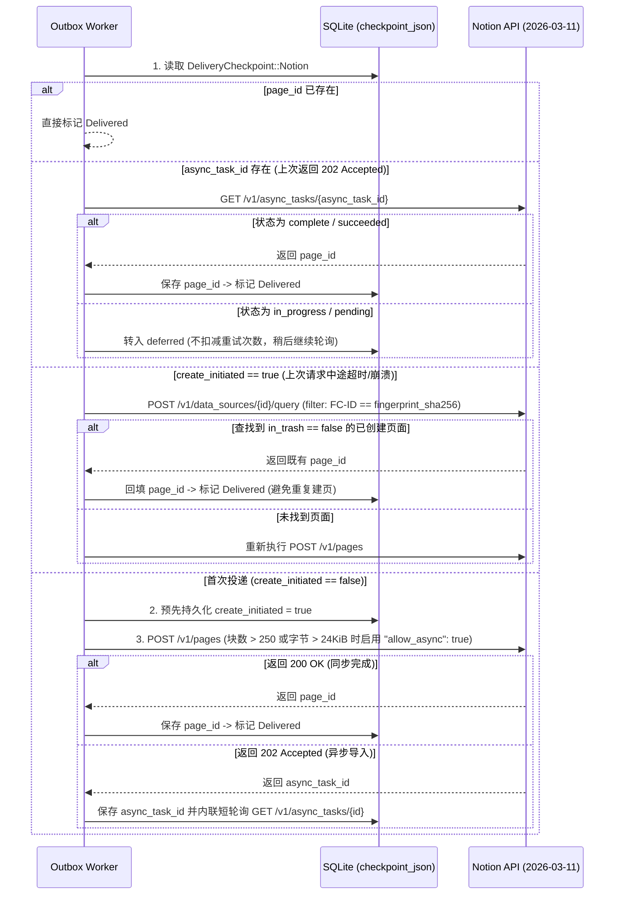

# 通道协议与投递实现

本文记录 FeedCourier 三类授信投递通道（**SMTP**、**Telegram Bot API 10.4**、**Notion API `2026-03-11`**）的底层协议规范、报文转换规则、流式媒体处理以及跨崩溃断点（`DeliveryCheckpoint`）对账流程。

关于通道在 WebUI 中的日常配置方法，请参阅用户指南中的 [SMTP 邮件简报](/zh/channels/smtp)、[Telegram 机器人](/zh/channels/telegram) 与 [Notion 数据库](/zh/channels/notion)。

---

## 1. 断点续投数据结构概览（`DeliveryCheckpoint`）

`delivery_tasks.checkpoint_json` 存储序列化后的 `DeliveryCheckpoint`（定义于 `src/channels/mod.rs`），用于在任务重试或 `lease_until` 租约超时恢复时避免重复投递：

| 枚举变体 | 序列化 JSON 字段 | 投递语义与恢复机制 |
| :--- | :--- | :--- |
| `DeliveryCheckpoint::Smtp` | `{"kind": "smtp", "message_id": "<...>", "sent_recipients": ["<address_hmac>", ...]}` | **至少一次（逐收件人续传且客户端可去重）**：为每位已验证收件人生成确定性 RFC 5322 `Message-ID`（`<fc-{fp[..24]}-r{route_id}-{hmac[..8]}@{from_domain}>`），并在每封送达后将其 `address_hmac` 追加至 `sent_recipients`，重试时自动跳过已送达收件人（即便落盘断点遇瞬时写库异常，内存中的 `sent_recipients` 也会随 `DeliveryOutcome::Retry` 保留）。 |
| `DeliveryCheckpoint::Telegram` | `{"kind": "telegram", "next_batch_offset": 10, "sent_message_ids": [...], "degraded_to_compact": false}` | **至少一次（按批次推进）**：`media_mode` 每完成一组（最多 10 项）`sendMediaGroup` 即通过 `CheckpointSink` 落盘 `next_batch_offset`；重试时跳过已发送批次。 |
| `DeliveryCheckpoint::Notion` | `{"kind": "notion", "create_initiated": true, "async_task_id": "...", "page_id": "..."}` | **有效一次（Effective-once）**：发起创建前标记 `create_initiated = true`；重试时先按 `FC-ID == fingerprint_sha256` 反查数据源或轮询 `async_task_id`，若页面已存在则直接回填 `page_id` 闭环。 |

---

## 2. SMTP 邮件通道实现（`src/channels/smtp.rs`）

### 1. `lettre` 异步传输与连接池
- `SmtpSender` 基于 `lettre::AsyncSmtpTransport<Tokio1Executor>` 通过**原生 TCP/TLS 直连**发送（HTTP/SOCKS 出站代理与 `OUTBOUND_PROXY` 不适用于 SMTP），支持三种传输加密模式（`SmtpSecurity`）：
  - `StartTls`（默认端口 `587`）：显式 STARTTLS 升级；
  - `Tls`（默认端口 `465`）：隐式 TLS / Wrapper 模式；
  - `Plain`（默认端口 `25`）：仅用于受控内网中继的明文连接。
- 内部按 `(host, port, security, username, password)` 的 SHA-256 摘要缓存连接池（`PoolConfig::new().max_size(2).idle_timeout(60s)`），单次 SMTP 指令默认超时为 `DEFAULT_SMTP_TIMEOUT = 30s`。
- 账号级测试（未传 `destination_id` 调用 `POST /api/v1/channels/{id}/test`）校验连通性与认证并**仅向自身 `from_address`** 发送自检邮件；目的地级测试（`POST /api/v1/destinations/{id}/test`）与预览 `debug_push` 均严格**只向 `verified` 收件人**按单 `To:` 隔离信封附带 RFC 8058 合规头逐人发送（0 位已验证收件人时直接报错拦截）。

### 2. `minijinja` 自动转义单栏渲染、响应式 HTML 改写与 `< 95 KiB` 体积预算
- 每封邮件组装为 `multipart/alternative`（`MultiPart::alternative_plain_html`），同时包含：
  1. **`text/html` 主体**：由 `minijinja` 以 `"email.html"` 注册并强制启用 **`AutoEscape::Html`** 渲染内置 `EMAIL_HTML_TEMPLATE`（最大宽度 `640px`、内容可用宽度 `EMAIL_CARD_INNER_WIDTH_PX = 592px` 的单栏卡片布局，搭配内联 `style="..."` 与 `<head>` 兜底样式，兼容 Gmail、Apple Mail 与 Outlook.com）。仅经 `ammonia` 消毒的正文片段 `body_html` 使用 `| safe`，其余所有元数据（`subject`、`entry_title`、`feed_title`、`meta_line`、`sender_identity`、目的地/路由名称及链接）均由模板引擎统一 HTML 转义。元信息行中的发布时间按**路由时区**经 `format_local_timestamp` 格式化为 `YYYY-MM-DD HH:MM (UTC±HH:MM)`；
  2. **`text/plain` 回退体**：由 `html2text` 按 `PLAIN_TEXT_WRAP_WIDTH = 78` 列宽转换生成，确保纯文本客户端与终端阅读器正常显示。
- **响应式正文 HTML 改写**：模板插值前统一规范可能撑破 `640px` 卡片的外部标签（属性采用分号感知的 HTML5 实体解码）：
  - ``：移除固定 `height` 属性，设置兼容 Outlook 的 `width="592"`（若原图显式宽度小于 `592px` 则保留原宽度），并内联响应式 `style="display:block;max-width:100%;width:100%;height:auto;..."`（小图不强制拉伸）。对于百分比宽度（`parse_percent_dimension`），小数百分比保留在内联 CSS 中（`style="width:33.3%;max-width:100%;height:auto;..."`），同时 HTML `width` 属性输出按 `592px` 折算的整数像素（如 `width="197"`）；`0%` 保持 `0` 不拉伸，正数且小于 `1%` 的宽度下限钳制为 `1%`；
  - `<figure>` / `<figcaption>`：清零水平外边距并设置小号灰字图注样式；
  - `<table>` / `<pre>`：添加 `max-width:100%` 并允许横向滚动或自动换行。
- **防 Gmail 折叠截断（`MAX_EMAIL_HTML_BYTES = 95 KiB`）**：Gmail 网页端与客户端会对总大小超过约 `102 KB` 的邮件正文执行 `[Message clipped]` 折叠。`render_entry_html` 将渲染后的 UTF-8 HTML 字节数严格控制在 **`95 KiB`（`97,280` 字节）** 以内；若原文超出预算，则在闭合标签边界处安全截断，并在邮件底部插入带原文链接的截断提示框（`Continue reading original article →`）。

### 3. `Force-From`、逐收件人确定性信头、RFC 8058 合规头与硬退信分类
- **`Force-From`（SPF / DKIM / DMARC 合规）**：无论上游 RSS 条目中声明的 `<author>` 为何，`From` 头部始终固定使用通道配置的授信发件邮箱 `from_address`，仅将显示名称格式化为 `"<Feed Title> via FeedCourier" <from_address>`。若配置了 `reply_to`，则单独写入 `Reply-To` 头部。
- **逐收件人隔离信封与确定性 `Message-ID`**：发件箱为每位 `verified` 收件人独立发送单 `To:` 邮件（收件人之间间隔 `1` 秒并自动续租），并将已接受收件人的 `address_hmac` 持久化至 `DeliveryCheckpoint::Smtp.sent_recipients`。每位收件人的 `Message-ID` 由条目指纹前 24 位十六进制字符、`route_id`、`address_hmac` 前 8 位十六进制字符与发件域名组成（任务级回退格式为 `<fc-{fp[..24]}-r{route_id}@{from_domain}>`）：
  ```text
  <fc-{fingerprint_sha256[..24]}-r{route_id}-{address_hmac[..8]}@{from_domain}>
  ```
- **RFC 8058 合规头与 `List-Id`**：附带 `Auto-Submitted: auto-generated`、`List-Id: <dest-{destination_id}.{from_domain}>`（无目的地 ID 时回退 `<feed-{feed_id}.{from_domain}>`）、`List-Unsubscribe: <{PUBLIC_URL}/u/{token}>, <mailto:{from_address}?subject=unsubscribe>`（未配置 `PUBLIC_URL` 时仅含 `mailto:`）以及配置 `PUBLIC_URL` 时的 `List-Unsubscribe-Post: List-Unsubscribe=One-Click`，并在邮件页脚渲染 CAN-SPAM 订阅说明与可选 `sender_identity`。
- **收件人级硬退信判定（`is_recipient_hard_bounce`）与 `auto_paused`**：
  - 仅当增强状态码命中收件人永久拒收（`5.1.1`、`5.1.2`、`5.1.3`、`5.1.6`、`5.1.10`）或明确指向收件人邮箱不存在/拒收的 `550`/`551`/`553` 时，才将该收件人标为 `bounced`（`revoked_method = "hard_bounce"`，`bounce_diagnostic` 与 `diagnostic_log` 中的邮箱均脱敏）并继续发送给其余已验证收件人；
  - 账号认证、配额、体积、内容反垃圾或策略拒信 5xx（`530`、`535`、`552`、`554`、`5.4.5`、`5.7.*`）立即中止投递循环，携带当前 `sent_recipients` 断点返回通道级错误，**绝不误标已验证订阅者为 `bounced`**；
  - 当目的地下全部收件人均转为 `unsubscribed` 或 `bounced` 时，`channel_destinations` 置为 `enabled = 0, auto_paused = 1`；后续有任一收件人重新完成验证时，`auto_paused` 目的地自动恢复 `enabled = 1, auto_paused = 0`。

---

## 3. Telegram 通道实现（`src/channels/telegram.rs`，Bot API 10.4）

`TelegramSender` 面向 **Telegram Bot API 10.4** 设计，支持私聊、群组、开启话题的超级群组（`message_thread_id`）、频道以及自建 Local Bot API Server（`api_base_url`），提供三种路由级展现模式（`TelegramDeliveryMode`）。



### 1. `RichMessage` 模式与 `telegram-rich 0.0.2` 结构化转换
- 路由设为 `rich_message` 时，`build_rich_message_payload_with_options` 基于 [`telegram-rich 0.0.2`](https://crates.io/crates/telegram-rich) 构建 Bot API 10.4 富文本消息：
  1. **头部块结构**：文章标题使用无超链接的纯白 **`<h3>`**（`Block::Heading { level: 3 }`，由底部胶囊按钮统一承载外链跳转），下方以 Telegram 原生小号灰字 **`<footer>`**（`Block::Footer`）展示按**路由时区**格式化的紧凑「来源 · 作者 · `YYYY-MM-DD HH:MM`」，并以水平分隔线（`Block::Divider` / `<hr>`）分隔头部与正文；
  2. **HTML 结构解析（`parse_rich_html` + `ParseOptions`）**：传入 `heading_offset: 3`（原文标题统一降级为 `h1→h4`、`h2→h5`、`h3+→h6`）与 `group_consecutive_media: true`（连续 2 张及以上内嵌图片自动合并为 `<tg-collage>`，超过 collage 上限时自动改用 `<tg-slideshow>`），同时保留紧凑表格（`<table compact>`）、可展开引用块（`<blockquote expandable>`）、带语法高亮标识的代码块（`<pre><code class="language-...">`）以及底部直达按钮行（`<tg-button-row>` / `Block::link_button`）；
  3. **配额自适应裁剪（`Document::fit` / `FitOptions`）**：在序列化为 `InputRichMessage` 前，自动将文档裁剪至 Bot API 10.4 的四项硬性限制以内：
     - 正文总字符数 $\le 32,768$；
     - 结构块（`Block`）总数 $\le 500$；
     - 节点嵌套深度 $\le 16$；
     - 内嵌媒体项总数 $\le 50$。

### 2. 端点能力探测（`probe_capabilities`）与自动降级
- 在创建或测试 Telegram **账号**（`POST /api/v1/channels` 或未传 `destination_id` 的 `POST /api/v1/channels/{id}/test`）时，`probe_capabilities` 先调用 `getMe` 校验 Token 并读取 `bot_username`（留空账号名时自动作为默认名称），随后向 `/bot<token>/sendRichMessage` 发送空负载 `{}` 进行无副作用探测：
  - 若服务端返回 `400 Bad Request`（提示缺少 `chat_id` 参数），表明目标服务端支持 Bot API `10.2+` / `10.4` 的 `sendRichMessage` 方法，记录 `supports_rich_message: true` 与 `bot_api_version: "10.4"`；
  - 若自建 Local Bot API Server 版本低于 `10.2` 并返回 `404 Not Found`（或未知方法描述），则记录 `supports_rich_message: false` 与 `bot_api_version: "<10.2"`，持久化至 `channels.capabilities_json`。
- 创建目的地时留空备注名会自动调用 `getChat` 获取群组/频道标题；`POST /api/v1/destinations/{id}/test` 向具体目的地的 `chat_id`（及可选 `message_thread_id`）发送验证消息。
- 当 `supports_rich_message` 为 `false`，或运行期调用 `sendRichMessage` 遭遇方法不支持错误或正文实体语法类 `400 Bad Request`（排除 `chat_id` 与权限类错误）时，`TelegramSender` 自动降级调用 `CompactCard`（`sendMessage`，`parse_mode: "HTML"`）。

### 2b. `CompactCard` 编辑卡片、ZWNJ 防误高亮与字素簇截断
- **编辑卡片排版**：顶部为加粗文章标题，主体为 `<blockquote>` 摘要（超过 `300` UTF-16 代码单元自动升级为可折叠 `<blockquote expandable>`，按词/句边界安全截断至 `<= 800` 单元，摘要与标题重复时自动省略），底部以斜体展示路由时区下的「来源 · 作者 · `YYYY-MM-DD HH:MM`」，并附带原生内联外链按钮（`reply_markup`），同时将 `link_preview_options.url` 校验为合法 `http://`/`https://` 后保留在原始文章链接上。
- **实体转义膨胀平滑预算回退**：当高频 `&`/`<` 等 HTML 实体转义导致渲染结果超过 `MAX_MESSAGE_UTF16_UNITS = 4,096` 时，`format_compact_card_html_with_options` 按膨胀比例平滑缩减摘要预算，绝不一次性清零预算丢弃整段摘要。
- **ZWNJ 自动实体抑制（`suppress_telegram_auto_entities`）**：插入不可见零宽非连接符（`\u{200C}`）防止 Telegram 将 `/commands`、`@scoped/packages` 以及显式代码/文档文件名（如 `README.md`、`sku.go`）误识别为蓝色可点击链接，同时完整豁免行内 `http://`/`https://` URL（即使紧邻中文、全角标点或 Markdown 链接如 `详见https://...`、`[原文](https://...)`）、含 `@` 的邮箱地址以及 `notion.so` 等常见裸域名。
- **Unicode 字素簇截断**：`truncate_utf16` 与 `truncate_utf16_word_boundary` 基于 `unicode_segmentation::UnicodeSegmentation::graphemes(true)` 按完整扩展字素簇切分，确保 ZWJ 复合 Emoji 与组合字符永不被劈裂。

### 3. `MediaMode` 三行超链接文案、按类型智能分流与 10 项分批断点
- **三行精简 HTML 文案（`MAX_CAPTION_UTF16_UNITS = 1,024`，`parse_mode: "HTML"`）**：
  - 第 1 行：经 HTML 转义的文章作者（无作者时回退为订阅源名称）；
  - 第 2 行：入库阶段由 `unicode-segmentation`（`unicode_sentences`）提取并经 HTML 转义的正文首句 `entries.first_sentence`；
  - 第 3 行：随路由 `options.locale`（缺省回退到旧版 `system_settings.locale`）本地化的原文超链接（中文为 `<a href="...">链接</a>`，英文为 `<a href="...">Link</a>`）。
  - 可见字符严格按 UTF-16 代码单元截断至 $\le 1,024$（当条目不含任何可用媒体时，发送相同三行格式的 HTML 消息）。
- **按类型智能分流、文件头魔数嗅探与纯 Rust MP4 元数据提取**：
  - **阶段 1（图片、音频与明确后缀文档的 URL 直传）**：优先将原始 URL 提交给 Telegram 服务器（`sendPhoto` / `sendAudio` / `sendDocument` / `sendMediaGroup`），遇防盗链或拉取失败时自动转入阶段 2。
  - **阶段 2（内存流式 `multipart/form-data` 上传与视频流式化管线）**：视频（`Video`）及无明确后缀的通用 `<enclosure>` 附件跳过 Telegram URL 直传（避免无 `.mp4` 后缀或 `application/octet-stream` 视频被 Telegram 静默降级为不可预览的 `Document` 文件并返回 `200 OK`），向全局信号量 `GLOBAL_MEDIA_UPLOAD_SEMAPHORE`（`MAX_CONCURRENT_MEDIA_UPLOADS = 2`）申请许可后，由 `ProtectedMediaFetcher` 携带源站 `Referer` 将字节流读取至内存 `Bytes` 缓冲区；通过 `sniff_media_bytes` 嗅探容器魔数（`ftyp`/`moov`、WebM EBML、JPEG/PNG/GIF/WebP、MP3/Ogg、PDF）将误判的附件自动升级并将视频 MIME/后缀统一归一化为 `video/mp4` + `.mp4`，同时由零外部依赖的 `parse_mp4_metadata` 解析 ISO-BMFF `moov -> mvhd / tkhd / stsd` Box（支持 90°/270° 手机竖屏旋转矩阵自动对调宽高），在 `sendVideo` 与 `sendMediaGroup`（`InputMediaVideo`）中注入 `supports_streaming: true`、`width`、`height` 与 `duration`。
  - **体积上限与超限降级**：图片上限为 `MAX_PHOTO_BYTES = 10 MiB`，视频/音频/文档上限为 `MAX_MEDIA_BYTES = 50 MiB`。若超出上限则立即中止下载流，并以 ` · <a href="...">媒体 N</a>`（`Media N`）超链接形式紧凑追加在第三行末尾。
- **`sendMediaGroup` 10 项分批与 `checkpoint_json` 续传**：
  - 当单篇文章包含超过 `MEDIA_GROUP_BATCH_SIZE = 10` 个媒体项时，自动拆分为每组最多 10 项的多个批次（仅首批次携带三行文案）；
  - 每组发送成功后立即调用 `CheckpointSink::save_checkpoint` 更新 `next_batch_offset` 与 `sent_message_ids`。若后续批次触发 `429 Too Many Requests` 或进程重启，恢复执行时直接从 `media_items[next_batch_offset..]` 继续发送。

---

## 4. Notion 通道实现（`src/channels/notion.rs`，`Notion-Version: 2026-03-11`）

### 1. 固定 `Notion-Version: 2026-03-11` 协议契约
`NotionSender` 对所有出站请求强制附加 `Notion-Version: 2026-03-11` 头部（`NOTION_API_VERSION`），遵循 `2026-03-11` 版本的 Data Source 数据模型。在双层通道模型下，`channels.encrypted_config` 存储账号凭据 `NotionChannelConfig`（`integration_secret`，账号测试调用 `GET /v1/users/me`），而 `channel_destinations.encrypted_config` 存储各目的地的 `NotionDestinationConfig`（`data_source_id`、可选 `database_id`/`parent_page_id` 与 `column_mapping`）：
- **父级容器（`data_source_id`）**：创建页面（`POST /v1/pages`）时使用 `parent: { "type": "data_source_id", "data_source_id": "<uuid>" }`，而非旧版的 `database_id`；
- **建库属性声明（`initial_data_source.properties`）**：通过 `POST /api/v1/channels/notion/init-db` 调用 `POST /v1/databases` 初始化 8 列标准收件箱（`Title`、`FC-ID`、`Link`、`Short URL`、`Source`、`Published`、`State`、`Tag`，对应 `NotionColumnMapping::standard_8_column()`）时，属性定义挂载于 `initial_data_source.properties`，并从响应的 `data_sources[0].id` 提取 `data_source_id`；而 `NotionColumnMapping::default()` 将 `short_url` 默认置为 `None`，保持对省略 `column_mapping` 的存量 7 列库兼容；
- **表结构自检、自动补齐与单事务 `data_source_id` 懒回写**：通过 `GET /v1/data_sources/{id}` 检查现有列类型，当 `patch_missing: true` 时调用 `PATCH /v1/data_sources/{id}` 自动创建缺失的标准列（若用户传入旧式数据库 URL/ID，客户端会先查询 `GET /v1/databases/{id}` 解析关联的 `data_source_id`）。投递遇 `404 object_not_found` 触发懒解析回写时，会在 `write_pool` 单事务内重读最新 `channel_destinations.encrypted_config` 仅更新 `data_source_id`，避免覆盖用户并发保存的列映射；
- **回收站状态字段（`in_trash`）**：页面与数据源状态判断统一使用 `in_trash: bool`，替代已移除的 `archived` 字段。

### 2. HTML 转 Markdown v2 与动态代码围栏扩展（`normalize_markdown_v2`）
Notion `2026-03-11` 支持在 `POST /v1/pages` 请求体的顶层 `markdown` 字段直接传入 Markdown v2 文本。`convert_entry_html_to_notion_markdown` 执行以下转换流水线：
1. **`htmd` 结构化转换**：将清洗后的 HTML 转换为 ATX 标题（`#`）、`-` 无序列表、行内链接与围栏代码块；
2. **动态反引号围栏扩展（`normalize_markdown_v2`）**：扫描代码块内容；若代码块内部包含连续 $k \ge 3$ 个反引号（例如描述 Markdown 语法的代码示例），自动将外层打开与闭合围栏扩展为 $k + 1$ 个反引号（如 ```` ```` ````），防止内部反引号提前闭合代码块导致 Notion 服务端解析错位；
3. **块边界截断保护**：Notion 单次写入硬限制为 `5,000` 个块。FeedCourier 设置安全水位线 `MAX_NOTION_BLOCKS = 4,800` 块与 `MAX_MARKDOWN_BYTES = 450,000` 字节（同时将单段富文本控制在 `MAX_NOTION_TEXT_FRAGMENT_CHARS = 2,000` 字符、单选/多选标签名控制在 `MAX_NOTION_SELECT_CHARS = 100` 字符以内）。超出阈值时在完整段落/围栏边界处截断，并追加原文跳转提示。

### 3. 大页面异步创建（`allow_async`）与有效一次（Effective-once）对账


- **异步阈值**：当估算块数超过 `ASYNC_BLOCK_THRESHOLD = 250` 或 Markdown 字节数超过 `ASYNC_BYTE_THRESHOLD = 24 KiB`（`24,576` 字节）时，`POST /v1/pages` 自动携带 `"allow_async": true`。若 Notion 返回 `202 Accepted` 及 `async_task_id`，Worker 先执行短轮询（`DEFAULT_INITIAL_ASYNC_POLLS = 2`，间隔 `600ms`）；若仍未完成，则持久化 `async_task_id` 并将任务置为 `deferred`（最长允许异步轮询 `DEFAULT_MAX_ASYNC_POLL_AGE_SECS = 20` 分钟，期间不消耗 `attempt_count`）。
- **`FC-ID` 幂等对账**：每次发起 `POST /v1/pages` 前，Worker 先通过 `CheckpointSink` 将 `create_initiated: true` 写入数据库，并在页面属性中写入 `FC-ID = entry.fingerprint_sha256`。若请求因网络抖动超时或容器重启而未收到响应，下次恢复执行时 Worker 会先调用 `POST /v1/data_sources/{id}/query` 检索 `FC-ID` 是否已存在有效页面（`in_trash == false`），从而在超时重试场景下实现有效一次（Effective-once）投递。
