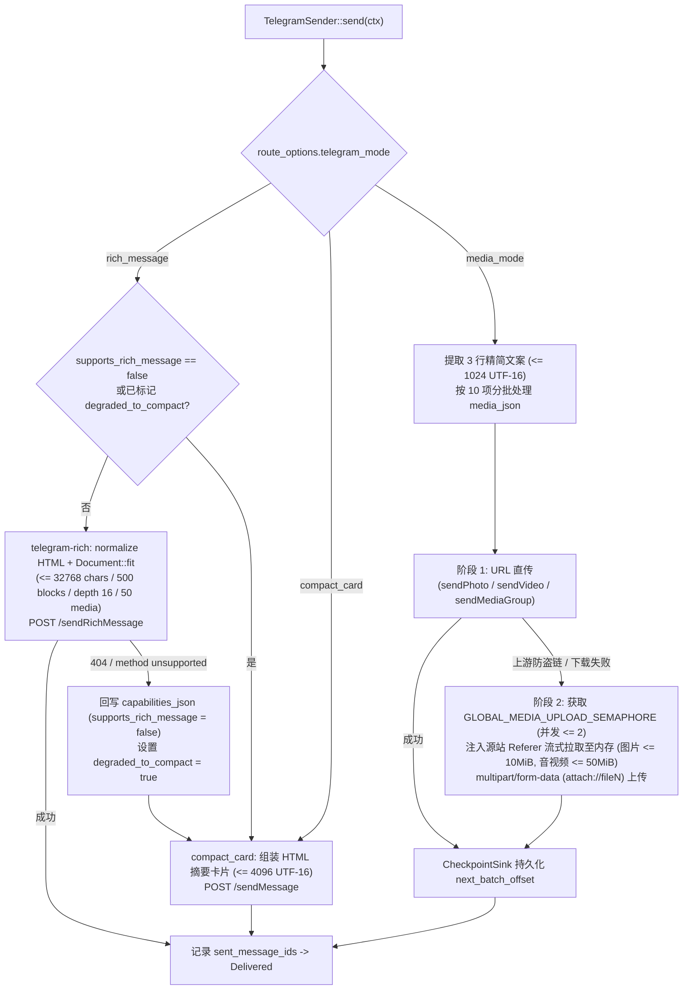
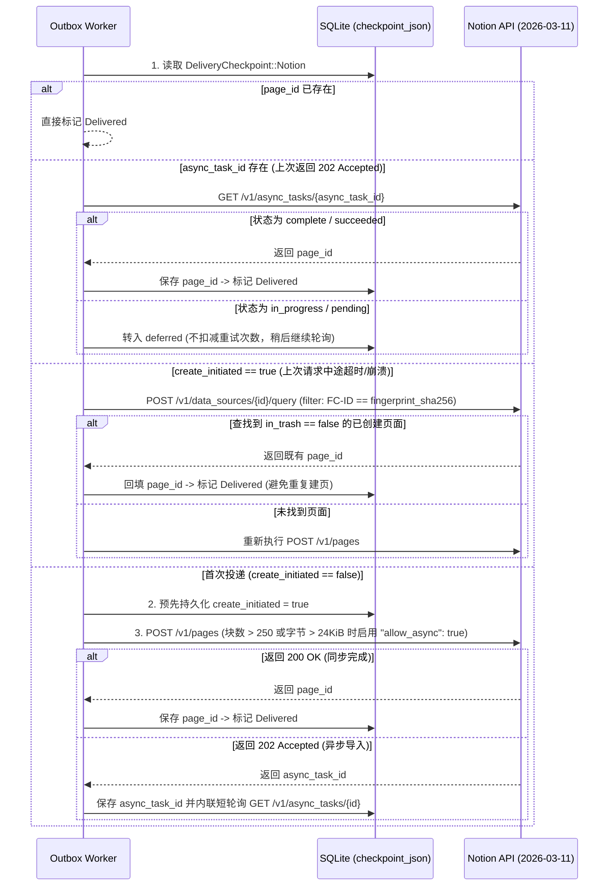

# 通道协议与投递实现

本文记录 FeedCourier 三类授信投递通道（**SMTP**、**Telegram Bot API 10.4**、**Notion API `2026-03-11`**）的底层协议规范、报文转换规则、流式媒体处理以及跨崩溃断点（`DeliveryCheckpoint`）对账流程。

关于通道在 WebUI 中的日常配置方法，请参阅用户指南中的 [SMTP 邮件简报](/zh/channels/smtp)、[Telegram 机器人](/zh/channels/telegram) 与 [Notion 数据库](/zh/channels/notion)。

---

## 1. 断点续投数据结构概览（`DeliveryCheckpoint`）

`delivery_tasks.checkpoint_json` 存储序列化后的 `DeliveryCheckpoint`（定义于 `src/channels/mod.rs`），用于在任务重试或 `lease_until` 租约超时恢复时避免重复投递：

| 枚举变体 | 序列化 JSON 字段 | 投递语义与恢复机制 |
| :--- | :--- | :--- |
| `DeliveryCheckpoint::Smtp` | `{"kind": "smtp", "message_id": "<...>"}` | **至少一次（客户端去重）**：首次构建邮件时生成确定性 RFC 5322 `Message-ID` 并持久化；后续重试复用同一 `Message-ID`，由收件箱客户端按标准头部去重。 |
| `DeliveryCheckpoint::Telegram` | `{"kind": "telegram", "next_batch_offset": 10, "sent_message_ids": [...], "degraded_to_compact": false}` | **至少一次（按批次推进）**：`media_mode` 每完成一组（最多 10 项）`sendMediaGroup` 即通过 `CheckpointSink` 落盘 `next_batch_offset`；重试时跳过已发送批次。 |
| `DeliveryCheckpoint::Notion` | `{"kind": "notion", "create_initiated": true, "async_task_id": "...", "page_id": "..."}` | **有效一次（Effective-once）**：发起创建前标记 `create_initiated = true`；重试时先按 `FC-ID == fingerprint_sha256` 反查数据源或轮询 `async_task_id`，若页面已存在则直接回填 `page_id` 闭环。 |

---

## 2. SMTP 邮件通道实现（`src/channels/smtp.rs`）

### 1. `lettre` 异步传输与连接池
- `SmtpSender` 基于 `lettre::AsyncSmtpTransport<Tokio1Executor>` 实现，支持三种传输加密模式（`SmtpSecurity`）：
  - `StartTls`（默认端口 `587`）：显式 STARTTLS 升级；
  - `Tls`（默认端口 `465`）：隐式 TLS / Wrapper 模式；
  - `Plain`（默认端口 `25`）：仅用于受控内网中继的明文连接。
- 内部按 `(host, port, security, username, password)` 的 SHA-256 摘要缓存连接池（`PoolConfig::new().max_size(2).idle_timeout(60s)`），单次 SMTP 指令默认超时为 `DEFAULT_SMTP_TIMEOUT = 30s`。

### 2. `minijinja` 单栏内联 CSS 渲染与 `< 95 KiB` 体积预算
- 每封邮件组装为 `multipart/alternative`（`MultiPart::alternative_plain_html`），同时包含：
  1. **`text/html` 主体**：由 `minijinja` 渲染内置的 `EMAIL_HTML_TEMPLATE`（最大宽度 `640px` 的单栏卡片布局，所有排版样式均通过内联 `style="..."` 属性声明，兼容禁用外部样式表的邮件客户端）；
  2. **`text/plain` 回退体**：由 `html2text` 按 `PLAIN_TEXT_WRAP_WIDTH = 78` 列宽转换生成，确保纯文本客户端与终端阅读器正常显示。
- **防 Gmail 折叠截断（`MAX_EMAIL_HTML_BYTES = 95 KiB`）**：Gmail 网页端与客户端会对总大小超过约 `102 KB` 的邮件正文执行 `[Message clipped]` 折叠。`render_entry_html` 将渲染后的 UTF-8 HTML 字节数严格控制在 **`95 KiB`（`97,280` 字节）** 以内；若原文超出预算，则在闭合标签边界处安全截断，并在邮件底部插入带原文链接的截断提示框（`Continue reading original article →`）。

### 3. `Force-From` 反伪造对齐与确定性信头
- **`Force-From`（SPF / DKIM / DMARC 合规）**：无论上游 RSS 条目中声明的 `<author>` 为何，`From` 头部始终固定使用通道配置的授信发件邮箱 `from_address`，仅将显示名称格式化为 `"<Feed Title> via FeedCourier" <from_address>`。若配置了 `reply_to`，则单独写入 `Reply-To` 头部。
- **确定性 `Message-ID`**：按条目指纹前 32 位十六进制字符、路由 ID 与发件域名计算：
  ```text
  <fc-entry-{fingerprint_sha256[..32]}-r{route_id}@{from_domain}>
  ```
- **邮件列表归档头（`List-Id` & `Auto-Submitted`）**：每封邮件自动附带 `Auto-Submitted: auto-generated` 与按源隔离的 `List-Id: <feed-{feed_id}.feedcourier.{from_domain}>`，便于收件箱按订阅源建立自动归档过滤规则。

---

## 3. Telegram 通道实现（`src/channels/telegram.rs`，Bot API 10.4）

`TelegramSender` 面向 **Telegram Bot API 10.4** 设计，支持私聊、群组、开启话题的超级群组（`message_thread_id`）、频道以及自建 Local Bot API Server（`api_base_url`），提供三种路由级展现模式（`TelegramDeliveryMode`）。



### 1. `RichMessage` 模式与 `telegram-rich` 结构化转换
- 路由设为 `rich_message` 时，`build_rich_message_payload` 调用工作区子库 `telegram-rich`（`crates/telegram-rich`）：
  1. **HTML 规范化（`telegram_rich::html::normalize`）**：将 `ammonia` 清洗后的正文转换为 Telegram 富文本结构块（`Block`），原生映射紧凑表格（`<table compact>`）、可展开引用块（`<blockquote expandable>`）、带语法高亮标识的代码块（`<pre><code class="language-...">`）、内嵌图片/视频以及底部直达按钮行（`<tg-button-row>` / `Block::link_button`）。
  2. **配额自适应裁剪（`Document::fit` / `FitOptions`）**：在序列化为 `InputRichMessage` 前，自动将文档裁剪至 Bot API 10.4 的四项硬性限制以内：
     - 正文总字符数 $\le 32,768$；
     - 结构块（`Block`）总数 $\le 500$；
     - 节点嵌套深度 $\le 16$；
     - 内嵌媒体项总数 $\le 50$。

### 2. 端点能力探测（`probe_capabilities`）与自动降级
- 在创建通道或点击“测试”时，`probe_capabilities` 先调用 `getMe` 校验 Token 并读取 `bot_username`，随后向 `/bot<token>/sendRichMessage` 发送空负载 `{}` 进行无副作用探测：
  - 若服务端返回 `400 Bad Request`（提示缺少 `chat_id` 参数），表明目标服务端支持 Bot API `10.2+` / `10.4` 的 `sendRichMessage` 方法，记录 `supports_rich_message: true` 与 `bot_api_version: "10.4"`；
  - 若自建 Local Bot API Server 版本低于 `10.2` 并返回 `404 Not Found`（或未知方法描述），则记录 `supports_rich_message: false` 与 `bot_api_version: "<10.2"`，持久化至 `channels.capabilities_json`。
- 当 `supports_rich_message` 为 `false`，或运行期调用 `sendRichMessage` 遭遇方法不支持错误时，`TelegramSender` 自动降级调用 `CompactCard`（`sendMessage`，`parse_mode: "HTML"`，受 `MAX_MESSAGE_UTF16_UNITS = 4,096` UTF-16 代码单元限制，并通过 `link_preview_options` 控制链接预览）。

### 3. `MediaMode` 三行超链接文案、按类型智能分流与 10 项分批断点
- **三行精简 HTML 文案（`MAX_CAPTION_UTF16_UNITS = 1,024`，`parse_mode: "HTML"`）**：
  - 第 1 行：经 HTML 转义的文章作者（无作者时回退为订阅源名称）；
  - 第 2 行：入库阶段由 `unicode-segmentation`（`unicode_sentences`）提取并经 HTML 转义的正文首句 `entries.first_sentence`；
  - 第 3 行：随 `system_settings.locale` 本地化的原文超链接（中文为 `<a href="...">链接</a>`，英文为 `<a href="...">Link</a>`）。
  - 可见字符严格按 UTF-16 代码单元截断至 $\le 1,024$（当条目不含任何可用媒体时，发送相同三行格式的 HTML 消息）。
- **按类型智能分流、文件头魔数嗅探与纯 Rust MP4 元数据提取**：
  - **阶段 1（图片、音频与明确后缀文档的 URL 直传）**：优先将原始 URL 提交给 Telegram 服务器（`sendPhoto` / `sendAudio` / `sendDocument` / `sendMediaGroup`），遇防盗链或拉取失败时自动转入阶段 2。
  - **阶段 2（内存流式 `multipart/form-data` 上传与视频流式化管线）**：视频（`Video`）及无明确后缀的通用 `<enclosure>` 附件跳过 Telegram URL 直传（避免无 `.mp4` 后缀或 `application/octet-stream` 视频被 Telegram 静默降级为不可预览的 `Document` 文件并返回 `200 OK`），向全局信号量 `GLOBAL_MEDIA_UPLOAD_SEMAPHORE`（`MAX_CONCURRENT_MEDIA_UPLOADS = 2`）申请许可后，由 `ProtectedMediaFetcher` 携带源站 `Referer` 将字节流读取至内存 `Bytes` 缓冲区；通过 `sniff_media_bytes` 嗅探容器魔数（`ftyp`/`moov`、WebM EBML、JPEG/PNG/GIF/WebP、MP3/Ogg、PDF）将误判的附件自动升级并将视频 MIME/后缀统一归一化为 `video/mp4` + `.mp4`，同时由零外部依赖的 `parse_mp4_metadata` 解析 ISO-BMFF `moov -> mvhd / tkhd / stsd` Box（支持 90°/270° 手机竖屏旋转矩阵自动对调宽高），在 `sendVideo` 与 `sendMediaGroup`（`InputMediaVideo`）中注入 `supports_streaming: true`、`width`、`height` 与 `duration`。
  - **体积上限与超限降级**：图片上限为 `MAX_PHOTO_BYTES = 10 MiB`，视频/音频/文档上限为 `MAX_MEDIA_BYTES = 50 MiB`。若超出上限则立即中止下载流，并以 ` · <a href="...">媒体 N</a>`（`Media N`）超链接形式紧凑追加在第三行末尾。
- **`sendMediaGroup` 10 项分批与 `checkpoint_json` 续传**：
  - 当单篇文章包含超过 `MEDIA_GROUP_BATCH_SIZE = 10` 个媒体项时，自动拆分为每组最多 10 项的多个批次（仅首批次携带三行文案）；
  - 每组发送成功后立即调用 `CheckpointSink::save_checkpoint` 更新 `next_batch_offset` 与 `sent_message_ids`。若后续批次触发 `429 Too Many Requests` 或进程重启，恢复执行时直接从 `media_items[next_batch_offset..]` 继续发送。

---

## 4. Notion 通道实现（`src/channels/notion.rs`，`Notion-Version: 2026-03-11`）

### 1. 固定 `Notion-Version: 2026-03-11` 协议契约
`NotionSender` 对所有出站请求强制附加 `Notion-Version: 2026-03-11` 头部（`NOTION_API_VERSION`），遵循 `2026-03-11` 版本的 Data Source 数据模型：
- **父级容器（`data_source_id`）**：创建页面（`POST /v1/pages`）时使用 `parent: { "type": "data_source_id", "data_source_id": "<uuid>" }`，而非旧版的 `database_id`；
- **建库属性声明（`initial_data_source.properties`）**：通过 `POST /api/v1/channels/notion/init-db` 调用 `POST /v1/databases` 初始化 7 列标准收件箱（`Title`、`FC-ID`、`Link`、`Source`、`Published`、`State`、`Tag`）时，属性定义挂载于 `initial_data_source.properties`，并从响应的 `data_sources[0].id` 提取 `data_source_id`；
- **表结构自检与补齐（`inspect-schema`）**：通过 `GET /v1/data_sources/{id}` 检查现有列类型，当 `patch_missing: true` 时调用 `PATCH /v1/data_sources/{id}` 自动创建缺失的标准列（若用户传入的是旧式数据库 URL/ID，客户端会自动先查询 `GET /v1/databases/{id}` 解析其关联的 `data_source_id`）；
- **回收站状态字段（`in_trash`）**：页面与数据源状态判断统一使用 `in_trash: bool`，替代已移除的 `archived` 字段。

### 2. HTML 转 Markdown v2 与动态代码围栏扩展（`normalize_markdown_v2`）
Notion `2026-03-11` 支持在 `POST /v1/pages` 请求体的顶层 `markdown` 字段直接传入 Markdown v2 文本。`convert_entry_html_to_notion_markdown` 执行以下转换流水线：
1. **`htmd` 结构化转换**：将清洗后的 HTML 转换为 ATX 标题（`#`）、`-` 无序列表、行内链接与围栏代码块；
2. **动态反引号围栏扩展（`normalize_markdown_v2`）**：扫描代码块内容；若代码块内部包含连续 $k \ge 3$ 个反引号（例如描述 Markdown 语法的代码示例），自动将外层打开与闭合围栏扩展为 $k + 1$ 个反引号（如 ```` ```` ````），防止内部反引号提前闭合代码块导致 Notion 服务端解析错位；
3. **块边界截断保护**：Notion 单次写入硬限制为 `5,000` 个块。FeedCourier 设置安全水位线 `MAX_NOTION_BLOCKS = 4,800` 块与 `MAX_MARKDOWN_BYTES = 450,000` 字节（同时将单段富文本控制在 `MAX_NOTION_TEXT_FRAGMENT_CHARS = 2,000` 字符、单选/多选标签名控制在 `MAX_NOTION_SELECT_CHARS = 100` 字符以内）。超出阈值时在完整段落/围栏边界处截断，并追加原文跳转提示。

### 3. 大页面异步创建（`allow_async`）与有效一次（Effective-once）对账


- **异步阈值**：当估算块数超过 `ASYNC_BLOCK_THRESHOLD = 250` 或 Markdown 字节数超过 `ASYNC_BYTE_THRESHOLD = 24 KiB`（`24,576` 字节）时，`POST /v1/pages` 自动携带 `"allow_async": true`。若 Notion 返回 `202 Accepted` 及 `async_task_id`，Worker 先执行短轮询（`DEFAULT_INITIAL_ASYNC_POLLS = 2`，间隔 `600ms`）；若仍未完成，则持久化 `async_task_id` 并将任务置为 `deferred`（最长允许异步轮询 `DEFAULT_MAX_ASYNC_POLL_AGE_SECS = 20` 分钟，期间不消耗 `attempt_count`）。
- **`FC-ID` 幂等对账**：每次发起 `POST /v1/pages` 前，Worker 先通过 `CheckpointSink` 将 `create_initiated: true` 写入数据库，并在页面属性中写入 `FC-ID = entry.fingerprint_sha256`。若请求因网络抖动超时或容器重启而未收到响应，下次恢复执行时 Worker 会先调用 `POST /v1/data_sources/{id}/query` 检索 `FC-ID` 是否已存在有效页面（`in_trash == false`），从而在超时重试场景下实现有效一次（Effective-once）投递。
