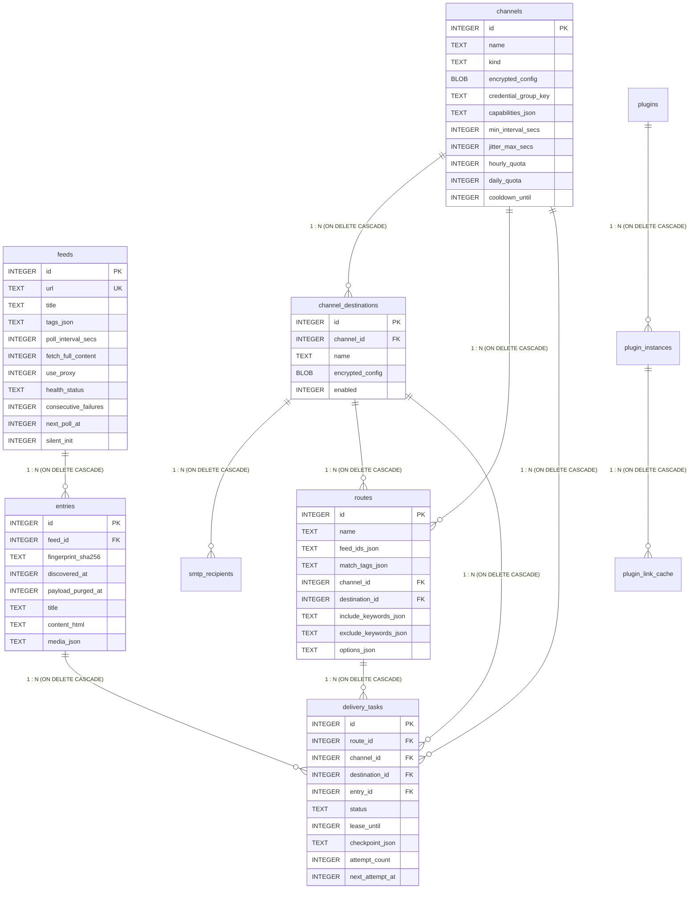

# SQLite 数据库表结构参考

FeedCourier 的全部持久化状态存储于单文件 SQLite WAL 数据库（`<DATA_DIR>/feedcourier.db`）中，编译期迁移脚本位于仓库 [`migrations/0001_init.sql`](https://github.com/ElleryHe/FeedCourier/blob/main/migrations/0001_init.sql)、[`migrations/0002_channel_destinations.sql`](https://github.com/ElleryHe/FeedCourier/blob/main/migrations/0002_channel_destinations.sql) 与 [`migrations/0003_plugins_and_smtp_compliance.sql`](https://github.com/ElleryHe/FeedCourier/blob/main/migrations/0003_plugins_and_smtp_compliance.sql)。

对存量数据库执行重大 DDL 迁移前，`Database::connect` 会**先于 SQL 迁移执行** `VACUUM INTO` 生成在线热备快照，并在检测目标文件或伴生 `-wal` / `-shm` 文件冲突时自动追加 UTC 时间戳与序号后缀、备份完成后清理残留 sidecar 文件：
- 升级 `v0.1.x` → `v0.2.0+`：先生成 `<DATA_DIR>/pre-v0.2.0-backup.db`，再执行 `0002_channel_destinations.sql` 与单事务迁移钩子 `Database::migrate_channels_to_v2`。
- 升级 `v0.2.x` → `v0.3.0`：先生成 `<DATA_DIR>/pre-v0.3.0-backup.db`，再执行 `0003_plugins_and_smtp_compliance.sql` 与幂等启动回填 `Database::backfill_legacy_smtp_recipients`。

所有时间戳字段均采用 **UTC Unix 纪元秒（`INTEGER`，`unixepoch()`）** 存储，业务表外键关联均启用 **`ON DELETE CASCADE`** 级联清理（`delivery_quota_ledger` 刻意不设外键，确保删除操作不会清空配额计数）。

---

## 实体关系概览图（ER Diagram）

---

## 1. `feeds`（订阅源状态与抓取策略表）

记录每个 RSS / Atom / JSON Feed 订阅源的抓取配置、HTTP 条件请求缓存头以及指数退避/熔断健康状态。

| 字段名 | 类型 | 约束与默认值 | 说明 |
| :--- | :--- | :--- | :--- |
| `id` | `INTEGER` | `PRIMARY KEY AUTOINCREMENT NOT NULL` | 订阅源主键 ID。 |
| `url` | `TEXT` | `NOT NULL UNIQUE` | 规范化后的订阅源 `http(s)` URL（全局唯一）。 |
| `title` | `TEXT` | `NOT NULL DEFAULT ''` | 订阅源名称（留空时由首次抓取自动填充）。 |
| `site_url` | `TEXT` | `NULL` | 订阅源对应的源站主页链接。 |
| `favicon_url` | `TEXT` | `NULL` | 自动探测到的源站图标 URL（用于 WebUI 展示与 Notion 页面图标）。 |
| `tags_json` | `TEXT` | `NOT NULL DEFAULT '[]'` | 自定义字符串标签数组 JSON（如 `["rust","tech"]`），关联路由匹配与 Notion `Tag` 多选列。 |
| `poll_interval_secs` | `INTEGER` | `NOT NULL DEFAULT 1800 CHECK (> 0)` | 基础轮询间隔秒数（默认 30 分钟）。 |
| `fetch_full_content` | `INTEGER` | `NOT NULL DEFAULT 0 CHECK (IN (0, 1))` | 是否按需启用 `dom_smoothie` Readability 网页全文提取。 |
| `use_proxy` | `INTEGER` | `NOT NULL DEFAULT 0 CHECK (IN (0, 1))` | 是否经由全局出站代理拉取该源及其全文网页。 |
| `etag` | `TEXT` | `NULL` | 上次成功拉取缓存的 HTTP `ETag` 响应头（用于发送 `If-None-Match`）。 |
| `last_modified` | `TEXT` | `NULL` | 上次成功拉取缓存的 HTTP `Last-Modified` 响应头（用于发送 `If-Modified-Since`）。 |
| `health_status` | `TEXT` | `NOT NULL DEFAULT 'active'` | 健康状态枚举：`'active'`（正常）、`'backoff'`（指数退避）、`'circuit_open'`（连续失败 $\ge 15$ 次熔断暂停）、`'paused'`（人工暂停）。 |
| `consecutive_failures` | `INTEGER` | `NOT NULL DEFAULT 0 CHECK (>= 0)` | 连续抓取失败次数（成功拉取或 `304 Not Modified` 时归零）。 |
| `next_poll_at` | `INTEGER` | `NULL` | 下次允许调度轮询的 Unix 时间戳（`'circuit_open'` 或 `'paused'` 时为 `NULL`）。 |
| `last_error` | `TEXT` | `NULL` | 最近一次拉取或解析失败的错误诊断信息。 |
| `silent_init` | `INTEGER` | `NOT NULL DEFAULT 1 CHECK (IN (0, 1))` | 首次同步静默标记（首次成功拉取记录存量指纹后自动置为 `0`）。 |
| `created_at` | `INTEGER` | `NOT NULL DEFAULT (unixepoch())` | 创建时间戳。 |
| `updated_at` | `INTEGER` | `NOT NULL DEFAULT (unixepoch())` | 最后更新时间戳。 |

- **索引**：`idx_feeds_poll_schedule ON feeds (health_status, next_poll_at)` —— 用于后台轮询协程按到期时间扫描 `'active'` 与 `'backoff'` 状态的订阅源。

---

## 2. `entries`（去重指纹与条目载荷表）

保存每篇文章的 64 位 SHA-256 指纹以防止重复投递；正文与媒体载荷字段在投递完成且超过 `RETENTION_HOURS` 保留窗口后，由 `NOT EXISTS` 垃圾回收任务置为 `NULL`（详见[系统架构总览](/zh/reference/architecture)）。

| 字段名 | 类型 | 生命周期 | 约束与默认值 | 说明 |
| :--- | :--- | :---: | :--- | :--- |
| `id` | `INTEGER` | **持久保留** | `PRIMARY KEY AUTOINCREMENT NOT NULL` | 条目主键 ID。 |
| `feed_id` | `INTEGER` | **持久保留** | `NOT NULL REFERENCES feeds(id) ON DELETE CASCADE` | 所属订阅源 ID。 |
| `fingerprint_sha256` | `TEXT` | **持久保留** | `NOT NULL CHECK (length = 64)` | 四级 SHA-256 指纹算法生成的 64 位十六进制哈希。与 `feed_id` 组成 `UNIQUE (feed_id, fingerprint_sha256)`。 |
| `published_at` | `INTEGER` | **持久保留** | `NULL` | 源报文显式声明的原始发布时间戳。 |
| `discovered_at` | `INTEGER` | **持久保留** | `NOT NULL DEFAULT (unixepoch())` | 首次拉取发现该条目的时间戳（作为 GC 保留窗口起算点）。 |
| `payload_purged_at` | `INTEGER` | **持久保留** | `NULL` | 正文载荷字段被 GC 回收的时间戳（未回收时为 `NULL`）。 |
| `title` | `TEXT` | *保留或按需回收* | `NULL` | 清洗后的纯文本文章标题。 |
| `canonical_url` | `TEXT` | *保留或按需回收* | `NULL` | 剥离营销追踪参数并补全相对路径后的规范化原文链接。 |
| `author` | `TEXT` | *保留或按需回收* | `NULL` | 文章作者名称。 |
| `content_html` | `TEXT` | *临时载荷（GC 回收）* | `NULL` | 经 `ammonia` 白名单清洗并补全绝对链接后的 HTML 正文。 |
| `first_sentence` | `TEXT` | *临时载荷（GC 回收）* | `NULL` | 按 Unicode 句子边界提取的正文首句（用于 Telegram `media_mode` 三行文案）。 |
| `summary_text` | `TEXT` | *临时载荷（GC 回收）* | `NULL` | 纯文本摘要（用于 Telegram `compact_card`、内容过滤与 MCP 预览）。 |
| `media_json` | `TEXT` | *临时载荷（GC 回收）* | `NULL` | 媒体资源数组 JSON（汇总 `<enclosure>`、`media:content` 与正文图片/音视频）。 |

- **索引**：
  - `UNIQUE (feed_id, fingerprint_sha256)` —— 幂等插入冲突检测（`INSERT INTO entries ... ON CONFLICT DO NOTHING`）。
  - `idx_entries_feed_discovered ON entries (feed_id, discovered_at DESC)` —— 按源检索最新条目。
  - `idx_entries_gc_candidates ON entries (discovered_at) WHERE payload_purged_at IS NULL` —— **部分索引（Partial Index）**，使后台 GC 仅扫描尚未回收正文的活跃行，避免扫描历史已回收行。

---

## 3. `channels`（授信投递通道账号与流控配置表）

保存由管理员在 WebUI 中配置的账号级加密凭据（`ChannelConfig`）、能力探测快照、代理开关以及由该账号下所有目的地（`channel_destinations`）共享的步进流控/配额/冷却参数（加密与脱敏细节见[安全与防注入机制](/zh/reference/security)）。

| 字段名 | 类型 | 约束与默认值 | 说明 |
| :--- | :--- | :--- | :--- |
| `id` | `INTEGER` | `PRIMARY KEY AUTOINCREMENT NOT NULL` | 通道账号主键 ID。 |
| `name` | `TEXT` | `NOT NULL` | 账号显示名称（留空时自动取 Telegram `getMe` `@username`、SMTP `from_address` 或 Notion `/v1/users/me` 集成名）。 |
| `kind` | `TEXT` | `NOT NULL CHECK (IN ('smtp', 'telegram', 'notion'))` | 通道协议类型。 |
| `encrypted_config` | `BLOB` | `NOT NULL` | 使用 `MasterKey` 经 ChaCha20-Poly1305 加密后的账号级 `ChannelConfig` JSON 密文（`12B nonce \|\| ciphertext \|\| 16B tag`）。 |
| `credential_group_key` | `TEXT` | `NOT NULL` | 基于底层发信身份计算的 SHA-256 分组标识（SMTP 纳入密码的 SHA-256 摘要且不存明文，使共用用户名但不同 API Key 的账号如 SendGrid `apikey` 保持隔离），使同账号与同凭据组共享步进、配额与冷却时间。 |
| `capabilities_json` | `TEXT` | `NOT NULL DEFAULT '{}'` | 探测到的平台能力快照（如 Telegram `supports_rich_message`、`bot_api_version`、`bot_username`、`fallback_reason`）。 |
| `min_interval_secs` | `INTEGER` | `NOT NULL DEFAULT 15 CHECK (>= 0)` | 账号下全部目的地共享的最小发信间隔秒数。 |
| `jitter_max_secs` | `INTEGER` | `NOT NULL DEFAULT 10 CHECK (>= 0)` | 每次投递后独立抽取的随机抖动上限秒数（仅存内存）。 |
| `hourly_quota` | `INTEGER` | `NULL CHECK (IS NULL OR > 0)` | 可选的滚动每小时最大投递篇数上限（账号下全部目的地共享）。 |
| `daily_quota` | `INTEGER` | `NULL CHECK (IS NULL OR > 0)` | 可选的滚动每日最大投递篇数上限（账号下全部目的地共享）。 |
| `use_proxy` | `INTEGER` | `NOT NULL DEFAULT 0 CHECK (IN (0, 1))` | 该账号及其所有目的地的出站请求是否经由全局代理转发。 |
| `cooldown_until` | `INTEGER` | `NULL` | 触发下游 `429` / `Retry-After` 时的账号及同组冷却截止时间戳。 |
| `enabled` | `INTEGER` | `NOT NULL DEFAULT 1 CHECK (IN (0, 1))` | 账号启用开关。 |
| `created_at` / `updated_at` | `INTEGER` | `NOT NULL DEFAULT (unixepoch())` | 创建与更新时间戳。 |

- **索引**：`idx_channels_credential_group ON channels (credential_group_key)` —— 支持按共享凭据组批量更新冷却时间。

---

## 3b. `channel_destinations`（授信投递目的地表）

挂载在 `channels` 账号下的具体投递目标（`migrations/0002_channel_destinations.sql`），每个目的地独立加密存储目标配置、独立启停与独立测试。

| 字段名 | 类型 | 约束与默认值 | 说明 |
| :--- | :--- | :--- | :--- |
| `id` | `INTEGER` | `PRIMARY KEY AUTOINCREMENT NOT NULL` | 授信目的地主键 ID（`routes` 与 MCP `configure_route`/`test_push_feed_entry` 的主要目标标识）。 |
| `channel_id` | `INTEGER` | `NOT NULL REFERENCES channels(id) ON DELETE CASCADE` | 所属父通道账号 ID。 |
| `name` | `TEXT` | `NOT NULL` | 目的地备注名（留空时自动取 Telegram `getChat` 群/频道名、SMTP 首个收件人或 Notion 数据库标题）。 |
| `encrypted_config` | `BLOB` | `NOT NULL` | 使用 `MasterKey` 经 ChaCha20-Poly1305 加密后的 `DestinationConfig` JSON 密文（Telegram `chat_id`/`message_thread_id`、SMTP `to_addresses`/`reply_to` 或 Notion `data_source_id`/`column_mapping`）。 |
| `enabled` | `INTEGER` | `NOT NULL DEFAULT 1 CHECK (IN (0, 1))` | 该目的地的独立启用开关。 |
| `created_at` / `updated_at` | `INTEGER` | `NOT NULL DEFAULT (unixepoch())` | 创建与更新时间戳。 |

- **索引**：`idx_channel_destinations_channel_id ON channel_destinations (channel_id)`

---

## 4. `routes`（路由编排与展现模式规则表）

定义订阅源或标签在通过关键词/正则过滤规则后，以何种展现选项投递至目标 `destination_id`（并记录父 `channel_id`）。

| 字段名 | 类型 | 约束与默认值 | 说明 |
| :--- | :--- | :--- | :--- |
| `id` | `INTEGER` | `PRIMARY KEY AUTOINCREMENT NOT NULL` | 路由主键 ID。 |
| `name` | `TEXT` | `NOT NULL` | 路由规则名称。 |
| `feed_ids_json` | `TEXT` | `NOT NULL DEFAULT '[]'` | 显式匹配的 `feed_id` 整数数组 JSON（与 `match_tags_json` 均为空时匹配所有订阅源）。 |
| `match_tags_json` | `TEXT` | `NOT NULL DEFAULT '[]'` | 按标签匹配的标签字符串数组 JSON。 |
| `channel_id` | `INTEGER` | `NOT NULL REFERENCES channels(id) ON DELETE CASCADE` | 所属父通道账号 ID。 |
| `destination_id` | `INTEGER` | `REFERENCES channel_destinations(id) ON DELETE CASCADE` | 目标授信目的地 ID（v0.2.0 迁移与新建路由均自动填充）。 |
| `include_keywords_json` | `TEXT` | `NOT NULL DEFAULT '[]'` | 包含关键词数组 JSON（非空时标题或正文至少命中其一）。 |
| `exclude_keywords_json` | `TEXT` | `NOT NULL DEFAULT '[]'` | 排除关键词数组 JSON（命中任意一词即排除）。 |
| `include_regex` | `TEXT` | `NULL` | 包含正则表达式（非空时必须匹配）。 |
| `exclude_regex` | `TEXT` | `NULL` | 排除正则表达式（匹配即排除）。 |
| `options_json` | `TEXT` | `NOT NULL DEFAULT '{}'` | 路由选项 JSON（`RouteOptions`）：`telegram_mode`、`link_preview`、`locale`（路由投递语言）、`timezone`（可选路由级 IANA 时区覆盖，留空继承 `system_settings.timezone`）、`active_windows`（`[{start, end}]`，路由时区下的 `HH:MM` 区间）、`active_weekdays`（`1` = 周一 … `7` = 周日）以及 `plugins`（`{ "<plugin_id>": { ... } }`）。 |
| `enabled` | `INTEGER` | `NOT NULL DEFAULT 1 CHECK (IN (0, 1))` | 路由启用开关。 |
| `created_at` / `updated_at` | `INTEGER` | `NOT NULL DEFAULT (unixepoch())` | 创建与更新时间戳。 |

- **索引**：`idx_routes_destination_id ON routes (destination_id)`

---

## 5. `delivery_tasks`（单篇事务发件箱与审计日志表）

承载 `1 Task = 1 Entry × 1 Route` 的持久化发件箱状态机、租约截止时间（`lease_until`）与跨崩溃断点（`checkpoint_json`）。

| 字段名 | 类型 | 约束与默认值 | 说明 |
| :--- | :--- | :--- | :--- |
| `id` | `INTEGER` | `PRIMARY KEY AUTOINCREMENT NOT NULL` | 投递任务主键 ID。 |
| `route_id` | `INTEGER` | `NOT NULL REFERENCES routes(id) ON DELETE CASCADE` | 关联的路由 ID。 |
| `channel_id` | `INTEGER` | `NOT NULL REFERENCES channels(id) ON DELETE CASCADE` | 所属父通道账号 ID（保留用于账号/凭据组级配额统计）。 |
| `destination_id` | `INTEGER` | `REFERENCES channel_destinations(id) ON DELETE CASCADE` | 目标授信目的地 ID。 |
| `entry_id` | `INTEGER` | `NOT NULL REFERENCES entries(id) ON DELETE CASCADE` | 关联的条目 ID。受 `UNIQUE (route_id, entry_id)` 唯一约束保护。 |
| `status` | `TEXT` | `NOT NULL DEFAULT 'queued'` | 状态机枚举：`'queued'`（待处理）、`'delivering'`（租约投递中）、`'delivered'`（已送达）、`'retrying'`（失败重试中）、`'deferred'`（流控/配额延后）、`'dead_letter'`（死信）。 |
| `lease_until` | `INTEGER` | `NULL` | 当 `status = 'delivering'` 时的 Worker 租约过期时间戳（过期后允许被重新领取）。 |
| `checkpoint_json` | `TEXT` | `NULL` | `DeliveryCheckpoint` 序列化 JSON（保存 SMTP `message_id` / `sent_recipients`、Telegram `next_batch_offset` 或 Notion `create_initiated` / `async_task_id` / `page_id`）。 |
| `attempt_count` | `INTEGER` | `NOT NULL DEFAULT 0 CHECK (>= 0)` | 已尝试发送次数（默认达到 6 次临时错误后转入 `'dead_letter'`）。 |
| `next_attempt_at` | `INTEGER` | `NOT NULL DEFAULT (unixepoch())` | 下次可被调度领取的时间戳。 |
| `last_status_code` | `INTEGER` | `NULL` | 下游最近一次返回的 HTTP 状态码或 SMTP 响应码。 |
| `diagnostic_log` | `TEXT` | `NULL` | 最近一次投递结果或错误诊断摘要。 |
| `completed_at` | `INTEGER` | `NULL` | 任务进入 `'delivered'` 或 `'dead_letter'` 终态的时间戳。 |
| `created_at` | `INTEGER` | `NOT NULL DEFAULT (unixepoch())` | 任务入队时间戳。 |

- **复合索引**：
  - `idx_delivery_tasks_status_next_attempt ON delivery_tasks (status, next_attempt_at)` —— 用于 Worker 按到期时间领取待发任务（领取时再通过 `entries` 关联，按 `COALESCE(entries.published_at, entries.discovered_at)` 排序，从而让多个订阅源形成统一的时间顺序流）。
  - `idx_delivery_tasks_status_lease ON delivery_tasks (status, lease_until)` —— 用于发现并接管过期租约任务。
  - `idx_delivery_tasks_entry_status ON delivery_tasks (entry_id, status)` —— 支撑 `entries` 正文 GC 的 `NOT EXISTS` 子查询。
  - `idx_delivery_tasks_channel_status_completed ON delivery_tasks (channel_id, status, completed_at)` —— 支撑通道历史投递查询及 `v0.2.0` 升级时向 `delivery_quota_ledger` 的近 24 小时回填。
  - `idx_delivery_tasks_destination_id ON delivery_tasks (destination_id)`

---

## 5b. `delivery_quota_ledger`（持久化配额与步进流水表）

在 `migrations/0002_channel_destinations.sql` 中新增，用于将滚动 1 小时 / 24 小时配额统计与 `last_completed_at` 步进时间戳与会被级联删除的 `delivery_tasks` 解耦。该表**刻意不设置任何业务外键**（不关联 `feeds`、`routes`、`channel_destinations` 或 `channels`），因此删除订阅源、路由、目的地或执行清除缓存（Clear cache）绝不会清零滚动配额或重置步进间隔。

| 字段名 | 类型 | 约束与默认值 | 说明 |
| :--- | :--- | :--- | :--- |
| `id` | `INTEGER` | `PRIMARY KEY AUTOINCREMENT NOT NULL` | 配额流水主键 ID。 |
| `credential_group_key` | `TEXT` | `NOT NULL` | 投递成功时的账号凭据组标识。 |
| `channel_id` | `INTEGER` | `NOT NULL` | 投递成功时的父通道账号 ID（无外键约束）。 |
| `completed_at` | `INTEGER` | `NOT NULL` | 投递成功时的 UTC Unix 纪元秒。 |

- **生命周期**：每次投递成功时追加写入（升级 `v0.2.0` 时自动从近 24 小时 `delivered` 任务回填）；超过 24 小时（`86,400` 秒）的历史记录由每小时后台维护协程自动清理。
- **索引**：
  - `idx_delivery_quota_ledger_group_completed ON delivery_quota_ledger (credential_group_key, completed_at)` —— 支撑按凭据组统计滚动 1h / 24h 配额及查询 `last_completed_at`。
  - `idx_delivery_quota_ledger_channel_completed ON delivery_quota_ledger (channel_id, completed_at)`

---

## 6. 系统设置、MCP 令牌与会话表（`system_settings`、`mcp_tokens`、`sessions`）

### `system_settings`（系统配置键值表）

| 字段名 | 类型 | 约束与默认值 | 说明 |
| :--- | :--- | :--- | :--- |
| `key` | `TEXT` | `PRIMARY KEY NOT NULL` | 配置项键名： • `'admin_username'`：管理员用户名（默认 `Courier`，每次启动时被 `ADMIN_USERNAME` 覆盖） • `'admin_password_hash'`：Argon2id PHC 管理员密码哈希 • `'admin_totp_secret'`：已生效的 TOTP 密钥（ChaCha20-Poly1305 加密后 Base64 存储；关闭 2FA 或 `RESET_2FA=true` 时删除） • `'admin_totp_pending'`：启用 2FA 过程中等待首次验证码确认的加密密钥 • `'admin_totp_last_step'`：最近一次已接受的 TOTP 时间步（重放防护） • `'admin_recovery_hashes'`：未使用恢复码的 SHA-256 哈希 • `'timezone'`：供路由默认继承的 IANA 系统时区（首次由 `TIMEZONE` / `TZ` 写入，默认 `America/Los_Angeles`） • `'outbox_queue'`：全局队列暂停状态（`paused`、可选 `resume_at`） • `'channel_model_version'`：通道数据模型版本号（完成 v0.2.0 双层账号/目的地迁移后写入 `2`） • `'smtp_recipient_model_version'`：SMTP 收件人合规回填标记（完成 v0.3.0 存量回填后写入 `1`） • `'public_url'`：可选公网根地址（供 `/u/{token}` 与 `/v/{token}` 使用；设置环境变量 `PUBLIC_URL` 时优先以环境变量为准） • `'locale'`：**旧版**兼容回退投递语言（仅用于未设置 `options.locale` 的路由） • `'outbound_proxy_url'`：全局出站代理地址 • `'ssrf_allowlist'`：内网 SSRF 白名单字符串数组 |
| `value_json` | `TEXT` | `NOT NULL` | JSON 序列化后的配置值。 |
| `updated_at` | `INTEGER` | `NOT NULL DEFAULT (unixepoch())` | 最后修改时间戳。 |

### `mcp_tokens`（双级 MCP 鉴权令牌表）

| 字段名 | 类型 | 约束与默认值 | 说明 |
| :--- | :--- | :--- | :--- |
| `id` | `INTEGER` | `PRIMARY KEY AUTOINCREMENT NOT NULL` | 令牌主键 ID。 |
| `name` | `TEXT` | `NOT NULL` | 令牌备注名称（如 `"Cursor Desktop"`）。 |
| `token_hash` | `TEXT` | `NOT NULL UNIQUE` | `fc_mcp_...` 明文令牌的 64 位 SHA-256 十六进制哈希（数据库不存明文）。 |
| `token_prefix` | `TEXT` | `NOT NULL` | 令牌前 15 个字符前缀（用于 WebUI 列表展示）。 |
| `scope` | `TEXT` | `NOT NULL CHECK (IN ('readonly', 'admin'))` | 权限范围枚举：`'readonly'` 或 `'admin'`。 |
| `last_used_at` | `INTEGER` | `NULL` | 最近一次通过 `/mcp` 鉴权调用的时间戳。 |
| `created_at` | `INTEGER` | `NOT NULL DEFAULT (unixepoch())` | 签发时间戳。 |

### `sessions`（WebUI 管理员登录会话表）

| 字段名 | 类型 | 约束与默认值 | 说明 |
| :--- | :--- | :--- | :--- |
| `token_hash` | `TEXT` | `PRIMARY KEY NOT NULL` | `fc_session` Cookie 随机令牌的 SHA-256 哈希。 |
| `expires_at` | `INTEGER` | `NOT NULL` | 会话过期时间戳（默认签发后 30 天 / `2,592,000` 秒，由后台维护协程定期清理过期行）。 |
| `created_at` | `INTEGER` | `NOT NULL DEFAULT (unixepoch())` | 登录时间戳。 |

---

## 7. 插件表族（`plugins`、`plugin_instances`、`plugin_link_cache`）

在 `migrations/0003_plugins_and_smtp_compliance.sql` 中新增，用于保存插件启停状态、加密服务商凭据与短链持久化缓存：

### `plugins`（已安装插件表）

| 字段名 | 类型 | 约束与默认值 | 说明 |
| :--- | :--- | :--- | :--- |
| `id` | `TEXT` | `PRIMARY KEY NOT NULL` | 插件唯一标识（如 `'link-rewrite'`）。 |
| `enabled` | `INTEGER` | `NOT NULL DEFAULT 0 CHECK (IN (0, 1))` | 插件全局启用开关（禁用时跳过钩子并保留路由配置）。 |
| `installed_version` | `TEXT` | `NOT NULL` | 已安装插件的语义化版本号。 |
| `settings_json` | `TEXT` | `NOT NULL DEFAULT '{}'` | 可选插件级 JSON 配置。 |
| `created_at` / `updated_at` | `INTEGER` | `NOT NULL DEFAULT (unixepoch())` | 创建与更新时间戳。 |

### `plugin_instances`（加密插件服务商实例表）

| 字段名 | 类型 | 约束与默认值 | 说明 |
| :--- | :--- | :--- | :--- |
| `id` | `INTEGER` | `PRIMARY KEY AUTOINCREMENT NOT NULL` | 服务商实例 ID（供 `routes.options_json -> $.plugins.<id>.provider_id` 引用）。 |
| `plugin_id` | `TEXT` | `NOT NULL REFERENCES plugins(id) ON DELETE CASCADE` | 所属插件 ID。 |
| `name` | `TEXT` | `NOT NULL` | 服务商显示名称（用于 WebUI 与零凭据 MCP `list_plugins`）。 |
| `encrypted_config` | `BLOB` | `NOT NULL` | 使用 `MasterKey` 经 ChaCha20-Poly1305 加密后的服务商配置（如 YOURLS `api_url`、`auth_mode`、`signature`/`password`、`exclude_domains`、`strict_mode`、`pass_title`、`use_proxy`）。 |
| `enabled` | `INTEGER` | `NOT NULL DEFAULT 1 CHECK (IN (0, 1))` | 服务商实例启用开关。 |
| `created_at` / `updated_at` | `INTEGER` | `NOT NULL DEFAULT (unixepoch())` | 创建与更新时间戳。 |

- **索引**：`idx_plugin_instances_plugin_id ON plugin_instances (plugin_id)`

### `plugin_link_cache`（短链缓存表）

| 字段名 | 类型 | 约束与默认值 | 说明 |
| :--- | :--- | :--- | :--- |
| `instance_id` | `INTEGER` | `NOT NULL REFERENCES plugin_instances(id) ON DELETE CASCADE` | 所属服务商实例 ID（复合主键）。 |
| `long_url_sha256` | `TEXT` | `NOT NULL` | 原始长链的 64 位 SHA-256 十六进制摘要（复合主键）。 |
| `short_url` | `TEXT` | `NOT NULL` | 服务商返回的短链。 |
| `created_at` | `INTEGER` | `NOT NULL DEFAULT (unixepoch())` | 首次缓存时间戳。 |
| `last_used_at` | `INTEGER` | `NOT NULL DEFAULT (unixepoch())` | 最近命中时间戳；超过 **90 天**未使用的记录由后台维护任务自动清理。 |

- **主键**：`PRIMARY KEY (instance_id, long_url_sha256)`
- **索引**：`idx_plugin_link_cache_last_used ON plugin_link_cache (last_used_at)`

---

## 8. `smtp_recipients`（SMTP 按收件人合规状态表）

在 `migrations/0003_plugins_and_smtp_compliance.sql` 中新增，记录每个 SMTP 收件地址的验证、授权审计、退订与同步硬退信状态；表内**不存任何明文邮箱**（明文地址仅存于 `channel_destinations.encrypted_config`）：

| 字段名 | 类型 | 约束与默认值 | 说明 |
| :--- | :--- | :--- | :--- |
| `id` | `INTEGER` | `PRIMARY KEY AUTOINCREMENT NOT NULL` | 收件人记录主键 ID。 |
| `destination_id` | `INTEGER` | `NOT NULL REFERENCES channel_destinations(id) ON DELETE CASCADE` | 所属 SMTP 目的地 ID。 |
| `address_hmac` | `TEXT` | `NOT NULL` | 小写化邮箱地址经 HKDF 派生子密钥（`fc-smtp-addr-v1`）计算的 HMAC-SHA256 十六进制摘要。 |
| `status` | `TEXT` | `NOT NULL CHECK (IN ('unverified','pending','verified','unsubscribed','bounced'))` | 收件人合规投递状态。 |
| `code_sha256` | `TEXT` | `NULL` | 当前有效 6 位验证码的 SHA-256 哈希。 |
| `code_expires_at` | `INTEGER` | `NULL` | 验证码过期时间戳（`now + 1800` 秒 / 30 分钟）。 |
| `code_attempts` | `INTEGER` | `NOT NULL DEFAULT 0` | 已输错次数（上限 `5`）。 |
| `last_code_sent_at` | `INTEGER` | `NULL` | 最近一次发送验证邮件的时间戳（60 秒冷却）。 |
| `codes_sent_window_start` | `INTEGER` | `NULL` | 每小时发送频率窗口起点。 |
| `codes_sent_in_window` | `INTEGER` | `NOT NULL DEFAULT 0` | 当前小时窗口内已发验证邮件数（上限 `5`）。 |
| `consent_method` | `TEXT` | `NULL` | 授权方式审计：`'code'`、`'link'` 或 `'legacy'`（存量升级回填）。 |
| `consented_at` | `INTEGER` | `NULL` | 完成验证的时间戳。 |
| `revoked_method` | `TEXT` | `NULL` | 撤销原因：`'one_click'`、`'link'`、`'admin'` 或 `'hard_bounce'`。 |
| `revoked_at` | `INTEGER` | `NULL` | 退订或硬退信时间戳。 |
| `bounce_diagnostic` | `TEXT` | `NULL` | 同步 SMTP 5xx 硬退信诊断原文。 |
| `created_at` / `updated_at` | `INTEGER` | `NOT NULL DEFAULT (unixepoch())` | 创建与更新时间戳。 |

- **唯一约束**：`UNIQUE (destination_id, address_hmac)`
- **索引**：`idx_smtp_recipients_destination_status ON smtp_recipients (destination_id, status)`
