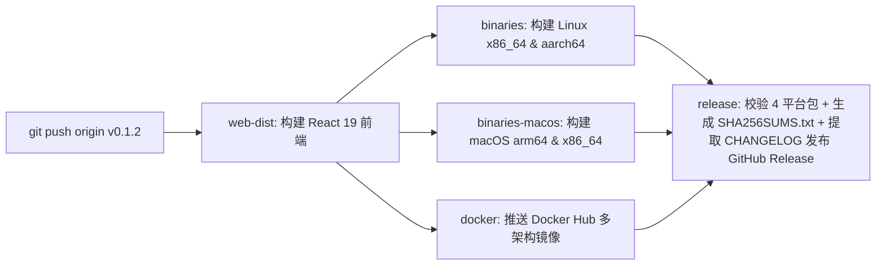

# 持续集成、自动化发版与文档部署

FeedCourier 使用 GitHub Actions 流水线（`.github/workflows/ci.yml` 与 `.github/workflows/release.yml`）执行代码检查、许可证合规校验、四平台二进制编译与 Docker Hub 多架构镜像构建，并通过 Cloudflare Workers Static Assets 部署中英双语文档站（`feedcourier.ellery.me`）。

---

## 1. 持续集成流水线（`.github/workflows/ci.yml`）

每次向 `main` 或 `develop` 分支推送代码或发起 Pull Request 时，CI 并行执行以下检查任务：

1. **WebUI 构建与类型检查（`web`）**：
   - 环境：Node.js 24 + `pnpm` 10（启用 `--frozen-lockfile`）；
   - 执行 `tsc --noEmit` TypeScript 类型检查与 `pnpm --dir web build` 生产构建，并将生成的 `web/dist` 作为构件上传供 Rust 编译内嵌。
2. **Rust 后端检查与测试（`rust`）**：
   - 下载 `web/dist` 前端静态产物（由 `rust-embed` 内嵌进二进制）；
   - 执行 `cargo fmt --all --check` 格式检查；
   - 执行 `cargo clippy --all-targets -- -D warnings` 静态分析；
   - 执行 `cargo test --all-targets` 单元与集成测试（覆盖四级去重、SSRF 拦截、DNS Rebinding、租约恢复、三大通道协议与 MCP 提示词注入防护）；
   - 执行 `cargo build --release --locked` 验证 Release 构建。
3. **开源许可证与供应链审计（`license-audit`）**：
   - 运行 `cargo-deny check licenses bans sources`，验证所有第三方 Crate 依赖与主程序 `AGPL-3.0-only` 及子库 `telegram-rich`（`MIT OR Apache-2.0`）许可证兼容。
4. **VitePress 双语文档站构建与死链检测（`docs`）**：
   - 运行 `pnpm --dir docs build`，通过 VitePress 构建期死链检测排查中英文内部断链或语法错误。

---

## 2. 自动化版本发布流水线（`.github/workflows/release.yml`）

当推送符合语义化版本规范的 Git 标签（`v*.*.*`，如 `v0.1.2`）时，自动触发发布流水线：



### 第一步：版本号校验与四平台二进制打包
- 比对 `Cargo.toml` 中的 `version` 与 Git 标签版本 `${GITHUB_REF_NAME#v}`，若不一致则中止流水线；
- 分别在对应运行器上编译并 `strip` 符号表，打包包含 `feedcourier` 单文件二进制、`LICENSE`、`README.md` 与 `README.zh-CN.md` 的四个 `.tar.gz` 归档包：
  - `feedcourier-<version>-x86_64-unknown-linux-gnu.tar.gz`（`ubuntu-24.04`）
  - `feedcourier-<version>-aarch64-unknown-linux-gnu.tar.gz`（`ubuntu-24.04-arm`）
  - `feedcourier-<version>-aarch64-apple-darwin.tar.gz`（`macos-latest`）
  - `feedcourier-<version>-x86_64-apple-darwin.tar.gz`（`macos-latest`）

### 第二步：Docker Hub 多架构镜像推送与文档同步
- 通过 Docker Buildx 与 QEMU 构建 **`linux/amd64` + `linux/arm64`** 多架构镜像并推送至 [`elleryhe/feedcourier`](https://hub.docker.com/r/elleryhe/feedcourier)；
- **镜像标签规则**：
  - `<version>`（如 `0.1.2`）
  - `<major>.<minor>`（如 `0.1`）
  - `<major>`（自 `1.0.0` 正式版起启用）
  - `latest`（仅对不带 `-rc` / `-beta` / `-alpha` 后缀的正式版标签更新）
- 构建完成后自动将仓库根目录的 `README.md` 与简介同步至 Docker Hub 镜像仓库主页。

### 第三步：`CHANGELOG.md` 提取与 `SHA256SUMS.txt` 发布
- 通过 `awk` 从根目录 `CHANGELOG.md` 中截取对应 `## [<version>]` 章节的更新说明；
- 对 4 个平台的 `.tar.gz` 压缩包生成 `SHA256SUMS.txt` 校验文件，并调用 `softprops/action-gh-release` 创建 GitHub Release。

---

## 3. 标准发版操作清单（Release Checklist）

发布新版本（例如从 `develop` 合入 `main` 发布 `v0.1.2`）时，按以下步骤操作：

```bash
# 1. 在 develop 分支完成并通过本地检查
pnpm --dir web build
pnpm --dir docs build
cargo fmt --all --check
cargo clippy --all-targets --locked -- -D warnings
cargo test --all-targets --locked

# 2. 更新 Cargo.toml 版本号与 CHANGELOG.md 对应版本章节并提交
# 3. 合并至 main 分支并推送标签
git checkout main
git merge --ff-only develop
git push origin main

git tag v0.1.2
git push origin v0.1.2
```

---

## 4. 文档站（`feedcourier.ellery.me`）部署说明

中英双语文档站基于 **VitePress** + **`vitepress-plugin-mermaid`** 构建，托管于 **Cloudflare Workers Static Assets**。

配置文件位于根目录 `wrangler.jsonc`（及 `docs/wrangler.jsonc`）：

- **Worker 名称（Worker name）**：`feedcourier`
- **构建根目录（Root directory）**：`/`（或 `docs`）
- **构建命令（Build command）**：`pnpm --dir docs install --frozen-lockfile && pnpm --dir docs build`
- **静态产物目录（Assets directory）**：`./docs/.vitepress/dist`（`docs/` 内为 `./.vitepress/dist`）
- **部署命令（Deploy command）**：`npx wrangler deploy`（非生产分支 / PR 预览命令为 `npx wrangler preview`，配置 `"previews": {}`）
- **自定义域名路由**：`https://feedcourier.ellery.me`（推送至 `develop` 分支时自动生成 Cloudflare Preview URL，合入 `main` 分支后发布至生产域名）。
