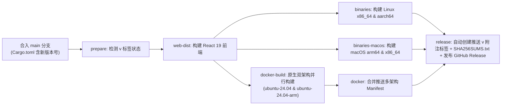

# 持续集成、自动化发版与文档部署

FeedCourier 使用 GitHub Actions 流水线（`.github/workflows/ci.yml` 与 `.github/workflows/release.yml`）执行代码检查、许可证合规校验、四平台二进制编译与 Docker Hub 多架构镜像构建，并通过 Cloudflare Workers Static Assets 部署中英双语文档站（`feedcourier.ellery.me`）。

---

## 1. 持续集成流水线（`.github/workflows/ci.yml`）

每次向 `main` 或 `develop` 分支推送代码或发起 Pull Request 时，CI 并行执行以下检查任务：

1. **WebUI 构建与类型检查（`web`）**：
   - 环境：Node.js 24 + `pnpm` 10（启用 `--frozen-lockfile`）；
   - 执行 `tsc --noEmit` TypeScript 类型检查与 `pnpm --dir web build` 生产构建，并将生成的 `web/dist` 作为构件上传供 Rust 编译内嵌。
2. **Rust 后端检查与测试（`rust`）**：
   - 下载 `web/dist` 前端静态产物（由 `rust-embed` 内嵌进二进制）；
   - 执行 `cargo fmt --all --check` 格式检查；
   - 执行 `cargo clippy --all-targets -- -D warnings` 静态分析；
   - 执行 `cargo test --all-targets` 单元与集成测试（覆盖四级去重、SSRF 拦截、DNS Rebinding、租约恢复、三大通道协议与 MCP 提示词注入防护）；
   - 执行 `cargo build --release --locked` 验证 Release 构建。
3. **开源许可证与供应链审计（`license-audit`）**：
   - 运行 `cargo-deny check licenses bans sources`，验证所有第三方 Crate 依赖与主程序 `AGPL-3.0` 及子库 `telegram-rich`（`MIT OR Apache-2.0`）许可证兼容。
4. **VitePress 双语文档站构建与死链检测（`docs`）**：
   - 运行 `pnpm --dir docs build`，通过 VitePress 构建期死链检测排查中英文内部断链或语法错误。

---

## 2. 自动化版本发布流水线（`.github/workflows/release.yml`）

当包含新计划版本号（`Cargo.toml` 中的 `version`）的 PR 合入 `main` 分支，且远端尚不存在对应 `v<version>` 标签时，将**自动触发**完整构建、打标与发版流水线（若 `main` 上的普通提交未升级版本号且对应标签已存在，`prepare` 任务会自动跳过后续构建；同时也兼容手动推送 `v*.*.*` 标签或 `workflow_dispatch` 演练构建）：



### 第一步：计划版本检测与四平台二进制打包
- `prepare` 任务读取 `Cargo.toml` 中的 `version` 并检查远端是否存在 `refs/tags/v<version>`；确认需要发版后启动后续编译；
- 分别在对应运行器上编译并 `strip` 符号表，打包包含 `feedcourier` 单文件二进制、`LICENSE`、`README.md` 与 `README.zh-CN.md` 的四个 `.tar.gz` 归档包：
  - `feedcourier-<version>-x86_64-unknown-linux-gnu.tar.gz`（`ubuntu-24.04`）
  - `feedcourier-<version>-aarch64-unknown-linux-gnu.tar.gz`（`ubuntu-24.04-arm`）
  - `feedcourier-<version>-aarch64-apple-darwin.tar.gz`（`macos-15`，`MACOSX_DEPLOYMENT_TARGET=11.0`）
  - `feedcourier-<version>-x86_64-apple-darwin.tar.gz`（`macos-15`，`MACOSX_DEPLOYMENT_TARGET=11.0`）

### 第二步：Docker Hub 原生双架构镜像并行构建与合并推送
- `docker-build` 矩阵任务分别在原生 `ubuntu-24.04`（`linux/amd64`）与 `ubuntu-24.04-arm`（`linux/arm64`）运行器上并行编译镜像（无需 QEMU 指令模拟，按架构独立缓存 Cargo 外部依赖层），并按不可变摘要（`push-by-digest`）推送分片；随后由 `docker` 任务调用 `docker buildx imagetools create` 合并生成统一的多架构 Manifest 并发布至 [`elleryhe/feedcourier`](https://hub.docker.com/r/elleryhe/feedcourier)；
- **镜像标签规则**：
  - `<version>`（如 `0.1.6`）
  - `<major>.<minor>`（如 `0.1`）
  - `<major>`（自 `1.0.0` 正式版起启用）
  - `latest`（仅对不带 `-rc` / `-beta` / `-alpha` 后缀的正式版标签更新）

### 第三步：自动打标、`CHANGELOG.md` 提取与 `SHA256SUMS.txt` 发布
- 当四平台二进制包与多架构容器镜像**全部构建成功**后，`release` 任务才会在当前 `main` 提交上自动创建并推送附注标签 `v<version>`（避免中途构建失败留下残缺标签，且使用内置 `GITHUB_TOKEN` 推送不会重复触发二次流水线）；
- 通过 `awk` 从根目录 `CHANGELOG.md` 中截取对应 `## [<version>]` 章节的更新说明，对 4 个平台的 `.tar.gz` 压缩包生成 `SHA256SUMS.txt` 校验文件，并调用 `softprops/action-gh-release` 创建 GitHub Release。

---

## 3. 标准发版操作清单（Release Checklist）

发布新版本（例如从 `develop` 合入 `main`）时，只需在 `develop` 完成版本准备并合并 PR 即可自动完成打标与发版：

```bash
# 1. 在 develop 分支完成并通过本地检查
pnpm --dir web build
pnpm --dir docs build
cargo fmt --all --check
cargo clippy --all-targets --locked -- -D warnings
cargo test --all-targets --locked

# 2. 在 develop 分支更新 Cargo.toml 计划版本号与 CHANGELOG.md 对应版本章节并推送
# 3. 发起 PR 合入 main 分支 —— 合并后 GitHub Actions 将自动创建 v<version> 标签并发布全平台产物与 Docker 镜像
```

---

## 4. 文档站（`feedcourier.ellery.me`）部署说明

中英双语文档站基于 **VitePress** + **`vitepress-plugin-mermaid`** 构建，托管于 **Cloudflare Workers Static Assets**。

配置文件位于 `docs/wrangler.jsonc`：

- **Worker 名称（Worker name）**：`feedcourier`
- **构建根目录（Root directory）**：`docs`（注意填写目录名 `docs`，不要带通配符）
- **构建监控路径（Build watch paths）**：`docs/**`（仅当 `docs/` 目录下文件变更时触发构建）
- **构建命令（Build command）**：`pnpm run build`
- **静态产物目录（Assets directory）**：`./.vitepress/dist`
- **部署命令（Deploy command）**：`npx wrangler deploy`（非生产分支 / PR 预览命令为 `npx wrangler preview`，配置 `"previews": {}`）
- **自定义域名路由**：`https://feedcourier.ellery.me`（推送至 `develop` 分支且涉及 `docs/**` 变更时自动生成 Cloudflare Preview URL，合入 `main` 分支后发布至生产域名）。
