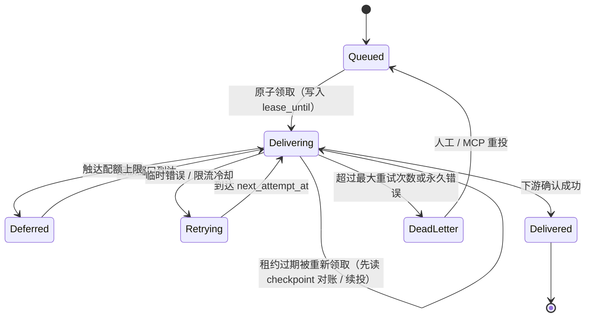

# FeedCourier 架构设计与开发计划书

* **项目名称**：FeedCourier（规划域名：`feedcourier.com`）
* **代码托管**：直接挂载于个人 GitHub 账号下（沉淀个人技术影响力，免去组织级权限与镜像命名空间迁移负担）
* **项目定位**：面向个人与极客小团队（$10$ 人以内规模）的纯血 Rust 轻量级**订阅投递网关**，原生内置 MCP 协议以支持 AI 辅助部署与运维
* **部署形态**：内嵌 WebUI 与 `/mcp` 端点的单一静态二进制文件 / 多架构极简 Docker 镜像
* **开源协议**：主程序 `AGPL-3.0-only`（在 WebUI 页脚与 `/mcp` 服务端元数据中原生内置仓库源码链接与构建版本声明，满足 AGPLv3 第 13 条网络远程交互要求）；独立子库 `telegram-rich` 采用 `MIT OR Apache-2.0`（详见第八章）

---

## 一、产品愿景与极简克制原则

`FeedCourier` 旨在继承经典工具 `rss2email` 稳定可靠的单篇投递哲学，同时砍掉重型多租户与伪商业化包袱，用现代 Rust 异步工程能力打造一款“解决自身真实需求、架构干净利落”的代表作级开源工具（目标空闲内存低于 $20\text{ MB}$）。

项目严格遵循四条设计边界：

1. **做投递网关，不做在线阅读器**：不在本地永久囤积海量文章全文与媒体文件缓存，将深度阅读与知识沉淀体验交给最擅长的终端（邮箱客户端、Telegram 即时流、Notion 结构化数据库）。
2. **指纹永久保留，正文阅后即焚**：单文件 SQLite 永久保存极小体积的文章唯一指纹以防重发；体积较大的清洗后正文与临时媒体元数据仅在“排队流控或待重试”窗口期内暂存，投递闭环并渡过保留窗口后自动清空，媒体中转流即传即毁绝不落盘。
3. **全通道单篇流式，防风控匀速控速**：不做跨天 Cron 汇总拼版，全通道统一为“单篇实时入队（`1 Task = 1 Entry × 1 Route`）”；发送端通过持久化发件箱实施“最小间隔步进 + 随机离散抖动 + 小时/日配额护栏”削峰填谷，避免瞬时突发连发触发下游反垃圾风控。
4. **人类面板与 AI 协议同源驱动、权限分级隔离**：可视化 WebUI 与内置 MCP 服务端共享同一套底层业务层；WebUI 独占锁死敏感凭证与授信投递终点，MCP 在安全边界内用自然语言完成日常巡检、全文提取调优与路由规则编排。

---

## 二、技术栈选型（纯血 Rust 极简架构）

### 1. 后端核心生态

* **异步运行时与 Web 框架**：`tokio` + `axum` + `tower-http`（统一承载管理后台 REST API、前端静态资源以及 Streamable HTTP 模式的 `/mcp` 端点）。
* **嵌入式存储引擎**：`sqlx` + **SQLite**（直接启用 `sqlx` 编译期 SQL 语法与类型强校验，单文件零外部容器依赖）。
* **AI 协议原生接入**：`rmcp`（MCP 官方 Rust SDK，挂载于现有 Web 路由，并在 `ServerInfo` 中声明项目源码地址与版本信息）。
* **网络请求、代理分流与源解析**：
  * `reqwest`：启用 `rustls-tls` 与 `socks`，便于静态交叉编译；所有指向用户可控 URL 的出站请求统一经由**受保护 HTTP 客户端**（见第四章第 1 节），支持系统环境变量与按源/按通道切换的 HTTP/SOCKS5 出站代理。
  * `feed-rs`：高容错统一解析 RSS 0.9x/1.0/2.0、Atom 及 JSON Feed，同步提取 `<enclosure>` 与 Media RSS 媒体资源。
  * `dom_smoothie`（纯 Rust Readability 实现）：零外部无头浏览器依赖，为仅输出简短摘要的订阅源提供按需开启的网页正文提取能力。
* **HTML 清洗与多协议结构转换管线**：
  * `ammonia`：白名单级安全清洗野生 HTML，剥离追踪像素、脚本与破坏排版的内联样式；清洗前统一以条目链接 / `xml:base` / 原文 URL 为基准将相对路径的图片与超链接补全为绝对地址。
  * `minijinja`：渲染精调内联 CSS 的响应式单栏阅读信纸（不引入 MJML 编译器，缩减编译耗时与二进制体积）。
  * `htmd`：HTML 转 Markdown，后置 **Notion v2 规范化器**（代码围栏动态扩充、超长截断，见第五章第 3 节）。
  * `html2text`：邮件纯文本回退。
  * `telegram-rich`（自研独立子库）：Telegram 富消息 HTML 子集规范化 + `InputRichBlock` 构建器（见第五章第 2 节与第八章）。
  * `unicode-segmentation`：按 Unicode 句子边界提取“正文第一句”，兼容中文 `。！？` 与英文缩写场景。
* **投递客户端、步进流控与安全体系**：
  * `lettre`：纯异步 SMTP 客户端，支持连接复用、`multipart/alternative` 构建与主流加密传输方式。
  * **持久化步进流控器**：基于发件箱租约调度与通道级冷却锁，实现“最小发信间隔 + 随机抖动”平滑吐出及小时/日配额水位管控（同一底层发信账号 / 同一 Bot Token / 同一 Notion Integration 自动共享限流状态）。
  * `argon2` + `chacha20poly1305`：WebUI 单管理员口令采用 Argon2id 哈希落盘；通道凭证采用 ChaCha20-Poly1305 对称加密（主密钥优先读取环境变量 `MASTER_KEY`，缺省时在 `/data` 自动生成 `0600` 权限高熵密钥文件，零配置开箱即用）。

### 2. 前端 WebUI 与单文件分发

* **前端技术栈**：`Vite` + `React 19` + `TypeScript` + `Tailwind CSS` + `shadcn/ui` + `TanStack Query`。
* **单二进制内嵌方案**：编译阶段通过 `rust-embed` 将前端构建产物打包进可执行文件（页脚内置源码仓库链接与版本号声明）。用户只需运行单个二进制或拉取单一 Docker 镜像并挂载本地 `/data` 目录即可完成部署。

---

## 三、SQLite 生产级调优与状态机表结构设计

### 1. 单机并发调优与免运维保障

* **连接初始化参数**：启动时强制执行 `PRAGMA journal_mode = WAL`；配置 `PRAGMA synchronous = NORMAL`、`PRAGMA busy_timeout = 5000` 以及 `PRAGMA foreign_keys = ON`。
* **读写连接池隔离**：应用层维护“多连接并发读池 + 容量为 $1$ 的串行写池”，杜绝后台抓取与前端/MCP 配置修改撞锁（`SQLITE_BUSY`）。
* **防膨胀与热备份机制**：后台 GC 协程回收已闭环条目的正文大字段，定期运行 `PRAGMA optimize`；管理接口提供基于 `VACUUM INTO` 的零停机在线快照备份。

### 2. 表结构规划

1. **`feeds`（订阅源状态与抓取策略表）**
   * 核心字段：主键 ID、源 URL、标题、站点主页、源站 `favicon_url`、自定义多标签数组（`tags` JSON，联动路由筛选并同步至 Notion `Tag` 属性）、拉取间隔秒数、按源网页全文提取开关（`fetch_full_content`，默认关闭）、按源代理开关（`use_proxy`）、HTTP 缓存头（`etag` 与 `last_modified`）、健康状态（正常 / 降频退避 / 熔断暂停）、连续失败次数、下次调度时间戳、最近一次错误摘要、首次同步静默开关。
2. **`entries`（去重指纹与阅后即焚载荷表）**
   * 永久保留字段：主键 ID、所属 `feed_id`、定长 $64$ 位 SHA-256 指纹哈希（与 `feed_id` 组成联合唯一索引）、原始发布时间、首次发现时间、正文是否已回收标记（`payload_purged_at`）。
   * 临时暂存字段：文章标题、规范化原文链接、作者名称、清洗后 HTML 正文、首句纯文本与精炼摘要、媒体资源列表 JSON。
   * *自动瘦身策略*：**不维护引用计数**。GC 协程以动态子查询零误差判定可回收条目——首次发现时间超过保留窗口（默认 $24$ 小时，便于故障手动重推），且 `NOT EXISTS` 任何关联的未终态（排队中 / 投递中 / 等待重试 / 配额顺延）投递任务，即清空正文与媒体列表等大字段，仅保留指纹行。中途删改路由、禁用通道或条目未命中任何路由的情形均可被自然覆盖。
3. **`channels`（授信投递通道与流控护栏表）**
   * 核心字段：主键 ID、通道备注名称、通道类型枚举（`smtp` / `telegram` / `notion`）、加密后的凭证与授信终点载荷（SMTP 收发件地址；Telegram `chat_id`、`message_thread_id`、自定义 `api_base_url`；Notion `data_source_id` 与属性列映射表）、探测到的平台能力快照（如 Bot API 是否支持 `sendRichMessage` 及版本特性）、最小发信间隔秒数、随机抖动上限秒数、可选每小时/每日配额上限、按通道代理开关（`use_proxy`）、通道冷却截止时间戳、启用开关。
4. **`routes`（路由编排与展现模式规则表）**
   * 核心字段：主键 ID、规则名称、输入源选择器（指定 `feed_ids` 集合或匹配 `tags` 标签）、目标授信 `channel_id`、过滤规则配置（标题或正文关键词包含/排除、正则表达式匹配）、通道展现选项 JSON（如 Telegram 三模切换 `rich_message` / `compact_card` / `media_mode` 及链接预览开关）、启用开关。
5. **`delivery_tasks`（单篇幂等事务发件箱与审计日志表）**
   * 核心字段：主键 ID、关联 `route_id`、`channel_id` 与强外键 `entry_id`（`(route_id, entry_id)` 联合唯一索引确保不重复生成任务）、任务状态（排队中 / 投递中 / 已送达 / 等待重试 / 配额顺延 / 死信失败）、**租约截止时间（`lease_until`）**、**投递断点（`checkpoint` JSON）**、已尝试次数、下次可调度时间、下游响应状态码与诊断日志、完成时间。
   * `checkpoint` 统一承载各通道的中间进度，供重试与崩溃恢复时断点续投：Telegram 媒体模式已送达批次偏移量与已发 `message_id` 列表；Notion 异步任务 `async_task_id` 与已确认 `page_id`；SMTP 已生成的确定性 `Message-ID`。
   * 索引：`(status, next_attempt_at)` 服务调度领取，`(entry_id, status)` 服务 GC 的 `NOT EXISTS` 子查询。
6. **`system_settings` 与 `mcp_tokens`（轻量系统配置与令牌表）**
   * 持久化存储单管理员 Argon2id 密码哈希、全局 HTTP/SOCKS5 出站代理地址、内网放行 CIDR/主机名白名单，以及双级 MCP Bearer Token 哈希与权限范围（`readonly` / `admin`）。

### 3. 发件箱租约状态机与崩溃恢复

* **原子领取**：Worker 以单条 `UPDATE ... SET status = 'delivering', lease_until = now + N WHERE id = (SELECT ... ) RETURNING *` 领取任务，串行写池保证无并发竞争。
* **租约过期自动回收**：调度器将 `lease_until` 已过期的“投递中”任务视为可领取，覆盖进程被强杀、容器重启及运行期 Worker 卡死等全部情形，无需单独的启动扫描逻辑。
* **领取即对账**：重新领取的任务先读取 `checkpoint`——存在 Notion 异步任务 ID 则先查询任务状态，存在 Notion 投递记录疑点则按 `FC-ID` 查询数据源确认页面是否已存在；存在 Telegram 批次游标则从断点批次继续发送。
* **投递语义**：Notion 通过 `FC-ID` 对账实现**有效一次**；SMTP 通过确定性 `Message-ID` 便于客户端识别重复；Telegram 平台本身无幂等机制，属于**至少一次**语义（批次游标将重复范围收敛到单个批次以内），在文档中明确说明。

---

## 四、核心引擎防坑机制（致敬并超越 rss2email）

### 1. 受保护出站客户端、礼貌抓取与按需全文提取

* **统一受保护 HTTP 客户端**：拉取 Feed、全文网页提取、媒体防盗链中转、favicon 抓取以及 MCP `preview_feed_latest` 试抓，**全部**经由同一个受保护客户端：
  * *连接层 SSRF 校验*：通过自定义 DNS Resolver 在建立连接时校验解析出的每个 IP，拦截环回、链路本地、云元数据及私有网段地址，防御 DNS rebinding；
  * *逐跳跳转校验*：禁用自动跳转，对每一跳 `30x` 目标重新执行协议与地址校验，并限制最大跳转次数；
  * *资源上限*：统一设置连接/总超时与响应体字节上限（默认 Feed $10\text{ MB}$、全文网页 $5\text{ MB}$），超限立即中断读取，防御恶意超大响应撑爆内存；
  * *精细内网放行*：通过 CIDR / 主机名白名单放行同内网自建 `RSSHub` 等实例，而非整体关闭防护。
* **HTTP 条件请求**：自动携带持久化的 `If-None-Match` 与 `If-Modified-Since`；源站返回 `304 Not Modified` 时跳过解析并更新下次调度时间。
* **指数退避与熔断保护**：遭遇网络超时或 `429` / `5xx` 错误时，优先遵循 `Retry-After`；否则按带随机抖动的指数退避计算延迟：
  $$t_{\text{delay}} = \min\left(t_{\max}, t_0 \cdot 2^{n} + \text{jitter}\right)$$
  其中 $t_0$ 为基础拉取间隔，$n$ 为连续失败次数。连续失败达到阈值（如 $15$ 次）切换为熔断暂停，等待人工或 AI 巡检恢复。
* **按源可选 Readability 全文提取**：开启 `fetch_full_content` 后请求原文链接并通过纯 Rust Readability 算法提取正文；提取结果以原文 URL 为基准补全相对路径后再进入 `ammonia` 清洗。全文抓取使用**独立并发信号量**（默认 $2$）与独立超时，避免慢速站点拖慢常规源轮询；遭遇反爬或提取异常时自动回退至 Feed 原生摘要，不阻断投递链路。
* **混合出站代理**：同时支持系统级代理环境变量与 WebUI 全局 HTTP/SOCKS5 代理配置，订阅源与下游通道可独立勾选是否走代理。

### 2. 四级降级去重链路与防刷屏保护

按四级优先级回退生成 SHA-256 指纹：

1. **一级优先**：标准条目唯一标识（Atom `id` / RSS `guid` / JSON Feed `id`）。
2. **二级回退**：规范化后的永久链接（剥离 `utm_*`、`fbclid`、`spm` 等营销追踪参数并统一协议头）。
3. **三级回退**：仅当源报文明确包含发布时间字段时，采用“标题 + 原始发布时间戳”拼接（防止缺失时间戳的源因注入当前时间导致指纹漂移刷屏）。
4. **四级兜底**：标题与清洗后纯文本前 $512$ 字节拼接摘要。

* **静默初始化与改稿免打扰**：新增订阅源或批量导入 OPML 时，存量历史条目仅写入指纹表而不生成投递任务（可选仅推送最新 $1$ 篇验证通道连通性）；已命中指纹的条目若源站后续改稿，默认静默忽略。

### 3. 防风控匀速步进流控与配额护栏

* **步进削峰填谷（Pacing + Jitter）**：突发涌入的多篇新文章全部落盘 `delivery_tasks`，Worker 严格按各通道“最小发信间隔 + 随机抖动”（如 SMTP 每封 $15 \sim 25$ 秒）匀速发送；共用同一底层凭证的多个通道自动共享限流锁。
* **配额顺延与动态冷却**：支持按通道设置每小时/每日配额，触顶后顺延至下一窗口；遇到 SMTP `421`/`45x`、Telegram `retry_after` 或 Notion `429 Retry-After` 时对该通道实施全局冷却，恢复后基于 `checkpoint` 无损续投。

---

## 五、三大精选推送通道工程落地细节

### 1. SMTP 邮件通道（传承 rss2email 单篇阅读精髓）

* **轻量信纸与防折叠控制**：通过 `minijinja` 渲染响应式单栏内联 CSS 阅读邮件，构造标准 `multipart/alternative` 结构（搭配 `html2text` 纯文本回退），控制 HTML 体积远离 Gmail $102\text{ KB}$ 截断红线。
* **高送达率与自动归类邮件头**：保留 `rss2email` 经典的 `Force-From` 机制（发信地址固定为已完成 SPF/DKIM/DMARC 认证的自有发件箱，显示名称动态拼装订阅源名称），注入 `Auto-Submitted: auto-generated`、基于条目指纹的确定性 `Message-ID`，以及按订阅源生成的 `List-Id` 便于客户端自动归档。

### 2. Telegram 通道（对齐 Bot API 10.4，路由级三模可选）

支持推送至私聊、群组指定话题（`message_thread_id`）及频道，允许配置自定义 Bot API Base URL（兼容反代与自建 Local Bot API Server）。

* **平台能力探测与降级**：添加或更新通道时探测目标 Bot API 端点是否支持 `sendRichMessage` 及 10.3 特性，并写入 `channels` 能力快照；运行期若收到方法不存在类错误，自动将富文档模式降级为快讯模式并在 WebUI/MCP 中提示（应对自建 Local Bot API Server 版本滞后）。

每条路由可按需选择三种展现模式：

* **富文档模式（Rich Message Mode）**：调用 `sendRichMessage`，统一走 **Rich HTML** 路径（官方 Rich HTML 已覆盖紧凑表格 `<table compact>`、可折叠引用 `<blockquote expandable>`、按钮行 `<tg-button-row>`、附件 `<tg-document>` 等全部 10.3/10.4 特性，无需自建块树）：
  * 由 `telegram-rich` 将清洗后正文规范化为 Telegram Rich HTML 子集，媒体以 `http(s)` URL 直接作为独立媒体块；需要显式上传时再改写为 `tg://photo?id=` 引用并放入 `InputRichMessageMedia`。
  * 由 `telegram-rich` 的 `Document::fit` 按 $32{,}768$ 字符 / $500$ 块 / $16$ 层嵌套 / $50$ 个媒体 / $20$ 列上限在块边界截断，文末固定追加“阅读原文”按钮行，截断时额外追加原文尾注。
* **快讯模式（Compact Card Mode）**：调用 `sendMessage`（$4096$ 字符安全截断），组装“加粗标题 + 来源标签 + 精炼摘要 + 原文直达链接”，支持按路由通过 `LinkPreviewOptions` 开关链接预览。
* **媒体模式（Media Mode）**：全量提取条目媒体（`<enclosure>`、`media:content` 及正文图像/音视频），附带固定三行文案——**第一行作者（缺失时回退为订阅源标题） + 第二行正文第一句完整句子（按 Unicode 句子边界切分，剥离末尾句号） + 第三行规范化直达链接**：
  * *智能传输与防盗链回退*：优先外链 URL 直传；若遭遇防盗链导致 Telegram 抓取失败，回退为本机经受保护客户端携带源站请求头流式拉取并 `multipart` 上传（即传即毁不落盘）。
  * *中转体积卡死*：流式中转按 Telegram 上传上限设置单文件读取上限（图片 $10\text{ MB}$、其他 $50\text{ MB}$，可下调），先依据 `Content-Length` 预判，读取过程中累计超限立即中断；中转全局并发限制为 $1 \sim 2$。超限媒体降级为在文案中附带纯链接。
  * *多图分批与断点续投*：超过 `sendMediaGroup` 单组 $10$ 个上限时按 $10$ 个一组分批发送（三行文案仅挂载于首批首项），每批成功后立即将批次偏移量写入 `checkpoint`；后续批次触发限流重试时从断点批次继续，不重发已送达批次。
  * *无媒体降级*：条目不含可获取媒体时，降级为发送同格式三行纯文本消息。

### 3. Notion 数据源通道（对齐 2026-03-11，自动建表 / 绑定已有 + Markdown v2 入库）

全面对齐 `Notion-Version: 2026-03-11`（围绕 `data_source_id` 运作；使用 `in_trash` 替代已移除的 `archived`，块追加使用 `position` 对象）。

* **方式一：零门槛自动建表**：用户填入 Integration Secret 与授权父页面（Page ID/URL），`FeedCourier` 调用 `POST /v1/databases` 新建数据库，**初始属性列声明于 `initial_data_source.properties` 下**（不再平铺于请求顶层），并从响应中持久化绑定 `data_source_id`。标准属性列：
  * `Title`（`title`）：文章标题
  * `Link`（`url`）：规范化原文链接
  * `Source`（`select`）：订阅源名称
  * `Published`（`date`）：原始发布日期与精确时间
  * `State`（`select`）：预设 `UnRead` / `Read`，新条目默认写入 `UnRead`
  * `Tag`（`multi_select`）：同步该订阅源的自定义多标签
  * `FC-ID`（`rich_text`，幂等对账专用列）：写入条目指纹，用于重试前查重
* **方式二：绑定已有数据源**：用户直接填入现有 `data_source_id`（或数据库 URL，自动解析其默认数据源）。系统读取数据源结构，按“名称 + 类型”自动匹配标准列并展示映射预览：
  * 缺失的标准列与 `FC-ID`，经用户确认后通过更新数据源接口补齐；
  * 同名但类型不符的列，允许重新映射到其他列或跳过该字段；
  * 仅 `Title` 列与 `FC-ID` 为必需项，映射结果持久化于 `channels` 加密载荷中。
* **清爽纯净版排版**：页面仅挂载源站 Favicon 作为 `icon`（不设封面、不插导语 Callout），直接输出纯净全文。
* **Markdown v2 规范化器**（位于 `htmd` 之后）：
  * *代码围栏动态扩充*：扫描每个代码块内容中最长的连续反引号串，外层围栏长度取其 $+1$（至少 $3$），满足 Notion v2 语法对内含三反引号代码块必须使用四反引号及以上围栏的要求；
  * *超长截断兜底*：估算转换后块数，超过块数上限（暂按 $5000$ 设为常量，实现阶段对照官方文档与实测确认）或请求体大小上限时，于块边界截断并追加“原文过长已截断 + 原文链接”尾注，避免校验失败（`allow_async` 不会绕过校验）。
* **原子写入与幂等对账**：调用 `POST /v1/pages`，以 `"markdown_version": "v2"` 一次性写入属性与正文；超长文启用 `"allow_async": true`：
  1. 发起请求前在 `checkpoint` 标记“已发起创建”；
  2. 收到 `202` 后立即落盘 `async_task_id`，再轮询任务状态直至成功并记录 `page_id`；
  3. 任何重试或租约过期重新领取时，若 `checkpoint` 存在 `async_task_id` 则先续查任务；若仅有“已发起创建”标记（崩溃发生在请求发出与响应落盘之间），则先按 `FC-ID` 查询数据源，命中即直接判定为已送达并回填 `page_id`，未命中才重新创建。

---

## 六、原生 MCP（Model Context Protocol）服务与安全护栏

通过在 Axum 服务中原生挂载 `/mcp` 端点（Streamable HTTP 传输 + 静态 Bearer Token 鉴权），用户可在任意兼容 MCP 的客户端中用自然语言接管日常巡检与规则编排。

### 1. 暴露的核心工具集（Tools）

* **只读巡检与观测工具**：
  * `list_feeds_status`：查询订阅源抓取健康度、退避延迟、代理状态与熔断详情。
  * `inspect_failed_deliveries`：检索等待重试、配额顺延或死信状态的投递任务及诊断原因。
  * `preview_feed_latest`：经受保护客户端实时试抓指定 URL（支持对比开启 `fetch_full_content` 前后的提取效果）并预览过滤规则命中结果。
* **配置编排工具**：
  * `manage_feed`：新增、修改、暂停订阅源，维护 `tags`，开关全文提取与代理。
  * `configure_route`：将订阅源或标签组路由至已授信通道并配置展现模式与过滤规则。
* **主动运维动作工具**：
  * `reset_and_poll_feed`：解除熔断并立即触发一次增量拉取。
  * `retry_dead_tasks`：批量或按 ID 重投死信任务，或向已授信通道发送连通性测试消息。

### 2. 纵深安全护栏设计

* **WebUI 门禁与零配置密钥保护**：单管理员口令鉴权（首次访问引导设置或环境变量预设，Argon2id + HttpOnly 会话 Cookie）；主密钥支持环境变量注入或 `/data` 下 `0600` 密钥文件自动初始化。
* **读写双级 MCP 令牌隔离**：分别签发“只读巡检 Token”与“全权限管理 Token”。
* **凭证黑盒与授信终点锁死**：通道凭证及投递终点（收件邮箱、Telegram `chat_id`、Notion 数据源）锁死在 WebUI 管理的 `channels` 中；MCP 仅暴露通道 ID 与脱敏备注名，杜绝提示词注入诱导外发。
* **不可信内容标注**：MCP 工具返回的订阅正文、标题等外部内容统一截断并以显式的“不可信外部内容”结构包裹，降低恶意订阅源对 AI 客户端的提示词注入风险；MCP 试抓同样受 SSRF 防护约束。

---

## 七、分阶段开发路线图（周末极客节奏）

### 阶段零：`telegram-rich` 子库占名与骨架（预计 2～3 天，可与阶段一并行）
* 新建独立 GitHub 仓库与 Cargo 包 `telegram-rich`（`MIT OR Apache-2.0`），实现 Bot API 10.4 富消息类型、Rich HTML 规范化器与限额截断，发布 `0.0.x` 版本至 crates.io 占名。

### 阶段一：v0.1 核心引擎、租约发件箱与双通道闭环（预计 2 周）
* 完成 SQLite WAL 读写分离连接池、编译期迁移脚本、表结构（含 `lease_until` / `checkpoint`）与零配置主密钥加密模块。
* 实现受保护 HTTP 客户端（连接层 SSRF 校验、逐跳跳转校验、响应体上限）、条件请求、指数退避熔断、相对路径补全、按源全文提取（独立信号量）与四级防漂移去重管线。
* 跑通租约制发件箱调度器（原子领取、过期回收、`checkpoint` 断点续投、`NOT EXISTS` GC），打通 **Telegram（能力探测 + 富文档 / 快讯 / 媒体三模，依赖 `telegram-rich`）** 与 **SMTP（轻量内联信纸 + `rss2email` 规范头）** 两大通道。

### 阶段二：v0.2 Notion 适配与内嵌 WebUI（预计 2 周）
* 完成 **Notion** 通道：自动建表（`initial_data_source.properties`）与绑定已有数据源两种接入方式、属性映射校验与补列、Markdown v2 规范化器、`allow_async` 任务句柄落盘与 `FC-ID` 对账。
* 开发 React 19 管理面板（管理员密码引导、运行概览、OPML 导入导出、代理与内网白名单配置、三大通道向导与连通性测试、Notion 映射预览、路由可视化编辑、死信重投日志及页脚 AGPL 源码声明）。
* 完成 `rust-embed` 单二进制整合与多架构 Docker 镜像流水线（发布至个人 `ghcr.io`）；`telegram-rich` 随 API 稳定发布 `0.1.0`。

### 阶段三：v0.3 原生 MCP 赋能与开源精品打磨（预计 1 至 2 周）
* 集成 `rmcp` 上线 `/mcp` 端点、双级 Token 鉴权、ServerInfo 合规元数据、不可信内容标注与全部巡检编排工具。
* 补齐 `VACUUM INTO` 在线快照备份，以及去重、相对路径补全、Notion v2 规范化、Telegram 规范化/截断、租约恢复与 SSRF 校验的单元与集成测试。
* 撰写中英双语 README（突出架构思考、低内存基准与 MCP 演示），以 `AGPL-3.0-only` 公开主仓库并提交至自托管与 MCP 社区名录。

---

## 八、独立子库 `telegram-rich`

* **定位**：Rust 生态中面向 Telegram Bot API 富消息（`sendRichMessage`，类型对齐 Bot API 10.4）的通用工具库，不依赖 FeedCourier 任何代码，不做网络 I/O：
  * HTML 规范化器（`html` feature）：将任意网页 HTML 规范化为 Telegram Rich HTML——补全相对路径、把图片/视频从段落和链接中提升为独立媒体块、识别懒加载图片、剔除脚本/表单/隐藏元素/追踪像素、拆解排版表格、`<figure>` 转带标题媒体、保留代码语言、从 MathML 提取 TeX；
  * `Document` 中间表示：可手工构建、改写媒体 URL、渲染为 Rich HTML；
  * 限额感知截断 `Document::fit`：按 $32{,}768$ 字符 / $500$ 块 / $16$ 层嵌套 / $50$ 个媒体 / $20$ 列上限在块边界截断，支持预留固定尾部块与截断提示；
  * 完整 serde 类型：`InputRichMessage`、`InputRichMessageMedia`、全部 `InputRichBlock`、全部 `RichText` 实体与 `RichMessageButton`，供偏好 blocks 表示的调用方自行拼装（不提供 HTML → 块树转换器，因官方 Rich HTML 已覆盖全部特性）。
* **仓库与许可**：独立 GitHub 仓库 `ElleryHe/telegram-rich`，`MIT OR Apache-2.0` 双许可；主程序通过 crates.io 版本号依赖，许可证兼容由 `cargo-deny` 在 CI 中校验。
* **发布节奏**：阶段零先发布 `0.0.x` 占名，阶段二 API 稳定后发布 `0.1.0`，此后遵循语义化版本独立迭代。
